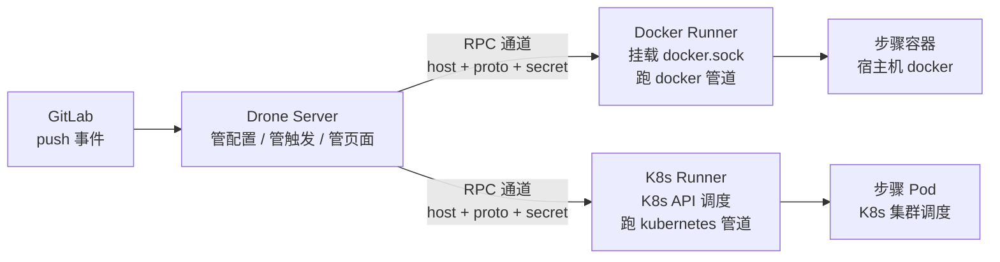

# 47. Docker 与 K8s 两种管道运行流水线：Runner 部署与 kubernetes 管道配置

## 纲要

- **Server 是大脑，Runner 是手脚**：Server 管事件、配置与页面，Runner（执行器）才是真正跑构建的节点——地位等同 Jenkins 的 Slave 节点
- **Runner 接入 Server 只需三要素**：`DRONE_RPC_HOST`（Server 主机名:端口）、`DRONE_RPC_PROTO`（协议）、`DRONE_RPC_SECRET`（共享密钥）——三者必须与 Server 侧完全一致
- **管道类型与 Runner 一一对应**：`type: docker` 由 Docker Runner 执行（挂载 docker.sock），`type: kubernetes` 由 K8s Runner 执行（每步骤一个 Pod）
- **Docker Runner 部署看两行日志**：出现「server 启动」与「成功连接远程服务器」即接入成功；并发容量 `DRONE_RUNNER_CAPACITY` 默认 2、可按机器规格调大
- **K8s Runner 部署 = RBAC + Deployment**：先给 SA 授 pods/pods/log 等权限，再用 Deployment 起 Runner，验证标准同样是那两行日志
- **私有镜像仓库靠 `image_pull_secrets`**：步骤镜像来自私有仓库时，必须在 `.drone.yml` 里声明拉取 secret，否则 ImagePullBackOff

## 一、场景引入：Server 装好了，谁来干活？

前两篇把 Drone Server 跑了起来、接入了 GitLab、理清了权限。但此时的系统还缺最后一块拼图——**Runner（执行器）**。

可以把架构理解为：**Server 是「调度大脑」**（接收 GitLab 事件、管理仓库与配置、展示页面、决定何时触发什么流水线）；**Runner 是「执行手脚」**（真正拉代码、跑命令、起容器的地方）。地位完全对应 Jenkins 的 Master 与 Slave：没有 Slave 的 Master 只是个空壳控制台。课程原话——「终端（Runner）就是用来执行任务的，就跟 Jenkins 的 slave 节点一样」。

Drone 官方提供多种 Runner，对应不同的管道类型与执行环境。本篇讲课程主线的两种：**Docker Runner**（跑 `type: docker` 管道）与 **K8s Runner**（跑 `type: kubernetes` 管道），最后落到 `type: kubernetes` 管道的 `.drone.yml` 配置细节。

## 二、核心概念与原理

### 2.1 Server + Runner 的分离架构



两条设计要点：

1. **RPC 单向长连接**：Runner 主动向 Server 的 RPC 端口注册并保持连接，Server 有构建任务时通过这条通道下发。所以 Runner 侧必须知道 Server 的地址，Server 不需要关心 Runner 在哪——Runner 可以部署在任何能网络可达的位置。
2. **执行环境由管道类型决定**：同一条 `.drone.yml` 声明 `type: kubernetes`，任务就会被路由给 K8s Runner；声明 `type: docker`，路由给 Docker Runner。**Runner 与管道类型错配 = 任务无人接单。**

### 2.2 管道类型与 Runner 对应表

| `type` | 执行器 | 每步骤形态 | 典型场景 |
| --- | --- | --- | --- |
| `docker` | Docker Runner | 宿主机上的容器 | 单机构建环境，简单直接 |
| `kubernetes` | K8s Runner | 集群中的 Pod | **本课程主线**：弹性、隔离、多节点 |
| `ssh` | SSH Runner | 远程主机上的进程 | 在既定裸机/虚机上执行 |
| `exec` | Exec Runner | Runner 所在主机的本地进程 | 特殊遗留环境，课程基本不用 |

### 2.3 RPC 三要素：Runner 接入的唯一凭据

| 环境变量 | 含义 | 一致性要求 |
| --- | --- | --- |
| `DRONE_RPC_HOST` | Server 的主机名 + RPC 端口 | 必须网络可达（`telnet <host> <port>` 可验证） |
| `DRONE_RPC_PROTO` | 协议，`http` / `https` | 必须与 Server 实际暴露协议一致 |
| `DRONE_RPC_SECRET` | 共享密钥 | **必须与 Server 的 `DRONE_RPC_SECRET` 逐字符一致** |

这三项在 #45 部署 Server 时已埋下伏笔（`DRONE_RPC_SECRET`），本篇 Runner 部署时原样回填。**密钥对不上，Runner 日志会反复报连接失败；host 端口不通，现象同样是连不上**——两者日志表现接近，排查时先 `telnet` 验证网络、再核对密钥。

### 2.4 并发容量：一台 Runner 能同时跑几个构建

Docker Runner 的 `DRONE_RUNNER_CAPACITY` 决定**同时执行的构建数**，默认 **2**。课程演示将其调大为 **10**——具体配多少，取决于 Runner 所在机器的 CPU/内存与单个构建的资源消耗。容量调大不等于变快：超出物理资源的并发只会让所有构建一起变慢，容量规划见 4.2 节。

## 三、动手实践：两种 Runner 部署 + kubernetes 管道配置

### 3.1 第一步：Docker Runner 部署

课程通过 `runner.sh` 脚本部署 Docker Runner，重构如下：

```bash
#!/bin/bash
# Drone Docker Runner 部署脚本（重构自课程讲稿）
docker run -d \
  --name drone-runner \
  --restart always \
  -v /var/run/docker.sock:/var/run/docker.sock \
  -e DRONE_RPC_PROTO=http \
  -e DRONE_RPC_HOST=gitlab.example.com:80 \
  -e DRONE_RPC_SECRET="$RPC_SECRET" \
  -e DRONE_RUNNER_CAPACITY=10 \
  -e DRONE_RUNNER_NAME=docker-runner \
  -p 3000:3000 \
  drone/drone-runner-docker:1
```

逐字段拆解：

| 配置 | 值 | 说明 |
| --- | --- | --- |
| `-v /var/run/docker.sock:/var/run/docker.sock` | 挂载 docker socket | **Docker Runner 的核心**：Runner 通过 socket 指挥宿主机 docker 拉起步骤容器 |
| `DRONE_RPC_PROTO` | `http` | 与 Server 协议一致 |
| `DRONE_RPC_HOST` | `gitlab.example.com:80` | Server 主机名 + 端口（讲稿演示值；**以 Server 实际可达地址为准**，本案例 Server 对外映射为 82，连不上就改 82） |
| `DRONE_RPC_SECRET` | 共享密钥 | 与 Server 侧逐字符一致（讲稿演示值为「67045 开头、991 结尾」的短串，**生产必须随机长串**） |
| `DRONE_RUNNER_CAPACITY` | `10` | 同时执行 10 个构建（默认 2，按机器规格调整） |
| `DRONE_RUNNER_NAME` | `docker-runner` | Runner 名字，Server 页面按名字区分多个 Runner |
| `-p 3000:3000` | 端口映射 | Runner 容器自身端口 3000 |
| `--restart always` | 重启策略 | 异常退出自动拉起，与 Server 保持一致 |

**验证是否部署成功**：

```bash
docker logs drone-runner
```

日志中出现 **「server 启动」与「成功连接远程服务器」两行**，即代表 Runner 已运行并成功接入 Server。这两行是课程反复强调的验收标准——看不到它们，后面的一切都无从谈起。

### 3.2 第二步：K8s Runner 部署

K8s Runner 的部署分两件 YAML：**先 RBAC（SA + Role + RoleBinding），再 Deployment**。

**RBAC 配置**——Runner 要以 K8s API 创建/管理构建 Pod，必须先有权限：

```yaml
apiVersion: v1
kind: ServiceAccount
metadata:
  name: drone-runner-sa
  namespace: default
---
apiVersion: rbac.authorization.k8s.io/v1
kind: Role
metadata:
  name: drone-runner-role
  namespace: default
rules:
- apiGroups: [""]
  resources: ["pods", "pods/log", "secrets", "services", "configmaps"]
  verbs: ["get", "list", "watch", "create", "delete", "update"]
---
apiVersion: rbac.authorization.k8s.io/v1
kind: RoleBinding
metadata:
  name: drone-runner-binding
  namespace: default
subjects:
- kind: ServiceAccount
  name: drone-runner-sa
roleRef:
  kind: Role
  name: drone-runner-role
  apiGroup: rbac.authorization.k8s.io
```

按讲稿，Role 至少覆盖两类核心资源权限：**pods 的创建/删除**（起构建 Pod）与 **pods/log 的读取**（回捞构建日志）；RoleBinding 绑定到 `default` ServiceAccount（讲稿做法；生产建议改用上面的专用 `drone-runner-sa`，见 4.1 节）。

**Deployment 配置**：

```yaml
apiVersion: apps/v1
kind: Deployment
metadata:
  name: drone-runner
  namespace: default
spec:
  replicas: 1
  selector:
    matchLabels:
      app: drone-runner
  template:
    metadata:
      labels:
        app: drone-runner
    spec:
      serviceAccountName: drone-runner-sa
      containers:
      - name: runner
        image: drone/drone-runner-kube:1
        ports:
        - containerPort: 3000
        env:
        - name: DRONE_RPC_HOST
          value: "gitlab.example.com:82"
        - name: DRONE_RPC_PROTO
          value: "http"
        - name: DRONE_RPC_SECRET
          value: "<与 docker 部署 Runner 时同一个 RPC Secret>"
        - name: DRONE_RUNNER_CAPACITY
          value: "10"
```

部署与验证：

```bash
kubectl apply -f rbac.yaml
kubectl apply -f deployment.yaml
kubectl logs deploy/drone-runner
```

同样以日志出现 **成功连接远程服务器** 为验收标准。至此，`type: kubernetes` 的管道有执行者了。

### 3.3 第三步：kubernetes 管道配置（两个代码文件拆解）

课件 `7-Drone/` 目录下两个 `.drone.yml` 实例，完整展示 kubernetes 管道的骨架写法。

**实例一：镜像拉取方式与拉取私有镜像**

```yaml
kind: pipeline      # 资源类型
type: kubernetes    # 管道类型：由 K8s Runner 执行
name: default       # 管道名称

clone:
  depth: 1          # 克隆深度：只取最近 1 次提交，加速构建

steps:
- name: step1
  pull: if-not-exsits        # 镜像拉取策略（注意：此为课件原始拼写）
  image: registry.cn-hangzhou.aliyuncs.com/cicd-demo/app:alpine-3.16
  commands:
  - pwd

image_pull_secrets:
- images-secret     # 拉取私有镜像使用的 K8s secret
```

逐字段拆解：

| 字段 | 值 | 作用 |
| --- | --- | --- |
| `kind` | `pipeline` | 固定值，声明这是一个流水线定义 |
| `type` | `kubernetes` | 指定由 K8s Runner 执行，每步骤起一个 Pod |
| `name` | `default` | 流水线名，同一仓库可配置多条不同名流水线（如 `default` / `release`） |
| `clone.depth` | `1` | **浅克隆**：只拉最近一次提交，大仓库能省下数分钟 |
| `steps[].name` | `step1` | 步骤名，日志与页面上按它标识 |
| `steps[].pull` | `if-not-exsits` | 镜像拉取策略：本地没有才拉（**课件原值拼写有误，正确为 `if-not-exists`，见排查表**） |
| `steps[].image` | `registry.cn-hangzhou.aliyuncs.com/...` | 步骤执行环境镜像，**指向私有仓库** |
| `steps[].commands` | `- pwd` | 步骤内执行的命令列表 |
| `image_pull_secrets` | `images-secret` | **声明拉取私有镜像的 K8s Secret 名**——缺它，Pod 起不来 |

**实例二：工作空间与步骤**

```yaml
kind: pipeline      # 资源类型
type: kubernetes    # 管道类型
name: default       # 管道名称

clone:
  depth: 1          # 浅克隆

steps:
- name: step1
  image: alpine
  commands:
  - ls -la

- name: step2
  image: alpine
  commands:
  - pwd
  - ls -la
```

这个实例演示**多步骤串行**：`step1` 与 `step2` 都用 `alpine` 镜像，命令分别是 `ls -la` 与 `pwd + ls -la`。两个关键语义：

1. **步骤默认串行**：step2 一定在 step1 成功后执行；step1 失败则流水线中止、step2 不跑。
2. **每步骤独立容器**：kubernetes 管道下，每个 step 是独立 Pod——**step1 里 `ls` 看到的文件，step2 里不一定有**（除非配置共享 workspace，留待 #49 卷的篇章展开）。这是新手最常踩的认知坑：把流水线当成一台机器上的连续 shell，实际是「一房一厅」的容器接力。

两个实例合起来，就是 kubernetes 管道的最小完整骨架：**kind + type + name 三件套定位，clone 控制克隆深度，steps 定义执行序列，image_pull_secrets 打通私有镜像**。

## 四、生产实践要点

1. **Docker Runner 的 socket 挂载是特权级操作**：挂载 `docker.sock` 等于把宿主机 docker 控制权交给 Runner 容器——能起容器就能逃逸到宿主机。**Docker Runner 只部署在专用构建机**，不与业务混部；K8s Runner 路线则天然规避这个问题（走 K8s API，不起特权容器）。
2. **容量规划看资源不看心情**：`DRONE_RUNNER_CAPACITY` × 单构建峰值资源 ≤ 节点可分配资源。K8s 路线建议同时在 `.drone.yml` 或 Runner 层配置资源 requests/limits，让调度器而非管理员决定并发上限；容量打满时正确做法是**加 Runner 副本**（K8s Deployment `replicas` 调大即可水平扩展），而不是把单副本容量调到无限大。
3. **RBAC 按命名空间收紧**：讲稿为省事绑 `default` SA。生产为 Runner 建专用 SA + 命名空间级 Role（只授 `pods`、`pods/log`、`secrets` 必要 verb），禁止跨命名空间创建 Pod；需要拉私有镜像时，secret 与构建 Pod 同命名空间。
4. **RPC Secret 生产随机化 + 轮换机制**：`openssl rand -hex 16` 生成，存 K8s Secret 或环境变量管理系统；轮换时 **Server 与所有 Runner 必须同窗口更换**，否则 Runner 集体掉线（可先加新值双跑、再摘旧值）。
5. **RPC 通道加密**：内网 HTTP 图省事可以理解，跨机房/公网场景 RPC 也必须 HTTPS——RPC 通道里跑的是完整构建指令与日志流。
6. **Runner 高可用**：K8s Runner 用 Deployment 多副本 + 反亲和部署在不同节点；Docker Runner 至少在 2 台构建机上各部署一个，一台宕机时另一半任务继续跑。Server 侧按 Runner 名字区分接入实例，天然支持多 Runner 负载分担。
7. **镜像拉取策略与仓库延迟的权衡**：`if-not-exists` 命中本地缓存时构建最快，但节点上残留的旧镜像可能导致「代码是新的、基础镜像是旧的」；对基础镜像更新敏感的业务（安全基线类），发布流水线用 `always` 强制拉取，日常流水线用 `if-not-exists` 保速度。
8. **私有仓库 secret 提前建**：`image_pull_secrets` 引用的 K8s Secret 必须**先于流水线创建**，且与构建 Pod 同命名空间；`kubectl create secret docker-registry images-secret --docker-server=<仓库地址> --docker-username=<用户> --docker-password=<密码>` 一条命令建成，多仓库账号走 CI 统一管理。

## 五、报错排查表

| 现象 | 根因 | 解法 |
| --- | --- | --- |
| Runner 日志反复报 RPC 连接失败/拒绝 | ① `DRONE_RPC_SECRET` 与 Server 不一致；② `DRONE_RPC_HOST` 端口不通 | 密钥逐字符对齐；`telnet <host> <port>` 验证网络，本案例 Server 对外为 82 |
| Runner 容器起来了，但 Server 页面看不到它 | `DRONE_RPC_PROTO` 与 Server 不一致（如 Server https、Runner 填 http） | 协议对齐；确认后看日志是否出现「成功连接远程服务器」 |
| Runner 日志无「成功连接」且无报错 | `DRONE_RPC_HOST` 写成容器内网地址，Runner 根本找不到 Server | 填 Server 的**对外可达**地址:端口 |
| K8s 管道构建 Pod 起不来，`ImagePullBackOff` | `image_pull_secrets` 没配 / secret 名字写错 / secret 不在构建命名空间 | 补 `image_pull_secrets`；核对 secret 名与命名空间 |
| 步骤镜像明明在，日志仍报拉取失败 | 私有仓库凭证失效或仓库地址写错 | `kubectl create secret docker-registry` 重建凭证；核对镜像地址 |
| `.drone.yml` 报 `invalid pull policy` 类似错误 | **课件 `pull: if-not-exsits` 拼写错误** | 改为正确值 `if-not-exists`（或 `always` / `never`） |
| step1 生成的文件 step2 读不到 | kubernetes 管道每步骤独立 Pod，无共享存储 | 配置共享 workspace / PVC（#49 展开） |
| 构建全部排队，Runner 显示繁忙 | `DRONE_RUNNER_CAPACITY` 太小，或有僵尸构建占坑 | 调大容量（不超节点资源）；开启「自动取消」清理旧构建 |
| K8s Runner 创建 Pod 报 403 forbidden | RBAC 未配或 RoleBinding 没绑到 Runner 实际使用的 SA | 核对 Deployment 的 `serviceAccountName` 与 RoleBinding subjects 一致 |
| Docker Runner 无法起容器，报 socket 权限错 | `docker.sock` 未挂载或 Runner 用户无权限 | 确认 `-v /var/run/docker.sock:/var/run/docker.sock` 挂载存在 |

## 六、面试考点与追问

**Q1：Drone 的 Server 和 Runner 分别负责什么？为什么这样设计？**
Server 负责事件接入（GitLab Webhook）、配置管理、页面展示与任务分发；Runner 负责真正执行构建（拉代码、跑步骤）。分离设计带来三个好处：Server 无状态化运维简单；Runner 可按需水平扩展与异构部署（不同机器/集群）；执行环境隔离，构建崩溃不影响 Server。

**Q2：Runner 接入 Server 需要哪三个参数？哪个必须与 Server 完全一致？**
`DRONE_RPC_HOST`（Server 主机名:端口）、`DRONE_RPC_PROTO`（协议）、`DRONE_RPC_SECRET`（共享密钥）。其中 **RPC Secret 必须与 Server 侧逐字符一致**，它是 RPC 通道的唯一暗号；host/proto 则必须与实际可达地址和协议匹配。

**Q3：`type: docker` 和 `type: kubernetes` 管道的区别是什么？各自需要什么 Runner？**
`type: docker` 由 Docker Runner 执行，每步骤是宿主机上的容器，Runner 需挂载 `docker.sock`；`type: kubernetes` 由 K8s Runner 执行，每步骤是集群 Pod，Runner 需 K8s API 权限（RBAC）。前者简单但绑定单机，后者弹性隔离，是生产主线。

**Q4：Docker Runner 挂载 docker.sock 有什么风险？**
挂载 socket 等于把宿主机 Docker 控制权交给 Runner 容器——能创建容器就能以特权模式挂载宿主机根目录，实质是宿主机 root 等价权限。因此 Docker Runner 只能跑在专用构建机，不与业务混部；安全要求高的场景直接选 K8s Runner 路线。

**Q5：K8s Runner 部署为什么必须先配 RBAC？**
Runner 要通过 K8s API 创建构建 Pod、读取 Pod 日志，这些操作都需要权限。RBAC（ServiceAccount + Role + RoleBinding）就是授权过程；不配或绑错 SA，Runner 能启动但一接任务就 403。生产按最小权限授 `pods`、`pods/log` 等必要 verb，并绑定专用 SA。

**Q6：`DRONE_RUNNER_CAPACITY` 的作用是什么？调得越大越好吗？**
它决定单个 Runner 同时执行的构建数，默认 2。不是越大越好：并发上限受节点物理资源约束，超配会导致所有构建争抢资源、集体变慢。正确做法是按资源测算设置单副本容量，不够时加 Runner 副本水平扩展。

**Q7：`image_pull_secrets` 是做什么的？配了但 Pod 仍 ImagePullBackOff，怎么查？**
它声明 K8s 拉取私有镜像所用的 Secret。仍失败时查三点：secret 名字与 `.drone.yml` 引用是否一致；secret 是否在**构建 Pod 所在命名空间**；凭证本身是否有效（仓库地址/账号/密码）。可用 `kubectl describe pod <构建pod>` 看事件里的具体报错。

## 📎 文本↔代码关联

| 代码文件 | 正文提及 | 内容 |
| --- | --- | --- |
| `code/7-Drone/drone.yml-镜像拉取方式与拉取私有镜像` | 3.3 实例一 | kubernetes 管道骨架：`kind/type/name` 三件套、`clone.depth: 1` 浅克隆、`pull` 拉取策略、`image_pull_secrets` 私有镜像凭证（含课件拼写 `if-not-exsits`，已在文中标注纠正） |
| `code/7-Drone/drone.yml-工作空间与步骤` | 3.3 实例二 | 多步骤串行演示：step1/step2 均用 alpine，验证「每步骤独立容器、默认串行」语义 |

**技术点总结**：Runner 是 Drone 的执行手脚，接入 Server 只需 RPC 三要素——`DRONE_RPC_HOST`（主机:端口）、`DRONE_RPC_PROTO`（协议）、`DRONE_RPC_SECRET`（共享密钥），三者与 Server 完全一致且网络可达，日志出现「成功连接远程服务器」即验收通过。两条部署路线：Docker Runner 靠挂载 `docker.sock` 在宿主机起步骤容器（简单但是特权操作，限专用构建机），`DRONE_RUNNER_CAPACITY` 控制并发（默认 2）；K8s Runner 先配 RBAC（pods 创建/删除 + pods/log 读取）再以 Deployment 部署，每步骤一个 Pod，弹性与隔离性更佳，是生产主线。管道配置侧，`type: kubernetes` 的 `.drone.yml` 骨架 = kind/type/name 三件套 + `clone.depth` 浅克隆 + 串行 steps + `image_pull_secrets` 私有镜像凭证；两个最深的坑是「每步骤独立 Pod、文件不互通」与课件里的 `pull: if-not-exsits` 拼写错误（正确值 `if-not-exists`）。

