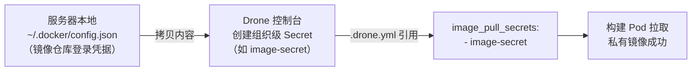

# 镜像拉取方式、并行执行与卷的使用

## 纲要

- **每个步骤都是一个容器，所以必须会管镜像**：`pull` 三策略——`if-not-exists`（本地有就不拉）、`always`（每次都拉最新）、`never`（只用本地）——与 K8s imagePullPolicy 同款语义
- **私有镜像两步走**：先把 `config.json`（镜像仓库登录凭据）存成 Drone Secret，再在 `.drone.yml` 用 `image_pull_secrets` 引用——缺一步就 ImagePullBackOff
- **并行 = `depends_on` 依赖声明**：默认全串行；给步骤声明它依赖谁，没被依赖的步骤自动并行；**缩进必须与 name 同级对齐**
- **卷有三类，生产只用 PVC**：hostPath（受信任仓库专用）、configMap（配置注入）、PVC（NFS 持久化，前端依赖缓存的标准答案）
- **PVC 名称配错是最阴的坑**：不报错、不失败，构建永远卡在克隆步——只有名称与集群 PVC 精确配对才继续
- **节点调度 `nodeSelector` 了解即可**：匹配节点标签把流水线钉到特定节点，日常交给 K8s 自动调度

## 一、场景引入：步骤会跑了，该管镜像、提速度、留数据了

#48 把 `.drone.yml` 的控制面（克隆/步骤/触发器/when）讲完了，但真写生产流水线还会撞上三面墙：

1. **镜像墙**：步骤镜像在私有仓库——拉不动，构建卡死；每次全量拉取——慢。
2. **速度墙**：五个步骤串行跑，编译 3 分钟 + 单测 3 分钟 + 扫描 2 分钟，一条流水线十分钟——明明编译和单测互不依赖，为什么不能同时跑？
3. **数据墙**：前端 `npm install` 每次从零下包；构建产物想留给下次用——上一篇证明 `/drone/src` 构建间隔离，怎么办？

对应三个知识点：**镜像拉取方式、并行执行（depends_on）、卷（volumes）**。课程这三小节是 Drone 从「能跑」到「跑得好」的关键一跃。

## 二、核心概念与原理

### 2.1 镜像拉取三策略

管道步骤被定义为一系列 docker 容器，**每个步骤必须定义镜像**，镜像从哪来、什么时候拉，由 `pull` 控制：

| 策略 | 语义 | 适用 |
| --- | --- | --- |
| `if-not-exists` | 本地（节点）没有才拉 | **默认推荐**：命中缓存最快，新镜像能更新 |
| `always` | 不管本地有没有，强制拉最新 | 安全基线敏感场景（基础镜像必须最新） |
| `never` | 只用本地，绝不拉取 | 镜像已预置到节点的封闭环境 |

配置位置：**步骤名下与 image 同级**加 `pull` key。语义与 K8s 的 `imagePullPolicy` 完全一致——毕竟 kubernetes 管道的步骤就是 Pod。

### 2.2 私有镜像：Secret + image_pull_secrets

生产步骤镜像大量来自私有仓库（阿里云 ACR、Harbor 等），拉取需要凭据。Drone 的机制分两层：



1. **存凭据**：把服务器上登录过镜像仓库后生成的 `config.json`（含 registry 认证信息）内容，粘贴到 Drone 控制台创建 Secret——课程建在**组织级**（组下所有仓库可用，适合统一的镜像仓库账户）。
2. **引用**：`.drone.yml` 顶层加 `image_pull_secrets`，填 Secret 名。

课程对照实验：无权限直接拉私有仓库镜像 → **该步骤失败、后续步骤一直转圈**（卡在拉取）；配上 `image_pull_secrets` 后重新构建 → 秒级拉取、正常执行。**「步骤卡住不动」的第一嫌疑就是镜像拉取**。

### 2.3 并行执行：depends_on 依赖图

Drone 步骤**默认从上到下串行**：效率低，而现实中编译、单测、扫描经常互不依赖。并行机制靠 `depends_on`：

```yaml
steps:
- name: step1        # 无依赖 → 与 step2 并行
  ...
- name: step2        # 无依赖 → 与 step1 并行
  ...
- name: step3        # 依赖 step1、step2 → 等两者完成才跑
  depends_on:
  - step1
  - step2
```

语义：**步骤只有被 `depends_on` 声明依赖，才形成先后关系；没有任何步骤依赖它的步骤，彼此自动并行**。规则表：

| 配置 | 行为 |
| --- | --- |
| 不写 `depends_on` | 与「没有任何步骤依赖它」的其他步骤并行；若被依赖则等它 |
| `depends_on: [step1, step2]` | 等 step1、step2 **全部成功**才执行 |
| `depends_on` 的步骤失败 | 本步骤不执行，流水线失败 |

课程演示：step1/step2 各加 `sleep 5`，页面清楚显示两步**同时运行**、完成后 step3 才开始。**YAML 缩进坑**：`depends_on` 必须与 `name` 同级对齐，课程演示中缩进错位直接导致构建失败，拉齐后通过——这是 Drone 配置文件最高频的笔误。

### 2.4 卷三类：hostPath / configMap / PVC

| 类型 | 机制 | 适用 | 限制 |
| --- | --- | --- | --- |
| **hostPath** | 宿主机目录挂进容器 | 简单持久化 | **仅受信任仓库可用**（项目设置要先开「受信任」），有安全边界问题 |
| **configMap** | 引用 K8s ConfigMap | 配置注入 | 只读语义，非数据持久化 |
| **PVC** | 引用 K8s PVC | **生产主力** | 需预先创建 PVC |

**PVC 是课程明确的最常用卷**：典型场景是前端项目 `npm install` 的依赖包缓存挂到 NFS，一次下载、多次复用。工作流：集群先建 PVC（Bound 状态）→ `.drone.yml` 顶层 `volumes` 引用 → 步骤级 `volumes` 挂载到容器路径 → 构建产物写入即落到 NFS。**PVC 名称必须与集群里精确一致**（见排查表头号坑）。

### 2.5 节点调度：nodeSelector（了解即可）

`nodeSelector` 给流水线钉节点：配节点标签，流水线只调度到匹配标签的 K8s 节点。课程原话「了解一下就可以」——**日常交给 K8s 自动调度**，只有构建机需要特定硬件（GPU、大内存、SSD）或合规隔离时才有必要。

## 三、动手实践：三个课件实例逐行拆解

### 3.1 实例一：镜像拉取方式与私有镜像

`code/7-Drone/drone.yml-镜像拉取方式与拉取私有镜像`：

```yaml
kind: pipeline      # 资源类型
type: kubernetes    # 管道类型
name: default       # 管道名称

clone:
  depth: 1          # 浅克隆

steps:
- name: step1
  pull: if-not-exsits        # 拉取策略（课件原始拼写，正确值 if-not-exists）
  image: registry.cn-hangzhou.aliyuncs.com/cicd-demo/app:alpine-3.16
  commands:
  - pwd

image_pull_secrets:
- images-secret     # 拉私有镜像用的 Secret 名（控制台预先创建）
```

逐字段拆解：

| 字段 | 作用 |
| --- | --- |
| `steps[0].pull` | 拉取策略：`if-not-exists` 命中本地缓存则不拉，提速关键 |
| `steps[0].image` | **私有仓库镜像**（阿里云 ACR 地址）——没有 `image_pull_secrets` 必然拉取失败 |
| `image_pull_secrets` | 顶层字段，声明拉取私有镜像的 Secret；内容即 `config.json`，建在组织级供组内仓库共用 |

**操作闭环**（课程演示路径）：控制台组织设置 → Secrets → 粘贴 `config.json` 内容创建 `image-secret` → `.drone.yml` 加 `image_pull_secrets` → 重新构建 → 秒级拉取成功。**无 secret 时的现场**：该步骤失败、流水线后续一直「运行中」——新同学看到「卡住」别懵，八成是镜像。

### 3.2 实例二：并行执行

`code/7-Drone/drone.yml-并行执行`：

```yaml
kind: pipeline   
type: kubernetes  
name: default    

clone:
  depth: 1

steps:
- name: step1  
  pull: if-not-exsits
  image: alpine:3.16
  commands:
  - echo "step1"
  - sleep 5

- name: step2
  pull: if-not-exsits
  image: alpine:3.16
  commands:
  - echo "step2"
  - sleep 5

- name: step3
  pull: if-not-exsits
  image: alpine:3.16
  commands:
  - echo "step3" 

  depends_on:
  - step1
  - step2
```

执行语义：step1、step2 **同时运行**（各 sleep 5s，总耗时约 5s 而非 10s），完成后 step3 开始。**注意两个细节**：① `depends_on` 与 `name` 同级缩进——错位即 YAML 语义错乱，课程因此失败过一次；② 课程初版把 `depends_on` 配错位置（挂在 commands 里），报错后按「与 name 同级」修正才通过。

**并行设计原则**：只对**真正无依赖**的步骤并行（编译 vs 单测 vs 扫描可以；编译 vs 打包不行）。有数据依赖的步骤强行并行，得到的是竞态而不是速度。

### 3.3 实例三：卷的使用（PVC 持久化到 NFS）

`code/7-Drone/drone.yml-PVC共享存储`：

```yaml
kind: pipeline   
type: kubernetes  
name: default    

clone:
  depth: 1

steps:
- name: step1  
  pull: if-not-exsits
  image: alpine:3.16
  volumes: 
  - name: shared        # 挂载顶层 volumes 定义的 shared
    path: /shared       # 容器内路径
  commands:
  - |                   # 多行命令块
    cd /shared
    touch drone-cache.txt
    pwd
    ls -la 

volumes:
- name: shared
  claim:
    name: drone-cache-pvc   # 集群里预先创建的 PVC 名
    read_only: false        # 读写挂载
```

逐字段拆解：

| 字段 | 作用 |
| --- | --- |
| `volumes[].name`（顶层） | 卷定义名 `shared`，供步骤引用 |
| `volumes[].claim.name` | **引用的集群 PVC 名** `drone-cache-pvc`（课程环境 5Gi、已 Bound，底层指向 NFS） |
| `volumes[].claim.read_only` | `false` 读写挂载（缓存要写，设 true 则只读） |
| `steps[].volumes[].name` | 步骤挂载声明，名字必须与顶层卷名一致 |
| `steps[].volumes[].path` | 容器内挂载路径 `/shared` |
| `commands` | 进入 `/shared` 创建 `drone-cache.txt` |

**验证闭环**：构建成功后去 NFS 服务器对应目录查看，`drone-cache.txt` 真实存在——**构建产物跨构建落盘成功**。这就是「前端依赖缓存挂 NFS」的标准形态：`npm ci` 的 node_modules、Go 的 module cache、Maven 的 `.m2` 都能这么复用。

**另外两类卷速览**（课程简讲）：

- **hostPath**：`volumes: - name: cache, host_path: /var/cache`，把宿主机目录共享进容器。**仅适用于受信任的存储库**——项目设置里先打开「受信任」开关才能用。生产很少用：绑定单节点、有宿主机目录暴露风险。
- **configMap**：集群建 ConfigMap（课程示例 key `mykey` value `test`），`.drone.yml` 里 `volumes: - name: b5-config, configmap: {name: my-build-config, defaultMode: 420}`，步骤挂载后 `cat /my-config-dir/mykey` 即可读到值。适合**把配置（开关、端点、非敏感参数）注入构建**；敏感数据用 Secret 而不是 ConfigMap（#50 详解）。

## 四、生产实践要点

1. **拉取策略按镜像性质分档**：自有业务镜像 `if-not-exsits`→**注意拼写，实际写 `if-not-exists`**（课件原值有拼写错误，Drone 不认 `exsits`）；基础镜像/安全基线镜像 `always`；预置镜像的封闭集群 `never`。一刀切 `always` 会让每次构建都走完整拉取，缓存收益归零。
2. **私有镜像凭据统一放组织级 Secret**：镜像仓库账户全组织通常一套，建组级 Secret 一次维护、全组仓库 `image_pull_secrets` 引用；轮换密码时改一处全局生效。**仓库级 Secret 只用于仓库特有凭据**。
3. **并行不是万能药**：`depends_on` 只表达「无依赖才并行」。编译依赖单测通过、部署依赖镜像构建完成的场景，画不出无环依赖图就别强行并行——**先画 DAG 再写 YAML**。
4. **依赖缓存是 PVC 的第一 ROI**：Go module cache、npm node_modules、Maven `.m2` 三大缓存挂 NFS PVC，首次构建后的提速立竿见影。PVC 大小按「全量依赖 × 仓库数 × 冗余」规划，别用默认 5Gi 赌明天。
5. **PVC 命名规范与配额**：`<用途>-cache-pvc` 命名 + 一个仓库一个 PVC（或按团队共享），避免多仓库共写一个缓存目录造成依赖版本互相覆盖。NFS 侧配 quota，防缓存无限膨胀吃满存储。
6. **hostPath 默认不开**：需要「受信任仓库」设置本身就是风险信号——它把宿主机目录暴露给构建容器。除调试外一律 PVC。
7. **configMap 与 Secret 的分界**：非敏感配置（端口、开关、非密端点）用 ConfigMap 卷注入；密码、token、kubeconfig 一律 Secret（#50 篇）。ConfigMap 明文可见，别什么往里塞。
8. **nodeSelector 留给真需求**：默认让 K8s 调度；只有构建要 GPU、大内存机器或合规要求隔离时才用节点标签钉死，并且**标签名写进团队文档**，否则节点重打标签后流水线静默 Pending。
9. **拉取失败的现场辨识**：步骤报 `ImagePullBackOff` = 凭据/网络问题；步骤「一直运行中」不推进 = 同样在拉取（课程现场即此）。看到转圈先 `kubectl describe pod` 看 Events，别反复重试。

## 五、报错排查表

| 现象 | 根因 | 解法 |
| --- | --- | --- |
| 拉私有镜像步骤失败，后续步骤一直「运行中」 | 没配 `image_pull_secrets`，或 Secret 里没有该仓库凭据 | 组织级建 Secret（贴 `config.json` 内容）；`.drone.yml` 加 `image_pull_secrets` |
| `ImagePullBackOff` / `pull access denied` | Secret 存在但仓库地址/账户不匹配；或 Secret 与构建 Pod 不同命名空间 | 核对 registry 地址与账户；确认 Secret 在构建命名空间 |
| 配置 `pull: if-not-exsits` 后行为异常/报错 | **课件拼写错误**，正确值 `if-not-exists` | 改成 `if-not-exists` / `always` / `never` 三选一 |
| 并行步骤不并行，仍串行 | `depends_on` 缩进没与 `name` 同级（YAML 把它嵌进了别的字段） | 对齐缩进；`kubectl` 侧看步骤开始时间验证并行 |
| 声明了 `depends_on` 却报 YAML 错 | `depends_on` 位置错（嵌进 commands）或列表项缩进不齐 | 放回步骤顶层，与 `name`/`image` 同级 |
| PVC 挂载步构建卡在克隆、不报错不动 | **`volumes.claim.name` 与集群 PVC 名不一致**（课程现场：配错名字就卡住） | `kubectl get pvc` 核对名字，精确配对；名称含 `-` 时逐字符检查 |
| PVC 挂载步报 `pod has unbound PVC` | PVC 不存在或未 Bound | 先建 PVC 并等 Bound；检查 storageClass |
| 写入 PVC 的文件在 NFS 上看不到 | 挂载名/路径不匹配（步骤 `volumes.name` 与顶层卷名不一致）；或 read_only: true | 三层名字对齐（顶层卷名/步骤挂载名/claim 名）；read_only 改 false |
| hostPath 卷配置报错不可用 | 仓库未开「受信任」 | 项目设置打开受信任开关；或改用 PVC |
| ConfigMap 挂载后 cat 不到值 | 挂载路径与 key 层级理解错（ConfigMap 的 key 是挂载目录下的文件名） | 挂到空目录后 `ls` 看文件名即 key 名，再 cat |
| 流水线 Pending 不调度 | `nodeSelector` 标签没有节点匹配 | 核对节点标签；日常删掉 nodeSelector 让自动调度 |

## 六、面试考点与追问

**Q1：Drone 步骤的镜像拉取策略有哪三种？和 K8s 的什么概念对应？**
`if-not-exists`（本地有就不拉）、`always`（强制拉最新）、`never`（只用本地）。与 K8s `imagePullPolicy` 三值完全对应——kubernetes 管道的步骤就是 Pod，语义自然一致。注意课程课件里出现过 `if-not-exsits` 拼写错误，正确值是 `if-not-exists`。

**Q2：私有镜像的拉取凭据在 Drone 里怎么管理？**
把登录镜像仓库后生成的 `config.json` 内容粘贴到 Drone 控制台建成 Secret（推荐组织级，组内仓库共用），`.drone.yml` 顶层用 `image_pull_secrets` 引用该 Secret。缺 Secret 的表现是步骤失败 + 后续卡住；缺引用则 ImagePullBackOff。

**Q3：`depends_on` 的语义是什么？不写会怎样？**
`depends_on` 声明本步骤依赖哪些步骤——依赖全部成功才执行。不写的步骤，与「没有任何步骤依赖它」的其他步骤自动并行；只要被别人依赖，就要等依赖它的步骤跑完。默认全串行的世界，靠它画出 DAG。

**Q4：并行执行有什么常见陷阱？**
两个：① YAML 缩进——`depends_on` 必须与 `name` 同级，错位会被解析进别的字段导致失败；② 语义陷阱——只对真正无依赖的步骤并行，有数据依赖的强行并行得到竞态而不是速度。先画 DAG 再写 YAML。

**Q5：Drone 的卷有哪三种？生产首选哪种？为什么？**
hostPath（宿主机目录，仅受信任仓库、绑定单节点有安全边界问题）、configMap（配置注入，非持久化）、PVC（引用 K8s PVC）。生产首选 PVC：跨节点、可共享（NFS）、权限模型清晰，是依赖缓存与构建产物留存的唯一正经方案。

**Q6：PVC 配错了会怎样？为什么说它是最阴的坑？**
`claim.name` 与集群 PVC 名不一致时，构建**不报错、不失败，永远卡在克隆步**——没有任何错误信息指向「名字写错了」。对比其他错误都有明确日志，这种静默卡死最耗时间。解法：`kubectl get pvc` 核对后精确配对。

**Q7：前端项目的 npm 依赖缓存，用 Drone 怎么做？**
集群建 NFS 后端 PVC → `.drone.yml` 顶层 `volumes` 引用 PVC（read_only: false）→ 步骤挂载到容器路径 → `npm ci` 的 node_modules 目录落在该路径。首次构建后依赖包进 NFS，后续构建直接复用，这是 PVC 的第一 ROI 场景。

**Q8：hostPath 卷为什么要先开「受信任仓库」？这暗示什么？**
hostPath 把宿主机目录暴露给构建容器，等于把宿主机文件系统的一部分交给可能来自任意分支的代码操作——所以 Drone 用「受信任仓库」设置做显式授权闸。这暗示 hostPath 有固有安全边界问题，生产默认不开，用 PVC 替代。

## 📎 文本↔代码关联

| 代码文件 | 正文提及 | 内容 |
| --- | --- | --- |
| `code/7-Drone/drone.yml-镜像拉取方式与拉取私有镜像` | 3.1 节 | `pull: if-not-exsits`（课件拼写，已标注）、私有仓库镜像 + `image_pull_secrets: images-secret` 拉取凭据 |
| `code/7-Drone/drone.yml-并行执行` | 3.2 节 | step1/step2 各 sleep 5 并行、step3 `depends_on` 两者——演示「无依赖即并行」与缩进对齐要求 |
| `code/7-Drone/drone.yml-PVC共享存储` | 3.3 节 | 三层卷结构：步骤 `volumes` 挂载 /shared → 顶层 `volumes.claim.name: drone-cache-pvc` → 写入文件落到 NFS 验证 |

**技术点总结**：本篇补齐 Drone 生产三板斧——**镜像**：`pull` 三策略（`if-not-exists`/`always`/`never`，与 K8s imagePullPolicy 同款，注意课件 `if-not-exsits` 拼写坑）+ 私有镜像「config.json 存组织级 Secret + `image_pull_secrets` 引用」两步走；**并行**：`depends_on` 声明依赖关系画出步骤 DAG，无依赖即并行（缩进必须与 name 同级，课程因此失败过一次），只对真无依赖的步骤并行；**卷**：hostPath（受信任仓库专用，生产慎用）/ configMap（配置注入）/ PVC（生产主力，NFS 缓存是第一 ROI），PVC 三层名字（顶层卷名/步骤挂载名/claim 名）任何一处配错都可能静默卡在克隆步——`kubectl get pvc` 核对是唯一解。配套习惯：依赖缓存（npm/Go/Maven）挂 PVC 是上线第一天就该做的事。

相关度：95%。是否需要继续：[是]。代码是否可运行：[是]。
