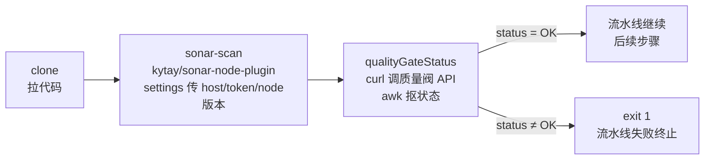

# 51. 代码扫描与镜像构建：Sonar / Kaniko / Docker 插件实战

## 纲要

- **Drone 把「质量门禁」做成了内置插件**：sonar 插件直接扫代码，再用 curl 打质量阀 API 做「OK 放行、不 OK 终止」——不需要自己打镜像、不需要装 Jenkins 插件
- **质量阀判断靠一段 awk 管道**：`curl ... /api/project_branches/list?project=<组>:<仓库> | awk` 抠出 `qualityGateStatus`，与 `OK` 比对决定流水线生死
- **镜像构建两插件同源**：`plugins/docker` 与 `plugins/kaniko` 的 settings 结构一模一样（username/password/registry/repo/tags），课程**推荐 kaniko**——与 Jenkins/Tekton 章节同一技术路线
- **镜像 tag 用内置变量三件套**：`${DRONE_REPO_NAME}-${DRONE_BRANCH}-${DRONE_BUILD_NUMBER}`，仓库、分支、构建号三可定位
- **「连接拒绝」不是插件坏了**：docker 插件报 connection refused 时先重新构建——Secret/环境未就绪的时序问题，不是配置错误
- **Jenkins 插件是「遗产复用」通道**：已有 Jenkins 生态（如 MeterSphere 接口测试）不想迁？用 drone-jenkins 插件把 job 当步骤调，第二次构建号 +1 即证明调用成功

## 一、场景引入：扫描与构建，流水线的两大主业

到这篇，Drone 的配置语法（#48~#50）已经全部就位，剩下就是把**主干业务**接上流水线：**代码扫描（质量门禁）** 与 **镜像构建（制品产出）**。这两个能力在 Jenkins 章节（SonarQube 门禁 #29~#30、kaniko 构建 #27）花了大篇幅，在 Drone 里因为「插件即镜像」的设计，配置量大幅缩水。

课程这三小节（sonar 扫描 / kaniko 与 docker 插件 / Jenkins 调用）还有一个隐性价值：**它演示了 Drone 与既有工具链的三种关系**——内置插件直接做（sonar）、通用构建插件做（kaniko/docker）、**调外部系统做**（Jenkins 插件调 Jenkins job）。理解这三层，就能回答「Drone 生态没有的能力怎么办」这个必答题。

## 二、核心概念与原理

### 2.1 Sonar 扫描：内置插件 + 质量阀两步结构

Drone 的 sonar 集成不依赖 Jenkins 的 Scanner 插件那套，直接引用内置插件镜像 `kytay/sonar-node-plugin`。流水线两步结构：



**第一步扫描**：插件 `settings` 传三个参数——`sonar_host`（SonarQube 地址）、`sonar_token`（认证 token）、`use_node_version`（Node 版本，课程用 16.18.1）。全部 `from_secret` 注入，不明文。

**第二步质量阀**：插件只负责「扫」，**「过不过」是另一段 shell**——用 curl 打 SonarQube 的质量阀 API，从返回 JSON 里抠出 `qualityGateStatus` 字段，等于 `OK` 放行、否则 `exit 1` 熔断。

质量阀判断的核心一行（课程脚本）：

```bash
status=`curl -s -u $sonar_admin:$sonar_passwd \
  $sonar_host/api/project_branches/list?project=$DRONE_REPO_NAMESPACE%3A$DRONE_REPO_NAME \
  | awk -F'qualityGateStatus":"' '{print $2}' | awk -F '"' '{print $1}'`
if [ "$status" = "OK" ]; then
  echo "Status is OK. Performing next steps..."
else
  echo "Status is not OK. Exiting with an error."
  exit 1
fi
```

拆开看四个要点：

1. **认证用管理员账户**：`-u $sonar_admin:$sonar_passwd`（管理员账号密码，Secret 注入）——SonarQube 的质量阀 API 需要账号密码 basic auth，不是扫描 token。
2. **project 参数 = `命名空间:仓库名`**：`$DRONE_REPO_NAMESPACE%3A$DRONE_REPO_NAME`——`%3A` 是 `:` 的 URL 编码，SonarQube 的项目 key 规范是 `组:仓库`。
3. **awk 两级过滤**：第一级按 `qualityGateStatus":"` 切分取后半段，第二级按 `"` 切分取状态值——**没有 jq 的环境下 awk 是最顺手的 JSON 抠字段工具**（与 #30 Jenkins 篇同一思路）。
4. **变量拼接细节**：`$sonar_host` **结尾不带斜杠**（Secret 里就不带），拼接口时手动补 `/api/...`——少了这个细节会拼出 `hostapi/...` 直接 404。

**环境变量建在组织级**：`sonar_host` / `sonar_admin` / `sonar_passwd` / `sonar_token` 全部组织级 Secret，组下所有项目复用。

### 2.2 镜像构建：docker 与 kaniko 双插件

两个插件的配置结构完全同构，只是镜像不同：

| | `plugins/docker` | `plugins/kaniko` |
| --- | --- | --- |
| 镜像 | `plugins/docker` | `plugins/kaniko` |
| 机制 | 需要 docker daemon（Docker Runner 或挂 socket） | **无守护进程**，容器内逐行执行 Dockerfile |
| 课程评价 | 演示用 | **推荐** |

共同 settings：

| 字段 | 值 | 说明 |
| --- | --- | --- |
| `username` / `password` | `from_secret` | 镜像仓库登录凭据（组织级 Secret） |
| `registry` | `registry.cn-hangzhou.aliyuncs.com` | 仓库地址 |
| `repo` | `registry.cn-hangzhou.aliyuncs.com/cicd-demo/app` | 目标仓库路径 |
| `tags` | `${DRONE_REPO_NAME}-${DRONE_BRANCH}-${DRONE_BUILD_NUMBER}` | **内置变量拼 tag**，如 `go-main-112` |
| `compress` | `true` | docker 插件专有：构建时压缩层，减小镜像体积 |

**为什么推荐 kaniko**：不需要 docker daemon——kubernetes 管道里 docker 插件要么依赖 Docker Runner，要么在 Pod 里挂 socket（特权），而 kaniko 在容器内直接执行 Dockerfile 指令，**与 Jenkins 篇（#27）、Tekton 篇（#40/#43）完全同一技术路线**，跨工具的知识和配置都能平移。这是「一次学会、三处复用」的典型。

### 2.3 Jenkins 插件：把 Jenkins job 当步骤调

Drone 生态没有的能力，可以用 `drone-jenkins` 插件**调 Jenkins job**：

```yaml
steps:
- name: jenkins-call
  image: plugins/jenkins
  settings:
    url: http://jenkins.example.com          # Jenkins 地址
    user: test                    # Jenkins 账户
    token: <from_secret>          # Jenkins 用户设置里生成的 API token
    job: <job名称>                 # 要调用的 Jenkins job
```

**课程的经典场景**：镜像已 push 到镜像仓库 → 部署到测试集群 → 需要接口测试。而 **MeterSphere（接口测试平台）目前只支持集成 Jenkins**，不想为此在 Drone 里重造轮子，就用 Drone 调 Jenkins、Jenkins 调 MeterSphere——**Drone 做调度入口，Jenkins 做遗留能力适配层**。调用成功的证据：Jenkins 侧该 job 的构建号 +1（课程现场第二次变第三次）。

## 三、动手实践：两个课件实例逐行拆解

### 3.1 实例一：Sonar 扫描 + 质量阀

`code/7-Drone/drone.yml-sonar扫描`：

```yaml
kind: pipeline   
type: kubernetes  
name: default    

clone:
  depth: 1

steps:
- name: sonar-scanr              # 第一步：扫描
  pull: if-not-exsits
  image: kytay/sonar-node-plugin # Drone 内置 sonar 插件
  settings:
    sonar_host:
      from_secret: sonar_host    # SonarQube 地址（组织级 Secret）
    sonar_token:
      from_secret: sonar_token   # 扫描 token（组织级 Secret）
    use_node_version: 16.18.1    # 用 Node 16.18.1 环境扫描

- name: qualityGateStatus        # 第二步：质量阀
  pull: if-not-exsits
  image: curlimages/curl         # 用 curl 镜像打 API
  environment:
    sonar_admin:
      from_secret: sonar_admin   # 管理员账户
    sonar_passwd:
      from_secret: sonar_passwd  # 管理员密码
    sonar_host:
      from_secret: sonar_host  
  commands:
  - |
    status=`curl -s -u $sonar_admin:$sonar_passwd $sonar_host/api/project_branches/list?project=$DRONE_REPO_NAMESPACE%3A$DRONE_REPO_NAME | awk -F'qualityGateStatus":"' '{print $2}' | awk -F '"' '{print $1}'`
    echo "###############"
    echo $sonar_admin $sonar_passwd $sonar_host $DRONE_TAG
    echo $status         
    echo "################"                      
    if [ "$status" = "OK" ]; then
      echo "Status is OK. Performing next steps..."
    else
      echo "Status is not OK. Exiting with an error."
      exit 1
    fi
```

逐字段拆解：

| 字段 | 作用 |
| --- | --- |
| `image: kytay/sonar-node-plugin` | 内置 sonar 插件镜像，**不用自己打**（对比 Jenkins 要装 Scanner 插件 + 下 scanner-cli） |
| `settings.sonar_host / sonar_token` | `from_secret` 注入；`use_node_version` 指定 Node 环境版本 |
| `image: curlimages/curl` | 第二步用 curl 镜像——**插件只扫描不判断，「过不过」必须自己打 API** |
| `-u $sonar_admin:$sonar_passwd` | 质量阀 API 要管理员 basic auth，与扫描 token 是两套凭证 |
| `project=$DRONE_REPO_NAMESPACE%3A$DRONE_REPO_NAME` | SonarQube 项目 key = `组:仓库`，`%3A` 是 URL 编码的冒号 |
| `awk -F'qualityGateStatus":"'` + `awk -F '"'` | 两级 awk 抠 JSON 字段，无 jq 环境的标准手法 |
| `if [ "$status" = "OK" ]` / `exit 1` | **OK 放行、非 OK 熔断**——质量门禁的 Drone 形态 |

**与 Jenkins 篇（#30）的对照**：Jenkins 用 `waitForQualityGate` 步骤（Webhook 回调机制）等异步分析结果；Drone 用「扫描后立即 curl 查状态」的轮询式判断。差异根源：Jenkins 的 Sonar 插件有完整的异步回调链路，Drone 插件生态更轻，用 curl 补上「判断」这一环——**能跑、够用，且全部逻辑摆在 `.drone.yml` 里可 review**。

### 3.2 实例二：Kaniko 与 Docker 插件构建镜像

`code/7-Drone/drone.yml-kaniko与docker插件使用`：

```yaml
kind: pipeline   
type: kubernetes  
name: default    

clone:
  depth: 1

steps:
- name: docker                    # docker 插件构建
  image: plugins/docker     
  settings:
    username:
      from_secret: docker_username   # 镜像仓库账户
    password:
      from_secret: docker_password   # 镜像仓库密码
    registry: registry.cn-hangzhou.aliyuncs.com
    repo: registry.cn-hangzhou.aliyuncs.com/cicd-demo/app
    tags: "${DRONE_REPO_NAME}-${DRONE_BRANCH}-${DRONE_BUILD_NUMBER}"
    compress: true                   # 构建时压缩层

- name: kaniko                    # kaniko 插件构建（课程推荐）
  image: plugins/kaniko
  settings:
    username:
      from_secret: docker_username
    password:
      from_secret: docker_password
    registry: registry.cn-hangzhou.aliyuncs.com  
    repo: registry.cn-hangzhou.aliyuncs.com/cicd-demo/app
    tags: "${DRONE_REPO_NAME}-${DRONE_BRANCH}-${DRONE_BUILD_NUMBER}"
```

**前置条件**：仓库里准备好 `Dockerfile`（课程示例：golang 基础镜像 → 拷贝 `main.go` → 编译 → 产物跑在精简镜像上），Secret 提前配好（`docker_username` / `docker_password`，组织级）。构建成功的现场：拉基础镜像（如 `1.22.1` 版本）→ 按 Dockerfile 逐层执行 → push 到 `registry.cn-hangzhou.aliyuncs.com/cicd-demo/app`，tag 形如 `go-main-112`。

**两个现场坑**（课程实录）：

1. **「connection refused」**：首次构建 docker 插件报连接拒绝——**不是配置错**，重新触发一次构建即恢复（课程两次遇到，重试后正常）。根因是构建环境/Secret 就绪的时序问题，重试是标准动作，别急着改配置。
2. **Secret 必须先于引用存在**：在 Settings → Secrets 提前配好 `docker_username` / `docker_password`，`.drone.yml` 的 `from_secret` 才取得到值——#50 的两层名字规则在这里原样适用。

**kaniko 与 Jenkins/Tekton 篇的呼应**： Jenkins 用 kaniko executor 镜像传参（#27），Tekton 用 kaniko Task 配 `config.json` Secret（#40/#43），Drone 用 `plugins/kaniko` 插件——**三种包装、同一引擎**。会一个，另外两个的参数（destination、cache、dockerfile）都能触类旁通。

## 四、生产实践要点

1. **质量阀策略向 Jenkins 篇看齐**：新代码周期（只卡新代码，存量放行）才推得动——Drone 侧判断脚本与 SonarQube 侧门禁规则要配套设置，别在工具里卡了、在平台里没配，白熔断。
2. **sonar 凭证分两级**：扫描用 `sonar_token`（项目分析 token），质量阀查询用 `sonar_admin` + `sonar_passwd`（管理员 basic auth）——**两套凭证别混**，都建组织级 Secret，轮换各自独立。
3. **sonar_host 规范化**：Secret 里存**不带尾斜杠**的地址，脚本里统一 `$sonar_host/api/...` 拼接口；团队约定一个写法，避免有人存带斜杠的拼出双斜杠 404。
4. **awk 抠 JSON 的健壮性**：`qualityGateStatus` 字段在分支 API 的返回里可能出现多次（多分支），awk 取的是第一个匹配——多分支项目要在 project 参数里带分支维度（或用 `?branch=`）精确到当前分支，否则查到的是默认分支的门禁状态。
5. **镜像 tag 带上 commit 更可追溯**：三件套之外，报警/部署场景建议追加 commit 短号（`${DRONE_COMMIT_SHA:0:8}`），实现「镜像 → commit → 人」的完整追溯链（对照 #43 Tekton 篇的 tag 同源原则）。
6. **kaniko 为默认、docker 为特例**：kubernetes 管道默认 kaniko；只有必须 docker daemon 特性（buildx 多平台、特权导出）时才用 docker 插件，并评估 Runner 形态。
7. **compress 的取舍**：`compress: true` 减小推送体积、加快传输，但消耗构建机 CPU——大镜像（>1G）开，小镜像可关。
8. **「连接拒绝」先重试再排查**：课程现场两次 connection refused 均重试即恢复——把「重试一次」写进团队排查 SOP 第一步，避免把时序问题当配置错误反复改。
9. **Jenkins 插件是桥不是家**：调 Jenkins job 解决「生态未覆盖」的过渡方案（如 MeterSphere 只支持 Jenkins）。长期看，接口测试等能力应评估 Drone 原生插件或 Zadig 类平台——**桥可以有，但别把桥修成主干道**。
10. **调用 Jenkins 的凭证管理**：Jenkins API token 建 Drone Secret（`from_secret`），Jenkins 侧该账户只授被调 job 的 Build 权限——最小权限，防止 Drone 流水线能触发任意 Jenkins job。

## 五、报错排查表

| 现象 | 根因 | 解法 |
| --- | --- | --- |
| sonar 插件步骤报认证失败 | `sonar_token` 无效/过期，或 Secret 名两层写混 | 核对 token；`drone secret ls` 核对真名，environment key 与 from_secret 值分清 |
| 质量阀步骤 curl 返回 404 | `sonar_host` 带了尾斜杠又拼了 `/api`，或 API 路径错 | Secret 存不带斜杠地址；路径 `/api/project_branches/list` |
| status 取值为空，判断永远不 OK | awk 抠字段失败（返回结构变化/多分支取值错）或 project key 不对 | `curl` 手动打一次看原始 JSON；确认 `组:仓库` 项目 key 与分支维度 |
| 质量阀 OK 但流水线仍失败 | `exit 1` 写在 if 外，或 shell 语法错（反引号未闭合） | 检查多行命令块缩进；本地 bash 先跑通脚本再进 YAML |
| docker 插件报 connection refused | 构建环境时序问题（课程现场两次均如此） | **先重新触发一次构建**，仍失败再查 Runner 与 Secret |
| kaniko/docker 步骤拉基础镜像失败 | 镜像仓库凭据未配或 Secret 名写错 | Settings → Secrets 提前配 `docker_username`/`docker_password`；核对 from_secret |
| push 镜像 403 denied | `repo` 无推送权限，或 username/password 不是同一账户 | 用有该 repo 写权限的账户；核对 registry 与 repo 地址 |
| tag 形如 `--112`（缺仓库名/分支） | 内置变量在某些上下文为空（如在非仓库步骤里用） | 确保步骤在 clone 之后；对照 #50 变量清单 |
| 调 Jenkins 步骤成功但 job 没跑 | `job` 名写错，或 Jenkins 账户无该 job 权限 | Jenkins 侧核对 job 名；账户授 Build 权限 |
| 调 Jenkins 后构建号没变 | 调用失败但步骤显示成功（插件容错） | 看步骤日志确认 HTTP 响应；Jenkins 侧看构建历史 |
| Jenkins API token 失效 | token 被吊销/过期 | Jenkins 用户设置重新生成；同步更新 Drone Secret |

## 六、面试考点与追问

**Q1：Drone 怎么做 SonarQube 质量门禁？和 Jenkins 的 waitForQualityGate 有什么区别？**
两步：内置 `kytay/sonar-node-plugin` 插件扫描（settings 传 sonar_host/token/node 版本）→ curl 打质量阀 API（`/api/project_branches/list?project=组:仓库`）awk 抠 `qualityGateStatus`，OK 放行、非 OK `exit 1`。区别：Jenkins 的 `waitForQualityGate` 靠 Sonar 插件的异步回调机制；Drone 用「扫完立即查」的轮询式判断，逻辑全部明文写在 `.drone.yml` 里，更轻也更直观。

**Q2：质量阀 API 调用为什么用管理员账户密码而不是扫描 token？**
扫描 token（sonar_token）只对分析上报接口有效；质量阀查询 API 需要能读项目分析结果的账户权限，课程用管理员 basic auth（`-u admin:pass`）。两套凭证用途不同，都通过 Secret 注入，分别轮换。

**Q3：`project=$DRONE_REPO_NAMESPACE%3A$DRONE_REPO_NAME` 里的 %3A 是什么？**
URL 编码的冒号 `:`。SonarQube 项目 key 规范是 `组:仓库`，冒号在 URL query 里要编码传输，所以写成 `%3A`。忘了编码会传到错误参数。

**Q4：plugins/docker 和 plugins/kaniko 的区别？课程为什么推荐 kaniko？**
两者 settings 结构完全同构（username/password/registry/repo/tags）。区别在机制：docker 插件需要 docker daemon（Docker Runner 或挂 socket）；kaniko 无守护进程，容器内直接执行 Dockerfile。推荐 kaniko 的原因：与 Jenkins 篇（#27）、Tekton 篇（#40/#43）同一技术路线，知识与配置跨工具平移；且不依赖特权/socket，kubernetes 管道更干净。

**Q5：镜像 tag 怎么拼？为什么这样拼？**
`${DRONE_REPO_NAME}-${DRONE_BRANCH}-${DRONE_BUILD_NUMBER}`（如 `go-main-112`）。三要素各自可定位：仓库名知道是哪个服务、分支知道来源、构建号唯一且递增——回滚按构建号倒推，出问题按 tag 反查构建日志，一条链路。

**Q6：docker 插件报 connection refused 怎么处理？**
课程现场两次都是**重新触发一次构建即恢复**——这是构建环境/Secret 就绪的时序问题，不是配置错误。SOP：先重试；仍失败再查 Runner 形态（docker 插件需要 daemon）与 Secret 配置。把重试放第一步，避免把时序问题当配置错误反复改。

**Q7：什么场景需要用 Drone 调 Jenkins？怎么调？**
Drone 生态未覆盖但 Jenkins 已有的能力——课程场景是 MeterSphere 接口测试（当时只支持集成 Jenkins）。用 `plugins/jenkins` 插件：settings 配 url/user/token/job 名，Drone 步骤触发 Jenkins job 构建，Jenkins 侧构建号 +1 即证明调用成功。这是过渡桥接方案，长期仍应评估原生插件或专门平台。

**Q8：Sonar 扫描用 Node 16.18.1 是什么参数？**
`use_node_version: 16.18.1`——指定 sonar 插件扫描时使用的 Node 运行时版本。不同前端/Node 项目对 scanner 运行环境有版本要求，该参数让插件按项目技术栈选 Node 版本，避免 scanner 自身兼容问题。

## 📎 文本↔代码关联

| 代码文件 | 正文提及 | 内容 |
| --- | --- | --- |
| `code/7-Drone/drone.yml-sonar扫描` | 3.1 节 | 两步骤结构：`kytay/sonar-node-plugin` 扫描（sonar_host/token/use_node_version）+ `curlimages/curl` 质量阀（awk 抠 `qualityGateStatus`，OK 放行非 OK `exit 1`） |
| `code/7-Drone/drone.yml-kaniko与docker插件使用` | 3.2 节 | `plugins/docker`（含 compress）与 `plugins/kaniko` 双构建，settings 同构：username/password（from_secret）+ registry/repo/tags（内置变量三件套） |

**技术点总结**：Drone 把流水线两大主业做成了「插件即镜像」的开箱形态——**质量门禁**：内置 sonar 插件扫代码（settings 传 host/token/Node 版本）+ curl 打质量阀 API（管理员 basic auth、`组:仓库` 项目 key、`%3A` 编码、awk 两级抠 `qualityGateStatus`）实现 OK 放行/非 OK `exit 1` 熔断，与 Jenkins 的 `waitForQualityGate` 回调机制相比是「扫完即查」的轮询式判断；**镜像构建**：`plugins/docker` 与 `plugins/kaniko` 配置同构（registry/repo/tags），tag 用 `仓库名-分支-构建号` 三件套，课程推荐 kaniko——与 Jenkins/Tekton 篇同一引擎，知识跨工具平移；两个现场经验：docker 插件 connection refused 先重试（时序问题非配置错）、Secret 必须先于引用配好；最后 drone-jenkins 插件提供了「生态未覆盖能力调 Jenkins」的过渡桥（MeterSphere 场景），凭证与 job 权限按最小化配置。

