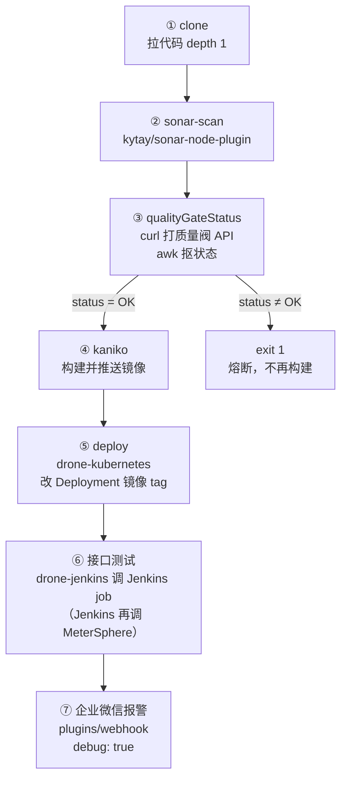

# 53. Drone 项目实战：七步流水线串联与三大 CI 工具对比（含本章总结）

## 纲要

- **七步流水线是前八篇的「总装线」**：克隆 → sonar 扫描 → 质量阀 → kaniko 构建 → K8s 部署 → 接口测试 → 企业微信报警，**没有一个新插件**，全是已学内容的排列组合
- **质量阀是「质量门禁」的 Drone 表达**：curl 打 SonarQube API 抠 `qualityGateStatus`，`OK` 才放行——与 Jenkins 的 `waitForQualityGate` 回调机制殊途同归
- **接口测试借道 Jenkins 插件**：MeterSphere 当时只支持集成 Jenkins，用 `drone-jenkins` 调 job——**遗产系统不必推倒重来，桥接就行**
- **三大 CI 工具一句话定位**：Jenkins 是老将（生态大、到处在用）、Tekton 是 K8s 原生（吃运维功底）、Drone 是轻量派（yml 进仓库即用）
- **Drone 唯一硬伤：不支持 GitLab 子组**——项目建在子组里无法同步，选型第一排查项
- **本章九个必须掌握的点**：kubectl 客户端、触发器、Secret、环境变量、when、卷、并行、deploy 插件、sonar 插件

## 一、场景引入：把散落的插件串成一条产线

#44~#52 我们像集邮一样把 Drone 的插件学了个遍：克隆、触发器、when、Secret、并行、卷、sonar、kaniko、deploy、SSH/SCP、报警。但**单插件都会了，不等于能交付出一条流水线**——真正的考验是「排序」：谁先谁后？哪一步失败必须熔断？哪一步可以并行？

本节的七步项目实战就是这张考卷。课程原话：每个步骤其实都是我们前面所学习过的内容，**很多插件都是内置的，并不需要我们再自己去搞**。这句话道破了 Drone 的设计哲学——**流水线的复杂度不在插件，在编排**。

同时本节还对三大 CI 工具（Jenkins / Tekton / Drone）做横评收尾，并给出 Drone 章节的九个重点清单。学完本节，CI 篇正式收官，下面（#54）进入持续交付（CD）的 KubeVela。

## 二、核心概念与原理

### 2.1 七步流水线全景：一张图看懂「克隆到报警」



七个步骤的职责与「出处」：

| 步骤 | 插件/动作 | 职责 | 对应前篇 |
| --- | --- | --- | --- |
| ① 克隆 | 内置 clone | 拉代码，`depth: 1` 浅克隆提速 | #48 |
| ② 代码扫描 | `kytay/sonar-node-plugin` | 扫代码质量，结果推 SonarQube | #51 |
| ③ 质量阀 | `curlimages/curl` + awk | 查 `qualityGateStatus`，非 OK 即 `exit 1` | #51 |
| ④ 构建镜像 | `plugins/kaniko` | 无守护进程构建，推阿里云镜像仓库 | #51 |
| ⑤ 部署 | `quay.io/honestbee/drone-kubernetes` | 改 K8s Deployment 镜像 tag | #52 |
| ⑥ 接口测试 | `appleboy/drone-jenkins` | 调 Jenkins job，Jenkins 调 MeterSphere | #51 |
| ⑦ 报警 | `plugins/webhook` | 企业微信机器人推送构建结果 | #52 |

**为什么③放在②后面、④前面**：先扫描、再过阀、后构建——**质量不合格的代码不配占用构建资源**，更不配上线。这个「扫描在构建前」的顺序是质量门禁生效的前提；反序（先构建后扫描）则构建出的镜像即使门禁不过也已推入仓库，只是「不上线」而已，仓库里照样堆垃圾镜像。

**为什么⑥放在⑤后面**：接口测试要打的是**刚部署起来的服务**——镜像不上线，测试无从谈起。这条顺序也解释了「测试环境从哪来」：不是预先搭好的，而是流水线自己部署出来的。

### 2.2 三大 CI 工具横评：老将、原生派、轻量派

三个工具都讲完了，课程给了一张「性格画像」：

| 维度 | Jenkins | Tekton | Drone |
| --- | --- | --- | --- |
| 资历 | **历史悠久**，存在很多年 | 新型，专为 K8s 设计 | 新型，轻量级 |
| 生态 | 最大，插件成千上万 | K8s 原生生态 | 插件即镜像，生态较新 |
| 普及度 | **基本上每家公司都在用** | 随 K8s 普及而增长 | 新兴采用 |
| 对 K8s 的依赖 | 无（插件可装） | **强依赖**——不用 K8s 就用不了它 | 中（Runner 可 docker 可 k8s） |
| 对人的要求 | 低，上手快 | **需要运维熟悉 K8s**，否则用不起来 | 低，yml 即流水线 |
| 上手动作 | 装插件、配 job | 装 CRD、写 Task/Pipeline | **仓库里放一个 `.drone.yml`** |
| 权限/项目管理 | 需要分配权限、建构建项目 | 需要分配权限、建构建项目 | **不需要**，yml 进仓库即可构建 |
| 硬伤 | 重、插件治理难 | 没运维 / 运维不熟 K8s 的企业玩不转 | **不支持 GitLab 子组**（项目在子组里无法同步） |

三个关键结论：

1. **没有 K8s？直接 Jenkins**——另外两个都长在 K8s 上（Tekton 是 CRD，Drone 的云原生形态跑在 K8s）；
2. **用了 K8s？Tekton 与 Drone 二选一，看熟悉度**——课程明确说看你对几个工具的熟悉程度，而不是迷信某个「最好」；
3. **Drone 的适用边界要提前问清**：项目是不是建在 GitLab 的**子组**里？是，则 Drone 直接出局（同步不过来）——这是选型时第一个要问的问题，等流水线搭一半才发现同步不了，沉没成本极大。

课程反复强调的收尾句：**具体用什么，看企业环境、看项目形态、看团队熟悉度**——工具选型从来不是技术优越性比赛，是约束条件下的匹配。

### 2.3 本章小结：Drone 章节九个重点

课程总结按「使用频率」点名的九项，建议逐条自检：

| # | 重点 | 用在哪 |
| --- | --- | --- |
| 1 | kubectl 客户端运行方式 | 操作 Drone Server / Runner（#45） |
| 2 | 触发器 + 并行构建 | 只让 main / test / PR 分支触发，其他分支不触发（#48） |
| 3 | 定义仓库用户名密码 | 拉私有代码、推私有镜像的 Secret（#50） |
| 4 | 环境变量 | 步骤间传参、内置变量拼 tag（#50） |
| 5 | when 条件判断 | 按分支/事件决定是否自动构建（#48） |
| 6 | 卷（Volume） | kubeconfig、持久化包、NPM 依赖挂载进容器（#49） |
| 7 | 并行执行 | 多步骤同时跑，压缩流水线总时长（#49） |
| 8 | k8s deployment 插件 | 把构建产物部署进集群（#52） |
| 9 | sonar 插件 | 构建时扫代码质量（#51） |

其中**触发器**被课程标为「用得最多」——分支策略（哪些分支触发、哪些不触发）是流水线的第一道闸门。

## 三、动手实践：项目实战流水线逐行拆解

`code/7-Drone/drone.yml-项目实战`（敏感值已掩码，实际经 Secret 注入）：

```yaml
kind: pipeline
type: kubernetes
name: default

clone:
  depth: 1                       # 浅克隆：只取最新 commit，提速

steps:
- name: sonar-scanr              # ② 代码扫描
  pull: if-not-exsits             # 注：课件原文拼写，正确为 if-not-exists
  image: kytay/sonar-node-plugin
  settings:
    sonar_host:
      from_secret: sonar_host
    sonar_token:
      from_secret: sonar_token
    use_node_version: 16.18.1

- name: qualityGateStatus        # ③ 质量阀：非 OK 即 exit 1
  pull: if-not-exsits
  image: curlimages/curl
  environment:
    sonar_admin:
      from_secret: sonar_admin
    sonar_passwd:
      from_secret: sonar_passwd
    sonar_host:
      from_secret: sonar_host
  commands:
  - |
    status=`curl -s -u $sonar_admin:$sonar_passwd $sonar_host/api/project_branches/list?project=$DRONE_REPO_NAMESPACE%3A$DRONE_REPO_NAME | awk -F'qualityGateStatus":"' '{print $2}' | awk -F '"' '{print $1}'`
    echo "###############"
    echo $status
    echo "################"
    if [ "$status" = "OK" ]; then
      echo "Status is OK. Performing next steps..."
    else
      echo "Status is not OK. Exiting with an error."
      exit 1
    fi

- name: kaniko                   # ④ 构建镜像
  image: plugins/kaniko
  settings:
    username:
      from_secret: docker_username
    password:
      from_secret: docker_password
    registry: registry.cn-hangzhou.aliyuncs.com
    repo: registry.cn-hangzhou.aliyuncs.com/cicd-demo/app
    tags: "${DRONE_REPO_NAME}-${DRONE_BRANCH}-${DRONE_BUILD_NUMBER}"

- name: deploy                   # ⑤ 部署到 K8s
  image: quay.io/honestbee/drone-kubernetes
  settings:
    kubernetes_server: https://k8s.example.com:6443
    kubernetes_token: <ServiceAccount JWT，Secret 注入>
    namespace: default
    deployment: nginx-deployment
    repo: registry.cn-hangzhou.aliyuncs.com/cicd-demo/app
    container: nginx
    tag: "${DRONE_REPO_NAME}-${DRONE_BRANCH}-${DRONE_BUILD_NUMBER}"

- name: 接口测试                  # ⑥ 借道 Jenkins 调 MeterSphere
  image: appleboy/drone-jenkins
  settings:
    url: http://node1.example.com:32000
    user: test
    token: <Jenkins API token，Secret 注入>
    job: aa

- name: send                     # ⑦ 企业微信报警
  image: plugins/webhook
  settings:
    debug: true
    urls:
      - https://qyapi.weixin.qq.com/cgi-bin/webhook/send?key=<企业微信机器人key>
    content_type: application/json
    template: |
      {
        "msgtype": "text",
        "text": {
         "content": "owner: {{ repo.owner }}\nRepo: {{ repo.name }}\nStatus: {{ build.status }}"
        }
      }
```

三个编排层面的观察点：

1. **pipeline 类型是 `kubernetes`**——每个步骤跑在独立 Pod 里（#47 讲过的 K8s Runner），步骤间靠 workspace/卷共享数据（本例 clone 由内置步骤完成，产物经镜像仓库中转，不依赖共享目录）；
2. **「接口测试」步骤名是中文**——Drone 步骤名随意起，课程现场把默认名改成中文「接口测试」，日志可读性立刻上升；第 122 次构建时该步骤名还是「-」（一个横杠），页面显示灰色，改名后第 123 次构建全绿。**步骤命名是给三个月后的自己看的**；
3. **五个 Secret 组织级托管**：`sonar_host` / `sonar_token` / `sonar_admin` / `sonar_passwd` / `docker_username` / `docker_password`，全部 `from_secret`——yml 进 Git，密钥一个明文都不留。

另有一份极简对照 `code/7-Drone/drone.yml-Jenkins插件使用`：**整个流水线只有一个步骤**——`clone.disable: true` 关掉克隆，直接 `appleboy/drone-jenkins` 调 Jenkins job `jenkins-kaniko`。它演示的是「Drone 只做触发器、脏活累活全在 Jenkins」的极端桥接模式：适合迁移过渡期——先把触发权拿过来，构建逻辑原样留在 Jenkins，逐步把步骤搬回 Drone。

## 四、生产实践要点 / 常见坑

1. **步骤顺序即质量策略**：扫描在构建前（不干净的代码不进制品库）、测试在部署后（测的是真环境）、报警在最后（只报最终态）。顺序错了，门禁就白设了。
2. **`pull: if-not-exists` 别写错**：课件多文件里的 `if-not-exsits` 是拼写错误（Drone 拉取策略为 `if-not-exists` / `always` / `never`）。拼错时行为以服务端解析为准，**别依赖它做镜像更新策略**——要拉新镜像就写 `always`。
3. **接口测试借道 Jenkins 的三个前提**：Jenkins 可达（url）、token 有该 job 的触发权、Jenkins 侧能调到 MeterSphere。三层链路任一断，测试步骤红，但**红的原因可能在最底层**——排查要从 Drone 日志 → Jenkins 构建记录 → MeterSphere 报告逐层看。
4. **`use_node_version` 与项目技术栈对齐**：sonar 插件扫描用的 Node 版本要匹配被扫项目（课程 16.18.1），否则 scanner 自身先崩。
5. **分支策略配触发器（#48）**：实战流水线应配「main/test/PR 触发、其他不触发」，否则每个 feature 分支的提交都跑一遍七步，队列堵死——课程点名的「用得最多」的配置。
6. **并行只加在无依赖步骤间**：②③④⑤⑥⑦ 是强顺序链，没有可并行的；可并行的典型是「多个语言的单测」「多个镜像的构建」（#49）——并行是压缩手段，不是默认姿势。
7. **报警接 when 条件**：`when: status: [failure,changed]` 之类，只报异常与状态翻转；全成功也报的流水线，三天后群里就没人看了。
8. **CI 工具选型先查「子组」**：用 Drone 前确认项目不在 GitLab 子组下；已深陷子组的团队，直接评估 Jenkins/Tekton，别硬拧。

## 五、报错排查表

| 现象 | 根因 | 解法 |
| --- | --- | --- |
| 质量阀步骤 `exit 1`，流水线终止 | `qualityGateStatus ≠ OK`——扫描发现新问题或阈值收紧 | 看 SonarQube 报告修问题；确认为误报可临时调阈值（别常态化） |
| `curl` 返回空，`status` 为空串 | `sonar_host` 结尾带斜杠 / project key 错（`组:仓库` 写飞） | 核对 Secret 值不带尾斜杠；`$DRONE_REPO_NAMESPACE%3A$DRONE_REPO_NAME` 编码别手改 |
| 接口测试步骤失败，Jenkins 侧无记录 | `url` 不通或 token 无权 | 从 Runner Pod `curl` Jenkins url；核对 token 对 job `aa` 的触发权限 |
| Jenkins 有记录但 MeterSphere 没跑 | 桥接第二段断（Jenkins→MeterSphere） | 查 Jenkins job 配置里的 MeterSphere 插件参数 |
| 步骤名显示为灰色横杠、流水线停住 | 步骤命名为 `-` 之类的占位，观感上像中断 | 改有意义的名字（支持中文），如「接口测试」 |
| 七步里某步成功后后续不执行 | 上游 `exit 1` 熔断（质量阀/deploy 失败） | 从失败步骤日志定位；熔断是设计行为，不是 bug |
| 镜像 tag 对不上构建记录 | ⑤ 的 repo/tag 与 ④ 不同源 | 两步骤逐字段核对（#52） |

## 六、面试考点与追问

**Q1：一条完整的企业级流水线包含哪些阶段？顺序是什么？**
克隆 → 代码扫描 → 质量阀 → 构建镜像 → 部署 → 接口测试 → 报警。原则：**质量校验在构建前**（不过门禁不占构建资源）、**测试在部署后**（测真实环境）、**报警在最后**（报最终态）。

**Q2：质量阀（qualityGateStatus）是怎么实现的？为什么不用插件自带判断？**
Drone 的 sonar 插件只负责「扫」，「过不过」用 `curl` 打 SonarQube 质量阀 API，从返回 JSON 里 awk 抠出 `qualityGateStatus` 字段，等于 `OK` 放行、否则 `exit 1`。这是「扫完即查」的轮询式门禁；Jenkins 的 `waitForQualityGate` 是回调式——机制不同，目的相同：**门禁不过，流水线断**。

**Q3：Jenkins、Tekton、Drone 三大工具如何选型？**
不用 K8s → Jenkins（老将、生态大、到处在用）；用 K8s → Tekton 或 Drone 二选一，看团队熟悉度（Tekton 吃运维功底，没运维或运维不熟 K8s 用不起来）；Drone 轻量（yml 进仓库即构建、不需分配权限建项目），但**必须确认项目不在 GitLab 子组**——子组项目同步不过来，一票否决。最终看企业环境、项目形态、熟悉度三者匹配。

**Q4：Drone 相比 Jenkins 最大的优势和硬伤各是什么？**
优势：轻量——不需要分配权限、不需要部署构建项目，`.drone.yml` 放仓库就能构建，整体简单。硬伤：不支持在 GitLab 组里创建子组，否则项目没办法同步过来。

**Q5：Drone 章节的哪些知识点使用频率最高？**
课程点名「用得最多」的是**触发器**——main/test/PR 等指定分支才触发构建，其他分支不触发。其次是 Secret（仓库用户名密码）、环境变量、when 条件、卷（kubeconfig/持久化包/NPM 依赖）、并行执行、deployment 插件与 sonar 插件。

**Q6：什么场景下用 Drone 调 Jenkins（drone-jenkins）？**
Drone 生态未覆盖但 Jenkins 已有的能力，课程场景是 MeterSphere 接口测试（当时只支持集成 Jenkins）。配 url/user/token/job 四字段，Drone 步骤触发 Jenkins job，Jenkins 侧构建号 +1 即证明成功。这是**迁移过渡的桥接方案**——先把触发权拿到 Drone，遗留能力留 Jenkins，逐步回迁；长期仍应评估原生方案。

**Q7：七步流水线里哪些步骤之间可以并行？为什么？**
强顺序链②→③→④→⑤→⑥→⑦都不能并行：扫描不过就不构建（③依赖②结果）、部署的必须是刚构建的镜像（⑤依赖④）、接口测试要打刚部署的服务（⑥依赖⑤）。可并行的是**无依赖关系**的步骤，如多个语言的单测、多个服务的镜像构建（#49）——并行的前提是步骤间无数据/时序依赖。

**Q8：Drone 的步骤命名有什么讲究？**
步骤名是日志与页面上的唯一标识，应起有意义的名字（支持中文，如「接口测试」）。课程现场把占位名 `-` 改成中文名后观感与可读性大幅改善——**命名是给排障的人（三个月后的自己）看的**，占位符命名会让「哪一步挂了」都要猜。

## 📎 文本↔代码关联

| 代码文件 | 正文提及 | 内容 |
| --- | --- | --- |
| `code/7-Drone/drone.yml-项目实战` | 2.1、三 节 | 七步实战流水线：clone → sonar-scanr → qualityGateStatus（curl+awk，非 OK `exit 1`）→ kaniko → deploy（nginx-deployment）→ 接口测试（drone-jenkins 调 job `aa`）→ 企业微信 webhook 报警；含 `pull: if-not-exsits` 原文拼写 |
| `code/7-Drone/drone.yml-Jenkins插件使用` | 2.2、三 节 | 极简单步骤桥接样例：`clone.disable: true` + `appleboy/drone-jenkins` 调 Jenkins job `jenkins-kaniko`，演示「Drone 只触发、Jenkins 干活」的过渡模式 |

**技术点总结**：本篇是 Drone 章节的「总装 + 横评 + 收尾」。**七步流水线**（克隆 → sonar 扫描 → 质量阀 → kaniko 构建 → K8s 部署 → 接口测试 → 企业微信报警）的全部零件都在前八篇讲过，编排逻辑体现为三条铁序——质量校验在构建前（不干净的代码不进制品库）、测试在部署后（测真实环境）、报警在最后（报最终态）；质量阀用 `curl` + awk 轮询 SonarQube 的 `qualityGateStatus`，与 Jenkins 的 `waitForQualityGate` 回调机制殊途同归；接口测试借道 `drone-jenkins` 桥接 MeterSphere，是「Drone 做调度入口、Jenkins 做遗留适配层」的过渡范式，另有单步骤极简版演示纯触发模式。**三大 CI 工具横评**结论：Jenkins 是老将（历史悠久、基本每家公司都用、生态最大），Tekton 是 K8s 原生派（不用 K8s 或用不熟 K8s 的团队玩不转），Drone 是轻量派（yml 进仓库即构建、不分配权限不建项目）但**硬伤是不支持 GitLab 子组**——选型第一排查项；不用 K8s 选 Jenkins，用 K8s 在 Tekton/Drone 间按熟悉度选，最终看企业环境、项目形态与团队熟悉度三者的匹配。**本章九重点**：kubectl 客户端、触发器（用得最多：main/test/PR 触发）、Secret、环境变量、when、卷、并行、deployment 插件、sonar 插件——CI 篇到此收官，下面进入 CD 篇 KubeVela。

