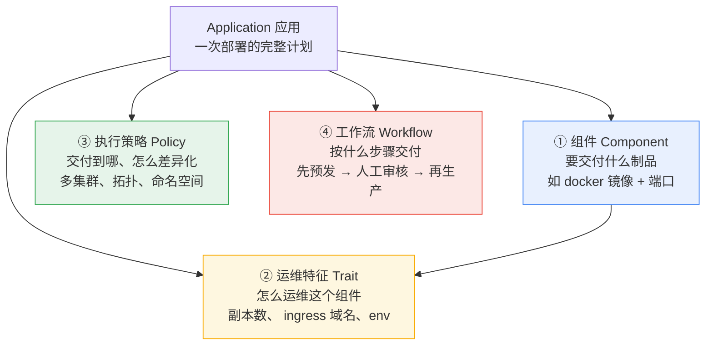
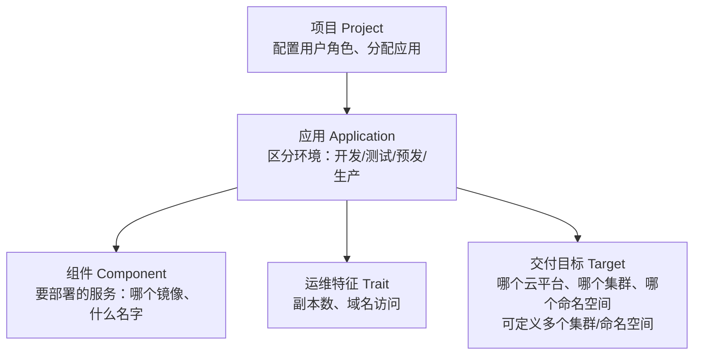
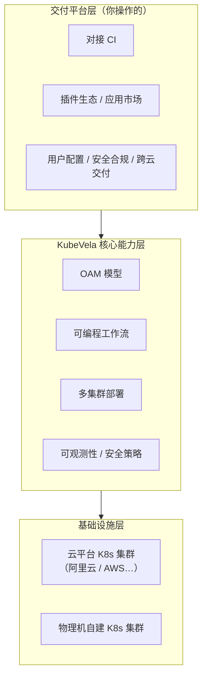

# 54. KubeVela 概述、部署与核心概念：OAM 抽象层入门

## 纲要

- **KubeVela 在 K8s 之上再抽象一层**：不直接写 Deployment/Service，改写成「组件 + 运维特征 + 策略 + 工作流」四件套——基于 **OAM 开放应用模型**，让部署描述变简单
- **多云多集群是立身之本**：一份应用声明，同时交付到阿里云集群与 AWS 集群，还能差异化配置（A 集群 3 副本、B 集群 2 副本）
- **部署三步走**：装 `vela` CLI → `vela install` 装核心 → `vela addon enable velaux` 装 UI 控制台
- **VelaUX 五大概念**：**项目 → 应用 → 组件/运维特征**，外加**环境**与**交付目标**（集群 + 命名空间），构成控制台的全部操作对象
- **卸载有严格顺序**：先删所有应用、禁用所有插件，再 `vela uninstall`，最后清 CRD——顺序反了会被拦住
- **`first-app.yaml` 是后续所有章节的「Hello World」**：组件 + scaler + topology 策略 + deploy 工作流，四段式读懂 OAM

## 一、场景引入：K8s 原生 Deployment 还不够好用吗？

先回答一个必然会有的疑问：我们已经有 Deployment、StatefulSet、Service、Ingress 这一套 K8s 原生资源了，**为什么还要在它上面再包一层**？

想象两个场景：

**场景 A**：你要把一个 Go 服务部署到「开发、测试、预发、生产」四套环境。用原生资源，意味着每个环境一套 Deployment + Service + Ingress + ConfigMap，四个环境十几份 YAML，改一个镜像路径要改十几处，环境间差异全靠复制粘贴维护。

**场景 B**：公司上了多云——核心业务在阿里云 ACK，灾备在 AWS EKS。同一份服务要在两边都跑，还要「阿里云 3 副本、AWS 2 副本」。原生资源的表达方式是：两份几乎一样、细节处不一样的 YAML，外加两套 kubectl 上下文切换。**「部署到哪」这件事，K8s 原生模型里根本没有一等公民**——kubeconfig 切上下文是人的动作，不是声明的一部分。

KubeVela 就是来解决这两个场景的。课程对它的定义：**一个云原生的应用平台，提供简单灵活的方式管理和部署云原生应用**；它不是替代 K8s 资源，而是在 K8s 原生资源之上**再抽象出一层**——你定义的是 KubeVela 抽象出来的资源，底层该生成 Deployment 还是会生成，只是不用你亲手写。

一个恰当的类比：**Deployment 是「发动机零件图纸」，KubeVela 是「整车交付单」**。零件图纸精确但琐碎，交付单只写「什么车、什么配置、送到哪个 4S 店、走什么流程」——细节由产线（KubeVela）自动完成。

从本节开始进入课程的 **CD 篇（持续交付）**，路线图：KubeVela 介绍与部署 → 页面配置与权限控制 → 交付方式与工作流 → 与其他工具集成 → 内置/自定义模块 → 项目实战。

## 二、核心概念与原理

### 2.1 OAM：开放应用模型与四要素

KubeVela 的理论底座是 **OAM（Open Application Model，开放应用模型）**——一套「在 K8s 资源之上再抽象一层」的建模方法。它的核心主张是：**把「应用是什么」和「怎么运维它」拆成不同角色关注的东西**，开发者描述业务制品，运维描述运维策略，两者在一个模型里组合。

OAM 的**部署计划（Application）由四要素构成**，这是整个 CD 篇的词汇表，必须一次记牢：



| 要素 | 回答的问题 | 课程举例 |
| --- | --- | --- |
| **组件 Component** | 交付什么制品？ | `webservice` 类型，定义镜像名与端口——如 `oamdev/hello-world`，8000 端口 |
| **运维特征 Trait** | 这个组件怎么被运维？ | 副本数（scaler）、域名访问（ingress：域名、HTTP 路径、端口） |
| **执行策略 Policy** | 交付到哪里、多集群怎么差异化？ | topology 策略：A 集群 3 副本、B 集群 2 副本的**差异化多集群部署** |
| **部署工作流 Workflow** | 按什么步骤上线？ | 先部署到预生产环境 → **暂停人工审核** → 审核通过再上生产 |

注意语法归属：**运维特征「包含」在组件之下**（traits 是 component 的子字段），而策略与工作流是 Application 的顶层字段——这个层级关系在读 YAML 时一眼可辨。

「差异化多集群」值得多说一句：同一个 nginx 服务，策略规定 A 集群 3 副本、B 集群 2 副本。**差异不再靠复制两份 YAML 手工维护，而是声明在同一份应用里**——这是「部署即代码」与「复制粘贴即代码」的分水岭。

### 2.2 VelaUX 概念层级：项目 / 应用 / 组件 / 交付目标

装好 VelaUX 控制台后，所有操作都落在五个概念上。课程的讲解顺序是自上而下：



| 概念 | 课程定义 |
| --- | --- |
| **项目** | 组织与资源的承载；可配置**用户角色**、**分配应用** |
| **应用** | 可区分不同**环境**（开发/测试/预发/生产）；由**组件**组成 |
| **组件** | 「要部署的一个服务」——定义**部署哪个镜像、镜像名是什么** |
| **运维特征** | 组件的运维属性——**副本数**、**域名访问**（域名定义在运维特征里） |
| **交付目标** | 应用要交付到**哪个云平台的哪个集群、哪个命名空间**；**可定义多个集群、多个命名空间**——即一个服务可同时部署到不同云平台的不同集群 |

「一个服务同时部署到多云多集群」这句话，落到控制台操作就是：建多个交付目标，应用绑定它们——底层集群差异被拓扑策略吸收，人在页面上看到的仍然是一个应用。

### 2.3 系统架构：三层看 KubeVela

课程给了一张开箱即用的架构图，自上而下三层：



- **基础设施层**：云厂商的 K8s、物理机自建的 K8s——KubeVela 不挑食；
- **核心能力层**：OAM 模型、可编程工作流、多集群部署、可观测性、安全策略；
- **交付平台层**：对接 CI、**丰富的插件生态**（课程提到 Argo CD 插件等）、应用市场、用户配置、安全合规、跨云交付。

注意架构图里「**对接 CI**」这个位置——KubeVela 是 **CD 层**，它上面的输入正是前七章 CI 流水线产出的镜像。CI 管「造货」，CD 管「送货到哪、怎么送」，两层在架构上咬合。

## 三、动手实践：安装、控制台与第一个应用

### 3.1 安装 vela CLI 与 KubeVela 核心

KubeVela 的一切操作从 `vela` 命令行开始。课程环境：服务器 `k8s.example.com`，集群已就绪。

```bash
# ① 安装 vela CLI（官方一键脚本）
# ⚠️ 管道执行前先下载审阅：curl -fsSL -o install.sh https://kubevela.io/script/install.sh && less install.sh
# 以下为课程演示的一键方式；生产环境建议走审阅后执行或固定版本
curl -fsSL https://kubevela.io/script/install.sh | bash

# ② 安装 KubeVela 核心（写入 vela-system 命名空间）
vela install

# ③ 等待就绪并确认
kubectl get ns vela-system          # 命名空间已创建
kubectl get pods -n vela-system     # 课程现场：3 个 Pod 全部 Running
```

两个现场细节：

- `vela install` 是**幂等**的，重复执行只会补齐缺失部分；
- 课程现场 Pod 列表一开始有 `deployment 没有准备`（not ready）的过渡态，**等一会再查即全部 Running**——安装类操作的「查得太早」是新手最常见的误判。

### 3.2 启用 VelaUX 控制台与端口暴露

核心装好只是「引擎有了」，UI 控制台要靠 **VelaUX 插件（addon）**：

```bash
# 启用 VelaUX 插件（vela addon enable <插件名>，内置插件通用姿势）
vela addon enable velaux

# 查看插件状态
vela addon status                   # 课程现场：velaux 命名空间下两个组件（apiserver + 前端）
```

**端口暴露**与 K8s Service 的三种类型一一对应——课程原话：学过 K8s，一共三种暴露方式，**ClusterIP（默认）、NodePort、LoadBalancer**：

```bash
# 方式一：端口转发（开发/临时访问，默认 ClusterIP 下的标准做法）
vela port-forward addon-velaux -n vela-system
# 然后本地访问 http://127.0.0.1:8080（按提示选择 local | velaux）

# 方式二：启用时直接指定 Service 类型（团队访问）
vela addon enable velaux serviceType=LoadBalancer   # 云集群有 LB 时
vela addon enable velaux serviceType=NodePort       # 自建集群，走 节点IP:NodePort
```

课程现场用端口转发暴露后，通过 `http://k8s.example.com:<端口>` 访问到登录页。**首次登录**：默认账号 `admin`，初始密码 `VelaUX12345`（官方默认值，首次登录强制修改——课程现场即重新设定了管理员密码，**生产环境务必换强密码**）。

**外接数据库（生产必看）**：VelaUX 支持 **Kubernetes（默认，数据存集群内 CR）与 MongoDB** 两种数据库。课程原话：默认走 Kubernetes，生产建议外接 MongoDB。启用时追加数据库参数：

```bash
vela addon enable velaux dbType=mongodb \
  dbURL=mongodb://$DB_USER:$DB_PASSWORD@$MONGODB_HOST:27017/kubevela
```

（不同 KubeVela 版本的参数名略有差异，早期版本为分别指定数据库类型、用户名、密码、地址；以 `vela addon status velaux` 提示为准。）

### 3.3 VelaUX 控制台巡礼

登录后的界面就是 2.2 节五个概念的图形化。课程逐个点了过去：

| 区域 | 内容 |
| --- | --- |
| **应用列表** | 部署过的所有应用都在此呈现 |
| **流水线** | 构建的交付流水线 |
| **环境列表** | 测试环境、生产环境、预生产环境…… |
| **交付目标** | 部署到哪个集群的哪个命名空间；平台共有多少个项目 |
| **项目** | 项目维度的资源与成员管理 |
| **平台扩展（插件）** | 安装/启用/禁用插件——已装的 velaux 在此可搜到、可**禁用**（禁用即自动删除）；也可终端 `vela addon enable <插件>` 装，与页面点启用等价 |
| **扩展能力 / 管理面板** | 管理面板需**管理员角色**才能访问 |
| **全局配置** | 镜像配置、项目、创建用户角色、基础设置 |

「禁用插件 = 自动删除」这个设计要记牢——它是卸载顺序（3.5 节）的基础动作。

### 3.4 第一个应用：first-app.yaml 四段式拆解

课件 `code/8-Kubevela/first-app.yaml` 是 CD 篇的 Hello World，**全文就是 2.1 节四要素的实例化**：

```yaml
apiVersion: core.oam.dev/v1beta1
kind: Application
metadata:
  name: first-vela-app        # 应用名
  namespace: test             # Application CR 的存放命名空间（控制面）
spec:
  components:                 # ① 组件：交付什么
    - name: express-server
      type: webservice        # 组件类型：Web 服务（底层生成 Deployment + Service）
      properties:
        image: oamdev/hello-world   # 要部署的镜像
        ports:
         - port: 8000               # 容器端口
           expose: true             # 对外暴露
      traits:                 # ② 运维特征：怎么运维（组件的子字段）
        - type: scaler
          properties:
            replicas: 1            # 1 个副本
  policies:                  # ③ 执行策略：交付到哪
    - name: target-local-k8s
      type: topology         # 拓扑策略：指定集群与命名空间
      properties:
        clusters: ["local"]  # 目标集群（local = 管控集群本身）
        namespace: "test-app"    # 应用实际部署到该命名空间
  workflow:                  # ④ 工作流：按什么步骤交付
    steps:
      - name: deploy-to-local-k8s
        type: deploy
        properties:
          policies: ["target-local-k8s"]   # 引用上面的策略
```

对照 2.1 节的表格逐段验收：

| YAML 段 | 对应要素 | 讲稿口径 |
| --- | --- | --- |
| `components[0]` | 组件 | 「部署一个服务由组件组成；组件定义**部署哪个镜像、名字是什么**」——本例 `express-server`，镜像 `oamdev/hello-world`，端口 8000 |
| `components[0].traits[0]` | 运维特征 | 讲稿口述示例为 ingress 类特征（域名、HTTP 路径 `/`、端口 8000）；课件用 scaler 定义**副本数 1**——两者都是 trait，只是运维侧面不同 |
| `policies[0]` | 执行策略 | topology 策略：交付到 `local` 集群的 `test-app` 命名空间——「部署到哪个集群、哪个命名空间由交付目标定义」 |
| `workflow.steps[0]` | 部署工作流 | 一个 `deploy` 步骤，引用策略 `target-local-k8s`——复杂工作流（预发 → 审核 → 生产）就是多个步骤的编排，后续展开 |

**部署与查看**：

```bash
vela up -f first-app.yaml          # 部署应用
vela status first-vela-app         # 查看应用交付状态
kubectl get deploy -n test-app     # 底层资源：Deployment 已由 KubeVela 生成
```

对照文件 `code/8-Kubevela/hello-world.yaml`：结构完全相同，差异在三处——应用名 `gitops-app`、镜像带 `:v1` tag、CR 命名空间与目标命名空间为 `test-app` / `testlocal-app`，且 `clusters: [""]`（空串同样指向管控集群）。**「结构不变、参数微调」正是抽象层的价值**：换环境只改策略字段，不动组件与工作流。

### 3.5 卸载：顺序错了会被拦住

课程给了严格的卸载 SOP——**反序操作**：

```bash
# ① 先删除所有应用（有应用未删时卸载会被提示先删应用）
vela delete first-vela-app ...      # 逐个删，或在控制台删除

# ② 禁用所有插件（命令或控制台点击禁用，禁用即删除）
vela addon disable velaux

# ③ 卸载 KubeVela 核心
vela uninstall

# ④ 清理 CRD（先确认 CR 已删净）
kubectl get crd | grep oam | awk '{print $1}' | xargs kubectl delete crd
```

第 ④ 步的 awk 管道与前面质量阀脚本（#51/#53）同一思路——**没有 jq 时 awk 是命令行抠字段的通用手段**，这里从 `kubectl get crd` 输出里过滤出 OAM 相关 CRD 再批量删。

## 四、生产实践要点 / 常见坑

1. **Application CR 的命名空间 ≠ 应用部署的命名空间**：`metadata.namespace: test` 是 CR 存哪（控制面），`topology.namespace: test-app` 是应用落到哪（数据面）——两个字段分开读，别混。
2. **`clusters: ["local"]` 与 `[""]` 都指管控集群**：单集群环境两种写法等价；多集群时填各集群名（由 KubeVela 集群管理注册）。
3. **VelaUX 数据存储选型**：默认 Kubernetes（数据以 CR 形式存集群）适合试用；**生产外接 MongoDB**——控制台元数据（项目、用户、流水线记录）量大且有审计要求，别让业务集群背 K-V 存储。
4. **默认密码必须首登即改**：`admin` / `VelaUX12345` 是公开常识，暴露在外网接口上等于裸奔；管理面板仅管理员可访问，配合 LDAP（#55 讲）收敛到统一认证。
5. **serviceType 按暴露面选择**：开发用 `port-forward`（零暴露面），团队内网用 `NodePort`，云上正式用 `LoadBalancer` + 域名 + TLS——默认 `ClusterIP` 不对外，是最安全的起点。
6. **插件生态是双刃剑**：addon 机制让能力扩展极便利（Argo CD 等插件），但每个插件都是往集群里装东西——上线前评估插件的维护状态与权限范围，禁用一个即可自动清理。
7. **工作流的「人工审核」步骤是合规利器**：生产发布链插一个 `suspend` 步骤，审核记录天然沉淀在平台里——比「群里喊一声就上线」可审计得多（工作流详细配置在后续）。
8. **卸载前确认依赖**：删 CRD 前必须确认 CR 已删净，否则残留 CR 会变成「孤儿资源」，KubeVela 没了但工作负载还在跑，治理失控。

## 五、报错排查表

| 现象 | 根因 | 解法 |
| --- | --- | --- |
| `vela install` 后 Pod 处于 not ready | 安装过渡态，镜像还在拉 | 等 1~2 分钟再 `kubectl get pods -n vela-system`，勿反复重装 |
| `vela addon enable velaux` 卡住不动 | 插件镜像拉取慢（仓库不通） | 指定国内可达仓库：`vela addon enable velaux repo=acr.kubevela.net` |
| 访问 VelaUX 连接被拒 | 默认 ClusterIP 未暴露，或转发端口不符 | `vela port-forward addon-velaux -n vela-system` 按提示访问；或启用时指定 `serviceType` |
| 登录页打不开但 Pod 正常 | Service 类型/端口与访问方式不匹配 | `vela status addon-velaux -n vela-system --endpoint` 拿真实 endpoint |
| `vela uninstall` 报错要求先删应用 | 卸载 SOP 反序——应用未删净 | 先删所有应用再禁用插件再卸载 |
| 删 CRD 后集群残留工作负载 | CR 未删净就删了 CRD，控制器没了没人回收 | 卸载 SOP 严格执行；残留 Deployment 等手工清理并复盘 |
| `vela up` 后应用一直不 ready | 镜像拉不到 / 副本数资源不足 | `vela status <app>` 看详情，`kubectl describe` 底层 Pod 看 Events |
| VelaUX 数据错乱、记录丢失 | 用了默认 Kubernetes 存储但环境重建 | 生产外接 MongoDB，控制台元数据与应用集群解耦 |

## 六、面试考点与追问

**Q1：KubeVela 是什么？它和直接用 K8s Deployment 的区别？**
KubeVela 是基于 OAM（开放应用模型）的云原生应用平台，在 K8s 原生资源之上再抽象一层：不写 Deployment/Service，而是定义「组件 + 运维特征 + 策略 + 工作流」。区别在于**抽象层级**——Deployment 描述「一个工作负载怎么跑」，KubeVela 描述「一个应用交付到哪些集群、按什么步骤、带什么运维配置」，且原生支持多云多集群差异化部署。

**Q2：OAM 的四个核心概念？各自职责？**
组件（Component）：要交付的制品，如 docker 镜像与端口；运维特征（Trait）：组件的运维属性，如副本数、ingress 域名，**定义在组件之下**；执行策略（Policy）：交付目标与差异化配置，如多集群拓扑（A 集群 3 副本、B 集群 2 副本）；部署工作流（Workflow）：交付的具体步骤，如先预发 → 人工审核 → 再生产。

**Q3：VelaUX 里的「项目 / 应用 / 组件 / 交付目标」是什么关系？**
项目是组织与资源承载（配置用户角色、分配应用）；应用归属项目、可区分多环境（开发/测试/预发/生产）；应用由组件构成，组件定义部署哪个镜像，组件的运维属性（副本数、域名）由运维特征定义；交付目标定义应用落到哪个云平台的哪个集群哪个命名空间，**可多个**——支撑一个应用同时部署到多云多集群。

**Q4：KubeVela 怎么安装？UI 控制台怎么来？**
三步：安装 `vela` CLI（官方脚本）→ `vela install` 安装核心（vela-system 命名空间）→ `vela addon enable velaux` 启用 VelaUX 控制台插件。暴露方式按 K8s Service 三类型：默认 ClusterIP（配 `vela port-forward` 访问）、NodePort、LoadBalancer。默认账号 admin / VelaUX12345，首登强制改密。

**Q5：VelaUX 支持什么数据库？生产怎么选？**
支持 Kubernetes（默认，数据以 CR 存集群）与 MongoDB。默认方式适合试用；生产外接 MongoDB（`dbType=mongodb` + 连接串）——控制台元数据与业务集群解耦，便于备份、迁移与审计。

**Q6：卸载 KubeVela 的顺序？为什么不能直接 uninstall？**
先删所有应用 → 禁用所有插件（`vela addon disable`，禁用即删除）→ `vela uninstall` → 清理 CRD（`kubectl get crd | grep oam | xargs kubectl delete crd`）。因为应用与插件都依赖核心 CRD 与控制器，直接卸载会被拦截；即便强删，残留 CR 会变成没人回收的孤儿资源。

**Q7：first-app.yaml 里 components、traits、policies、workflow 各解决什么问题？**
components 定义交付物（webservice + 镜像 + 端口）；traits 定义运维属性（scaler 副本数；ingress 类特征定义域名访问）；policies（topology）定义交付目标（集群 + 命名空间）；workflow 定义交付步骤（deploy 步骤引用策略）。四段合起来就是一次完整的「应用交付计划」。

**Q8：为什么说 KubeVela 是 CD 工具而不是 CI 工具？它和 CI 怎么配合？**
KubeVela 的输入是「已经构建好的镜像 + 交付声明」，输出是「多集群多环境的部署与运维」——它不编译代码、不跑单测（那是 CI 的职责，如 Jenkins/Drone/Tekton）。架构上 KubeVela 位于「对接 CI」的位置：CI 流水线产出镜像后，通过 Webhook/插件/CLI 触发 KubeVela 应用更新，形成「CI 造货 → CD 送货」的完整链路。

## 📎 文本↔代码关联

| 代码文件 | 正文提及 | 内容 |
| --- | --- | --- |
| `code/8-Kubevela/first-app.yaml` | 2.1、3.4 节 | CD 篇 Hello World：`express-server` webservice 组件（镜像 `oamdev/hello-world`、8000 端口 expose）+ scaler trait（1 副本）+ topology 策略（local 集群 / `test-app` 命名空间）+ deploy 工作流步骤，四要素齐全 |
| `code/8-Kubevela/hello-world.yaml` | 3.4 节 | 同构对照样例：应用名 `gitops-app`、镜像 `oamdev/hello-world:v1`、`clusters: [""]`、命名空间 `test-app` / `testlocal-app`——演示「结构不变、参数微调」的抽象层价值 |

**技术点总结**：CD 篇开篇把 KubeVela 的「骨架」立起来——**定位**：基于 OAM 在 K8s 资源之上再抽象一层的云原生应用平台，核心价值在多云多集群混合环境的**一次声明、多处交付、差异化配置**（拓扑策略实现 A 集群 3 副本、B 集群 2 副本）；**模型**：OAM 四要素——组件（交付什么制品）、运维特征（副本数/域名，定义在组件之下）、执行策略（交付目标与拓扑）、工作流（先预发后审核再生产的步骤编排），VelaUX 控制台以**项目 → 应用 → 组件/运维特征 + 环境/交付目标**五概念承接；**落地**：`vela` CLI 装核心 → `vela addon enable velaux` 装 UI → 按 ClusterIP/NodePort/LoadBalancer 三类型暴露（默认 ClusterIP 最安全）→ 默认 `admin`/`VelaUX12345` 首登强改 → 生产外接 MongoDB 解耦元数据；`first-app.yaml` 用「组件 + scaler + topology + deploy」四段式把全部概念落到一份可部署的 YAML，是后续交付方式、工作流、CUE 扩展等所有章节的基准样例；卸载 SOP（删应用 → 禁插件 → uninstall → 清 CRD）顺序即依赖序，反序必被拦。CI 篇到此正式交棒，下面讲 KubeVela 接入 OpenLDAP 统一认证。

