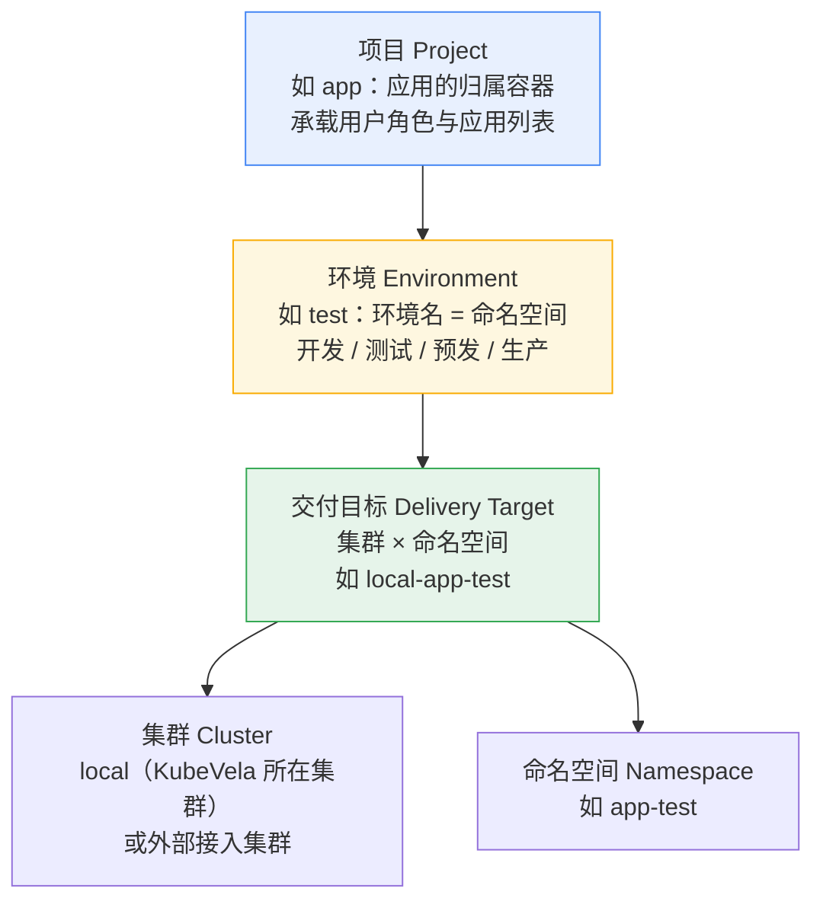
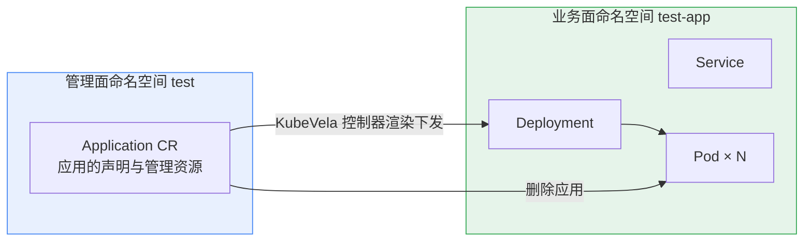

# 56. 交付目标与接入 K8s 集群部署首个应用：项目、环境、交付目标三元组

## 纲要

- **部署前先回答「部署到哪」**：KubeVela 用**项目 → 环境 → 交付目标**三元组承接这件事，交付目标 = **集群 × 命名空间**，名称形如 `local-app-test`
- **接入集群只需一次粘贴**：管理面板 → 集群 → 新建 → 粘贴 kubeconfig，状态显示**健康**即连接成功；`local` 集群就是 KubeVela 自己所在的集群
- **`go-deploy.yaml` 是进阶版首个应用**：webservice 组件 + scaler/resource/startup-probe 三运维特征 + topology 策略 + 「先暂停审核、再部署」工作流，比 `first-app.yaml` 更接近生产形态
- **双命名空间模型是理解全局的钥匙**：`test` 放应用管理资源（CR）、`test-app` 放真实工作负载（Deployment/Pod），**在 `test` 删应用会级联删掉 `test-app` 的 Pod**
- **服务操作全套命令**：`vela status` 看状态、`vela logs` 看日志、`vela exec` 进容器、`vela status --endpoint` 拿访问地址——endpoint 域名与 Service 都由平台自动生成
- **`my-deploy.yaml` 引出 raw 组件**：把原生 K8s 资源整体交给 KubeVela 托管；`raw.yaml` 则是带 gateway 域名与 `publishVersion` 注解的 v1 基线，为金丝雀发布埋伏笔

## 一、场景引入：镜像造好了，「送到哪」还没答案

CI 篇七章忙完，我们手里的产出是一个构建好的容器镜像。但持续交付的另一半问题才刚开始：**这个镜像要部署到哪个集群的哪个命名空间？** 用 kubectl 的世界回答这个问题，靠的是人肉记三个东西——kubeconfig 切到哪个上下文、`-n` 跟哪个命名空间、helm/apply 用哪套 values。环境一多（开发、测试、预发、生产），「部署到哪」就靠复制粘贴和口头约定维持，错一次就是生产事故。

KubeVela 的思路是把「部署到哪」变成**声明式的一等公民**。前面立好了骨架（OAM 四要素），这一篇落地第一块砖：**先把「目标」管起来，再部署第一个应用**。课程的推进顺序非常工程化：

1. 建**项目**——应用的容器，后续所有应用都挂在它下面；
2. 建**环境**与**交付目标**——回答「部署到哪个集群的哪个命名空间」；
3. 接入**集群**——把目标集群的 kubeconfig 交给平台；
4. 部署**首个应用**——用一份 Application YAML 把组件、运维特征、策略、工作流全部跑通；
5. 用**命令与 UI 双侧验证**——状态、日志、终端、endpoint、拓扑图，逐项确认。

走完这五步，你就拥有了后续所有章节（镜像部署、金丝雀、GitOps、CUE 扩展）的演练场。

## 二、核心概念与原理

### 2.1 项目 / 环境 / 交付目标：三元组各管什么

课程把这三个概念放在同一小节讲，因为它们共同回答「应用在平台里怎么安家」：



| 概念 | 课程口径 | 操作入口 |
| --- | --- | --- |
| **项目** | 存放应用的容器；后续所有部署的应用都放在项目下（课程建的项目名为 `app`） | 管理面板 → 项目 → 新增项目 |
| **环境** | 与本地开发→测试→预生产→生产同义；**环境名就是命名空间**，没有会自动创建 | 持续交付 → 环境列表 → 新增环境 |
| **交付目标** | **要交付的集群 + 目标命名空间**；名称是集群名与命名空间的组合，如 `local-app-test` | 建环境时顺带创建，或在交付目标页提前创建 |

「环境名 = 命名空间」这条对应关系是后面所有操作的暗线：课程里环境叫 `test`，应用的管理资源就放在 `test` 命名空间；环境叫 `app-test` 的业务面，工作负载就落在 `app-test`。**看到命名空间，就要条件反射出它对应哪个环境**。

交付目标有两个创建时机：**建环境时顺手创建**（课程演示路径），或**提前在交付目标页创建**（先选项目、再选集群与命名空间）。预生产环境同理——建预发环境，交付目标选预发的集群与命名空间。命名空间如果还没建，页面上点「新增」即可，平台会代劳。

### 2.2 接入集群：kubeconfig 是唯一凭证

集群接入的操作极其简单，简单到容易被低估：**管理面板 → 集群 → 新建集群 → 填英文名称与描述 → 粘贴 kubeconfig → 确认**。判定成功的唯一标准是**状态显示健康**。

课程演示时埋了两个重要细节：

- **`local` 集群是 KubeVela 自己所在的集群**——安装时自动就有，代表「平台自身所运行的集群」；
- 演示环境里另有一个 `cx` 集群，**它与 `local` 其实是同一个集群**（同一个 kubeconfig 接了两遍），课程特意把它断开，避免「一个集群两个入口」造成的管理混乱。

这个细节在生产里的镜像问题是：**同一个集群被多条 kubeconfig 接入时，平台会当成多个集群管理**，应用拓扑、交付目标、权限全部错位。接入规范应是「一个集群一个入口」，多余的入口及时清理。

安全上还要多想一层：**平台拿到的 kubeconfig 是什么权限，平台在集群里就能干什么**。生产接入建议不要直接贴 `~/.kube/config` 里的集群管理员账号，而是为 KubeVela 单独建一个 ServiceAccount 并绑定受控 RBAC（至少能管理 Deployment/Service/CRD/命名空间），把爆炸半径限制在交付必要的资源类型上。这一步课程未展开，但它是「平台持有集群凭证」类工具的通用安全底线。

### 2.3 双命名空间模型：管理面与业务面分离

这是本篇最需要建立的心智模型。部署完成后，课程带着学员执行了两条查看命令，故意制造「为什么命名空间不一样」的疑问：

```bash
vela ls -n test            # 查看 test 命名空间里的应用
kubectl get pods -n test-app   # 查看 test-app 命名空间里的 Pod
```

答案是 KubeVela 的**双命名空间设计**：



- **`test`（管理面）**：存放 Application 自定义资源，即「应用在 KubeVela 眼里的样子」；`vela apply -f xxx.yaml -n test` 的 `-n` 指定的就是这里；
- **`test-app`（业务面）**：存放控制器渲染出来的真实工作负载——Deployment、Pod、Service；
- **级联关系**：在 `test` 里删除应用，`test-app` 里的 Pod 会随之删除，两者是关联的。

为什么这么设计？好处很直接：**管理资源与业务资源隔离**——清理业务命名空间不会误删平台的管理对象；反过来，删应用即删全部业务资源，不留孤儿。坏处是新人必然困惑一次，所以本节专门立此存照：**看到 Pod 不在 `-n` 指定的命名空间里，不要慌，去业务命名空间找**。

### 2.4 webservice 与 raw：两种组件类型的初见面

课程在首个应用里只用了 `webservice` 一种组件类型，并明确「其他类型后边慢慢讲」。这里先建个最小认知：

- **`webservice`**：KubeVela 最常用的组件类型，**本质就是一个 Deployment 应用**，平台会自动帮你创建 Deployment 与 Service——课程原话「webservice 就是 deployment，它会自动解析成 deployment 以及 service」；
- **`raw`**：把原生 K8s 资源定义整体塞进组件属性里交给 KubeVela 托管（见 3.8 节 `my-deploy.yaml`），适合托管无法被标准组件覆盖的资源。

### 2.5 endpoint 自动生成：平台比你多做的事

课程演示查看服务时，平台直接给出了一个访问域名 `endpoint.<命名空间>`——这不是课程手工建的，是 KubeVela 在 Service 之上**再抽象的一层**自动解析出来的。配合 80 端口自动创建 Service 的行为，可以看到 KubeVela 的部署哲学：**你声明「要暴露 80 端口」，域名、Service、Endpoint 由平台补齐**。这就是「在 K8s 之上再抽象一层」在日常操作里最直观的体感。

## 三、动手实践：从建项目到部署首个应用

### 3.1 创建项目

**管理面板 → 左侧「项目」→ 新增项目**，项目名填 `app`。创建成功后项目列表出现 `app`——后续所有应用都归属它。

### 3.2 创建环境与交付目标

**持续交付 → 环境列表 → 新增环境**：

- 环境名称：`test`（环境名即命名空间）；
- 隶属项目：`app`；
- 交付目标：没有现成的就地创建——选集群 `local`、命名空间 `app-test`（没有则点新增），确认后交付目标名为 `local-app-test`。

创建完成后，环境列表出现「项目 app / 命名空间 test / 交付目标 `local-app-test`」，交付目标详情页也能看到这条记录。预生产环境的创建流程完全同构，换集群与命名空间即可。

### 3.3 接入集群

**管理面板 → 集群 → 新建集群**：名称填英文（如 `local` 或集群用途名），粘贴 kubeconfig 内容，确认。右下角显示**健康**即接入成功。课程提醒：`local` 即 KubeVela 所在集群，已有入口的集群不要重复接入（演示中断开了重复的 `cx` 入口）。

### 3.4 逐字段拆解 `go-deploy.yaml`

这是本篇的主角文件——比导学篇的 `first-app.yaml` 多了资源限制、启动探针与人工审核暂停步，更接近生产形态：

```yaml
apiVersion: core.oam.dev/v1beta1
kind: Application
metadata:
  name: golang
  namespace: test-app
spec:
  components:
  - name: golang
    properties:
      exposeType: ClusterIP
      image: nginx:1.10
      imagePullPolicy: IfNotPresent
      #imagePullSecrets:
      #- name: registrykey
      livenessProbe:
        failureThreshold: 3
        httpGet:
          path: /
          port: 80
          scheme: HTTP
        initialDelaySeconds: 10
        periodSeconds: 5
        timeoutSeconds: 15
      ports:
      - expose: true
        port: 80
        protocol: TCP
      readinessProbe:
        failureThreshold: 3
        httpGet:
          path: /
          port: 80
          scheme: HTTP
        initialDelaySeconds: 10
        periodSeconds: 5
        timeoutSeconds: 15
    traits:
    - properties:
        replicas: 2
      type: scaler
    - properties:
        cpu: "0.001"
        limits:
          cpu: "1"
          memory: 1512Mi
        memory: 10Mi
        requests:
          cpu: "0.01"
          memory: 112Mi
      type: resource
    - properties:
        failureThreshold: 3
        httpGet:
          path: /
          port: 80
          scheme: HTTP
        initialDelaySeconds: 10
        periodSeconds: 5
        timeoutSeconds: 15
      type: startup-probe
    type: webservice
  policies:
  - name: test-golang
    properties:
      clusters:
      - local-test
      namespace: test-app
    type: topology
  workflow:
    steps:
      - type: suspend
        name: suspend
        timeout: 43200s
      - type: deploy
        name: deploy-golang-to-prodEnv
        properties:
          policies: ["test-golang"]
```

逐字段拆解表：

| 字段路径 | 值 | 含义与要点 |
| --- | --- | --- |
| `apiVersion` | `core.oam.dev/v1beta1` | KubeVela 核心 API 组，所有 Application 固定用它 |
| `kind` | `Application` | 资源类型：一份应用部署计划 |
| `metadata.name` | `golang` | 应用名，UI 与 `vela ls` 里显示的名字 |
| `metadata.namespace` | `test-app` | **管理资源所在命名空间**——本文件把它放在业务面，`vela apply` 时也可用 `-n` 覆盖指定 |
| `components[0].name` | `golang` | 组件名 |
| `components[0].type` | `webservice` | 组件类型：会渲染为 Deployment + Service |
| `properties.image` | `nginx:1.10` | 要部署的镜像 |
| `properties.exposeType` | `ClusterIP` | 服务暴露方式（另有 NodePort/LoadBalancer，默认 ClusterIP 最安全） |
| `properties.imagePullPolicy` | `IfNotPresent` | 拉取策略；私有仓库需配合 `imagePullSecrets`（文件里注释掉的 `registrykey`） |
| `properties.ports[0]` | `expose: true,port: 80,TCP` | 声明暴露 80 端口——Service 与 endpoint 由平台自动生成 |
| `properties.livenessProbe` | 3 次失败阈值、GET `/`、10s 初始延迟、5s 周期、15s 超时 | **存活探针**：探测失败重启容器 |
| `properties.readinessProbe` | 同上参数 | **就绪探针**：探测失败摘流量——探针参数直接写在组件属性里，无需再包 trait |
| `traits[0]` | `scaler: replicas: 2` | 运维特征：2 副本 |
| `traits[1]` | `resource`：requests cpu 0.01 / memory 112Mi，limits cpu 1 / memory 1512Mi | 运维特征：**requests 决定调度，limits 决定上限**——requests 给太小会调度困难，limits 给太大会浪费配额 |
| `traits[2]` | `startup-probe`：同探针参数 | 运维特征：**启动探针**，给慢启动应用更宽限期，避免存活探针过早杀容器 |
| `policies[0]` | `topology` 策略，名 `test-golang`，clusters `[local-test]`、namespace `test-app` | 执行策略：交付到 `local-test` 集群的 `test-app` 命名空间 |
| `workflow.steps[0]` | `suspend`，超时 `43200s` | 工作流第一步：**暂停等待人工审核**（12 小时超时） |
| `workflow.steps[1]` | `deploy`，名 `deploy-golang-to-prodEnv`，`policies: ["test-golang"]` | 工作流第二步：按 `test-golang` 策略部署 |

**三个最容易踩的对应关系**，课程都点了名：

1. **工作流 deploy 步骤引用的策略名必须与 `policies` 里定义的名称一致**——`policies: ["test-golang"]` 对不上策略名，部署直接出错；
2. **探针三兄弟分工不同**：startup-probe 管「起来了吗」、liveness-probe 管「还活着吗」、readiness-probe 管「可以接流量了吗」——慢启动服务必须配 startup-probe，否则 liveness 会把还在启动的容器反复杀掉；
3. **`suspend` 步骤让部署变成「先审核后上线」**——超时 `43200s`（12 小时）是兜底，防止暂停步永久卡死工作流。

### 3.5 部署首个应用

```bash
# -f 指定 YAML；-n 指定 KubeVela 管理该应用所用的命名空间
vela apply -f go-deploy.yaml -n test
# 输出创建成功提示
```

注意 `-n test` 与文件里 `metadata.namespace: test-app` 的关系：**命令行 `-n` 是「应用作为管理资源放哪」，策略里的 namespace 是「业务负载放哪」**——前者管「平台怎么管这个应用」，后者管「Pod 实际跑在哪」，别混。

### 3.6 命令侧查看与操作

```bash
# ① 查看应用列表与状态
vela ls -n test
vela status golang -n test

# ② 查看业务面工作负载（注意命名空间是 test-app）
kubectl get pods -n test-app
kubectl get deploy -n test-app

# ③ 进入容器终端（-n 指向管理命名空间，-- 后接 shell）
vela exec golang -n test -- sh

# ④ 查看日志
vela logs golang -n test-app

# ⑤ 查看 endpoint 访问地址
vela status golang -n test --endpoint
```

`vela status` 的输出信息量很大，课程逐项讲过：应用名、部署命名空间、创建时间、**当前状态（正常）**、流水线名称与状态（`running` 表示工作流在跑）、完成状态（是否有错误）、**是否暂停人工审核**（`suspend` 步骤在时为待审核）、步骤 ID 与名称、服务名称、集群、健康状态、运维特征（scaler 副本数）等。**「完成状态 = 错误」时先去看工作流停在哪一步**——这是排查部署失败的第一现场。

访问地址由平台自动生成，形如 `endpoint.<业务命名空间>`，课程演示中 80 端口的 Service 也已自动建好——「在 K8s 之上再抽象一层」说的就是这些平台代劳的动作。

### 3.7 UI 侧查看：应用、版本、工作流、拓扑图

控制台路径：**持续交付 → 应用列表 → 按项目名/命名空间搜索**，能看到刚部署的应用；支持列表与**卡片**两种视图。点进应用后信息分四区：

- **左侧应用配置**：所属项目（app）、创建/更新时间、组件类型（webservice）、容器镜像、CPU/内存（不配默认内存 1024Mi、CPU 0.5，本文 3.4 已显式定义）、策略名称、触发器（手动触发）；
- **版本**：点详情可看 KubeVela 生成的资源定义与自动注解；本应用只有一个版本；
- **工作流**：本文的工作流含「暂停审核 → 部署」两步，是最简形态；要加人工审核、多集群部署，在终端侧的 workflow 里定义即可；
- **状态/拓扑**：部署耗时、资源拓扑图（Deployment、Service、Endpoint、Pod 及其健康状态）、实例列表（与副本数一致）、按实例查看日志。

环境列表侧还能看到归属逻辑：**应用部署在 `test` 命名空间，就自动归属 `app` 项目**；若部署在其他命名空间，则默认归 `default` 项目——**想归哪个项目，就用哪个项目的命名空间**。交付目标里带 `SYS-` 前缀的记录是**系统自动创建**的（应用部署后平台自动补建），手工创建的没有前缀——两字之差，别把系统记录当手工记录去改。

### 3.8 `my-deploy.yaml`：raw 组件托管原生 Deployment

```yaml
apiVersion: core.oam.dev/v1beta1
kind: Application
metadata:
  name: my-app
spec:
  components:
    - name: my-raw-deployment
      type: raw
      properties:
        apiVersion: apps/v1
        kind: Deployment
        spec:
          replicas: 3
          selector:
            matchLabels:
              app: my-app
          template:
            metadata:
              labels:
                app: my-app
            spec:
              containers:
                - name: my-app
                  image: nginx:1.19.1
                  ports:
                    - containerPort: 80
```

这份文件展示第二种组件类型：`type: raw`，`properties` 里直接写**原生 K8s 资源**（这里是 `apps/v1` Deployment，3 副本，nginx:1.19.1，80 端口）。KubeVela 对它不做任何抽象渲染，**原样托管**——selector 与 template 标签都用了 `app: my-app`，这是原生 Deployment 的硬性要求（selector 必须匹配 template labels）。

什么时候用 raw？当资源形态超出标准组件表达能力时（课程后续的 `k8s-object` 多集群交付会展开）：标准组件给你便利，raw 给你自由，**先用标准组件、不够了再降级到 raw**。

### 3.9 `raw.yaml`：带域名与版本注解的 v1 基线

```yaml
apiVersion: core.oam.dev/v1beta1
kind: Application
metadata:
   name: canary-demo
   annotations:
      app.oam.dev/publishVersion: v1
spec:
   components:
      - name: canary-demo
        type: webservice
        properties:
           image: wangyikewyk/canarydemo:v1
           ports:
              - port: 8090
        traits:
           - type: scaler
             properties:
                replicas: 5
           - type: gateway
             properties:
                domain: canary-demo.com
                http:
                   "/version": 8090
```

这份文件是下面金丝雀发布的**基线**，先记住三个新东西：

- `app.oam.dev/publishVersion: v1` 注解：**给应用打版本号**，版本差异对比、回滚都靠它；
- `gateway` 运维特征：**配置访问域名与路由规则**（域名 `canary-demo.com`，路径 `/version` 转发到 8090 端口）；
- 无 `policies`/`workflow`：**不指定策略与工作流时，默认部署到本地集群、apply 时指定的命名空间**——课程部署到了 `test-app`。

至此，首个应用的「项目 → 环境 → 交付目标 → 集群 → 应用」全链路闭合。

## 四、生产实践要点

**① 命名空间规划：管理面与业务面分开，且按环境分桶。** 课程示范了 `test` / `test-app` 两个命名空间的分工，生产上应推广为「每个环境一对」：`prod` 管管理资源、`prod-app` 管业务负载；测试、预发同理。好处是权限可以分级授——开发只给业务命名空间的 read，平台管理员才碰管理命名空间。

**② 交付目标命名规范：集群-命名空间，一眼可读。** `local-app-test` 这种「集群名 + 命名空间」的组合是课程口径，生产上建议加环境前缀统一成 `<集群>-<环境>-<命名空间>`（如 `ack-prod-app`），多集群环境下按名字就能判断流量去向，避免「部署到测试集群的生产命名空间」这类事故。

**③ 接入集群的凭证要最小权限 + 可轮换。** kubeconfig 里别放集群管理员；为 KubeVela 建专用 ServiceAccount + 受限 RBAC，并纳入证书轮换流程——平台持有的集群凭证是长期有效的，泄露即失守。

**④ 资源 requests/limits 按服务画像配置，别用默认值裸奔。** `go-deploy.yaml` 给了完整示范：requests（cpu 0.01 / memory 112Mi）保调度、limits（cpu 1 / memory 1512Mi）保上限。课程也展示了 UI 不配时的默认值（内存 1024Mi / CPU 0.5）——**默认值只适合演示**，生产每个服务都应按压测数据设定，否则 limit 过小会被 OOMKilled、过大则节点配额浪费。

**⑤ 探针三件套按启动特性配置。** 慢启动服务（JVM、大型 Go 二进制）必须配 startup-probe 给足宽限期；liveness 路径要选轻量端点；readiness 不过就不接流量——课程文件里三探针参数一致是演示简洁，生产上应该差异化。

**⑥ 工作流第一步放 suspend，是「人工卡口」的标准姿势。** `go-deploy.yaml` 的 workflow 先 suspend（12 小时超时）再 deploy，等于把「审核通过才允许上线」写进了流水线。生产上这道卡口常接审批系统（或至少接 IM 通知），超时时间按 SLA 设，别让暂停步变成永久卡死。

**⑦ 一个集群一个接入入口。** 课程专门断开重复接入的 `cx` 集群。生产上重复接入同一集群会造成「平台以为有两个集群」的拓扑错乱，接入前先盘点现有入口。

## 五、报错排查表

| 现象 | 根因 | 解法 |
| --- | --- | --- |
| 部署报错、工作流失败 | deploy 步骤引用的策略名与 `policies` 定义的名称不一致 | 核对 `policies: ["test-golang"]` 与策略 `name: test-golang` 严格一致 |
| `vela ls -n test` 有应用，`kubectl get pods -n test` 看不到 Pod | 双命名空间模型：Pod 在业务命名空间 | 到业务命名空间查：`kubectl get pods -n test-app` |
| 集群列表状态不健康 | kubeconfig 过期 / 网络不通 / 集群 API Server 不可达 | 用该 kubeconfig 直连集群验证；检查 API Server 地址与证书有效期 |
| 删了应用，Pod 还在 | 直接删了业务命名空间的 Deployment，没删 Application | 删管理资源：`vela delete golang -n test`，级联删业务负载 |
| 应用归属了 default 项目 | 部署时用的命名空间不属于目标项目 | 用项目对应命名空间重新 apply（环境名 = 命名空间） |
| 工作流一直暂停、部署不推进 | `suspend` 步骤在等待人工审核 | 控制台点「继续」，或 `vela workflow resume <应用名>` |
| endpoint 访问不通 | exposeType 为 ClusterIP 时仅集群内可达；域名未解析 | 集群内用 endpoint 域名验证；对外暴露换 NodePort/LoadBalancer 或配 gateway/ingress |
| 新 Pod 反复重启 | 存活探针过于严格（慢启动被误杀） | 加 startup-probe 给宽限、调大 initialDelaySeconds、换轻量探测路径 |
| Pod pending 调度不上 | requests 超过节点可分配资源 | 下调 requests 或扩容节点；`kubectl describe pod` 看事件 |

## 六、面试考点与追问

**Q1：KubeVela 的项目、环境、交付目标分别是什么？关系如何？**
项目是应用的归属容器；环境对应部署阶段（开发/测试/预发/生产），**环境名即命名空间**；交付目标是「集群 × 命名空间」的组合，回答应用最终部署到哪。环境绑定交付目标，应用归属项目。

**Q2：为什么 `vela apply -n test` 之后 Pod 不在 test 命名空间？**
KubeVela 采用双命名空间模型：`test` 是管理面，存 Application CR；策略里指定的命名空间（如 `test-app`）是业务面，存 Deployment/Pod/Service。在管理面删应用会级联删除业务面负载。

**Q3：`go-deploy.yaml` 里三探针分别解决什么问题？**
startup-probe 给慢启动应用宽限期；liveness-probe 探测失败重启容器；readiness-probe 探测失败摘除流量。只配 liveness 不配 startup，是慢启动服务被反复杀死的常见根因。

**Q4：工作流 deploy 步骤部署失败，第一排查点是什么？**
先核对 deploy 步骤 `policies` 引用的名称与 `policies` 列表里的策略名是否严格一致，名称对不上部署必然出错；其次看 `vela status` 的完成状态与工作流停在哪一步。

**Q5：不指定 policies 与 workflow 时，应用部署到哪？**
默认部署到本地集群、apply 命令指定的命名空间——策略与工作流缺省时平台按最简路径交付。

**Q6：`SYS-` 前缀的交付目标和手工创建的有什么区别？**
`SYS-` 前缀是系统自动创建的交付目标（应用部署后平台自动补建），手工创建的没有前缀。运维上不要把系统记录当手工记录修改。

**Q7：webservice 组件与 raw 组件的区别？各自适用场景？**
webservice 是标准组件，自动渲染 Deployment + Service，适合常规无状态服务；raw 把原生 K8s 资源整体托管，适合标准组件覆盖不了的特殊资源。选型原则：先用标准组件，不够再降级 raw。

## 📎 文本↔代码关联

| 代码文件 | 正文提及 | 内容 |
| --- | --- | --- |
| `code/8-Kubevela/go-deploy.yaml` | 2.4、3.4、3.5、四.④⑤⑥ 节 | 进阶版首个应用：webservice 组件（nginx:1.10、ClusterIP、80 端口、liveness/readiness 探针）+ scaler（2 副本）+ resource（requests/limits）+ startup-probe 三 trait + topology 策略 `test-golang`（local-test 集群 / test-app 命名空间）+ 「suspend 人工审核 → deploy」两步工作流 |
| `code/8-Kubevela/my-deploy.yaml` | 2.4、3.8、四. 节 | raw 组件示例：`type: raw` 托管原生 `apps/v1` Deployment（3 副本、nginx:1.19.1、80 端口），selector 与 template 标签一致——标准组件覆盖不了时的兜底形态 |
| `code/8-Kubevela/raw.yaml` | 2.5、3.9 节 | v1 基线应用：webservice（canarydemo:v1、8090 端口）+ scaler（5 副本）+ gateway（域名 canary-demo.com、路径 /version 路由 8090）+ `publishVersion: v1` 注解，无策略/工作流走默认部署——金丝雀发布篇的起点 |

**技术点总结**：本篇把「部署到哪」做成了声明式对象——**项目**承载应用、**环境**（环境名 = 命名空间）区分阶段、**交付目标 = 集群 × 命名空间**（如 `local-app-test`）精确落点；集群经 kubeconfig 接入、**健康即通**，`local` 即平台所在集群且一个集群只留一个入口。核心心智是**双命名空间模型**：管理面（如 `test`）存 Application CR，业务面（如 `test-app`）存 Deployment/Pod/Service，删应用即级联删负载。`go-deploy.yaml` 用「webservice + scaler/resource/startup-probe + topology 策略 + suspend→deploy 工作流」立起生产形态样本，三探针分工（启动/存活/就绪）与 requests/limits（调度/上限）是配置重点，deploy 步骤引用的策略名必须与定义严格一致；`my-deploy.yaml` 展示 raw 托管原生资源、`raw.yaml` 用 gateway 域名与 publishVersion 注解铺好金丝雀基线。命令侧 `vela status/logs/exec` 与 UI 侧（应用列表/版本/工作流/拓扑）双通道验证，endpoint 域名与 Service 全由平台代劳——抽象层的价值在每一次「平台帮你补全」里兑现。下面讲 KubeVela 项目配置：托管模式、插件 CLI 与角色成员体系。

