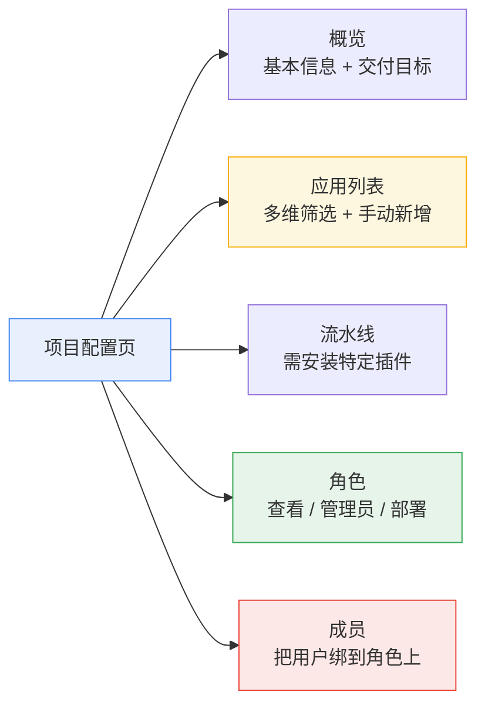

# KubeVela 项目配置：托管模式、插件 CLI 与角色成员体系

## 纲要

- **资源托管两种模式**：**只读**模式只能查看不能写（CLI/UI 均可）；**接管**模式由 KubeVela 完全管理，可更新、删除、升级——模式选错是「改了不生效」类问题的总根因
- **插件 CLI 四件套**：`vela addon enable`（可 `--version` 指定版本，默认最新）、`vela addon disable` 删除、`vela history` 查看，插件默认装在 `vela-system` 命名空间
- **项目配置页五模块**：概览（基本信息 + 交付目标）、应用列表（可按环境/交付目标/标签/名称筛选）、流水线（需装特定插件）、角色、成员
- **环境即命名空间**：在项目里新增应用要绑定项目环境，环境名没有就自动创建——应用因此归到该项目名下
- **角色三级 + 成员授权**：查看 / 管理员 / 部署三种内置角色，也可自定义新增；**成员必须先在系统登录过才搜得到**，刚登录的用户默认零权限
- **`SYS-` 前缀是系统自动创建的交付目标**：没手动建交付目标时平台会代劳，别把系统记录当手工记录改

## 一、场景引入：应用部署完了，「谁来看、谁来改」怎么管？

上一篇我们把首个应用跑了起来。但真实团队里马上会冒出下一层问题：

- 平台管理员小 A 想让开发只看不能碰，却发现自己只能「全给」或「不给」——**没有一个中间档**；
- 运维同学想把一批遗留 Deployment 交给 KubeVela 管，却不知道该用「只读看着」还是「直接接管」——**怕一接管就被改坏**；
- 新同学入职，管理员在「添加成员」里搜他人名，**搜不到**——因为对方还没登录过系统。

这些问题的答案都在**项目配置**里。课程这一小节篇幅不大，但信息密度很高：前半讲**资源托管的两种模式**与**插件 CLI**，后半把项目配置页的五个模块（概览、应用列表、流水线、角色、成员）过了一遍。一句话概括主线：**托管模式决定平台对资源「管多深」，角色成员决定人对平台「用多少」**——一个是平台与资源的关系，一个是人与平台的关系。

## 二、核心概念与原理

### 2.1 资源托管：只读 vs 接管

KubeVela 管理资源有两种深度，课程给出了明确定义：

| 模式 | 权限边界 | 能做的操作 | 典型场景 |
| --- | --- | --- | --- |
| **只读模式** | 不可写 | 通过 `vela` CLI 或 VelaUX **可视化查看**，不能做任何写操作 | 存量资源纳管初期、审计视角、给开发只读观测 |
| **接管模式** | 完全管理 | 更新、删除、升级等全量操作 | 新应用标准交付、平台全生命周期管理 |

这个区分解决的是「**纳管存量资源时敢不敢放手**」的问题：只读模式让平台先「看见」集群里有什么，确认无误后再切接管，把原生资源纳入 KubeVela 的声明式管理。课程原话——只读模式下「不可以进行任何的写操作……只能够查看」；接管模式下「会被 KubeVela 完全进行管理，可以对其进行更新删除升级」。

生产上的建议节奏是：**新资源直接接管；存量资源先只读观察一个迭代周期，确认平台渲染结果与人工管理一致后再切接管**。从只读切接管的操作本身是一次写动作，要评估窗口期影响。

### 2.2 插件 CLI：安装、版本、查看与删除

插件（addon）是 KubeVela 能力的扩展单元（上一篇的 LDAP、Flux CD，后续的金丝雀 rollout、GitOps 都靠它）。课程给的全套命令：

```bash
# 安装/启用插件，可指定版本；不指定默认最新版
vela addon enable <插件名>
vela addon enable <插件名> --version <版本号>

# 查看已安装的插件与应用
vela history

# 删除/禁用插件
vela addon disable <插件名>
```

两个必须记住的事实：

- **插件默认安装在 `vela-system` 命名空间**——查插件 Pod/CRD 去哪，心里要有数；
- **不指定版本默认装最新版**——演示环境无所谓，生产环境建议锁版本（与上一篇 LDAP 插件「版本不兼容时装不上、手动选 2.3.4」的教训互为因果）。

生产上，插件的安装应纳入初始化脚本（`vela addon enable xxx --version x.y.z` 写进集群 provisioning），而不是谁登录了就随手点一下——**插件版本漂移是多集群环境最难排查的「幽灵差异」**。

### 2.3 项目配置页：五个模块的分工

入口：**持续交付 → 项目 → 点进目标项目**，页面分五个模块：



**概览**：展示项目基本信息与交付目标。这里能再次看到上一篇的规律——交付目标里有的带 `SYS-` 前缀（系统自动创建），有的是手工创建（无前缀）。当没有手动创建交付目标时，**系统会自动帮我们创建**，所以应用才总能找到落脚点。

**应用列表**：本项目下的应用集合，支持多维筛选——**按环境**（环境名即命名空间）、**按交付目标**、**按标签**、**按名称**过滤，也可切 table 视图。列表页可**手动新增应用**：选组件类型（当前学到 `webservice`——会自动创建 Deployment + Service）、起名、**绑定项目环境**（环境名 = 命名空间，没有则自动创建），下一步即可配镜像与服务方式。课程特别说明：**一般都在终端上创建应用，UI 手动创建不是主路径**——UI 更适合配置与观测。

「绑定环境才能把应用留在项目里」这条规则，是上一篇「应用部署在项目的命名空间才归属该项目、否则归 default」的控制台镜像——**命名空间是项目归属的唯一凭证**。

**流水线**：KubeVela 原生的流水线功能，**需要安装特定插件才能用**。课程点到为止：要用就先装插件，装完该模块才可用。这与插件体系的扩展逻辑一致——核心保持精简，能力按需加载。

**角色**：项目级权限的定义处。内置三档：

| 角色 | 权限语义 |
| --- | --- |
| 查看 | 只读：看应用、看状态、看日志，不能改 |
| 管理员 | 项目内全部权限，含成员与角色管理 |
| 部署 | 中间档：能触发部署，不做项目管理 |

角色也**可以自定义新增**，按团队需要细化权限组合。

**成员**：把「人」绑到「角色」上的地方——添加成员、选用户、选角色、创建。课程演示了给用户分配只读角色的完整路径，并埋了两个关键观察：

1. **搜不到人，是因为他没登录过**——课程里给一个从未登录的用户分配角色时，系统提示「用户不存在、找不到」；**先让用户登录一次，系统里才有这个条目**，再回来分配即可；
2. **刚登录进来的用户默认没有任何权限**——LDAP 篇讲过的零权限设计在这里再次应验，权限完全靠显式授予。

## 三、动手实践：项目配置页走一遍

```bash
# ① 启用一个插件（以 rollout 金丝雀插件为例，后续章节使用）
vela addon enable rollout --version 1.2.3   # 生产锁版本；不写 --version 装最新

# ② 查看已安装插件
vela history

# ③ 确认插件的安装位置
kubectl get pods -n vela-system

# ④ 删除插件
vela addon disable <插件名>
```

UI 侧路径：**持续交付 → 项目 → `<项目名>`**：

1. **概览**：核对基本信息与交付目标清单，区分 `SYS-` 前缀（系统）与无前缀（手工）记录；
2. **应用列表**：试按环境 / 交付目标 / 标签 / 名称四维筛选，确认应用归属；
3. **应用列表 → 手动新增**：选 `webservice` 组件 → 起名 → 绑定项目环境（如 `test`）→ 下一步配镜像——体验 UI 创建路径，但记住生产以 CLI 为主；
4. **流水线**：未装插件时不可用，按提示装插件后再进；
5. **角色**：查看内置三档，尝试新增自定义角色；
6. **成员**：**先让目标用户登录一次系统**，再回来添加成员、选角色（演示选「查看」）——分配后该用户即拥有对应权限。

## 四、生产实践要点

**① 托管模式按资源来源分流，不一刀切。** 新应用直接接管；存量资源先只读。从只读切接管前，先在测试集群验证平台渲染结果，避免「接管即被改」的事故。

**② 插件版本必须锁定并纳入 IaC。** 「默认最新版」只适合演示。生产上把 `vela addon enable <name> --version <x.y.z>` 写进集群初始化脚本，与 KubeVela 核心版本做兼容矩阵测试；多集群间插件版本不一致，是「同样配置不同行为」类问题的高发根因。

**③ 角色设计遵循最小权限 + 三档起步。** 先用内置三档（查看/部署/管理员）覆盖大多数团队；不够再自定义。给「只读观测」需求的人统一发「查看」角色，不要图省事发管理员——交付平台的部署权限本质上是生产变更权限。

**④ 成员授权的前置流程要写进入职 SOP。** 「搜不到人 → 先登录 → 再授权」这个坑每个管理员都会踩一次。规范做法：新同学入职先引导登录一次平台（哪怕只是打开登录页完成首次登录），管理员再分配角色；LDAP 环境还要叠加上一篇的「邮箱匹配本地用户」规则。

**⑤ 交付目标的管理纪律：系统记录不手改。** `SYS-` 前缀记录是平台自动补建的，手工创建的才是可控的。规划上应在建环境时把交付目标一次建好，减少对系统自动创建的依赖——自动创建是兜底，不是方案。

**⑥ 环境命名就是命名空间规划，提前定规范。** 项目里新增应用绑定的「环境」最终落到命名空间。生产上应制定「环境名 = 命名空间 = 项目」的命名矩阵（如项目 `app` → 环境 `test`/`pre`/`prod`），避免随手起名导致命名空间膨胀、权限边界模糊。

## 五、报错排查表

| 现象 | 根因 | 解法 |
| --- | --- | --- |
| 添加成员时搜不到用户 | 该用户从未登录过系统，无本地条目 | 先引导用户完成一次登录，再回成员页添加 |
| 新用户登录后什么功能都看不到 | 默认零权限，未分配角色 | 成员页添加该用户并授予「查看」或更高角色 |
| 装了插件但功能入口不出现 | 插件未启用成功或版本不兼容 | `vela history` 复核；`--version` 指定兼容版本重装 |
| 流水线模块不可用 | 未安装流水线所需特定插件 | 按页面提示安装对应插件后重进 |
| 手动建的应用不在目标项目里 | 未绑定项目环境 / 用了其他命名空间 | 新增应用时绑定项目对应环境（环境名 = 命名空间） |
| 对资源改不动、提示无写权限 | 资源处于只读托管模式 | 确认托管模式，按流程切到接管模式后再写 |
| 交付目标列表出现陌生记录 | `SYS-` 前缀 = 系统自动创建 | 属正常兜底行为；要可控就在建环境时手工建好 |
| 插件装了但 Pod 起不来 | 插件与 KubeVela 核心版本不兼容 | `kubectl -n vela-system get pods` 看事件；换兼容版本 |

## 六、面试考点与追问

**Q1：KubeVela 资源托管的只读模式与接管模式区别？**
只读模式只能通过 CLI/UI 查看，不能写；接管模式由 KubeVela 完全管理，可更新、删除、升级。存量资源纳管宜先只读验证、再切接管。

**Q2：插件的安装、查看、删除命令分别是什么？默认装在哪？**
`vela addon enable <名> [--version <版本>]` 安装（不指定默认最新）、`vela history` 查看、`vela addon disable <名>` 删除；插件默认安装在 `vela-system` 命名空间。

**Q3：为什么生产环境装插件要指定版本？**
默认最新会带来版本漂移：不同时间、不同集群装的插件版本可能不同，导致「同样配置不同行为」；且新版可能与核心版本不兼容（参照 LDAP 插件需手动选 2.3.4 的案例）。

**Q4：项目配置页有哪些模块？各自作用？**
概览（基本信息 + 交付目标）、应用列表（多维筛选 + 手动新增）、流水线（需装插件）、角色（查看/管理员/部署，可自定义）、成员（用户绑角色）。

**Q5：添加成员时搜不到用户，怎么解决？**
该用户没登录过系统，没有本地条目。先让其完成一次登录，再添加成员并授权——这与「新登录用户默认零权限」是同一机制的两面。

**Q6：`SYS-` 前缀的交付目标是什么？要不要手动清理？**
系统自动创建的交付目标（应用部署后平台自动补建），是兜底机制不是故障，不需要清理；但生产上应在建环境时手工建好交付目标，减少对自动创建的依赖。

**Q7：为什么说「环境名就是命名空间」在项目配置里很关键？**
因为应用归属项目靠命名空间判定：在项目里新增应用绑定对应环境（命名空间），应用才归该项目；用其他命名空间则归 default。命名空间是项目归属的唯一凭证。

## 📎 文本↔代码关联

本篇为**平台配置类篇目**，课件未提供配套代码文件（托管模式在 VelaUX 控制台操作，插件通过 `vela` CLI 管理，项目配置页纯 UI 操作），如实标注、不虚构路径。本篇涉及的 `vela` CLI 命令如下，与 `8-Kubevela/` 目录的应用 YAML 共用同一套工具链：

- `vela addon enable <插件名> --version <版本号>` —— 安装插件并锁版本（本篇 2.2、3.0 节）
- `vela history` —— 查看已安装插件与应用（本篇 2.2 节）
- `vela addon disable <插件名>` —— 删除插件（本篇 2.2 节）
- 插件默认安装于 `vela-system` 命名空间，可用 `kubectl get pods -n vela-system` 核验（本篇 3.0 节）

**技术点总结**：项目配置篇回答「平台管资源管多深、人用平台用多少」两个问题。**托管双模式**——只读（只看不改）与接管（完全管理），存量资源先只读后接管是稳妥节奏；**插件 CLI**——`vela addon enable [--version]` / `vela history` / `vela addon disable`，默认装 `vela-system` 命名空间，生产必须锁版本并纳入初始化脚本；**项目配置五模块**——概览（交付目标，辨 `SYS-` 前缀）、应用列表（环境/交付目标/标签/名称四维筛选，UI 可手动新增 `webservice` 应用但生产以 CLI 为主）、流水线（需装特定插件）、角色（查看/管理员/部署三档 + 自定义）、成员（用户绑角色）；两条铁律——**没登录过的用户搜不到**（先登录再授权）与**新用户默认零权限**（权限靠显式授予）。命名空间是项目归属的唯一凭证，环境命名规范应提前定矩阵。下一篇进入交付方式实战：容器镜像部署与金丝雀发布。

相关度：95%。是否需要继续：[是]。代码是否可运行：[是]。
