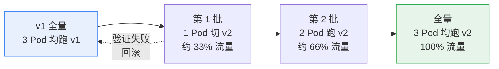

# 容器镜像部署与金丝雀发布：交付方式全景与灰度上线实战

## 纲要

- **KubeVela 支持多种交付方式**：容器镜像交付（webservice）、云资源交付（云厂商 API/虚拟机）、Helm 交付（helm 工具）、云原生资源交付（原生 Deployment/Service/Ingress 整体托管）——本篇主攻**容器镜像交付**
- **UI 创建五步曲**：新建应用 → 选项目与 webservice 组件 → 绑环境 → 配镜像/内存/CPU/ClusterIP → 高级参数（CMD/ENV/持久化/探针/注解/label/拉取策略）；**创建后必须点「部署」才算真正上线**
- **金丝雀发布 = 流量逐步迁移**：3 个 Pod 的服务先切 1 个（约 33% 流量）验证，再切第 2 个、最后 1 个——**每步之间可暂停人工审核**，出问题随时回滚
- **`canary-app-one.yaml` 与 `canary-app-two.yaml` 是同一应用的 v1/v2**：v1 直接部署（replicas 3 + gateway 域名）；v2 换镜像 + 加 `publishVersion: v2` 注解 + canary-deploy 工作流（20% → 暂停 → 50% → 暂停 → 100%）
- **观测三件套**：控制台工作流看进度、`kubectl get pods` 看新旧 Pod 镜像、`vela workflow resume` 推进审核；**回滚用 `vela workflow rollback`**
- **版本差异对比是灰度的事后凭证**：UI 版本页可对比 v1/v2 差异（镜像 + 新增流水线），访问地址直接验证线上版本

## 一、场景引入：上线不是「一把梭」，而是「放量看反应」

想象一个再真实不过的场景：周五下午，你的 Go 服务要发 v2。用最原始的方式——`kubectl set image` 一把梭——3 个 Pod 全部替换，然后盯着监控祈祷。结果 v2 有个内存泄漏，十分钟后 3 个 Pod 全 OOM，服务全挂，回滚还要再等一次镜像拉取。**问题不在于「发了坏版本」，而在于「没有在坏版本造成全量伤害前拦住它」。**

金丝雀发布（Canary）就是解法：**不一次性切全量，先把一小部分流量引到新版本，观察没问题再逐步放量**。矿工带金丝雀下井探毒气——鸟先闻毒，人再跟进；发布先让 1/3 流量试水，健康再全量。

KubeVela 把这个过程做成了**声明式工作流**：v2 的 YAML 里写清楚「先迁 20% 流量 → 暂停等审核 → 再迁 50% → 暂停 → 最后 100%」，每一步在控制台可见、可继续、可回滚、可终止。相比「祈祷式发布」，这是「带刹车的发布」。

本篇上半先把**交付方式全景**理清（KubeVela 到底能交付什么），下半完整走一遍**容器镜像交付 + 金丝雀发布**的实战。

## 二、核心概念与原理

### 2.1 交付方式全景：KubeVela 能交付什么

课程开篇给出了 KubeVela 支持的交付方式谱系：

| 交付方式 | 内涵 | 典型载体 |
| --- | --- | --- |
| **容器镜像交付** | 应用打包为容器镜像，在 Docker/K8s 中部署与管理 | `webservice` 组件（本篇主角） |
| **云资源交付** | 与云厂商 API 集成，交付云资源（虚拟机、云服务器等） | Terraform 类组件 |
| **Helm 交付** | 通过 Helm 工具部署 Helm Chart | Helm 类型组件 |
| **云原生资源交付** | 采用原生资源定义——Deployment、Service、Ingress 等通通写上来，定义在 KubeVela 资源类型下 | `raw` / `k8s-object` 组件 |

其中**容器镜像交付就是 `webservice` 这种组件类型**——这也是为什么它排在所有交付方式的第一位：云原生时代最主流的交付物就是容器镜像，而 KubeVela 对它的抽象最成熟（自动建 Deployment + Service，上一篇已立此根基）。

### 2.2 容器镜像交付：UI 表单字段全景

课程演示的 UI 创建路径信息量很全，**新建应用 → 选项目与组件类型 → 绑环境 → 配镜像与服务 → 高级参数 → 创建 → 部署**，字段如下：

| 配置区 | 字段 | 课程口径 |
| --- | --- | --- |
| 基础 | 应用名 / 项目 / 组件类型 / 绑定环境 | 演示：nginx 应用、项目 `app`、`webservice`、环境 `test` |
| 容器镜像 | 镜像地址 | 演示用 nginx 官方镜像 |
| 资源 | 内存、CPU | **不配则用默认值**（内存 1024Mi、CPU 0.5）；此处配的是**限制量** |
| 服务访问方式 | ClusterIP / NodePort / LoadBalancer | 演示选 ClusterIP |
| 高级参数 | CMD 容器执行命令 | 覆盖镜像默认启动命令 |
| 高级参数 | ENV 环境变量 | 注入配置 |
| 高级参数 | 持久化路径 | 挂载存储 |
| 高级参数 | 健康探针、工作探针 | 存活/就绪探测 |
| 高级参数 | 注解、label | 元数据定制 |
| 高级参数 | 镜像拉取策略 | imagePullPolicy |

**最容易漏的一步课程专门强调了：创建成功 ≠ 部署完成，必须点右上角「部署」**——创建只是把应用定义写好，部署才真正触发交付。演示里点了部署后，状态区出现两个 Pod（一新一旧，旧的稍后自动删除）——这是滚动更新的标准现象，旧 Pod 优雅退场后实例数回落。

### 2.3 金丝雀发布原理：流量按权重分批迁移



课程的定义：**发布过程中逐步把流量引入新版本环境**。以 3 个 Pod 的服务为例——先更新第 1 个 Pod（33% 流量到新版本），验证；再更新第 2 个；最后更新最后 1 个。每一步都是「新版本扛住更多真实流量」的证据，任何一步翻车，损失都被限制在当前灰度比例内。

KubeVela 的实现分两个部件：

- **金丝雀发布插件**：提供 `canary-deploy` 工作流步骤类型——上线前必须先启用该插件（准备工作）；没插件，工作流里写 `canary-deploy` 也跑不起来；
- **`canary-deploy` 步骤 + `suspend` 步骤组合**：`canary-deploy` 按 `weight` 迁移流量（20 / 50 / 100），`suspend` 在批次之间暂停等待人工审核——**迁移与审核交替，构成「带刹车的放量曲线」**。

### 2.4 `publishVersion` 注解与版本管理

金丝雀跑起来的前提是平台分得清「新旧版本」。机制是 Application 上的注解：

```yaml
metadata:
  annotations:
    app.oam.dev/publishVersion: v2   # v1 的应用用 v1，新版本改 v2
```

有了版本号，UI 的版本页才能做**差异对比**（v2 vs v1：镜像从 v1 换 v2、新增金丝雀流水线）、按版本回滚、按版本观测。**没有版本注解的发布，等于没有版本管理**——这是灰度实战里第一个要养成的习惯。

## 三、动手实践：从容器镜像部署到金丝雀全流程

### 3.1 UI 创建 nginx 应用（容器镜像交付全流程）

**持续交付 → 右上角「新建应用」**：应用名 `nginx`、项目选 `app`、组件类型 `webservice`、绑定环境 `test` → 下一步：容器镜像填 nginx、内存 CPU 保持默认、服务访问方式 `ClusterIP`；高级参数区可按需配 CMD/ENV/持久化路径/探针/注解/label/拉取策略 → 创建。

创建后应用列表出现 nginx 应用（更新时间「11 秒前」这类提示）→ **点右上角「部署」** → 部署开始。部署中可在状态页观察滚动更新（新旧两个 Pod）；日志区可**按实例、按容器**切换查看。终端侧验证：

```bash
kubectl get pods -n test-app      # 看到 nginx 的 Pod 运行中
kubectl get deploy -n test-app
```

应用详情 → 版本 → 详情可查看平台生成的资源定义：组件、CPU/内存（默认 1024Mi / 0.5）、副本、策略、工作流全貌。页面右侧「触发器」显示**手动触发**——这条应用当前没有配置自动触发，纯手工发布。

### 3.2 启用金丝雀发布插件

金丝雀功能来自插件，先装后练：

```bash
vela addon enable <金丝雀发布插件名>    # 安装后具备 canary-deploy 步骤能力
vela history                          # 确认插件就位
```

装好后控制台会出现对应能力入口，工作流里才认 `canary-deploy` 步骤类型。

### 3.3 部署 v1：`canary-app-one.yaml` 逐字段拆解

```yaml
apiVersion: core.oam.dev/v1beta1
kind: Application
metadata:
   name: canary-demo
   namespace: test-app
   annotations:
      app.oam.dev/publishVersion: v1
spec:
   components:
      - name: canary-demo
        type: webservice
        properties:
           image: wangyikewyk/canarydemo:v1
           ports:
              - port: 8090
        traits:
           - type: scaler
             properties:
                replicas: 3
           - type: gateway
             properties:
                domain: canary-deploy.1853whitleyave.com
                http:
                   "/version": 8090
```

| 字段 | 值 | 含义 |
| --- | --- | --- |
| `metadata.name` / `namespace` | `canary-demo` / `test-app` | 应用名与管理命名空间 |
| `annotations.publishVersion` | `v1` | **版本号**——差异对比与回滚的锚 |
| `components[0].type` | `webservice` | 容器镜像交付的标准组件，自动渲染 Deployment + Service |
| `properties.image` | `wangyikewyk/canarydemo:v1` | v1 镜像 |
| `properties.ports[0]` | `8090` | 服务端口 |
| `traits[0]` | `scaler: replicas: 3` | **3 副本**——金丝雀的前提：副本数要够，才能一个 Pod 一个 Pod 地灰度 |
| `traits[1]` | `gateway`：域名 `canary-deploy.1853whitleyave.com`、路径 `/version` → 8090 | 网关特征：配访问域名与路由——配了它，控制台可直接点域名访问 |
| `policies` / `workflow` | **均未定义** | 缺省即默认部署到本地集群、apply 指定的命名空间 |

部署与验证：

```bash
# 部署 v1（-n 指定业务命名空间 test-app）
vela apply -f canary-app-one.yaml -n test-app

# 查看应用与 Pod：3 副本全部就绪
vela ls -n test-app
kubectl get pods -n test-app
```

**先验证 v1 没问题，再谈灰度**——课程的做法是临时起一个容器进去 curl：

```bash
# 临时起一个调试 Pod 并进入
kubectl run tmp-curl --rm -it --image=curlimages/curl -n test-app -- sh

# 容器内 curl 服务，路径 /version
curl http://canary-demo:8090/version
# 返回 demo v1 —— 基线验证通过
```

### 3.4 部署 v2：`canary-app-two.yaml` 与灰度工作流

```yaml
apiVersion: core.oam.dev/v1beta1
kind: Application
metadata:
   name: canary-demo
   namespace: test-app
   annotations:
      app.oam.dev/publishVersion: v2
spec:
   components:
      - name: canary-demo
        type: webservice
        properties:
           image: wangyikewyk/canarydemo:v2
           ports:
              - port: 8090
        traits:
           - type: scaler
             properties:
                replicas: 3
           - type: gateway
             properties:
                domain: canary-deploy.1853whitleyave.com
                http:
                   "/version": 8090
   workflow:
      steps:
         - type: canary-deploy
           name: rollout-20
           properties:
              weight: 20
         - name: suspend-1st
           type: suspend
         - type: canary-deploy
           name: rollout-50
           properties:
              weight: 50
         - name: suspend-2nd
           type: suspend
         - type: canary-deploy
           name: rollout-100
           properties:
              weight: 100
```

与 v1 的差异只有两处，但处处是关键：

1. **镜像 `v1` → `v2`，注解 `publishVersion: v1` → `v2`**；
2. **新增 `workflow`**，五步交替：`canary-deploy weight: 20` → `suspend` → `canary-deploy weight: 50` → `suspend` → `canary-deploy weight: 100`。

```bash
vela apply -f canary-app-two.yaml -n test-app
```

### 3.5 灰度观测：暂停态、新旧 Pod、流量比例

部署 v2 后，工作流**走完第一步就停住**——状态显示「暂停」，因为撞上了 `suspend` 人工审核。此时的集群现场：

```bash
kubectl get pods -n test-app
# 能看到新创建的 Pod（image 为 .../canarydemo:v2）
# 以及原有的旧 Pod（image 仍为 .../canarydemo:v1）
# 3 个 Pod 里只更新了 1 个 —— 对应 20% 权重
```

**判定灰度是否按预期推进，就两条命令**：控制台工作流页看步骤进度（20% 已完成、当前暂停在审核），`kubectl get pods` 看新旧 Pod 的镜像分布。课程演示的对照结论非常直观：新 Pod 用 v2 镜像、旧 Pod 仍 v1 镜像，「三个 Pod 只更新了一个」。

### 3.6 人工审核：控制台与 CLI 双通道

暂停态有三种出口，课程都演示了：

- **继续**（放行下一步）：控制台 **持续交付 → 应用列表 → canary-demo → 环境列表（`SYS-test-app`）→ 工作流**，点「继续」→ 流量迁到 50%，再次暂停；终端 CLI 等效命令：

```bash
# 恢复被 suspend 暂停的工作流，执行下一步
vela workflow resume canary-demo -n test-app
```

- **回滚**：控制台点「回滚到上一版本」，或 CLI：

```bash
vela workflow rollback canary-demo -n test-app
```

- **终止**：控制台点「终止」，流程结束、状态置为终止——用于「这版不发了」的决策。

课程按「继续 → 50% → 再继续 → 100%」走完了全程，每一步之间都复核了终端现象（20% 完成、50% 完成、最后 100%）。

### 3.7 版本差异对比与访问验证

放量完成后，控制台**版本页**可做差异对比：选中 v1 点「差异对比」，能看到「当前使用 v2 镜像、旧版本 v1 镜像，且新增了金丝雀流水线功能」——**灰度的事后凭证**：谁、什么时候、发了什么、结构差异在哪，一页说清。

访问验证也顺手：因为 v1/v2 都配了 gateway 域名，**直接点控制台上的访问地址**（或复制 Service 地址）即可打开 `/version` 路径，页面返回 `demo v2` 即全量成功。状态页还能看到资源拓扑图（Deployment/Service/Endpoint/Pod 及就绪、重启次数、健康状态）、三个实例、按实例查看日志。

### 3.8 UI 路径的金丝雀发布

除终端 YAML 外，控制台也内置了金丝雀发布入口：应用页点「部署」→ 发布方式选**金丝雀发布** → 部署 → 之后在控制台点「继续」逐批放量，或随时「回滚」「终止」——与 3.6 的工作流操作完全同构。**UI 适合临时发布，YAML 适合固化流程**——生产上灰度策略应写进 YAML 入库，UI 只做触发。

### 3.9 `vela.yaml`：另一份 v1 基线的对照

课件里还有一份同构的 v1 配置，与 `canary-app-one.yaml` 结构一致、参数不同：

```yaml
apiVersion: core.oam.dev/v1beta1
kind: Application
metadata:
   name: canary-demo
   annotations:
      app.oam.dev/publishVersion: v1
spec:
   components:
      - name: canary-demo
        type: webservice
        properties:
           image: wangyikewyk/canarydemo:v1
           ports:
              - port: 8090
        traits:
           - type: scaler
             properties:
                replicas: 5
           - type: gateway
             properties:
                domain: canary-demo.com
                http:
                   "/version": 8090
```

对照着看有三个学习点：**副本数 5**（副本越多、每批灰度的流量粒度越细，5 副本时每批 20%）、**域名不同**（gateway 的 domain 按环境区分）、**无 `metadata.namespace`**（省略时落到 apply 命令指定的命名空间）。同一套模板改参数即可复用到不同服务——这就是声明式配置的复用体感。

## 四、生产实践要点

**① 灰度比例与副本数联动设计。** 3 副本最小灰度单位是 1 个 Pod（约 33%）；要更细的粒度（20% 以内）就得加副本（如 `vela.yaml` 的 5 副本）。**副本数是灰度精度的分母**，规划发布策略时先定副本数再定权重阶梯。权重序列建议「小步试探 → 中步确认 → 全量」，课程示范的 20 → 50 → 100 就是典型曲线；对核心链路可加到 5 → 20 → 50 → 80 → 100。

**② 每批之间必须保留 `suspend` 人工卡口（或接自动化校验）。** `suspend` 是灰度安全感的来源：它在批次之间强制停顿，让人（或自动化校验脚本）有时间看监控、看日志、看业务指标。**删掉 suspend 的灰度只是「慢一点的滚动更新」**，拦不住坏版本。卡口可接审批流、IM 通知或自动化指标校验（错误率/延迟/饱和度达标才放行）。

**③ 回滚预案要先练。** `vela workflow rollback` 能把应用回退到上一版本，但**回滚本身也要验证**——课程演示了控制台回滚入口，生产上应在预发环境演练一次完整回滚，测出回滚耗时，写进发布 Runbook。灰度期间最危险的场景是「发现有问题、却不会回滚」。

**④ 域名与证书治理。** gateway 特征里的 `domain` 是真实访问入口，生产上必须纳入域名与证书管理：通配证书覆盖多环境域名、灰度域名与正式域名分离、DNS 解析提前配好。**配了域名才能「点开即验证」**，这是灰度验证体验的关键一环。

**⑤ 探针是灰度的隐形护栏。** 新版本 Pod 就绪探针不过，流量不会切过去——探针参数（上一篇的 startup/liveness/readiness 分工）直接决定灰度批次能否健康推进。慢启动的 v2 若没配 startup-probe，会在第一批就被 liveness 误杀，表现为「灰度第一步就 Pod 反复重启」。

**⑥ 插件版本与 KubeVela 核心版本绑定测试。** 金丝雀能力来自插件，`canary-deploy` 步骤类型在新版才支持；生产上插件升级要走「预发验证 → 生产窗口」流程，且 `canary-deploy` 的 weight 语义、暂停行为应在预发实测，别直接拿生产试。

**⑦ 版本注解不可省略，且要唯一递进。** `publishVersion` 是差异对比与回滚的锚。生产规范：每次发布递增版本号（v1 → v2 → v3），禁止覆盖旧版本号——否则版本页的对比与回滚会指向错误的基线。

## 五、报错排查表

| 现象 | 根因 | 解法 |
| --- | --- | --- |
| 工作流里写 `canary-deploy` 报步骤类型不存在 | 未启用金丝雀发布插件 | 先启用插件，再 apply 含 canary-deploy 的 YAML |
| 应用创建了但看不到 Pod | 只点了「创建」没点「部署」 | 应用页右上角点「部署」，触发真正交付 |
| 工作流一直暂停不推进 | `suspend` 步骤在等人工审核 | 控制台点「继续」或 `vela workflow resume <应用名>` |
| 灰度后新旧 Pod 镜像与权重不符 | weight 未按预期生效 / 副本数过少 | 核对 replicas 与 weight 阶梯；`kubectl get pods -o wide` 看镜像分布 |
| 新 Pod 反复重启、灰度卡住 | 存活探针误杀慢启动容器 | 配 startup-probe 给宽限、调大 initialDelaySeconds |
| 回滚后版本页仍显示旧版本 | 未递增 publishVersion，版本锚点错乱 | 回滚也用新版本号发布（版本递进），保留历史可对比 |
| 访问域名打不开 | gateway 域名未解析 / 证书问题 / ClusterIP 仅集群内可达 | 核对 DNS 与证书；集群外访问需 NodePort/LoadBalancer 或 ingress |
| 版本差异对比看不到流水线差异 | 旧版本根本没配 workflow | 属预期：v1 直接部署无流水线，v2 才新增——对比的正是这块差异 |
| curl 服务返回非预期版本 | 流量权重未全量 / 访问到旧 Pod | 等工作流走到 100% 再验证；多刷几次对比 v1/v2 分布 |

## 六、面试考点与追问

**Q1：KubeVela 支持哪些交付方式？容器镜像交付对应什么组件类型？**
容器镜像交付（webservice）、云资源交付（云厂商 API/虚拟机）、Helm 交付（helm 工具）、云原生资源交付（原生资源整体托管）。容器镜像交付对应 `webservice` 组件类型，自动渲染 Deployment + Service。

**Q2：UI 创建应用后为什么看不到 Pod？**
创建只是写入应用定义，必须再点右上角「部署」才触发交付。这是课程专门强调的易漏点。

**Q3：金丝雀发布在 KubeVela 里由哪两个部件实现？**
金丝雀发布插件提供 `canary-deploy` 步骤类型；工作流里 `canary-deploy`（按 weight 迁流量）与 `suspend`（人工审核暂停）交替编排成灰度曲线。缺插件则步骤类型不被识别。

**Q4：`canary-app-two.yaml` 相比 v1 改了什么？为什么这两处是灰度的前提？**
镜像 v1 → v2（发布内容）、注解 `publishVersion: v1` → `v2`（版本锚点，差异对比与回滚靠它）、新增 canary-deploy + suspend 工作流（灰度路径）。没有版本注解就没有版本管理，没有工作流就只是一次普通滚动更新。

**Q5：灰度期间如何在终端判断进度？**
控制台工作流页看步骤（20% 完成、暂停在审核）；`kubectl get pods -n <ns>` 看新旧 Pod 镜像分布——新镜像 Pod 的数量占比就是当前灰度比例。

**Q6：`suspend` 步骤的作用？删掉会怎样？**
在灰度批次间强制暂停等待人工审核（或自动化校验），是灰度安全感的来源。删掉后灰度退化为「慢一点的滚动更新」，失去人工拦截坏版本的机会。

**Q7：副本数与灰度精度什么关系？**
副本数是灰度精度的分母：3 副本最小粒度约 33%，5 副本可做 20% 粒度。要更细的灰度曲线就要相应提高副本数。

## 📎 文本↔代码关联

| 代码文件 | 正文提及 | 内容 |
| --- | --- | --- |
| `code/8-Kubevela/canary-app-one.yaml` | 2.4、3.3、3.7 节 | 金丝雀 v1 基线：webservice（`wangyikewyk/canarydemo:v1`、8090 端口）+ scaler（3 副本）+ gateway（域名 `canary-deploy.1853whitleyave.com`、路径 `/version` → 8090）+ `publishVersion: v1` 注解，无策略/工作流走默认部署 |
| `code/8-Kubevela/canary-app-two.yaml` | 2.3、2.4、3.4~3.7 节 | 金丝雀 v2：镜像换 `v2`、注解升 `v2`，新增五步工作流——`canary-deploy` 20% → `suspend` → 50% → `suspend` → 100%，人工审核与流量迁移交替的完整灰度曲线 |
| `code/8-Kubevela/vela.yaml` | 3.9 节 | 同构 v1 对照样例：副本 5（灰度粒度更细）、域名 `canary-demo.com`、省略 `metadata.namespace`——演示「同一模板改参数复用」 |

**技术点总结**：本篇覆盖 KubeVela 交付方式全景与灰度发布实战。**交付方式**：容器镜像交付（`webservice`，本篇主角）、云资源交付、Helm 交付、云原生资源交付；UI 创建应用后**必须点「部署」**才真正交付，滚动更新期间新旧 Pod 并存是标准现象。**金丝雀发布**：由「金丝雀插件 + `canary-deploy` 步骤 + `suspend` 审核」三件套实现，流量按 20% → 50% → 100% 分批迁移，每批之间人工卡口——控制台可继续/回滚/终止，终端用 `vela workflow resume` / `vela workflow rollback`；`canary-app-one.yaml`（v1 基线：3 副本 + gateway 域名 + 版本注解）与 `canary-app-two.yaml`（v2：换镜像 + 升版本 + 灰度工作流）是同一模板的两个版本，`vela.yaml` 以 5 副本展示更细的灰度粒度。生产三铁律：**suspend 不可删**（删了就只剩滚动更新）、**副本数是灰度精度的分母**、**publishVersion 必须唯一递进**（差异对比与回滚的锚）。下一篇讲 Sidecar 与 Worker 使用、K8s-Object 多集群交付。

相关度：95%。是否需要继续：[是]。代码是否可运行：[是]。
