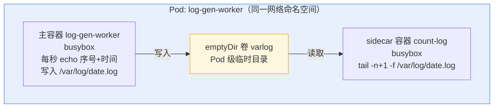

# 59. Sidecar 与 Worker 组件、K8s-Object 多集群交付：多容器注入与原生资源实战

## 纲要

- **一个 Pod 可以跑多个容器**：KubeVela 的 `worker` 组件类型专门承载「多容器 Pod」——主容器处理后台任务，`sidecar` 运维特征再注入一个伴生容器，两者通过 **emptyDir 卷**共享目录，这就是「容器注入」
- **`worker` 与 `webservice` 的分界线**：`webservice` 需要对外提供服务接口（自动建 Service 暴露端口），`worker` 只处理后台任务、不对外暴露——选错类型会凭空多出一个没有流量的 Service
- **`k8s-objects` 组件 = 原生资源直通通道**：组件的 `properties.objects` 里直接写 K8s 原生 YAML（Deployment + Service），KubeVela 原样 apply，适合「存量原生 YAML 不想重写成 OAM 模型」的场景
- **多集群交付靠 `topology` 策略**：`clusters` 数组列多个集群、`namespace` 指定统一命名空间——一次定义，多处部署；`test-k8s` 这类集群要手动接入，`local` 是 KubeVela 安装时自带的托管集群
- **没写 `workflow` 就是默认单步部署**：不定义流水线时系统自动生成「部署一步完成」，适合一次性交付；要分批/灰度/审核，才需要显式写 workflow
- **验证三连**：`vela ls` 看应用列表、`vela status <app>` 看流水线状态、`kubectl get pods/deployment -n test-app` 看真实落地的负载

## 一、场景引入：一个 Pod 里的「干活的人」与「记账的人」

先想一个很常见的运维场景：你有一个 Go 写的后台任务程序，每秒往日志文件里写一行「序号 + 时间戳」。业务本身不需要对外提供 HTTP 接口，但运维同学要求「日志必须实时可见」——最直观的做法是再跑一个 `tail -f` 的小容器，两个容器挂在同一个日志目录上。

在原生 K8s 里，这要手写 Deployment 的 `spec.template.spec.containers` 列表 + `volumes` 共享，几十行 YAML 容易写错。而在 KubeVela 里，这就是**一个 `worker` 组件 + 一个 `sidecar` 运维特征**的事——组件负责「主容器干业务」，运维特征负责「旁路容器看日志」，声明式写完，KubeVela 自动组装成多容器 Pod。

这就是本篇上半要讲的 **Sidecar 与 Worker**：同一个 Pod 内多容器协作的标准姿势。

下半讲另一个高频诉求：**把应用部署到多个集群**。很多公司有「测试集群 + 生产集群」或「杭州集群 + 北京集群」，同一套应用要在多处落地。KubeVela 的答案是 `k8s-objects` 组件（直接写原生资源）+ `topology` 策略（声明集群列表）——本篇用 `object.yaml` 走完全程。

## 二、核心概念与原理

### 2.1 `worker` vs `webservice`：先分清「对外」与「对内」

KubeVela 的组件类型决定了「这个负载在 K8s 里长成什么样」。课程至此已涉及四种：

| 组件类型 | 用途 | 是否对外暴露 | 典型落地 |
| --- | --- | --- | --- |
| `webservice` | 需要对外提供 HTTP 服务的应用 | **是**——自动创建 Service + 可选 Ingress/Gateway | Deployment + Service |
| `worker` | 后台任务、定时任务、日志处理 | **否**——不建 Service | 多容器 Deployment |
| `k8s-objects` | 直接使用 K8s 原生资源定义 | 取决于你写的原生 YAML | 原样 apply 的任意资源 |
| `gateway` | 统一入口、域名路由（前面简述） | **是**——网关资源 | Ingress/ALB 等 |

**选型口诀：有流量入口选 `webservice`，纯后台选 `worker`，存量原生 YAML 不想重构选 `k8s-objects`。** 把后台任务错选成 `webservice` 的后果：KubeVela 会贴心帮你建一个 Service——没有后端端口可指，或者指了个没人监听的端口，纯属噪音。

### 2.2 Sidecar 容器注入原理：卷是容器间的「桥梁」

同一个 Pod 里的多个容器**共享网络命名空间，但文件系统默认互相隔离**。要让 `tail -f` 容器读到主容器写的日志，必须让两个容器挂载**同一个卷**：



三个关键点：

- **emptyDir 的生命周期 = Pod 的生命周期**：Pod 创建时建、删除时清，适合「容器间传文件」这类临时共享，不适合持久化数据（要持久化得用 PVC，那是另一主题）；
- **sidecar 是运维特征（trait），不是组件**：它寄生在某个组件的 Pod 里，不能独立存在——所以定义位置在 `components[].traits` 下；
- **主容器先挂载、sidecar 后注入**：组件 `properties.volumes` 声明卷，sidecar 的 `properties.volumes` 引用同名卷即可读到。

### 2.3 `k8s-objects`：原生资源的「原样直通」

课程对它的定义一句话说完：**使用 K8s 原生资源来定义 YAML，再把这个 YAML 部署到不同集群**。它的 `properties.objects` 是个数组，数组里每个元素就是一份完整的原生 K8s 资源清单（Deployment、Service、ConfigMap……随你写），KubeVela 不做 OAM 抽象、直接 apply。

适用边界要清醒：

- **适合**：存量原生 YAML 迁移、需要一次性创建多个互相引用的原生资源（如 Deployment + Service + ConfigMap 一套）、KubeVela 内置组件表达不了的资源；
- **不适合**：想用 `scaler`/`gateway`/`sidecar` 等运维特征增强的负载——原生对象不吃 OAM 特征体系，用了 `k8s-objects` 就回到「手写 YAML、自己管更新」的世界。

### 2.4 多集群交付：`topology` 策略声明「发去哪」

多集群的本质是**把「应用定义」与「部署目标」解耦**：应用只写一份，`topology` 策略里的 `clusters` 数组决定它复制到哪些集群：

| 集群来源 | 获取方式 | 说明 |
| --- | --- | --- |
| `local` | 安装 KubeVela 时自动注册 | 控制面所在的本地集群 |
| `test-k8s` | **手动接入**（`vela cluster join` 或 UI 添加） | 需要 kubeconfig；课程演示用同一份 kubeconfig 注册出第二个集群名来模拟多集群 |

**课程给的单集群模拟技巧**：只有一套集群时，把同一份 kubeconfig 以不同名字注册两次，就能得到 `local` 和 `test-k8s` 两个「集群」，多集群效果照样能演示；真实多集群环境则各集群各一份 kubeconfig。

没有定义 `workflow` 时，系统默认生成**单步部署**：直接按 `topology` 策略把组件 apply 到目标集群——课程 object.yaml 走的就是这条路。

## 三、动手实践

### 3.1 `sidecar.yaml`：完整代码与逐字段拆解

先看主程序——`log-gen-worker` 组件，类型 `worker`，busybox 死循环写日志：

```yaml
apiVersion: core.oam.dev/v1beta1
kind: Application
metadata:
  name: vela-app-with-sidecar
  namespace: test-app
spec:
  components:
    - name: log-gen-worker
      type: worker
      properties:
        image: busybox
        cmd:
          - /bin/sh
          - -c
          - >
            i=0;
            while true;
            do
              echo "$i: $(date)" >> /var/log/date.log;
              i=$((i+1));
              sleep 1;
            done
        volumes:
          - name: varlog
            mountPath: /var/log
            type: emptyDir
      traits:
        - type: sidecar
          properties:
            name: count-log
            image: busybox
            cmd: [ /bin/sh, -c, 'tail -n+1 -f /var/log/date.log']
            volumes:
              - name: varlog
                path: /var/log
```

| 字段路径 | 值 | 作用 |
| --- | --- | --- |
| `metadata.name` | `vela-app-with-sidecar` | Application 资源名，控制台列表所见 |
| `metadata.namespace` | `test-app` | Application CR 所在命名空间（管理面） |
| `components[0].name` | `log-gen-worker` | 组件名，后续 `vela status` 定位用 |
| `components[0].type` | `worker` | **关键选型**：后台任务，不对外建 Service |
| `properties.image` | `busybox` | 主容器镜像 |
| `properties.cmd` | 多行 shell | 初始化 `i=0` → 循环 echo「序号: 时间」追加写 `/var/log/date.log` → 自增 → `sleep 1` |
| `properties.volumes[0]` | `varlog` / `/var/log` / `emptyDir` | 主容器挂载点：声明 Pod 级临时卷并挂到 `/var/log` |
| `traits[0].type` | `sidecar` | 容器注入：在**同一 Pod** 里再加一个容器 |
| `traits[0].properties.name` | `count-log` | 注入容器的名字 |
| `traits[0].properties.cmd` | `tail -n+1 -f /var/log/date.log` | 从第 1 行开始持续跟踪日志文件 |
| `traits[0].properties.volumes[0]` | `varlog` / `/var/log` | **与主容器同名同路径**——注入容器挂同一个卷，这才读得到日志 |

### 3.2 部署与验证：三条命令看三层真相

```bash
# 1) 部署应用
vela up -f sidecar.yaml -n test-app

# 2) 看应用与组件状态（vela ls 输出应用名/组件名/类型/TYPE/健康状态）
vela ls -n test-app

# 3) 落到 K8s 层看 Pod 里的真实容器数
kubectl get pods -n test-app
```

课程实测路径：部署后 `vela ls` 能看到应用名 `vela-app-with-sidecar`、组件名 `log-gen-worker`、类型 `worker`（TRAITS 列可见 `sidecar`）、STATUS 最终转 `healthy`；`kubectl get pods` 能看到 Pod 从 `0/2`（两个容器都没就绪）走到 `2/2 Running`——**READY 列的 `2` 就是「一个 Pod 两个容器」的直接证据**。想眼见为实，进 sidecar 容器看输出：

```bash
kubectl logs -n test-app $POD_NAME -c count-log
# 预期持续输出：0: Wed Oct 14 ... / 1: ... / 2: ...
```

### 3.3 `object.yaml`：原生资源 + 多集群交付

第二个文件把「原生资源直通」和「多集群」一次讲全：

```yaml
apiVersion: core.oam.dev/v1beta1
kind: Application
metadata:
  name: app-with-k8s-objects
  namespace: test-app
spec:
  components:
    - name: k8s-demo-service
      type: k8s-objects
      properties:
        objects:
          - apiVersion: apps/v1
            kind: Deployment
            metadata:
              name: nginx-object 
            spec:
              replicas: 2
              selector:
                matchLabels:
                  app: nginx
              template:
                metadata:
                  labels:
                    app: nginx
                spec:
                  containers:
                    - image: nginx
                      name: nginx
                      ports:
                        - containerPort: 80
          - apiVersion: v1
            kind: Service
            metadata:
              labels:
                app: nginx
              name: nginx-object
            spec:
              ports:
                - name: http
                  port: 80
                  protocol: TCP
                  targetPort: 80
              selector:
                app: nginx
  policies:
    - name: topology-hangzhou-clusters
      type: topology
      properties:
        clusters: ["test-k8s", "local"]
        namespace: test-app
```

| 字段路径 | 值 | 作用 |
| --- | --- | --- |
| `components[0].type` | `k8s-objects` | 声明「以下 objects 是原生资源，原样 apply」 |
| `properties.objects[0]` | `apps/v1 Deployment` | 原生 Deployment：2 副本、nginx 镜像、containerPort 80——**和你手写的一模一样，没有 OAM 包装** |
| `properties.objects[1]` | `v1 Service` | 原生 Service：80 → 80，selector `app: nginx` 与 Deployment 标签对上 |
| `policies[0].type` | `topology` | 部署拓扑策略：决定「发到哪些集群、哪个命名空间」 |
| `policies[0].properties.clusters` | `["test-k8s","local"]` | **多集群核心字段**：一次定义、两处落地 |
| `policies[0].properties.namespace` | `test-app` | 目标集群上的统一命名空间 |
| （无 `workflow`） | — | 省略 workflow 时默认单步部署，直接按策略 apply |

部署与验证：

```bash
# 部署（课程强调：test-k8s 需提前接入；单集群可复用同一 kubeconfig 注册第二个集群名）
vela up -f object.yaml -n test-app

# 应用列表与流水线状态
vela ls -n test-app
vela status app-with-k8s-objects -n test-app

# K8s 层确认原生资源真的在两个集群/命名空间里
kubectl get deployment -n test-app        # 预期看到 nginx-object，READY 2/2
kubectl get svc -n test-app               # 预期看到 nginx-object
```

课程实测：`vela status` 显示流水线（pipeline）正常、状态 healthy；`kubectl get deployment` 确认 `nginx-object` 2 副本就位——**证明 `k8s-objects` 的内容是「原汁原味」落地的，没有被 OAM 改写**。

## 四、生产实践要点

1. **sidecar 卷必须「同名同路径」**：主容器声明 `varlog:/var/log`，sidecar 引用 `varlog:/var/log`。名字错配的报错很隐蔽（Pod 起不来但 Application 显示 progressing），排查时先 `kubectl describe pod` 看事件。
2. **sidecar 适合日志/监控/代理注入，不适合业务耦合**：sidecar 与主容器**同生共死**，主容器挂了 sidecar 也退；把有状态业务写进 sidecar 会拖垮整个 Pod 的可用性。
3. **`worker` 的伸缩用 `scaler` 特征**：`worker` 组件同样支持 `traits: [{type: scaler,properties: {replicas: N}}]`，别因为「不对外」就忘了副本数。
4. **多集群先解决网络与凭据，再谈交付**：`topology` 只管「往哪 apply」，不管「集群间是否互通、kubeconfig 是否过期」。生产多集群建议：kubeconfig 用 Secret 托管、定期轮换；跨集群网络（Pod CIDR 互通）提前规划。
5. **`k8s-objects` 与 OAM 特征不要混用幻想**：选了原生对象，`scaler`/`gateway`/`sidecar` 这些特征都用不上；要「原生起步、逐步 OAM 化」，正确路径是先把资源托管（下面讲 `vela adopt`），再迁移到 `webservice`。
6. **命名空间分层管理**：Application CR 在 `test-app`（管理面），业务负载也在 `test-app`（业务面）——课程演示是同一命名空间；生产建议管理面与业务面分离，删除应用时的级联影响面更可控。

## 五、报错排查表

| 现象 | 根因 | 解法 |
| --- | --- | --- |
| `kubectl get pods` 显示 Pod 存在但 READY `0/2` | sidecar 容器未就绪：卷名错配或 `tail` 目标文件还没生成 | 核对 `volumes[].name` 两边一致；确认主容器已启动并创建 `/var/log/date.log` |
| 应用部署成功但 KubeVela 控制台搜不到 | 该应用是直接 `kubectl apply` 创建的，**从未被 KubeVela 纳管** | 用 `vela adopt` 托管（见下面），或统一走 `vela up` 交付 |
| `vela up` 报集群不存在 | `topology.clusters` 里的集群名未注册（如 `test-k8s`） | 先 `vela cluster join <name> --kubeconfig-path <file>`；单集群可复用同一 kubeconfig 注册第二个名字 |
| `k8s-objects` 部署后资源没出现 | 原生 YAML 字段写错（如 selector 与 template 标签不匹配）被 K8s 静默拒绝或报错 | `kubectl describe` 看 Events；`k8s-objects` 的内容按原生规范逐字段校对 |
| `vela status` 一直 progressing 不 healthy | 默认单步部署卡住：常见于镜像拉取失败或副本数不满足 | `kubectl get pods` 看 CrashLoop/ImagePull；修镜像或资源后重新 `vela up` |
| 删除应用时提示命名空间为空 | 跨命名空间操作未指定 `-n`（课程在托管删除环节专门踩过） | 所有 `vela`/`kubectl` 命令显式带 `-n test-app`，不依赖 default |

## 六、面试考点与追问

**Q1：`worker` 和 `webservice` 组件类型的区别？选型依据是什么？**
A：`webservice` 用于需要对外提供 HTTP 服务的应用，KubeVela 会自动创建 Service（并可配 gateway/ingress）暴露端口；`worker` 用于后台任务，不对外暴露、不建 Service。依据就一条：**这个负载有没有流量入口**。

**Q2：KubeVela 里怎么实现「一个 Pod 多容器」？**
A：用 `worker`（或 `webservice`）组件 + `sidecar` 运维特征。sidecar 定义在组件的 `traits` 下，通过**同名卷**与主容器共享文件系统，典型场景是日志收集、监控代理、流量代理注入。

**Q3：sidecar 容器与主容器的生命周期关系？**
A：同 Pod 同生共死。Pod 调度到节点后两个容器共享网络命名空间（可 localhost 互访）、各自独立文件系统（靠卷共享），任一个容器异常退出都会拉低 Pod 的 READY 计数。

**Q4：`k8s-objects` 组件与 `webservice` 的本质差异？**
A：`webservice` 是 OAM 抽象模型——KubeVela 按组件规范生成 Deployment/Service 并支持运维特征增强；`k8s-objects` 是原生资源直通——`properties.objects` 里写什么就 apply 什么，适合存量 YAML，但用不了 OAM 特征体系。

**Q5：`topology` 策略的作用？多集群交付的最小配置是什么？**
A：`topology` 声明应用部署的目标集群（`clusters` 数组）与命名空间（`namespace`）。最小配置就是一个 `type: topology` 的策略 + `clusters: ["集群A","集群B"]`；集群需提前注册，否则 `vela up` 报集群不存在。

**Q6：不写 `workflow` 时 KubeVela 怎么部署？**
A：系统生成默认单步部署——直接按策略把组件 apply 到目标集群，适合一次性交付。需要灰度、暂停审核、条件分支时才显式定义 workflow（下面展开）。

**Q7：单集群环境如何演练多集群交付？**
A：把同一份 kubeconfig 以不同集群名注册两次（如 `local` 与 `test-k8s`），即可在拓扑策略里声明两个「集群」；真实多集群环境则各集群一份 kubeconfig，注意先打通网络与凭据。

## 📎 文本↔代码关联

| 代码文件 | 正文提及 | 内容 |
| --- | --- | --- |
| `code/8-Kubevela/sidecar.yaml` | 3.1/3.2 节完整引用 | `worker` 组件 + `sidecar` 特征：主容器死循环写 `/var/log/date.log`，伴生容器 `tail -f` 同卷读取 |
| `code/8-Kubevela/object.yaml` | 2.3/3.3 节完整引用 | `k8s-objects` 组件：原生 Deployment（nginx-object，2 副本）+ Service，`topology` 策略声明 `test-k8s`/`local` 双集群 |
| `code/8-Kubevela/step-group.yaml` | 2.4 节顺带提及、下篇主角 | 三个 webservice + `step-group` 并行步骤（本篇未展开，详见 `if-and-timeout` 与工作流篇） |

**技术点总结**：本篇拿下了 KubeVela 交付模型的最后两块拼图——**Sidecar 容器注入**让一个 Pod 内容纳「干活的 + 看场的」多容器协作，`worker` 组件明确标记「不对外」的后台负载；**`k8s-objects` + `topology`** 打通「原生资源原样交付 + 多集群一次定义多处落地」。至此 webservice / worker / k8s-objects / gateway 四大组件类型全部亮相，组件选型的口诀可以固化为：**有对外入口选 webservice、纯后台选 worker、存量原生 YAML 选 k8s-objects、统一域名入口配 gateway**。多集群不是玄学，本质是「应用定义与部署目标解耦」——先注册集群，再在 topology 里列名字，交付动作交给默认单步或显式 workflow。

