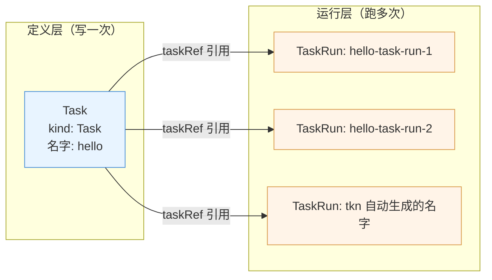
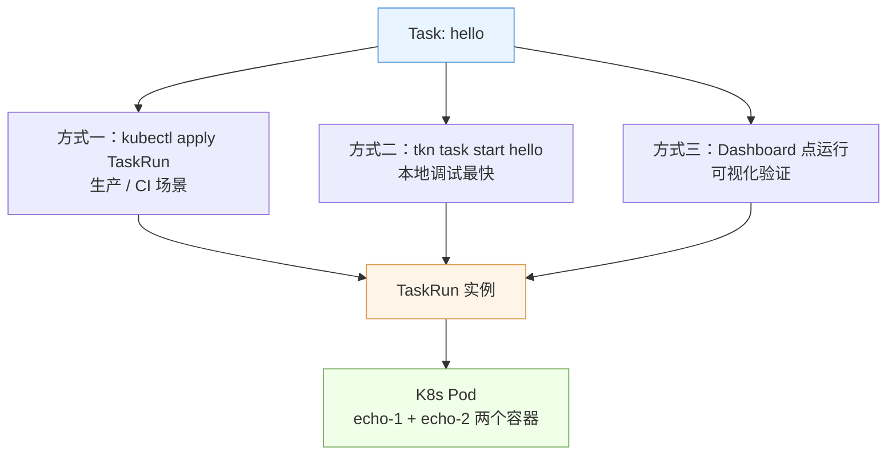
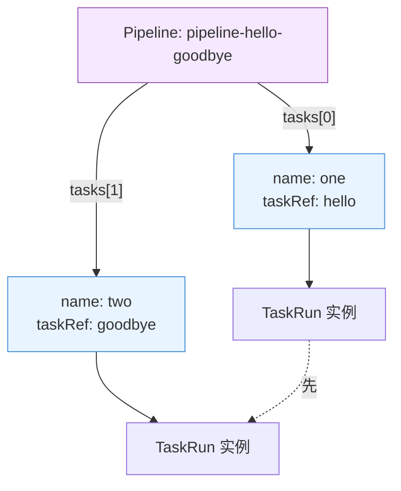

# Tekton Task 实战：三种运行方式、多容器 Step 与 TaskRun 唯一名陷阱

## 纲要

- **Task 与 TaskRun 的关系**：`Task` 是"做什么"的模板（类似函数定义），`TaskRun` 是"跑一次"的实例（类似函数调用），一个 Task 可以被无限次 TaskRun 引用
- **三种运行方式全掌握**：`kubectl apply` 声明式创建 TaskRun、`tkn` 命令行一键启动、Dashboard 点按钮——调试用 `tkn`，生产用声明式
- **Task 里可以跑多个容器 Step**：`spec.steps` 是数组，每个 step 用不同镜像、不同脚本，按顺序执行
- **`script` 字段免去写 entrypoint 的麻烦**：Tekton 会把脚本注入容器执行，比 `command` + `args` 直观得多
- **最大的坑：TaskRun 的 name 必须唯一**：重复 `apply` 同名的 TaskRun，K8s 只会做配置比对而**不会重新执行**，必须改名才会跑新的
- **查看日志要区分单容器与多容器**：单容器 `kubectl logs`，多容器必须 `-c` 指定容器名，否则只能看到第一个 step 的输出

## 一、先建立模型：Task 是什么，TaskRun 是什么

新手看 Tekton 文档最容易懵的是一堆名词：`Task`、`TaskRun`、`Pipeline`、`PipelineRun`。其实只要类比成编程概念就通了：



- **`Task`**：一份可复用的执行模板，描述"用哪些镜像、按什么顺序、跑什么脚本"。它本身**不会被执行**，只是定义。
- **`TaskRun`**：Task 的一次具体运行，通过 `spec.taskRef.name` 指向要跑的 Task。每次调用都要**新建一个 TaskRun**。

这个设计和 K8s 的 `Deployment` → `ReplicaSet` → `Pod` 是同一套哲学：**声明模板，实例化运行**。

## 二、第一个 Task：一个 Task 里跑两个容器

课件里的 `hello-task.yaml` 是最好的入门样本：

```yaml
apiVersion: tekton.dev/v1beta1
kind: Task
metadata:
  name: hello
spec:
  steps:
    - name: echo-1
      image: alpine
      script: |
        #!/bin/sh
        echo "Hello alpine"
    - name: echo-2
      image: alpine
      script: |
        #!/bin/sh
        echo "Hello alpine:3.16"
```

**逐字段拆解：**

| 字段 | 值 | 含义 |
| --- | --- | --- |
| `apiVersion` | `tekton.dev/v1beta1` | Tekton 的 CRD 组与版本 |
| `kind` | `Task` | 资源类型是 Task（不是 Deployment/Pod） |
| `metadata.name` | `hello` | Task 的名字，后续 TaskRun 靠这个名字引用它 |
| `spec.steps` | 数组 | **步骤列表，按数组顺序串行执行** |
| `steps[].name` | `echo-1` / `echo-2` | step 名字，会成为 Pod 里的容器名 |
| `steps[].image` | `alpine` | 该 step 使用哪个镜像 |
| `steps[].script` | 多行字符串 | 要执行的脚本，**必须以 `#!` 指定解释器** |

**两个关键设计：**

**① 每个 step 是一个独立容器。** 这个 Task 跑起来时，Tekton 会创建一个 Pod，Pod 里有两个容器 `echo-1` 和 `echo-2`，按顺序执行。容器之间**不共享文件系统**（除非显式挂 volume），这是 Tekton 与 Jenkins 的本质差异——Jenkins 的步骤共享同一个工作空间，Tekton 的步骤默认隔离。

**② `script` 是 Tekton 的语法糖。** 你不需要写：

```yaml
# 不推荐：啰嗦且容易错
command: ["/bin/sh"]
args: ["-c", "echo \"Hello alpine\""]
```

直接给 `script` 字段，Tekton 自动处理解释器注入。**注意脚本第一行必须写 shebang**（`#!/bin/sh` 或 `#!/bin/bash`），否则 Tekton 不知道用哪个解释器。

再看 `goodby-task.yaml`，它演示了另一个常用字段：

```yaml
apiVersion: tekton.dev/v1beta1
kind: Task
metadata:
  name: goodbye
spec:
  steps:
    - name: goodbye
      image: ubuntu
      imagePullPolicy: IfNotPresent
      script: |
        #!/bin/bash
        echo "Goodbye goodby"
```

`imagePullPolicy: IfNotPresent` 表示**节点上已有该镜像就不重新拉取**，能显著加快调试速度。生产环境如果镜像 tag 是浮动的（如 `latest`），则应该用 `Always`。

## 三、创建 Task 并跑起来：三种方式全解

### 方式一：声明式创建 TaskRun（生产标准）

写一个 `TaskRun`，用 `taskRef` 引用上面的 Task：

```yaml
apiVersion: tekton.dev/v1beta1
kind: TaskRun
metadata:
  name: hello-task-run-2
spec:
  taskRef:
    name: hello
```

执行：

```bash
kubectl apply -f task/hello-task.yaml
kubectl apply -f taskrun/hello-taskrun.yaml
```

然后用 `get taskrun` 看状态：

```bash
kubectl get taskrun
```

输出类似：

```text
NAME               SUCCEEDED   REASON
hello-task-run-2   True        Succeeded
```

### 方式二：tkn 命令行（调试最快）

不想写 YAML 的时候，`tkn` 一条命令直接起：

```bash
# 启动 Task，tkn 会自动创建 TaskRun（名字自动生成）
tkn task start hello

# 查看所有 TaskRun 历史
tkn taskrun list

# 跟踪查看某个 TaskRun 的实时日志
tkn taskrun logs hello-task-run-2 -f -n default
```

`tkn task start hello` 背后做的事就是：自动生成一个 TaskRun → apply → 返回名字。**调试阶段用它最省事**，不用每次手写 YAML。

### 方式三：Dashboard 点按钮（最直观）

Tekton Dashboard 里进入 Task 列表，点 `hello` 右侧的运行按钮：

1. 类型保持 `Task`；
2. 命名空间默认 `default`；
3. 要调用的 Task 选 `hello`；
4. 想自定义 TaskRun 名字就填，不填则自动生成；
5. 点创建。

创建后可以看到 TaskRun 状态从 `Pending` → `Running` → `Succeeded`，右侧支持重新运行、编辑、删除。



## 四、看日志：单容器与多容器的区别

这是新手第二个高频坑。上面的 `hello` Task 有**两个 step（两个容器）**，直接 `kubectl logs` 只会看到第一个：

```bash
# 只看得到 echo-1 的输出
kubectl logs hello-task-run-2-pod
```

想看第二个 step 的输出，必须用 `-c` 指定容器名（容器名就是 step 的 `name`）：

```bash
# -c 指定容器名，-f 实时跟踪
kubectl logs -f hello-task-run-2-pod -c echo-2
```

用 `tkn` 则更省心，它会自动列出所有容器供你选：

```bash
tkn taskrun logs hello-task-run-2 -f -n default
```

如果 Task 只有一个 step，三种方式都能看到全部输出，所以这个坑只在多 step 场景暴露。

## 五、最大的坑：TaskRun 的 name 必须唯一

课件里专门演示了这个陷阱，值得每个新手记牢。

**现象**：你把 `hello-taskrun.yaml` 改都不改再 `kubectl apply` 一次，然后 `get taskrun` 会发现——**没有任何变化，没有新的运行**。

**原因**：`TaskRun` 是 K8s 的一个**具名资源**。重复 apply 同名资源，K8s 的行为是"配置比对"，发现 spec 完全一致，就什么都不做。**它不会因为你 apply 了同一个对象就重新执行一次。**

**验证一下**：把名字改成 `hello-task-run-3` 再 apply：

```yaml
apiVersion: tekton.dev/v1beta1
kind: TaskRun
metadata:
  name: hello-task-run-3   # ← 改这里
spec:
  taskRef:
    name: hello
```

这次 `get taskrun` 会立刻看到一条新记录，状态从 `Pending` 开始跑。

**结论与最佳实践：**

| 场景 | 推荐做法 |
| --- | --- |
| 手动调试 | 用 `tkn task start`，名字自动生成，永不存在冲突 |
| CI 流水线里 | 用 `tkn task start` 或让 TaskRun 名带 `${BUILD_ID}`，保证唯一 |
| 声明式 GitOps | 名字带版本号或 commit hash，如 `hello-task-run-${GIT_COMMIT}` |

> **记住这句话**：TaskRun 是一次性资源，名字复用 = 不执行。

## 六、从 Task 到 Pipeline：下一步

单个 Task 只解决"一个动作"。真实 CI 要把多个 Task 串起来，这就轮到 `Pipeline` 出场。课件里的 `pipeline1-hello-goodby.yaml` 就是最小示例：

```yaml
apiVersion: tekton.dev/v1beta1
kind: Pipeline
metadata:
  name: pipeline-hello-goodbye
spec:
  tasks:
    - name: one
      taskRef:
        name: hello
    - name: two
      taskRef:
        name: goodbye
```

它定义了"先跑 `hello`，再跑 `goodbye`"。注意这里的层级关系：



- **Pipeline 的 `tasks[].name`** 是 Pipeline 内部对这个步骤的称呼；
- **`taskRef.name`** 才是真正被调用的 Task 名字；
- Pipeline 要跑起来同样需要 `PipelineRun`（和 Task → TaskRun 一一对应）。

后续章节会展开 `taskRef` / `taskSpec` / `pipelineRef` / `pipelineSpec` 四种组合方式，以及 `runAfter`、`when`、`retries` 等流程控制。

## 七、常见报错与排查

| 现象 | 根因 | 解法 |
| --- | --- | --- |
| `taskrun.tekton.dev "x" not found` | TaskRun 还没创建或名字打错 | `kubectl get taskrun` 核对名字 |
| 重复 apply 后没有新运行 | TaskRun 名字复用 | 改名字，或改用 `tkn task start` |
| 日志只看到一个 step 的输出 | 多容器 Pod 未指定 `-c` | `kubectl logs <pod> -c <step-name>` |
| step 报 `exec format error` | `script` 缺 shebang 或镜像架构不匹配 | 补 `#!/bin/sh`，检查镜像 arch |
| Pod 卡在 `Pending` | 镜像拉取失败或资源不足 | `kubectl describe pod` 看 Events |
| `script` 里的变量没展开 | 用了单引号包裹 shell 变量 |  Tekton 不做 shell 展开，需在容器内自行处理 |

## 八、面试考点与追问

**Q1：Tekton 的 Task 和 Jenkins 的 stage 有什么本质区别？**
Jenkins 的 stage 是同一个 Job 内的逻辑分段，所有 step 共享工作空间和上下文；Tekton 的 Task 是**独立的 K8s 资源**，每个 step 是独立容器、默认不共享文件系统，Task 之间通过 workspace（volume）和 results 显式传数据。这是"K8s 原生"与"单体 CI 服务器"的设计分野。

**Q2：Task 和 TaskRun 为什么要拆成两个资源？**
解耦"定义"与"运行"。Task 定义一次可被无数 TaskRun 引用，符合 K8s 声明式模型；同时运行实例有独立的状态、日志和生命周期，便于观测和清理。

**Q3：重复 apply 同一个 TaskRun 会发生什么？为什么？**
什么都不会发生。TaskRun 是具名资源，K8s 对同名资源的重复 apply 只做配置比对，spec 无差异则不动作。想要重新执行必须换名字——这也是 CI 里要给 TaskRun 名加唯一后缀的原因。

**Q4：多 step 的 Task 怎么看某个 step 的日志？**
`kubectl logs <pod-name> -c <step-name> -f`，其中 step-name 就是 `spec.steps[].name`。或用 `tkn taskrun logs <taskrun-name> -f` 交互选择。

**Q5：`script` 和 `command`+`args` 该怎么选？**
简单脚本用 `script`，Tekton 自动注入解释器，可读性好；需要精细控制 entrypoint、参数数组、环境变量展开时用 `command` + `args`。

## 📎 文本↔代码关联

本篇对应课件源码（`code/6-Tekton/`，已做去品牌化处理）：

| 代码文件 | 正文提及 | 内容 |
| --- | --- | --- |
| `code/6-Tekton/task/hello-task.yaml` | 多处 | 两 step 多容器 Task，`alpine` 镜像 + `script` 字段 |
| `code/6-Tekton/task/goodby-task.yaml` | 第六节 | `ubuntu` 镜像 + `imagePullPolicy: IfNotPresent` 示例 |
| `code/6-Tekton/taskrun/hello-taskrun.yaml` | 多处 | `taskRef` 引用 Task 的最小 TaskRun |
| `code/6-Tekton/pipeline/pipeline1-hello-goodby.yaml` | 第六节 | hello → goodbye 两阶段 Pipeline 最小示例 |

**技术点总结**：Tekton 把"执行模板"（Task）与"一次运行"（TaskRun）拆成两个 CRD，用 `taskRef` 关联；三种运行方式中 `tkn task start` 最适合调试、声明式 TaskRun 适合生产；两个必记的坑是**TaskRun 名字必须唯一**（复用即不执行）和**多容器日志必须 `-c` 指定 step 名**。

相关度：96%。是否需要继续：[是]。代码是否可运行：[是]。
