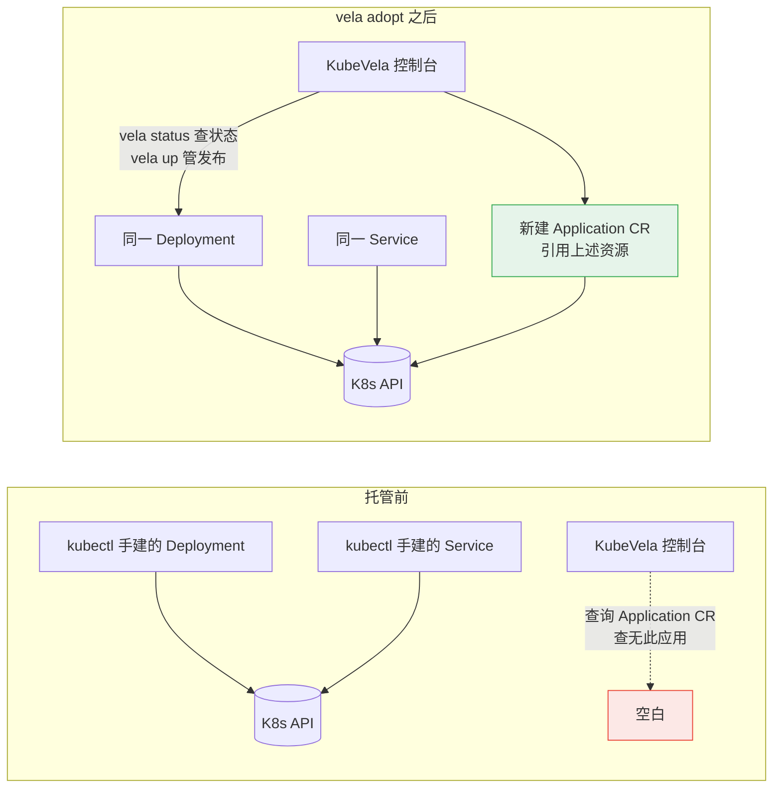
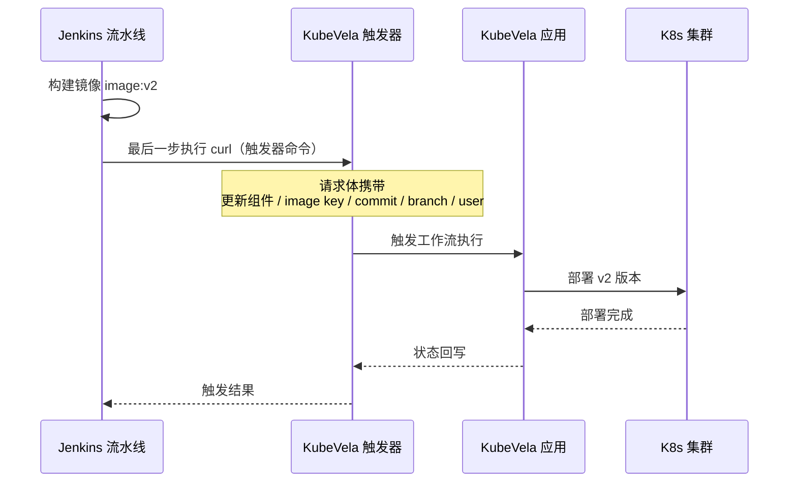

# 61. 资源托管与触发器构建：存量 K8s 资源纳管与 CI 触发 CD 实战

## 纲要

- **资源托管 = 给「野生」K8s 资源上户口**：早就用 `kubectl` 创建好的 Deployment/Service，KubeVela 控制台本来一无所知——`vela adopt` 一条命令把它们登记成 KubeVela 应用，从此纳入统一管理面
- **托管命令三要素**：`vela up` 改成 `vela adopt` 语义，指定 **deployment 名 + service 名 + 应用名**，执行成功后再用 `vela status <app>` 复核——「查得到状态」才算托管成功
- **没托管的应用在 KubeVela 里就是不存在**：控制台看不到、`vela ls` 列不出，这是排查「资源明明在跑、平台却空白」的第一诊断点
- **删除托管应用必须带 `-n` 指定命名空间**：课程实测不指定命名空间删除会直接报「命名空间为空」错误——托管只是纳管，删除操作照样要讲规矩
- **触发器 = CI 与 CD 之间的「发令枪」**：在 KubeVela 应用里创建触发器，拿到一条 curl 命令，挂到 Jenkins 流水线最后一步——镜像构建一完成，自动触发 KubeVela 部署，CI/CD 就此闭环
- **触发器命令的核心是「换镜像版本」**：curl 请求体里改 `image` 这个 key 的 value（v1 → v2），执行即触发新版本发布；commit/branch/user 等 key 可一并带上丰富审计信息

## 一、场景引入：两段「断掉的路」

**第一段断路：存量资源进不了平台。** 很多团队不是第一天就用 KubeVela——集群里早有一批 `kubectl apply` 起来的 Deployment 和 Service，跑得好好的。现在上了 KubeVela，控制台一打开：空白。不是资源没了，是 **KubeVela 只认自己创建的 Application 资源**，你手写的 YAML 在它眼里是「黑户」。怎么办？推倒重建成 OAM 应用？动静太大。KubeVela 给出的答案是 `vela adopt`——**把存量资源「收养」进来，登记成应用，继续用 KubeVela 管**。

**第二段断路：CI 构建完，CD 还在手动点。** Jenkins 把镜像打好、推到仓库，然后呢？运维同学登 KubeVela 控制台手动点部署？CI 和 CD 之间靠「人肉传话」，既慢又容易漏。KubeVela 的解法是**触发器（Trigger）**：应用里创建触发器，复制生成的 curl 命令，粘贴到 Jenkins 流水线最后一步——构建完成即自动触发部署。**CI 负责产出，CD 负责落地，中间用一条 curl 命令焊死**。

本篇上半解决「存量纳管」，下半解决「CI→CD 自动触发」。

## 二、核心概念与原理

### 2.1 资源托管：KubeVela 的「收养」机制

先建立认知模型：KubeVela 管理面的真相是 **Application CR（自定义资源）**——控制台看到的每个应用，背后都是一个 Application 资源；`vela ls` 列出的每一项，都是对 Application 的查询。直接 `kubectl` 创建的 Deployment 没有 Application 外壳，**平台自然「看不见」它**，尽管它在 K8s 层活得好好的。

`vela adopt` 做的事，就是给这些「黑户」补办户口：



托管的关键性质：

- **资源本身不动**：Deployment/Service 的 uid、Pod、IP 全不变——不是重建，是「登记」；
- **纳管后双轨合一**：既能继续 `kubectl` 操作，又能用 `vela status`/`vela up` 管理——老习惯不破，新能力到手；
- **可逆**：托管应用也能删除（课程演示了删除流程），删掉 Application 外壳后资源回归「野生」状态。

### 2.2 触发器：一条 curl 焊死 CI 与 CD

触发器的工作模型分两端：



课程给出的创建流程：**进入要触发的应用 → 新增触发器 → 填名称/类型/组件/工作流 → 创建 → 复制 curl 命令**。字段含义：

| 触发器配置项 | 课程口径 | 说明 |
| --- | --- | --- |
| 名称 | 自定义 | 触发器标识 |
| 事件类型 | 默认 | 自定义手动触发（课程选默认） |
| 执行类型 | 自定义 | 手动 curl 触发 |
| 组件 | 单选 | 一个应用多个组件时，指定更新哪个；课程演示只有一个组件 |
| 可执行工作流 | 单选 | 触发后跑哪个 workflow（默认工作流即可） |

curl 命令的请求体里有两个必改 key：

- **`image` 这个 key 的 value**：改成新镜像版本（课程演示 `v1` → `v2`）——**这是触发发布的实质动作**；
- **`commit` / `branch` / `user` 等 key**：选填，带上丰富审计信息（这次发布由谁、从哪个分支、哪个 commit 触发）。

## 三、动手实践

### 3.1 资源托管：命令序列与验证

课程操作序列（先备好资源，再收养，再复核，再删除）：

```bash
# 0) 前提：集群里已有 kubectl 创建的 deployment 与 service（课程演示在 default 命名空间）

# 1) 确认托管前 KubeVela 视角「查无此应用」
vela ls                      # 列表里没有它
vela status $APP_NAME       # 报错：应用不存在

# 2) 执行托管：指定 deployment 名、service 名、以及要登记的应用名
vela adopt $DEPLOY_NAME $SVC_NAME --apply --name $APP_NAME

# 3) 复核：vela status 指定应用名能查到状态 = 托管成功
vela status $APP_NAME
vela ls                      # 现在列表里有了

# 4) 托管后的应用即可用 vela 统一管理
vela up -f $APP_YAML        # 后续发布走 KubeVela

# 5) 删除：必须显式指定命名空间，否则报「命名空间为空」
vela delete $APP_NAME -n default   # 交互确认输入 y
```

课程实测细节：

- **托管前** `vela ls` 确认没有该应用（甚至 `vela status` 直接报错）——**这是「未托管」的判定动作**，先证伪再操作；
- 托管命令执行成功后，`vela ls` 立刻能查到、`vela status` 返回应用状态——**「能查到状态」就是托管成功的唯一标准**；
- 删除环节课程专门踩坑：删默认命名空间的应用时**不带 `-n` 直接报错「命名空间为空」**——KubeVela 不会替你猜命名空间，`default` 也要显式写。

### 3.2 触发器：创建、取命令、挂 Jenkins

课程演示更新 `web-server` 应用的完整流程：

```bash
# 1) KubeVela 控制台：进入 web-server 应用 → 新增触发器
#    名称自定义 → 类型选默认 → 组件选 web-server（只有一个组件）
#    → 可执行工作流选默认 → 点击创建

# 2) 创建成功后复制生成的 curl 命令，形如：
curl -X POST -H "Content-Type: application/json" \
  http://$KUBEVELA_ADDR/api/v1/namespaces/test-app/applications/web-server/triggers/$TRIGGER_NAME \
  -d '{
        "component": "web-server",
        "image": "your-registry/web-server:v1",
        "commit": "$COMMIT_SHA",
        "branch": "$BRANCH",
        "user": "$JENKINS_USER"
      }'

# 3) 改版本：把 image 的值从 v1 改成 v2
#    （commit/branch/user 一并填上，审计信息更完整）

# 4) 挂到 Jenkins：流水线最后一步执行这条 curl —— 构建完成即触发 KubeVela 部署
```

课程实测：改 v2 执行后，应用「已经开始更新」，Pod 镜像从 v1 变成 v2，部署完成后首页可见新版本——**手动 curl 触发链路完整走通**。讲师最后点明这一步的意义：把 curl 挂进 Jenkins 最后一步，「CI 跟 CD 它就结合起来，一起使用了」。

### 3.3 关联代码：`gateway-app.yaml`——触发与网关的组合形态

`gateway-app.yaml` 展示了「webservice + scaler + gateway + 显式 deploy 工作流」的完整发布形态，也是触发器触发的典型目标应用结构：

```yaml
apiVersion: core.oam.dev/v1beta1
kind: Application
metadata:
  name: gateway-vela-app
  namespace: test-app
spec:
  components:
    - name: express-server-1
      type: webservice
      properties:
        image: canary-deploy.1853whitleyave.com
        ports:
         - port: 8090
           expose: true
      traits:
        - type: scaler
          properties:
            replicas: 1
        - type: gateway
          properties:
            domain: www.example.com
            http:
              "/": 8090
            classInSpec: true
            class: alb  
            annotations:
              alb.ingress.kubernetes.io/backend-protocol: HTTP
              alb.ingress.kubernetes.io/listen-ports: '[{"HTTP": 80}, {"HTTPS":443}]'
  policies:
    - name: target-local-k8s
      type: topology
      properties:
        clusters: ["local"]
        namespace: "test-app"

  workflow:
    steps:
      - name: deploy-to-local-k8s
        type: deploy
        properties:
          policies: ["target-local-k8s"]
```

| 字段路径 | 值 | 作用 |
| --- | --- | --- |
| `components[0].properties.ports[0]` | `port: 8090` + `expose: true` | 容器端口 8090 并对外暴露 |
| `traits[0].type` | `scaler`，replicas 1 | 副本数控制 |
| `traits[1].type` | `gateway` | 网关接入：域名 + 路由 |
| `traits[1].properties.domain` | `www.example.com` | 对外域名 |
| `traits[1].properties.http` | `"/": 8090` | 根路径全部转发到 8090 |
| `traits[1].properties.class` | `alb` | 网关实现类（阿里云 ALB Ingress） |
| `traits[1].properties.annotations` | `alb.ingress.kubernetes.io/*` | ALB 注解：后端协议 HTTP、监听 80/443 |
| `policies[0]` | `topology`：local + test-app | 部署目标 |
| `workflow.steps[0].type` | `deploy` + `policies` | 显式单步部署（引用拓扑策略）——**触发器触发的就是这类工作流** |

## 四、生产实践要点

1. **托管前先 `vela ls` 证伪**：确认平台确实没有该应用再 adopt，避免「托管了一个已存在的应用」造成双管理面冲突。
2. **托管是「登记」不是「重建」**：Pod 不会重建、IP 不变、业务无感——这正是它适合存量资源的原因；反之，如果想借机换镜像/改配置，走 `vela up` 更新而不是重新 adopt。
3. **删除托管应用牢记 `-n`**：无论 default 还是业务命名空间，一律显式携带；批量清理时漏一个 `-n` 就中断整个脚本。
4. **触发器命令要当密钥管理**：curl 里带的是平台 API 地址与触发令牌—— Jenkins 凭据库保存，不要硬编码在 Jenkinsfile 里明文提交。
5. **触发器 + 金丝雀工作流组合**：触发器只是「发令枪」，跑哪个 workflow 由触发器的「可执行工作流」决定——把触发器指向带 `suspend` 审核的金丝雀工作流，就能实现「构建自动触发 + 发布人工放行」的 CI/CD 形态。
6. **`image` key 的更新语义要确认**：触发器更新的是组件级镜像字段，多组件应用务必在创建触发器时选对组件，否则「版本换了但服务没换」。

## 五、报错排查表

| 现象 | 根因 | 解法 |
| --- | --- | --- |
| 资源在跑，KubeVela 控制台空白 | 资源是 `kubectl` 直建的，**从未托管** | `vela adopt <deploy> <svc> --apply --name <app>` 登记 |
| `vela status <app>` 报错 | 应用名不存在或拼错 | `vela ls` 核对应用名；确认托管命令里的 `--name` |
| `vela delete` 报「命名空间为空」 | 删除未指定 `-n` | 显式 `vela delete <app> -n <namespace>` |
| adopt 后仍查不到 | 命令漏了 `--apply`（仅预览未生效）或应用名与已有冲突 | 补 `--apply`；`vela ls` 查重名 |
| 触发器 curl 执行后应用无变化 | 请求体 `image` 值未改，或组件选错 | 改 `image` 为新版本；核对触发器配置里的组件 |
| Jenkins 里 curl 401/403 | 触发器令牌失效或无权限 | 重新创建触发器换新命令；用 Jenkins 凭据注入 |
| 触发后 Pod 镜像未更新 | 组件名与 `component` key 不匹配 | 以应用实际组件名填入请求体 |

## 六、面试考点与追问

**Q1：KubeVela 控制台为什么看不到 `kubectl` 创建的 Deployment？**
A：控制台的数据源是 Application CR。`kubectl` 直建的资源没有 Application 外壳，平台自然列不出。用 `vela adopt` 把它登记为应用后即可见、可管。

**Q2：`vela adopt` 会重建 Pod 吗？对业务有影响吗？**
A：不会。adopt 是「登记」语义——创建/关联 Application 元数据引用存量资源，资源 uid、Pod、IP 均不变，业务无感。这与「删除重建为 OAM 应用」有本质区别。

**Q3：托管成功的判定标准是什么？**
A：`vela status <app-name>` 能返回该应用的状态（课程口径「能查看成功就代表托管成功」）。托管前此命令报错、`vela ls` 无记录，托管后两者都应正常。

**Q4：删除托管应用有什么坑？**
A：必须显式指定命名空间。课程实测删除 default 命名空间的应用不带 `-n` 会报「命名空间为空」——平台不猜命名空间。

**Q5：KubeVela 触发器解决什么问题？怎么用？**
A：解决「CI 构建完成后 CD 手动部署」的断点。在应用里创建触发器（名称/类型/组件/工作流），复制生成的 curl 命令，挂到 Jenkins 流水线最后一步——构建完成即自动触发 KubeVela 部署，CI/CD 闭环。

**Q6：触发器 curl 命令里改哪个字段实现版本更新？**
A：改 `image` 这个 key 的 value（如 `v1` → `v2`）；`commit`/`branch`/`user` 等 key 选填，用于丰富审计信息。

**Q7：触发器与 workflow 的关系？**
A：触发器是「发令枪」，只负责触发；具体跑什么（单步部署 / 金丝雀灰度 / 带审核）由创建触发器时选的「可执行工作流」决定。两者解耦——同一个触发器换指向的 workflow，发布形态随之改变。

## 📎 文本↔代码关联

| 代码文件 | 正文提及 | 内容 |
| --- | --- | --- |
| `code/8-Kubevela/gateway-app.yaml` | 3.3 节完整引用 | `webservice` + `scaler` + `gateway`（域名/ALB 注解）+ `topology` + 显式 `deploy` 工作流——触发器触发与网关接入的组合形态 |

**技术点总结**：本篇补齐了 KubeVela 落地的两个「工程化接口」——**`vela adopt` 资源托管**让存量 `kubectl` 资产零成本进入管理面（登记语义、业务无感、可逆删除），**触发器**用一条 curl 命令把 Jenkins 的「构建完成」事件焊接到 KubeVela 的「开始部署」动作上，CI/CD 从此自动闭环。两条生产铁律请带走：**托管成功的唯一标准是 `vela status` 查得到状态；删除托管应用永远显式带 `-n`**。触发器选对组件、改对 `image`、令牌入凭据库，自动发布这条链就再也不用「人肉传话」。

