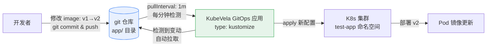
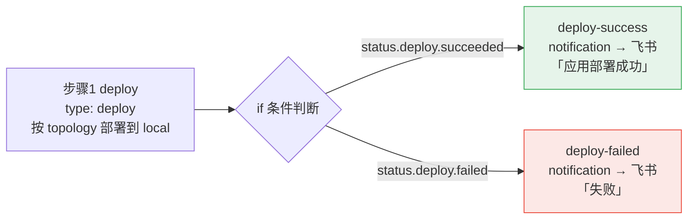

# 62. GitOps 部署、报警配置与角色权限分配：git 驱动交付与平台治理实战

## 纲要

- **GitOps 交付 = git 仓库即「事实源」**：应用 YAML 存进 git 仓库，KubeVela 用 `kustomize` 类型组件**每分钟轮询**仓库，一旦检测到文件变动（如镜像版本 v1 → v2）就自动拉取并部署——「提交代码即发布」
- **GitOps 应用是「双 YAML」结构**：一个 YAML（`gitops.yaml`）定义「监控哪个仓库/分支/路径」，仓库里的业务 YAML（课程演示 `helloworld.yaml`，内容即 `app-gitops.yaml` 的应用）才是真正被交付的应用——**监控者与被监控者分离**
- **私有仓库必须配 git Secret**：`secretRef` 指向同命名空间的 Secret（用户名/密码 base64 编码）——课程强调 Secret 与 GitOps 应用**必须在同一命名空间**，否则拉取直接失败
- **报警用 `notification` 步骤 + `if` 条件分支**：`deploy` 步骤之后挂两个通知步——`if: status.deploy.succeeded` 发飞书成功通知，`if: status.deploy.failed` 发失败通知；**条件不成立的步骤直接跳过**，不会误报
- **权限分两层**：平台角色（项目查看/配置管理/用户管理等平台级权限，管理面板配置）与项目角色（查看/管理员/开发，项目内配置）——**先建角色、再给用户分配**，两步缺一不可
- **LDAP 用户不能平台直建**：用 LDAP 单点登录时，平台角色只能等用户**首次登录后**再分配——「人先进来、权后到位」

## 一、场景引入：发布动作的「最后一公里」三种走法

到这一篇，KubeVela 的交付拼图只剩三块，但每一块都是生产刚需：

**第一块：GitOps。** 前面的交付都是「人推着走」——Jenkins 触发、手动 curl。GitOps 反过来：**把「期望状态」写进 git 仓库，平台自己盯着仓库，你只负责提交代码**。运维改版本 = 改 YAML 里的 image 字段 + git commit，一分钟内集群自动跟上。审计也顺便解决了——「谁、什么时候、改了什么」全在 git 历史里。

**第二块：报警。** 流水线跑完，成功失败总得有人知道。KubeVela 用 `notification` 步骤把结果推到飞书/钉钉——关键是**用 `if` 条件分支区分成功与失败两种通知**，前面的 `if` 语法在这里找到第一个生产级用武之地。

**第三块：权限。** 平台用久了不可能人人 admin。KubeVela 权限分**平台**与**项目**两层：平台角色管「这个用户能在平台上做什么」，项目角色管「这个用户在这个项目里能做什么」。角色创建与用户分配分离，是权限治理的基本结构。

本篇把这三块一次收齐。

## 二、核心概念与原理

### 2.1 GitOps：git 仓库是唯一事实源

GitOps 的定义课程给得很干脆：**使用 git 的方式来部署应用——资源 YAML 存放在 git 仓库，监控到仓库文件变化就触发部署**。它的运行回路：



三个设计要点：

- **`kustomize` 类型组件是「仓库监听器」**：课程明确「这个类型专门用于监控 git 仓库自动触发」——它自己不是业务应用，而是「看着仓库、有变动就部署」的机制；
- **`pullInterval` 决定响应速度**：课程配 `1m`（每分钟检测一次）——改版本后要「稍等一下」才会看到新版本出现，课程实测提交更改约 1 分钟后平台冒出 v2 应用记录；
- **与触发器的分工**：触发器是「CI 推着 CD 跑」（Jenkins 构建完主动 curl），GitOps 是「CD 盯着 git 跑」（平台轮询仓库）——两条自动化路径并存，按团队习惯选用。

### 2.2 双 YAML 结构：监控配置与被监控应用分离

GitOps 模式涉及两个 YAML，职责完全不同，这是最容易混淆的地方：

| YAML | 角色 | 关键内容 |
| --- | --- | --- |
| `gitops.yaml`（应用名 `kubevela-gitops`） | **监控者**：定义「盯哪个仓库」 | `type: kustomize`、仓库 URL、Secret 引用、`pullInterval`、分支、路径 |
| 仓库里的 `helloworld.yaml`（内容即 `app-gitops.yaml`） | **被监控者**：真正被交付的业务应用 | `webservice` 组件 + `topology` + `deploy` 工作流 |

监控者的字段逐项拆：

| 字段 | 课程值 | 作用 |
| --- | --- | --- |
| `repoType` | `git` | 仓库类型 |
| `url` | gitlab 配置仓库地址 | 监听的仓库（课程用内网 gitlab 地址） |
| `secretRef` | `git-secret` | 私有仓库凭据引用 |
| `pullInterval` | `1m` | 轮询间隔 |
| `git.branch` | `main` | 监听分支 |
| `path` | `./app` | 监听仓库内路径（只认 app 目录下的文件） |

**课程实操路径**：Jenkins 构建完成后，最后一步把仓库 YAML 拉下来、改 `image` 字段、提交回 git 仓库——提交即「事实源更新」，KubeVela 一分钟内感知并自动部署。这就是「改 git = 发布」的完整含义。

### 2.3 报警：`notification` 步骤与条件分支

报警的本质是**把流水线的最终状态推送到人能看到的地方**。`alert-app.yaml` 的结构：



关键机制复用前面的 `if`：**`if: status.deploy.succeeded` 与 `if: status.deploy.failed` 是两个互斥分支**——部署成功时只发成功通知，失败通知步「条件不成立，直接跳过」；反之亦然。课程实测：部署成功后 `notification` 状态为成功、消息内容正确，最后一个失败通知步未执行——**条件不成立的步骤是被跳过，不是失败**，这个语义对读流水线状态非常重要。

飞书通知的载荷结构（`lark` 段）：`url.value` 是 webhook 地址、`message.msg_type` 为 `text`、`content` 是 JSON 字符串（内含「部署项目/环境/结果」文案）——换成钉钉只是把 `lark` 段换成对应段，机制不变。

### 2.4 权限两层模型：平台角色 × 项目角色

课程把权限拆成两个正交的平面：

| 层级 | 管什么 | 配置入口 | 课程演示 |
| --- | --- | --- | --- |
| **平台角色** | 平台级能力：项目查看、配置管理、用户管理等 | 管理面板 → 平台角色 → 新增角色 | 建 `cat` 角色，只给「项目查看」权限 |
| **项目角色** | 项目内能力：查看 / 管理员 / 开发 | 项目内 → 角色分类 | 系统预置三角色，可自定义新增 |

配置路径是**两步走**：第一步「新增角色并配权限」，第二步「给用户分配该角色」——课程强调这两个动作缺一不可，只建角色不分配，权限不生效。还有个 LDAP 专属约束：**平台直建的用户不存在，LDAP 用户必须登录后才能被分配平台角色**（用户体系在 LDAP 侧，平台只做授权不做开户）。

## 三、动手实践

### 3.1 `gitops.yaml`：GitOps 监控应用完整代码

```yaml
apiVersion: core.oam.dev/v1beta1
kind: Application
metadata:
  name: kubevela-gitops
  namespace: test-app
spec:
  components:
  - name: gitops-config
    type: kustomize
    properties:
      repoType: git
      # 将此处替换成你需要监听的 git 配置仓库地址
      url: http://gitlab.example.com/kubevela/gitops.git
      # 如果是私有仓库，还需要关联 git secret
      secretRef: git-secret
      # 自动拉取配置的时间间隔，此处设置为1分钟
      pullInterval: 1m
      git:
        # 监听变动的分支 
        branch: main
      # 监听变动的路径，指向仓库中 app 目录下的文件
      path: ./app
```

| 字段路径 | 值 | 作用 |
| --- | --- | --- |
| `metadata.name` | `kubevela-gitops` | GitOps 应用名（控制台「版本」页可见） |
| `components[0].type` | `kustomize` | **仓库监听器类型**——监控 git 仓库自动触发 |
| `properties.repoType` | `git` | 仓库类型 |
| `properties.url` | gitlab 仓库地址 | 监听目标（换成你的实际仓库） |
| `properties.secretRef` | `git-secret` | 私有仓库凭据（引用同命名空间 Secret） |
| `properties.pullInterval` | `1m` | 轮询间隔：每分钟检测一次 |
| `properties.git.branch` | `main` | 监听分支 |
| `properties.path` | `./app` | 只监听仓库内 `app` 目录的变动 |

### 3.2 `git-secret.yaml` 与 `app-gitops.yaml`：凭据与业务应用

**凭据（与 GitOps 应用同命名空间 `test-app`）**：

```yaml
apiVersion: v1
kind: Secret
metadata:
  name: git-secret
  namespace: test-app
type: Opaque
data:
  username: <base64-encoded-username>
  password: <base64-encoded-password>

#echo -n "root" | base64
#echo -n "${GIT_PASSWORD}" | base64
```

> **安全提醒**：`username`/`password` 必须是 base64 编码值（文件中附带了生成命令注释）。本文对真实凭据值做了脱敏——生产环境**绝不把明文密码提交进任何仓库**，用变量或凭据管理工具注入。课程口径：仓库类型为 git、URL 填 git 配置仓库地址，私有仓库才需要关联这个 Secret。

**仓库 `app/` 目录下被监听交付的业务应用（`app-gitops.yaml`，即课程演示的 `helloworld.yaml` 内容）**：

```yaml
apiVersion: core.oam.dev/v1beta1
kind: Application
metadata:
  name: gitops-app
  namespace: test-app
spec:
  components:
    - name: gitops-server
      type: webservice
      properties:
        image: oamdev/hello-world:v1
        ports:
         - port: 8000
           expose: true
      traits:
        - type: scaler
          properties:
            replicas: 1
  policies:
    - name: target-local-k8s
      type: topology
      properties:
        clusters: ["local"]
        namespace: "test-app"
  workflow:
    steps:
      - name: deploy-to-local-k8s
        type: deploy
        properties:
          policies: ["target-local-k8s"]
```

### 3.3 GitOps 部署与自动触发验证

```bash
# 1) 先建 Secret（与 GitOps 应用同命名空间）
kubectl apply -f git-secret.yaml -n test-app

# 2) 建 GitOps 监控应用
vela up -f gitops.yaml -n test-app

# 3) 仓库里放业务 YAML：app/helloworld.yaml（内容即 app-gitops.yaml，image 为 v1）

# 4) 改版本：把 app/helloworld.yaml 的 image 改成 v2，git commit & push

# 5) 等约 1 分钟（pullInterval），控制台应用列表出现新版本；
#    点进应用配置 → 版本，可见 v2 版本详情，部署已自动更新
```

课程实测：提交 v2 更改后，约 1 分钟平台「多了一个应用出来」，版本页出现 v2 且已自动更新——**「提交 git = 触发部署」闭环成立**。

### 3.4 `alert-app.yaml`：报警应用完整代码与拆解

```yaml
apiVersion: core.oam.dev/v1beta1
kind: Application
metadata:
  name: alert-vela-app
  namespace: test-app
spec:
  components:
    - name: alert-express-server
      type: webservice
      properties:
        image: oamdev/hello-world
        ports:
         - port: 8000
           expose: true
      traits:
        - type: scaler
          properties:
            replicas: 1
  policies:
    - name: target-local-k8s
      type: topology
      properties:
        clusters: ["local"]
        namespace: "test-app"

  workflow:
    steps:
      - name: deploy
        type: deploy
        properties:
          policies: ["target-local-k8s"]
      - name: deploy-success
        type: notification
        if: status.deploy.succeeded
        properties:
          lark:
            url:
              value: https://open.feishu.cn/open-apis/bot/v2/hook/<your-webhook-token>
            message:
              msg_type: "text"
              content: "{\"text\":\" 部署项目: hello-world, 部署环境: prod, 部署结果: 应用部署成功 \"}"
      - name: deploy-failed
        type: notification
        if: status.deploy.failed
        properties:
          lark:
            url:
              value: https://open.feishu.cn/open-apis/bot/v2/hook/<your-webhook-token>
            message:
              msg_type: "text"
              content: "{\"text\":\" 部署项目: hello-world, 部署环境: prod, 部署结果: 失败 \"}"
```

| 字段路径 | 值 | 作用 |
| --- | --- | --- |
| `components[0].properties.image` | `oamdev/hello-world` | 被部署的 webservice 镜像 |
| `traits[0].type` | `scaler`，replicas 1 | 副本数 |
| `workflow.steps[0]` | `deploy` + 拓扑策略 | 第一步：按策略部署到 local 集群 test-app 命名空间 |
| `workflow.steps[1].type` | `notification` | 通知步骤类型 |
| `workflow.steps[1].if` | `status.deploy.succeeded` | **仅 deploy 成功才发** |
| `workflow.steps[1].properties.lark` | 飞书 webhook + text 消息 | 推送通道与文案（换成钉钉改这一段即可） |
| `workflow.steps[2].if` | `status.deploy.failed` | **仅 deploy 失败才发**，与上一步互斥 |

> **安全提醒**：webhook URL 中的机器人令牌已脱敏为 `<your-webhook-token>`——**webhook 链接等同于「谁拿到谁就能往群里发消息」**，不要提交进公开仓库，泄露后立即在飞书后台重置。

### 3.5 权限配置实操路径

```text
平台角色（管理面板 → 平台角色）：
  1. 新增角色，命名（课程演示 cat），勾选权限（课程演示：项目查看）
  2. 创建
  3. 给用户分配该角色：选用户（课程演示 test 用户）→ 配平台角色 cat
  4. 注意：LDAP 用户需先完成首次登录，才能在此分配

项目角色（进入项目 → 角色）：
  1. 系统预置：查看 / 管理员 / 开发 三种角色
  2. 可自定义新增角色并勾选项目级权限
  3. 给成员分配对应角色 —— 成员即拥有该项目内权限
```

## 四、生产实践要点

1. **GitOps 的 `path` 要收窄**：`path: ./app` 只监听 app 目录——仓库里其他文件（README、CI 脚本）的变动不会误触发部署，避免「改个文档发布一次」的幽灵发布。
2. **`pullInterval` 权衡**：1 分钟响应快但轮询频繁；对发布时效不敏感的内部系统可放宽到 5m。GitOps 的「最终一致」特性意味着**提交后到生效有固定延迟**，排障时先等一个轮询周期再下结论。
3. **Secret 与 GitOps 应用必须同命名空间**：课程反复强调——`secretRef` 只在本命名空间内解析，跨命名空间引用等于没配，报错还很难懂。
4. **报警文案要带「定位三要素」**：项目名、环境名、部署结果（课程 content 正是这三样）——值班同学看到消息要能在 3 秒内知道「谁、在哪、怎么了」，别只写「部署完成」。
5. **成功/失败通知都要配**：只配失败通知会漏「发布静默失败后无人知」的场景；只配成功通知则故障时无人被叫醒。`if` 两个分支都写上，成本一样，覆盖翻倍。
6. **权限最小化 + 定期审计**：平台角色按「查看/配置/用户管理」粒度勾选，别新建角色就全选；项目角色优先用预置三角色，确需自定义时按人配置、按季审计——LDAP 用户的平台角色在首次登录后补齐，新人入职流程里要带这一步。

## 五、报错排查表

| 现象 | 根因 | 解法 |
| --- | --- | --- |
| GitOps 应用不触发部署 | 仓库 YAML 的 `image` 字段没真正提交，或 `path` 没覆盖到该文件 | 确认 `git push` 成功；核对 `path: ./app` 与文件实际位置 |
| 改动提交后无反应 | `pullInterval` 未到（课程 1m 间隔） | 等一个轮询周期；急需可临时缩短间隔 |
| 拉取仓库报认证失败 | 私有仓库未配 Secret 或 `secretRef` 名字错 | 建 Secret 并与应用**同命名空间**；核对 `secretRef` 名称 |
| Secret 建了仍报错 | Secret 与 GitOps 应用不在同一命名空间 | 两者都放 `test-app`（或同一业务命名空间） |
| 飞书通知收不到 | webhook 地址错/失效，或 `if` 条件没命中 | 核对 lark `url`；看 `notification` 步骤状态确认条件分支 |
| 成功失败两条通知都发或都不发 | `if` 写的不是 `status.<部署步名>.succeeded/failed`，或步骤名改了没同步 | 核对 `status.deploy.succeeded` 与步骤名一致 |
| 用户登录后没有任何权限 | 只建了角色，没给用户分配；或 LDAP 用户未登录过 | 补「给用户分配角色」；等 LDAP 用户首次登录后再分配 |
| 平台里看不到某用户 | 该用户从未登录过平台（LDAP 场景不同步用户列表） | 让用户先完成一次登录，再在平台角色里分配 |

## 六、面试考点与追问

**Q1：什么是 GitOps？KubeVela 怎么实现？**
A：GitOps 是用 git 仓库作为「期望状态唯一事实源」的交付模式——资源 YAML 存仓库，平台监控仓库变动并自动部署。KubeVela 用 `kustomize` 类型组件实现：配仓库 URL、Secret、`pullInterval`、分支、`path`，每分钟轮询，检测到变动即拉取部署。

**Q2：GitOps 应用和触发器自动触发有什么区别？**
A：触发器是「CI 推着 CD」——Jenkins 构建完主动 curl 触发；GitOps 是「CD 盯着 git」——平台轮询仓库、有变动就部署。前者实时但依赖 CI 在线，后者最终一致（有轮询延迟）但 git 历史即审计日志。

**Q3：`kustomize` 类型组件的作用？关键字段有哪些？**
A：它是「仓库监听器」，自身不是业务应用。关键字段：`repoType`、`url`、`secretRef`（私有仓库凭据）、`pullInterval`（轮询间隔）、`git.branch`（分支）、`path`（监听路径）。

**Q4：GitOps 场景下 Secret 有什么硬约束？**
A：Secret 必须与 GitOps 应用在**同一命名空间**——`secretRef` 只在本命名空间解析；跨命名空间 = 没配，且报错不直观。

**Q5：KubeVela 报警怎么配置成功/失败两路通知？**
A：部署步之后加两个 `notification` 步骤，分别用 `if: status.deploy.succeeded` 和 `if: status.deploy.failed` 做互斥分支；通知内容走 `lark`（飞书）段的 webhook + text 消息。条件不成立的分支会被跳过而非失败。

**Q6：KubeVela 权限分几层？各自由谁配置？**
A：两层——平台角色（管理面板配置，控平台级能力如项目查看/配置管理/用户管理）与项目角色（项目内角色分类配置，查看/管理员/开发）。流程是「新增角色配权限 → 给用户分配角色」两步。

**Q7：LDAP 环境下分配平台角色有什么特殊点？**
A：LDAP 用户不在平台开户，必须**首次登录后**才能被分配平台角色——「人先进来、权后到位」。新人流程要把「登录一次」作为分配权限的前置步骤。

## 📎 文本↔代码关联

| 代码文件 | 正文提及 | 内容 |
| --- | --- | --- |
| `code/8-Kubevela/gitops.yaml` | 2.1/3.1 节完整引用 | `kustomize` 监控应用：仓库 URL、`secretRef: git-secret`、`pullInterval: 1m`、main 分支、`./app` 路径 |
| `code/8-Kubevela/app-gitops.yaml` | 3.2 节完整引用 | 被监听交付的业务应用：`webservice`（hello-world v1，8000 端口 expose）+ `scaler` + `topology` + `deploy` 工作流 |
| `code/8-Kubevela/git-secret.yaml` | 3.2 节引用（凭据值已脱敏） | 私有仓库 Secret：`username`/`password` base64 编码，与 GitOps 应用同命名空间 |
| `code/8-Kubevela/alert-app.yaml` | 2.3/3.4 节完整引用（webhook 令牌已脱敏） | 报警应用：`deploy` 步 + `notification` 成功/失败双分支，飞书 text 通知 |

**技术点总结**：本篇是 KubeVela 企业级治理的三件套收官——**GitOps** 把「发布」变成「提交 git」：`kustomize` 组件盯仓库、`pullInterval` 控节奏、双 YAML 分离监控者与被监控者、Secret 同命名空间是铁律；**报警**用 `notification` + `if` 互斥分支把成功/失败两路结果都推到人眼前，文案必带「项目/环境/结果」三要素；**权限**按「平台角色 × 项目角色」两层治理，「建角色 → 分配用户」两步走，LDAP 用户坚持「先登录、后授权」。三条安全红线再强调：**git 仓库密码不明文、webhook 令牌当密钥管、平台角色最小化**。至此，KubeVela 从「能部署」到「可审计、可通知、可授权」的企业级闭环全部打通。

