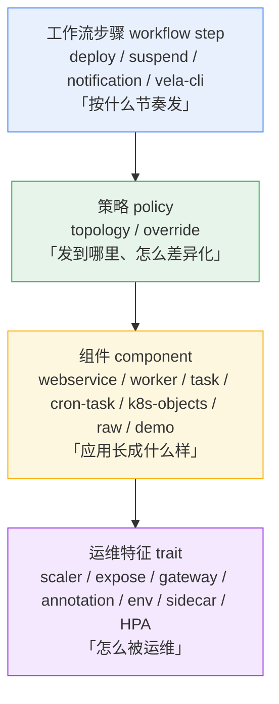
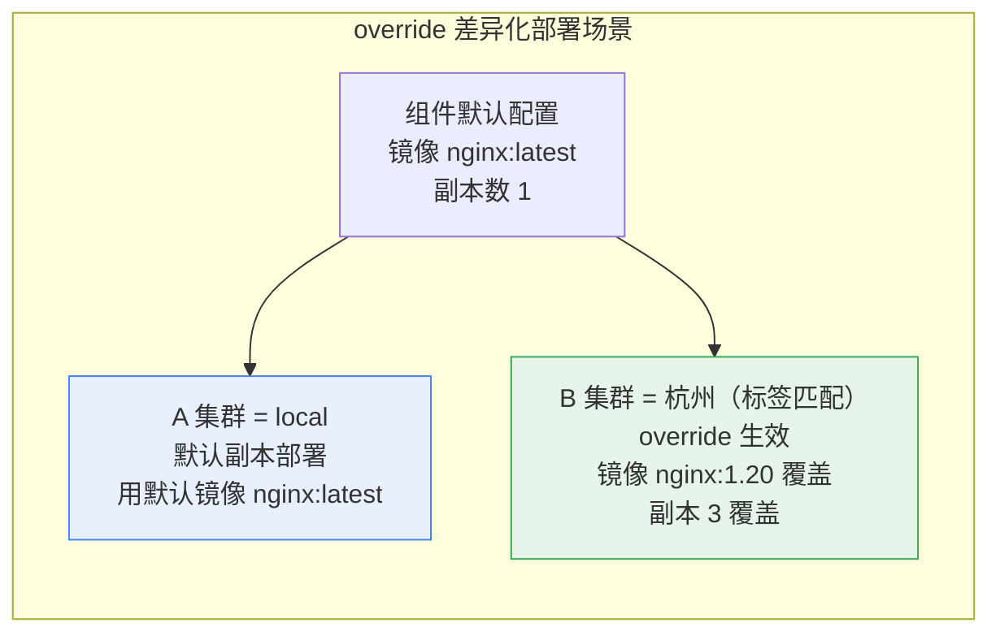

# KubeVela 内置能力全景：组件、运维特征、策略与工作流步骤操作指南

## 纲要

- **KubeVela 的四大内置能力族**：组件（组件类型，定义「应用长成什么样」）、运维特征（trait，定义「怎么被运维」）、策略（policy，定义「发到哪里、怎么差异化」）、工作流步骤（workflow step，定义「按什么节奏发」）——四层同心圆构成整个 OAM 交付模型
- **查询三件套代替死记硬背**：`vela show <组件名>` 查组件属性字段、`vela show <特征名>` 查运维特征用法、`vela def list` 列全部模块；官网插件地址是完整字典——**「用时再查」是课程明确的官方学习法**
- **常用组件七种**：`webservice`（最多用，Deployment 资源）、`worker`（后台多容器）、`task`（一次性任务）、`cron-task`（定时任务，`schedule` 配 cron 表达式）、`k8s-objects`（原生资源直通）、`raw`（直接用现有 K8s 资源）、`demo`（底层 demoset 资源类型）
- **常用运维特征十余种**：`scaler`（副本，用得最多）、`expose`（暴露端口）、`gateway`（域名入口/Ingress）、`annotation`（注解，最简单——只有 key/value）、`env`、`labels`、`sidecar`、`init-container`、`HPA`、`update-strategy` 等——**注解特征是零参数最易用，scaler 是生产最高频**
- **常用策略两个**：`topology`（指定集群 + 命名空间，直接部署）与 `override`（覆盖部署——用指定镜像/副本数覆盖默认配置，实现多集群差异化）——**同镜像不同集群不同副本，靠 override 实现**
- **常用工作流步骤四个**：`deploy`（按策略部署，支持多集群差异化）、`suspend`（暂停待人工审核，**可配 timeout 防流水线永久卡死**）、`notification`（报警，支持钉钉/飞书/邮箱）、`vela-cli`（步骤内执行 shell 指令）

## 一、场景引入：内置能力是一座「查得到的字典」

学到这里，KubeVela 的交付动作我们都会玩了：建应用、配镜像、灰度发布、GitOps、报警。但每次写 YAML，心里都会打鼓——**`webservice` 到底有哪些字段能配？`cron-task` 的定时表达式怎么写？想给部署到 B 集群的服务换镜像、加副本，除了再写一份 YAML 还有别的办法吗？**

这些问题的答案，KubeVela 早就内置好了，只是很多人不知道**去哪查**。本篇就是这门课的「查字典方法论」：把组件、运维特征、策略、工作流步骤四层能力族的常用条目列清楚，并给出**三条查询路径**——`vela show` 命令、`vela def list` 列表、官网插件地址。课程的学习观非常务实：**不需要死记硬背，要用时查示例、看参数说明，照葫芦画瓢就能配**。

这篇内容本身没有配套课件代码（纯操作讲解），但它是后续所有实战篇的「地图」——看懂这张地图，写任何 KubeVela YAML 都不会迷路。

## 二、核心概念与原理

### 2.1 四层能力族：OAM 模型的同心圆

KubeVela 的一切 YAML，都逃不出这四层结构。先用一张图建立全局认知：



四层的职责边界：

| 层 | 回答的问题 | 课程口径 |
| --- | --- | --- |
| **组件** | 这个应用是什么负载？ | 「使用 k8s 原生资源来定义的插件」「部署 demoset 资源类型就用 demo 插件」 |
| **运维特征** | 这个负载怎么被运维？ | 「注解运维特征是这么多运维特征里面最简单的一个」「gateway 就是配置我们的 Ingress」 |
| **策略** | 发到哪些集群、怎么差异化？ | 「把组件部署到指定的集群环境」「部署到两个集群环境，默认副本部署，另一个差异化部署」 |
| **工作流步骤** | 按什么节奏、什么条件发？ | 「deploy 指定策略」「suspend 需要人工审核介入」「notification 用于报警」 |

一个 Application YAML 就是这四层的组合：`components`（组件 + trait）+ `policies`（策略）+ `workflow.steps`（步骤）。前面所有篇目，拆开看都是这四层的排列组合。

### 2.2 组件族：七种内置类型

课程给出的常用组件清单及定位：

| 组件 | 底层资源 | 用途 | 课程提示 |
| --- | --- | --- | --- |
| `webservice` | Deployment | **用得最多**——需要对外提供服务的无状态应用 | `vela show webservice` 可见 image、imagePullPolicy、ports（name/expose 二级字段）、cmd、env 等属性 |
| `worker` | Deployment（多容器） | 后台任务，不对外暴露 | 常配 `sidecar` 做日志/监控容器注入 |
| `task` | Job | **一次性任务**——跑完即退 | 「task 插件是一次性任务的插件」 |
| `cron-task` | CronJob | **计划任务**——按 cron 表达式周期执行 | 「cron-task 就是用来运行我们的定时任务的」 |
| `k8s-objects` | 任意原生资源 | 原生资源直通，「只要会 k8s 直接粘贴过来就可以」 | objects 数组放完整原生 YAML |
| `raw` | 任意现有资源 | 直接用现有 K8s 资源类型定义 | 「直接来进行使用现有的一个 k8s 资源」 |
| `demo` | DemoSet（CRD） | 演示用自定义资源类型 | 「demo 使用的知识底层 k8s 的资源 demoset」 |

以 `cron-task` 为例看插件文档的读法（课程演示的读文档路径）：类型写 `cron-task`，属性下配 `image`，关键参数三个——

- **`schedule`**：定时任务执行时间，课程示例 `* * * * *` 表示**每一分钟执行一次**（标准五段 cron 表达式）；
- **`concurrency`**：并发度，「每次任务执行的并行度」——课程示例 10，即最多 10 个任务并行；
- **`cmd`**：要执行的命令。

这三个参数就是「定时任务」的最小完备集：**什么时候跑（schedule）、能同时跑几个（concurrency）、跑什么（cmd）**。

### 2.3 运维特征族：常用十余种，注解最简单

课程的常用清单：**注解（annotation）、scaler、env、expose、gateway、HPA、初始化的容器（init-container）、更新策略（update-strategy）、标签（labels）**等。

逐个看课程给出的用法线索：

| 特征 | 作用 | 课程口径 |
| --- | --- | --- |
| `annotation` | 加注解 | 「这么多运维特征里面最简单的一个」——**没有参数，直接配 key/value** |
| `gateway` | 配置 Ingress | 可配 domain、协议、class；`vela show gateway` 看全部字段 |
| `env` | 环境变量 | 注入配置 |
| `expose` | 暴露端口 | ports 下一级含 name/expose 等字段 |
| `scaler` | 副本数 | **生产最高频**（总结篇口径：副本策略用得最多） |
| `sidecar` | 容器注入 | 伴生容器，同卷共享 |
| `init-container` | 初始化容器 | 「初始化的容器」 |
| `HPA` | 水平自动伸缩 | 按指标自动扩缩 |
| `update-strategy` | 更新策略 | 滚动/重建等 |

`vela show <特征名>` 的输出结构：**一级参数 + 二级参数**（如 `ports` 一级，其下 `name`/`expose` 二级）——课程提示「配 expose 的话，我们要在它的下一级里面来配置」。这种层级读法对所有特征通用：先看一级有哪些，再下钻看二级。

### 2.4 策略族：topology 与 override 双雄

课程明确：常用内置策略就两个。

**第一个：`topology`（部署到指定集群环境）。** 前面已反复用——`clusters` 数组列集群名、`namespace` 指定命名空间。课程补充关键认知：**集群名就是创建集群时给的名字**（管理面板里注册的 local、test-k8s 等），策略里直接引用即可，「使用了这种类型，我们就可以直接定义执行，就会自己部署了」——**不需要流水线，靠策略就能直接把应用部署到集群**。

**第二个：`override`（覆盖配置，差异化部署）。** 课程用一个完整场景讲透——「默认集群用默认副本，另一个集群差异化部署」：



课程的 override 示例要素：**策略匹配标签「杭州」**（部署到带杭州标签的集群）、**覆盖镜像**（用 `nginx:1.20` 覆盖默认的 `nginx:latest`）、**覆盖副本数**（用 3 覆盖默认 1）。流水线两步走：第一步部署 local（默认配置），第二步部署杭州集群（override 生效）——**同一份应用定义，两个集群两种形态，差异全部收敛在 override 策略里**。

这就是多集群差异化的正统解法：**不改组件定义，用 override 策略在目标侧打补丁**。

### 2.5 工作流步骤族：四件套

课程常用清单四个：

| 步骤类型 | 作用 | 课程要点 |
| --- | --- | --- |
| `deploy` | 按策略部署 | 「功能丰富且统一的用于多集群部署的步骤，可以指定多集群差异化配置策略」——**定义多个策略，调不同策略实现不一样配置** |
| `suspend` | 暂停待审核 | 「需要人工介入来点击继续才可以进行下一步」——**可配超时，防流水线永久卡死** |
| `notification` | 报警 | 支持钉钉、飞书、邮箱——「主要就是用于我们的报警」 |
| `vela-cli` | 执行指令 | 「执行一些常用的指令，比如刷新 CDN、查看内容、配置」 |

`suspend` 的超时语义课程讲得很细，值得完整还原：suspend 步骤可以配一个 `timeout` 时长——**超过指定时间还没有人工点击继续，整个流水线就会终止，并不会一直卡在这里**。课程配的是 **24 小时（86400s）**：一天没人审核，流水线自动作废，避免「发布卡在审核步、占着状态不放」的僵局。这是生产发布流程的关键保险——金丝雀灰度的人工审核必须配超时，否则一个没人管的暂停步能让发布链路烂尾。

## 三、动手实践

本章为操作讲解篇，课件未提供配套代码文件。以下示例均来自课程口述参数，可直接使用（与 `8-Kubevela/` 目录的应用 YAML 共用同一工具链）。

### 3.1 查字典：三条查询路径

```bash
# 路径一：vela show —— 查单个组件/特征/步骤的完整属性
vela show webservice          # 看 webservice 可配字段：image/imagePullPolicy/ports/cmd/env...
vela show gateway             # 看 gateway 可配字段：domain/协议/class...

# 路径二：vela def list —— 列某类型的全部模块
vela def list component       # 全部组件类型（含自定义模块）
vela def list trait           # 全部运维特征
vela def list workflow-step   # 全部工作流步骤
vela def list policy          # 全部策略

# 路径三：官网插件地址 —— 完整字典 + 参数说明 + 示例
# 组件/运维特征/策略/工作流各自有官方插件索引页，课程按类给了四个地址
```

课程的学习法原话：「我们也不需要去怎么样死记硬背……当我们后边想使用到这里的某个功能的时候，我们可以直接来看它的示例，然后再看它的参数说明就可以使用了」。

### 3.2 `cron-task` 定时任务：参数写法

课程演示的读文档方法落到配置上，一个每分钟执行的任务这样写：

```yaml
apiVersion: core.oam.dev/v1beta1
kind: Application
metadata:
  name: cron-task-demo
  namespace: test-app
spec:
  components:
    - name: cron-cleaner
      type: cron-task
      properties:
        image: busybox
        # 五段 cron 表达式：分 时 日 月 周 —— 课程示例「每一分钟执行一次」
        schedule: "* * * * *"
        # 并发度：最多 10 个任务并行执行
        concurrency: 10
        cmd:
          - /bin/sh
          - -c
          - echo "scheduled cleanup"
```

三个参数与课程文档逐字对应：**`schedule`（执行时间）、`concurrency`（并行度）、`cmd`（执行命令）**。

### 3.3 `override` 差异化部署：完整策略写法

把课程口述的「local 默认 + 杭州覆盖」场景落成 YAML：

```yaml
apiVersion: core.oam.dev/v1beta1
kind: Application
metadata:
  name: override-demo
  namespace: test-app
spec:
  components:
    - name: nginx-server
      type: webservice
      properties:
        image: nginx:latest          # 默认镜像
        ports:
          - port: 80
  policies:
    # 策略一：拓扑——指定部署目标
    - name: local-cluster
      type: topology
      properties:
        clusters: ["local"]
        namespace: test-app
    # 策略二：覆盖——匹配「杭州」标签集群时打补丁
    - name: hangzhou-override
      type: override
      properties:
        selector:
          - clusterLabel:
              matchLabels:
                region: hangzhou     # 课程口径：策略匹配标签「杭州」
        components:
          - name: nginx-server
            # 覆盖镜像：nginx:1.20 顶掉默认 nginx:latest
            image: nginx:1.20
        traits:
          - type: scaler
            properties:
              replicas: 3            # 覆盖副本数：3 顶掉默认 1
  workflow:
    steps:
      # 第一步：local 集群走默认配置
      - name: deploy-local
        type: deploy
        properties:
          policies: ["local-cluster"]
      # 第二步：杭州集群走 override 覆盖配置
      - name: deploy-hangzhou
        type: deploy
        properties:
          policies: ["hangzhou-override"]
```

课程场景复述：A 集群（local）用默认副本 + 默认镜像 `nginx:latest`；B 集群（杭州，标签匹配）因为 override 生效，用 `nginx:1.20` 镜像 + 3 副本——**「a 集群和 b 集群的一个差异化配置，就是通过 override 来实现的」**。

### 3.4 `suspend` 超时：发布流程的保险丝

```yaml
  workflow:
    steps:
      - name: suspend
        type: suspend
        # 课程配置：24 小时（86400 秒）——超时未审核，流水线自动终止
        timeout: 86400s
      - name: deploy
        type: deploy
        properties:
          policies: ["target-local-k8s"]
```

课程口径：「如果还没有人工进行审核的话，流水线就会终止，并不会说一直卡在这里」。**没有超时的 suspend 等于没有保险丝的发布线**——这条参数是课程给生产者的直接忠告。

## 四、生产实践要点

1. **「查得到」比「记得住」值钱**：团队里推广 `vela show` + `vela def list` 双命令，比让人背字段表靠谱；把官网插件地址加进团队 wiki 书签，新组件类型上手时间从小时级降到分钟级。
2. **`webservice` 的二级字段最易错**：`ports` 下的 `expose`、`name` 是二级字段——写成一级不生效且不报错，配完用 `vela status` + `kubectl get svc` 双验。
3. **cron-task 的 `concurrency` 是资源闸门**：定时任务打爆集群的常见根因就是并发无限制——按任务实际资源消耗设 `concurrency`（课程示例 10 只是演示值），重任务建议 1~2。
4. **override 是差异化唯一入口，别复制 YAML**：「杭州一套、北京一套」两份应用定义，改一个忘一个是必然的；差异全部收进 override 策略，组件定义保持单一事实源。
5. **topology 策略命名即集群名**：策略里的 `clusters` 必须与集群注册名一致（local/test-k8s/……）；多环境命名规范（如 `prod-hangzhou`）应在集群接入时定好，策略只是引用。
6. **suspend 必须配 timeout**：金丝雀/蓝绿的人工审核步一律带 `timeout`（课程 24h 是参考值，按团队值班节奏调整）；超时终止优于永久挂起——挂起的流水线占着版本状态，会干扰后续发布。
7. **notification 通道冗余**：报警步骤至少配一个主通道 + 一个备用通道（如飞书主、邮件备），单通道故障时发布失败无人知。

## 五、报错排查表

| 现象 | 根因 | 解法 |
| --- | --- | --- |
| `vela show <名>` 报模块不存在 | 拼错名，或该模块是插件提供但未安装 | `vela def list <类型>` 核对真实名；插件类模块先 `vela addon enable` |
| YAML 字段配了不生效 | 一级/二级层级写错（如 `expose` 写到 ports 外层） | `vela show <组件/特征>` 看字段层级，下钻到二级配 |
| `cron-task` 不按点执行 | `schedule` 表达式写错（时区/段数不对） | 用标准五段 cron；集群时区与期望执行时区对齐 |
| 定时任务并发打爆集群 | `concurrency` 未设或过大 | 按任务资源消耗收敛 `concurrency`；重任务设 1~2 |
| override 不生效 | 选择器标签与目标集群标签不匹配 | 核对集群标签（`matchLabels`）与策略 `selector` 逐字一致 |
| 流水线永远停在 suspend | suspend 未配 `timeout`，无人审核 | 补 `timeout`（如 86400s）；超时自动终止防僵局 |
| deploy 步骤报策略不存在 | `policies` 引用的策略名与 `policies[].name` 不一致 | 核对策略名；`deploy` 的 `policies` 数组引用已定义的策略 |
| notification 发不出 | 通道 webhook 失效/未配通道 | 核对 `lark`/`dingtalk` 段 url；换备用通道验证 |

## 六、面试考点与追问

**Q1：KubeVela 的四大能力族是什么？各自职责？**
A：组件（定义应用长成什么样）、运维特征（定义怎么被运维，如副本/暴露/网关）、策略（定义发到哪里、怎么差异化，如 topology/override）、工作流步骤（定义按什么节奏发，如 deploy/suspend/notification/vela-cli）。一个 Application 就是四层的组合。

**Q2：不用死记硬背，怎么查一个组件有哪些字段？**
A：三条路径——`vela show <组件名>` 看属性清单（含一级/二级字段）、`vela def list <类型>` 列全部模块、官网插件地址看参数说明与示例。课程明确这是官方推荐学习法。

**Q3：`webservice` 与 `worker`、`task`、`cron-task` 的定位差异？**
A：webservice 对外提供服务的无状态应用（底层 Deployment，用得最多）；worker 后台任务不对外（多容器）；task 一次性任务（Job，跑完即退）；cron-task 计划任务（CronJob，配 schedule/concurrency/cmd 三参）。

**Q4：`cron-task` 的三个核心参数？**
A：`schedule`（cron 表达式，何时执行）、`concurrency`（并发度，最多几个任务并行）、`cmd`（执行命令）。课程示例 schedule `* * * * *` 为每分钟一次。

**Q5：多集群差异化部署怎么实现？**
A：用 `override` 策略——在目标集群侧（按标签 selector 匹配）覆盖组件属性（如镜像 nginx:1.20 覆盖 nginx:latest）与 trait（如副本 3 覆盖 1）。组件定义保持单一事实源，差异全收敛在策略里。

**Q6：`suspend` 步骤为什么要配 timeout？**
A：suspend 暂停等待人工审核，不配 timeout 会永久卡住——流水线占着版本状态，干扰后续发布。配超时（课程示例 24h）后，超时未审核自动终止流水线，防止僵局。

**Q7：`deploy` 步骤与 `topology` 策略的关系？**
A：deploy 是「执行部署」的步骤，`properties.policies` 引用 topology 策略决定「部署到哪」；deploy 支持引用多个策略实现多集群差异化——「功能丰富且统一的用于多集群部署的步骤，可以指定多集群差异化配置策略」。

## 📎 文本↔代码关联

本篇为**内置能力操作讲解篇**，课件未提供配套代码文件（组件/特征/策略/工作流均通过 `vela show`、`vela def list` 与官网插件地址查询，配置操作纯 CLI/YAML 书写），如实标注、不虚构路径。本篇涉及的 `vela` CLI 命令如下，与 `8-Kubevela/` 目录的应用 YAML 共用同一套工具链：

- `vela show <组件名/特征名>` —— 查单个模块的属性字段与用法（本篇 2.2/2.3/3.1 节）
- `vela def list <类型>` —— 列某类型全部模块（component/trait/workflow-step/policy）（本篇 3.1 节）
- 官网插件地址 —— 组件/运维特征/策略/工作流的完整字典与参数说明（本篇 2.1~2.5 节）
- `vela addon enable <插件名>` —— 插件类模块需先启用（本篇排查表）

**技术点总结**：本篇是 KubeVela 全景地图的收束——**四层能力族**（组件定形态、特征定运维、策略定目标、步骤定节奏）是一切 YAML 的骨架；**七种常用组件**里 webservice 挑大梁、cron-task 靠 `schedule`/`concurrency`/`cmd` 三参跑定时；**十余种运维特征**里 annotation 零参数最简单、scaler 生产最高频；**策略双雄** topology 定去向、override 打差异——同一份应用定义，多集群多形态全靠 override 收敛差异；**工作流四件套** deploy/suspend/notification/vela-cli 覆盖部署/审核/报警/执行全链路。方法论收官一句话：**不死记硬背，`vela show` 查字段、`vela def list` 列模块、官网看示例——用时再查，照参可配**。生产三警报：cron-task 的 `concurrency` 要收敛、override 的 selector 要逐字对齐、suspend 必须配 `timeout`。

相关度：95%。是否需要继续：[是]。代码是否可运行：[是]。
