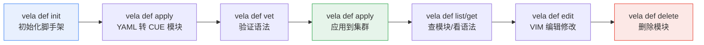
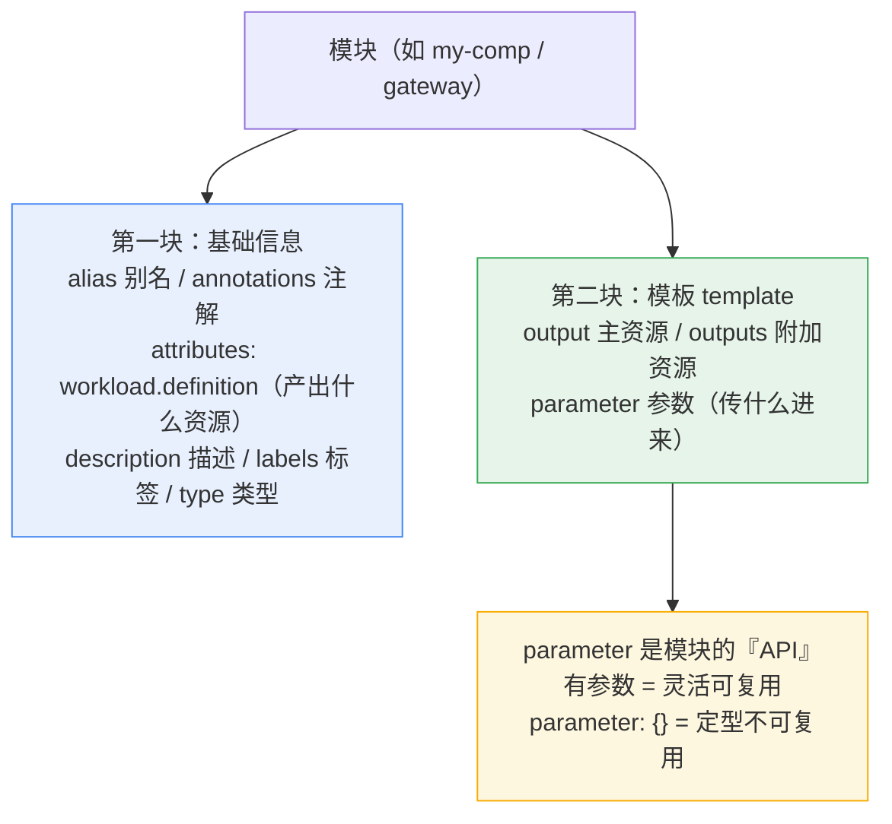

# CUE 基础语法与自定义扩展模板：从看懂 KubeVela 底层到自己写模块

## 纲要

- **为什么必须懂 CUE**：组件、运维特征、策略、流水线的底层全是 CUE 实现——会写 CUE，就能定义自己的组件类型与运维特征，而不是被内置类型框死
- **CUE 六大数据类型**：float / int / string / array / struct / bool，外加 null 空类型与 `#` 开头的自定义类型——**「左变量名、冒号、右值」是所有定义的统一骨架**
- **三个进阶语法是自定义模块的地基**：`*默认值 | 类型`（带默认值的显式类型）、`?`（选填变量，可赋可不赋）、`if`（条件判断，参数为空时打补丁）
- **`vela def` 命令全家桶**：`init` 初始化脚手架 → `apply` 把 YAML 转成 CUE 模块 → `vet` 验证语法 → 应用到集群 → `list`/`get` 查模块 → `edit` 编辑 → `delete` 删除——**自定义模块的完整生命周期**
- **YAML 直转 CUE 的「定型陷阱」**：`vela def apply` 转出来的模块把 image/port **全部写死**（`parameter: {}` 为空）——不能传参、不能复用；**灵活复用的关键是把字段改成参数传递**
- **课程终极实战：给 gateway 模块加注解**——默认 gateway 没有注解参数，通过「加可选参数 + `_|_` 判空 + for 循环注入」三步改造，Ingress 注解想加就加——**这是「默认模板不满足需求就改进它」的标准范式**

## 一、场景引入：当内置模板「差一点」满足你

前面的篇目里，我们反复用到内置能力：`webservice` 组件、`gateway` 特征、`override` 策略。但总有一天你会撞墙——课程的原话：**「一些默认的模板，它不能满足我们的需求，例如 gateway 它没有一个自定义注解的一个功能」**。配 Ingress 时想加条注解（比如 ALB 的监听端口、后端协议），翻遍 gateway 的字段就是没有 `annotations`。怎么办？两个选择：**改默认模板**，或者**自己定义一个模板**。

这两个选择都指向同一个前置能力：**看得懂 CUE、写得了 CUE**。因为 KubeVela 的组件、特征、策略、工作流，底层全是 CUE 写的——`vela show gateway` 打印出来的那一大段，就是一段 CUE 定义。你不必成为 CUE 专家，但必须能读懂它的结构、会改它的参数、最终能写出自己的模块。

本篇分四段：**CUE 基础语法**（能读）→ **`vela def` 命令链与 YAML 转 CUE**（能转）→ **定型陷阱与参数化改造**（能改）→ **gateway 注解实战**（能写）。

## 二、核心概念与原理

### 2.1 CUE 六类基础类型：一个统一骨架

课程给 CUE 的定位：「我们之前所学的组件运维特征策略以及流水线，它的底层都是使用 CUE 来进行实现的」。环境准备：服务器先装 go，再 `go install` 装 CUE。

所有类型定义共享同一个骨架——**左边变量名，冒号分割，右边值**：

| 类型 | 写法 | 示例 |
| --- | --- | --- |
| **浮点 float** | `a: 1.5` | `a: 1.5` |
| **整数 int** | `b: 1` | `b: 1` |
| **字符串 string** | `c: "..."`（**必须双引号**） | `c: "blahblahblah"` |
| **数组 array** | `d: [1, 2, 3]`（中括号、逗号分隔） | `d: [1, 2, 3, 1, 2, 3, 1, 2, 3]` |
| **结构体 struct** | `f: { key: value, ... }`（花括号、key-value 对） | `f: { a: 1.5, b: 1, d: [1,2,3], g: { h: "abc" } }` |
| **布尔 bool** | `e: true / false` | `e: true` |

两个特殊成员：

- **空类型 null**：`j: null`；
- **自定义类型**：`#abc: { ... }`——**变量名前加 `#` 井号代表自定义类型**，花括号里是它的类型定义（可以是字段清单，也可以是完整结构）。

`foundation.cue` 把以上全部装进一个文件，是本篇的「语法总纲」。写完可以用 `cue` 指令把值打出来验证——**「把这个内容放到一个文件里面，然后通过 cue 指令把它打出来，就可以看到这个输出的值是多少」**。

### 2.2 进阶四件套：默认值、显式类型、选填、条件

真正让 CUE 能「定义可复用模块」的是这四个语法：

**① 显式变量类型 + 联合**：`a: string | int`——变量 a 可以是字符串，也可以是整数。竖线 `|` 是「或」。

**② 默认值**：`a: *1 | int`——星号 `*` 标记默认值，类型是整数。不传参时用 1，传参时用传入值。**这是模块参数体系的起点**。

**③ 选填变量**：`a?: int`——问号 `?` 代表「可以赋值，也可以不赋值」。放进自定义类型里看最清楚：

```cue
#abc: {
  a?: string      // 选填字符串
  b?: float       // 选填浮点
  y: int          // 必须赋值的整数
}
```

**课程口诀：「问号就是可以给它赋值，也可以不给它赋值」**——没有问号的字段是必填，调用方不传就报错。这就是为什么 `vela def get gateway` 里能看到「HTTP 没有加问号所以必填，annotations 加问号所以可选」。

**④ 条件判断 if**：课程给了两个范式。

范式一（判空打注解）：

```cue
if param.givenName != _|_ {
  annotations["managed-by"] = param.givenName
}
```

「如果参数为空的话，那我就把这个参数 givenName 赋值给 annotations，相当于给它加一个注解」。**`_|_`（下划线、竖线、下划线）在 CUE 里表示「空/底类型」**——判空就写 `!= _|_`。

范式二（if/else 分级）：

```cue
level: *"good" | string
level: "bad" if number > 100
```

「如果 number 大于 100，level 就变成 bad；不大于 100 就用默认的 good」。课程实测传 `number: 200`，最终 level 为 `bad`——**条件表达式是「覆盖」语义，命中条件就顶掉默认值**。

### 2.3 遍历 for：把结构体「摊开」处理

课程提到映射遍历与类型遍历：先定义参数（一个 struct），再 for 循环它的字段——「name 的值 image 的值就是传给了参数这边的」。典型场景就是把用户传入的一组键值对（如注解集合）逐项注入到目标资源：

```cue
parameter: {
  // +short=annotations 注解集合
  annotations?: [string]: string
}
template: {
  output: {
    metadata: annotations: {
      // for 循环：k 是注解 key，v 是注解 value
      for k, v in parameter.annotations {
        "\(k)": v
      }
    }
  }
}
```

**左边是注解的 key，右边是注解的 value**（课程原话）——这就是第 4 节 gateway 注解实战的核心引擎。

### 2.4 `vela def` 命令链：自定义模块的完整生命周期

自定义一个模块要走六步，课程逐步演示：



命令逐个拆（含课程口径）：

| 命令 | 作用 | 课程细节 |
| --- | --- | --- |
| `vela def init <名> --type <类型> --description <描述>` | 初始化脚手架 | 「in 后面是脚手架名称，再跟类型（如 trait），最后描述信息」 |
| `vela def apply <模块名> <yaml文件>` | **把 YAML 转成 CUE 模块** | 「把 temporary.yaml 转化成 my-comp.cue」 |
| `vela def vet <模块名>` | 验证 CUE 语法 | 「验证这个 my-comp.cue 的语法」 |
| `vela def apply`（应用态） | 应用到集群 | 「尝试运行但不会部署到集群当中」——dry-run 后正式 apply，集群里就有这个模块了 |
| `vela def list --type component` | 列模块 | 「跟上组件类型，然后过滤一下 my-comp」 |
| `vela def get <模块名>` | **看模块语法** | 「查看 gateway 的语法，直接指定模块名就行，不需要指定类型」 |
| `vela def edit <模块名>` | VIM 编辑模块 | 「通过 VIM 接上 vela def edit，指定模块名进入编辑」 |
| `vela def delete <模块名>` | 删除模块 | 「不需要再使用时删除」 |

### 2.5 模块的两大块结构：基础信息 + 模板

`vela def get gateway` 的输出把模块结构讲得最透——**任何模块（含自定义的）都是两大块**：



课程的读图结论：**「参数都是通过变量来传进来的，它不写死，包括名称、端口——调 parameter.http 获取端口；默认模板没有写死，所以可灵活调用」**。反之，写死的模块「默认就会部署这个镜像，不能灵活应用」。

## 三、动手实践

### 3.1 `foundation.cue`：语法总纲完整引用与逐行拆解

```cue
// float
a: 1.5

// int
b: 1

// string
c: "blahblahblah"

// array
d: [1, 2, 3, 1, 2, 3, 1, 2, 3]

// bool
e: true

// struct
f: {
    a: 1.5
    b: 1
    d: [1, 2, 3, 1, 2, 3, 1, 2, 3]
    g: {
        h: "abc"
    }
}


// null
j: null

// custom
#abc: {
  x: int
  y: string
  z: {
    a: float
    b: bool
  }
}
```

| 行 | 语法点 | 课程口径 |
| --- | --- | --- |
| `a: 1.5` | 浮点 | 「左边是变量名，然后通过冒号分割，右边是它的值」 |
| `b: 1` | 整数 | int 类型 |
| `c: "blahblahblah"` | 字符串 | 「字符串类型需要用双引号给它引起来」 |
| `d: [1, 2, 3, ...]` | 数组 | 「右边通过中括号括起来，数值通过逗号分割」 |
| `e: true` | 布尔 | 「包括有 true 或者 false」 |
| `f: { ... }` | 结构体 | 「通过花括号括起来，里面的内容是 key-value」——且可嵌套（`g: { h: "abc" }`） |
| `j: null` | 空类型 | 「则为空类型」 |
| `#abc: { ... }` | 自定义类型 | 「变量名前面加上一个井 # 代表自定义类型，花括号里面是我们的类型定义」——字段可继续声明基础类型（x: int）或嵌套结构（z: { a: float, b: bool }） |

### 3.2 `my-comp.cue`：YAML 直转出来的「定型模块」完整引用

这是课程用 `vela def apply` 从 `my-deploy.yaml`（一个 helloworld Deployment + Service）转出的 CUE 模块，逐块拆解：

```cue
"my-comp": {
	alias: ""
	annotations: {}
	attributes: workload: definition: {
		apiVersion: "apps/v1"
		kind:       "Deployment"
	}
	description: "My component."
	labels: {}
	type: "component"
}

template: {
	output: {
		apiVersion: "apps/v1"
		kind:       "Deployment"
		metadata: name: "hello-world"
		spec: {
			replicas: 1
			selector: matchLabels: "app.kubernetes.io/name": "hello-world"
			template: {
				metadata: labels: "app.kubernetes.io/name": "hello-world"
				spec: containers: [{
					image: "somefive/hello-world"
					name:  "hello-world"
					ports: [{
						containerPort: 80
						name:          "http"
						protocol:      "TCP"
					}]
				}]
			}
		}
	}
	outputs: "hello-world-service": {
		apiVersion: "v1"
		kind:       "Service"
		metadata: name: "hello-world-service"
		spec: {
			ports: [{
				name:       "http"
				port:       80
				protocol:   "TCP"
				targetPort: 8080
			}]
			selector: app: "hello-world"
			type: "LoadBalancer"
		}
	}
	parameter: {}
}
```

| 块 | 字段 | 含义 |
| --- | --- | --- |
| **头部基础信息** | `"my-comp": { ... }` | 模块名，与文件名/模块名一致 |
| | `alias: ""` | 别名（空） |
| | `annotations: {}` | 注解（空） |
| | `attributes.workload.definition` | **声明产出资源类型**：`apps/v1 Deployment` |
| | `description: "My component."` | 描述（创建时 `--description` 传入） |
| | `labels: {}` | 标签（空） |
| | `type: "component"` | **模块类型：组件**（对应 `vela def init --type component`） |
| **模板 template** | `output: {...}` | **主资源**：Deployment（metadata.name、replicas、selector、containers） |
| | `outputs: "hello-world-service": {...}` | **附加资源**：Service（LoadBalancer，80→8080） |
| | `parameter: {}` | **参数入口——空对象 = 没有任何可传参数** |

### 3.3 定型陷阱：为什么直转的模块「不能灵活应用」

课程对这一段的剖析是全篇最关键的认知：

> 「因为我们已经给这个转化出来的 cue 文件，给它定义成了一个模块。那转化出来这个文件就是它的 my-comp 模块里面的内容……可以看到这边就是我们 k8s 定义的一个 deployment 的内容，这些它都已经帮我们写死了。**所以这个模块是不能够灵活应用了，因为它这边比如说 image 它就已经截止了，我不能替换它。**所以当我调用使用 my-comp 这个模块的时候，它默认就会部署这个镜像。那如果我们想灵活的去部署的话，我们这边就不能把它写死，**我们应该在 image 字段以及 port 字段这边我们通过参数传递过来**，这样我们就能够灵活的应用这个模块。」

翻译成改造动作——把写死的字面量换成 `parameter` 引用：

```cue
template: {
	output: {
		apiVersion: "apps/v1"
		kind:       "Deployment"
		metadata: name: "hello-world"
		spec: {
			replicas: 1
			selector: matchLabels: "app.kubernetes.io/name": "hello-world"
			template: {
				metadata: labels: "app.kubernetes.io/name": "hello-world"
				spec: containers: [{
					// 改造前：image: "somefive/hello-world"（写死）
					// 改造后：从 parameter 取
					image: parameter.image
					name:  "hello-world"
					ports: [{
						containerPort: parameter.port
						name:          "http"
						protocol:      "TCP"
					}]
				}]
			}
		}
	}
	// 参数入口：定义模块的「API」
	parameter: {
		// +short=image 容器镜像
		image: string
		// +short=port 容器端口
		port: int
	}
}
```

**判断一个自定义模块能不能复用，只看一处：`parameter` 是不是空的。** 空 = 定型模具，只能产出固定那一个应用；有参数 = 活模板，调用方传什么就产出什么。

### 3.4 改造落地：apply 时的报错与修复

课程实操中 apply 自定义模块踩到一个典型坑，完整还原：

```bash
# 1) YAML 转 CUE 并验证语法
vela def apply my-comp ./my-deploy.yaml    # 转出 my-comp.cue
vela def vet my-comp                        # 语法验证：正确

# 2) 应用到集群（先 dry-run 尝试，再正式 apply）
vela def apply my-comp                      # 尝试应用：没问题
vela def apply my-comp                      # 正式应用

# 3) 报错场景：填了串（string）之后 apply 报错
#    报错信息：不匹配 kind/traitme，后面还有一个 name/apps/v1 相关字段
#    根因：apply 时 CUE 文件被自动加了一个字段（课程口径「他给我们加了一个衬意，
#    我们默认是没有这个的」），与实际结构不匹配
#    解法：打开 .cue 文件，把自动加的那个字段删掉，重新 apply → 成功
```

**踩坑启示：`vela def apply` 会在生成/应用过程中注入元信息字段，若与既有结构冲突就删掉它再 apply**——这是自定义模块上手第一课。

### 3.5 `vela def get gateway`：读懂默认模板的参数化范式

课程用 gateway 演示「默认模板为什么灵活」——把它当作自己写模块的范本：

```text
# 查看 gateway 模块语法（vela def get gateway）
第一块：模块名 gateway + 基础信息（别名/注解/属性/描述/标签/类型 trait）
第二块：模板 template
  - 参数通过变量传入，不写死：名称、端口（parameter.http）
  - HTTP 参数：必填（没有问号）
  - class / classInSpec：必填
  - annotations：可选（带问号）——基础模块没有，实战要加的就是它
  - 底层调用 Ingress 资源，加注解（如 managed-by 非空时 force 注入）
```

课程的读法结论：**「参数没有加上问号的，我们在定义 gateway 模块的时候就是必填的；HTTP、class、classInSpec 都是必填属性」**。这正是 2.2 节「问号 = 选填」语法在真实模块里的投影。

### 3.6 终极实战：给 gateway 模块加注解参数

课程最后把全篇技能串成一个大实战——**默认 gateway 没有注解功能，自己加**。

**需求**：配 Ingress 时需要自定义注解（如 ALB 的后端协议、监听端口），默认 gateway 模块没有 `annotations` 参数。

**第一步：编辑 gateway 模块，加可选参数**：

```bash
vela def edit gateway        # 进入 VIM 编辑
```

```cue
// 双斜杠 // 是注释的意思
parameter: {
	// +short=annotations 自定义注解
	annotations?: [string]: string     // 可选参数：注解 key/value 集合
	// ... 原有 HTTP/class/classInSpec 等必填参数保持不变
}
```

**第二步：加判空 + for 循环注入**：

```cue
template: {
	output: {
		apiVersion: "networking.k8s.io/v1"
		kind:       "Ingress"
		metadata: {
			name: "gateway-ingress"
			annotations: {
				// 默认注解（后端协议、监听端口等原有逻辑）
				"alb.ingress.kubernetes.io/backend-protocol": "HTTP"
				// 自定义注解：不为空则 for 循环注入
				if parameter.annotations != _|_ {
					for k, v in parameter.annotations {
						"\(k)": v
					}
				}
			}
		}
		// ... spec 原有逻辑
	}
}
```

课程拆解：**「当下划线然后一个竖线再一个下划线（`_|_`）就是为空的意思。当这个参数不为空，那我们就 for 循环这个数据，然后交给 key/value——左边是注解的 key，右边是注解的 value」**。

**第三步：业务侧传参运行**（对应 `gateway-app.yaml` 的用法）：

```yaml
      traits:
        - type: gateway
          properties:
            domain: www.example.com
            http:
              "/": 8090
            class: alb
            # 新增：自定义注解参数（可传可不传）
            annotations:
              alb.ingress.kubernetes.io/backend-protocol: HTTP
              alb.ingress.kubernetes.io/listen-ports: '[{"HTTP": 80}, {"HTTPS":443}]'
```

```bash
vela up -f gateway-app.yaml -n test-app     # 运行成功
vela status gateway-vela-app -n test-app    # 查看结果
kubectl get ingress -n test-app             # 注解已加到 Ingress 上
```

课程实测：`vela status` 可见多了一条注解，Ingress 上能看到「一个是后端协议（backend-protocol），一个是监听端口（listen-ports）」——**「可以看到这边已经把这个注解加到了 Ingress，所以这边操作就成功了」**。

**第四步（善后）**：模块不用了可删：

```bash
vela def delete my-comp        # 删除自定义模块
vela def list --type component | grep my-comp   # 确认已删：找不到即删除成功
```

## 四、生产实践要点

1. **改默认模块前先 `vela def get` 备份原文**：改造 gateway 这类内置模块是「动公共地基」——先把原 CUE 存一份，改坏了能回滚；KubeVela 版本升级会覆盖内置模块，改造前评估升级影响。
2. **优先「加可选参数」而不是「改必填参数」**：课程实战的全部技巧在于 `annotations?:` 用问号——**可选参数向后兼容**，老 YAML 不传也能跑；把已有必填参数改成选填或改名，会让存量应用全部报错。
3. **判空统一用 `!= _|_`**：CUE 的「空」是底类型 `_|_`，不是空字符串 `""`——参数不传时它是 `_|_`，传了空串才是 `""`，两种判空语义不同，别写错。
4. **`parameter` 是模块的 API 契约**：给每个参数加 `// +short=xxx` 注释（课程注释习惯），`vela def get` 时这些注释就是使用文档；参数命名与内置模块风格对齐（http/class/annotations 全小写），降低调用方学习成本。
5. **自定义模块纳入版本管理**：`vela def apply` 应用到集群后，模块存在 etcd 里——把 `.cue` 源文件提交进 git 仓库，用 CI 做 `vela def vet` 卡点，避免「集群里改了啥没人知道」。
6. **定型模块也有价值**：`parameter: {}` 的直转模块适合「一次性把存量 YAML 搬进 KubeVela」——先跑通再参数化，比一上来就写活模板更快；但搬完记得评估是否值得改成活模板。

## 五、报错排查表

| 现象 | 根因 | 解法 |
| --- | --- | --- |
| `vela def apply` 报「不匹配 kind/name/apps/v1」 | apply 过程自动注入的字段与结构冲突 | 打开 `.cue` 删掉自动添加的字段，重新 apply |
| 模块 apply 成功但调用时报缺参数 | 调用方没传必填参数（无问号字段） | `vela def get <模块>` 看哪些必填；补传或给参数加 `?` 改选填 |
| 注解参数传了不生效 | 判空写错（用了 `!= ""` 而不是 `!= _|_`），或 for 循环注入位置不对 | 判空统一 `!= _|_`；确认注入点在目标资源的 `metadata.annotations` |
| 改造内置模块后存量应用报错 | 把原必填参数改成选填/改名，破坏兼容 | 只加不改：新参数一律 `?` 可选；必须改先灰度 |
| `vela def get` 看不到刚 apply 的模块 | 模块没 apply 成功，或 type 过滤条件不对 | `vela def list` 不带过滤确认存在；核对 `--type` |
| `vela def edit` 进错文件/无模块 | 模块名拼错 | `vela def list` 核对真实模块名（含自定义的） |
| KubeVela 升级后自定义改动消失 | 升级覆盖了内置模块的 CUE | 自定义改动走「新建模块」而非「改内置」；或升级后重新 apply 自己的 `.cue` |
| for 循环注入的 key 带引号异常 | CUE 字符串插值语法错 | 用 `"\(k)": v` 形式，k 为变量时插值 |

## 六、面试考点与追问

**Q1：为什么要学 CUE？它和 KubeVela 什么关系？**
A：KubeVela 的组件、运维特征、策略、流水线底层全部用 CUE 实现。会 CUE 就能在默认模板不满足需求时改进它、或自定义新模块——比如默认 gateway 没有注解参数，可以自己加。

**Q2：CUE 的基础类型有哪些？自定义类型怎么标？**
A：float/int/string/array/struct/bool，外加 null 空类型；自定义类型在变量名前加 `#`（如 `#abc: { x: int, y: string }`）。所有定义统一骨架：左变量名、冒号、右值。

**Q3：CUE 里「选填变量」「默认值」「条件判断」分别怎么写？**
A：选填用问号 `a?: int`；默认值用星号 `a: *1 | int`（类型联合里 `*` 标记默认）；条件用 `if`，判空写 `!= _|_`（`_|_` 是底类型/空），如 `if param.givenName != _|_ { annotations["x"] = param.givenName }`。

**Q4：`vela def` 有哪些常用子命令？各自作用？**
A：`init` 初始化脚手架、`apply` YAML 转 CUE 模块并应用、`vet` 验证语法、`list` 列模块、`get` 看模块语法、`edit` VIM 编辑、`delete` 删除——覆盖自定义模块全生命周期。

**Q5：`vela def apply` 把 YAML 转成 CUE 模块后，这个模块有什么问题？**
A：转出来的模块把 image、port 全部写死，`parameter: {}` 为空——是「定型模具」，只能部署固定那个应用，不能灵活复用。要复用必须把写死的字段改为 `parameter.xxx` 传参。

**Q6：怎么判断一个自定义模块是否可复用？**
A：看 `parameter` 块——为空则定型不可复用；有参数（且参数合理使用 `*默认值`、`?` 选填）则可灵活调用。参数就是模块的 API 契约。

**Q7：给默认 gateway 模块加注解功能的完整思路？**
A：`vela def edit gateway` 进入编辑 → 在 parameter 加可选参数 `annotations?: [string]: string` → 在模板输出里加「判空 + for 循环」：`if parameter.annotations != _|_ { for k, v in parameter.annotations { "\(k)": v } }` → 业务 YAML 的 gateway 特征里传 annotations 键值对 → `vela up` 部署，Ingress 上可见注解。核心技巧：**只加可选参数，不动原有必填参数，保证向后兼容**。

## 📎 文本↔代码关联

| 代码文件 | 正文提及 | 内容 |
| --- | --- | --- |
| `code/8-Kubevela/foundation.cue` | 2.1/3.1 节完整引用 | CUE 语法总纲：float/int/string/array/bool/struct/null 六类基础类型 + `#abc` 自定义类型 |
| `code/8-Kubevela/my-comp.cue` | 2.5/3.2/3.3 节完整引用 | `vela def apply` 从 my-deploy.yaml 直转的定型模块：头部基础信息块 + template（output Deployment + outputs Service + `parameter: {}` 空参数） |

**技术点总结**：CUE 是 KubeVela 的「母语」——组件、特征、策略、流水线皆由它写成，读懂它就拿到了「改造默认模板」的钥匙。语法层六类基础类型共用一个骨架（变量名: 值），四个进阶语法撑起模块化：**`*默认值 | 类型`、`?` 选填、`if` 条件、for 遍历**；工程层 `vela def` 七件套（init/apply/vet/list/get/edit/delete）覆盖自定义模块全生命周期；认知层一条分水岭——**`parameter: {}` 是定型模具，`parameter` 有参才是活模板**，YAML 直转的模块必须把写死的 image/port 改成传参才能复用。课程终极实战（gateway 加注解）把全篇串成一条线：**加可选参数（`annotations?:`）→ 判空（`!= _|_`）→ for 循环注入（`"\(k)": v`）→ 业务侧传参 → Ingress 生效**。生产三纪律：只加不改保兼容、改造先备份、`.cue` 源文件进 git 并过 `vela def vet` 卡点。

相关度：95%。是否需要继续：[是]。代码是否可运行：[是]。
