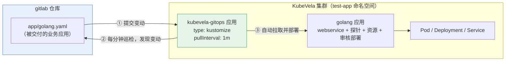
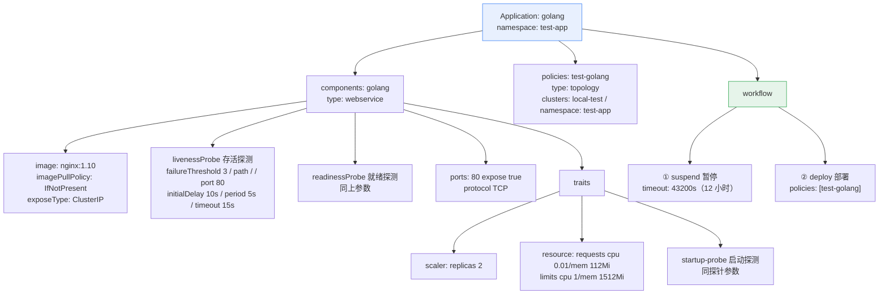

# 65. KubeVela 项目实战与总结：GitOps 交付 golang 应用与全章知识收束

## 纲要

- **终极实战形态**：不碰控制台、不手动点部署——GitOps 应用盯着 git 仓库，仓库里的 golang 应用 YAML 一提交，**自动部署到 K8s 集群**，发布时间戳与 git 提交一一对应
- **被交付的 `go-deploy.yaml` 是「全家桶」配置**：ClusterIP 暴露 + 双探针（存活/就绪）+ 启动探测 + 副本 + 资源限额（requests/limits）+ **suspend 人工审核（超时 43200 秒）+ deploy 按策略部署**——单文件覆盖运维全要素
- **删除应用不能只删「前台」**：直接删 golang 应用只是临时删除，GitOps 应用一分钟内会从仓库把它拉回来——**彻底删除要么删 GitOps 监控应用，要么删/移走仓库里的 YAML 文件**
- **全章总结三重点**：① 熟练内置组件/特征/策略/工作流（用得最多的是 webservice、scaler、topology、suspend+deploy）；② **能看懂 CUE 模板并改进**（默认不满足就改它，或自定义后引用）；③ 熟练 GitOps 交付（git 仓库管 YAML，提交即部署）
- **金丝雀与网关的回归视角**：`canary-app-one.yaml`（v1 全量 + 灰度起点）与 `gateway-app.yaml`（域名入口 + ALB 注解）放在本章末回看——**三份 YAML 分别代表「稳定版」「灰度版」「入口版」三种交付形态**

## 一、场景引入：交付的终点是「没人需要点按钮」

回顾一下这门课一路走来的交付姿势：`vela up` 手动部署、UI 点「部署」、金丝雀 `resume` 人工推进、Jenkins curl 触发。每一种都还需要「人」或「CI」在最后推一把。

本章实战给出 KubeVela 的**终极交付形态——GitOps**：先把 golang 应用的 YAML 提交进 git 仓库，再部署一个 GitOps 监控应用。之后发生的一切都不需要你：仓库文件有变动 → 监控应用每分钟巡检 → 发现变动 → 自动把最新 YAML 部署到集群。**你唯一的动作是 `git commit & push`。**

这就是「声明式交付」的完全体：**git 仓库是事实源，集群是被拉齐的对象，平台是永不停歇的 reconciliation 循环**。本篇把 golang 项目的实战走完，再对整个前述做知识收束。

## 二、核心概念与原理

### 2.1 实战拓扑：两个应用、一个仓库



课程的部署顺序（先监控者、后被监控者）：

1. **先执行 gitops 文件**（`kubevela-gitops` 应用）——「KubeVela 定时去检查我们的 gitlab 仓库」；
2. **仓库 app 目录放好 golang.yaml**——「当我们的仓库文件有所变化的时候，就会将 gitlab 仓库的一个 YAML 文件，自动部署到我们的 K8s 集群当中」；
3. 控制台可见两个应用：`kubevela-gitops`（发布时间即 gitops 应用创建时间）与 `golang`（发布时间与仓库文件提交时间一致）——**点进 golang 应用版本详情，看到的配置就是仓库里定义的配置**，「这样我们就部署成功了」。

### 2.2 `go-deploy.yaml` 全景解剖：一份「全家桶」应用

这份被 GitOps 交付的 golang 应用，是课程迄今**配置项最全的单文件**——把前几篇的所有招式集于一身：



四个值得单独讲解的设计点：

**① 三探针分工**：存活探测（liveness，失败重启容器）、就绪探测（readiness，失败切走流量）、启动探测（startup，给慢启动应用「宽限期」——启动完成前其他探针不生效）。课程口径「这边就是我们的一个存活的探测，我们之前没有定义过，那现在我们给它加进来」——**实战篇的标志就是把基础篇省掉的探针补全**。

**② resource 的双区结构**：`requests`（调度依据：cpu 0.01 / memory 112Mi）与 `limits`（上限：cpu 1 / memory 1512Mi）——requests 决定 Pod 落到哪个节点，limits 决定容器最多能抢多少。**只配 limits 不配 requests，调度器按 0 估算，集群容易超售**。

**③ suspend + deploy 的「审核后部署」**：工作流第一步 suspend（timeout 43200 秒 = 12 小时）——**超过 12 小时没人审核，流水线自动终止**；审核通过才走第二步 deploy，按 `test-golang` 策略部署到 `local-test` 集群的 `test-app` 命名空间。这是金丝雀篇 `suspend` 语法在项目里的正式亮相。

**④ 策略即目标**：`test-golang` 策略把「集群 + 命名空间」打包，deploy 步骤引用它——**应用定义与部署目标解耦**，换环境只改策略不动应用。

### 2.3 删除的正确姿势：GitOps 应用的「复活机制」

课程专门讲了这个反直觉点：**直接删 golang 应用，只是临时删除**——「过了一分钟之后，我们的 KubeVela 还会去读我们的 gitlab 仓库的这个配置，这个时候它就会帮我们去重新部署」。因为 git 仓库里 YAML 还在，监控应用的 reconciliation 循环会不断把「仓库里的期望状态」拉齐回来。

彻底删除只有两条路（课程原话）：

| 方法 | 操作 | 效果 |
| --- | --- | --- |
| **删监控者** | 删除 `kubevela-gitops` 应用 | 没人再巡检仓库，golang 应用不再复活 |
| **删事实源** | 删除/移走仓库 app 目录下的 `golang.yaml` | 仓库没有这个文件，监控应用无从部署 |

**这条机制是 GitOps 的双刃剑**：好处是「防手滑」——误删应用分钟级自愈；代价是「想真删必须动 git」——清理流程从「删资源」变成「删仓库文件 + 等同步」。团队必须把这条写进运维手册，否则「删了又冒出来」会成为经典工单。

## 三、动手实践

### 3.1 `go-deploy.yaml`：实战主文件完整引用与逐字段拆解

```yaml
apiVersion: core.oam.dev/v1beta1
kind: Application
metadata:
  name: golang
  namespace: test-app
spec:
  components:
  - name: golang
    properties:
      exposeType: ClusterIP
      image: nginx:1.10
      imagePullPolicy: IfNotPresent  
      #imagePullSecrets:
      #- name: registrykey
      livenessProbe:
        failureThreshold: 3
        httpGet:
          path: /
          port: 80
          scheme: HTTP
        initialDelaySeconds: 10
        periodSeconds: 5
        timeoutSeconds: 15
      ports:
      - expose: true
        port: 80
        protocol: TCP
      readinessProbe:
        failureThreshold: 3
        httpGet:
          path: /
          port: 80
          scheme: HTTP
        initialDelaySeconds: 10
        periodSeconds: 5
        timeoutSeconds: 15
    traits:
    - properties:
        replicas: 2
      type: scaler
    - properties:
        cpu: "0.001"
        limits:
          cpu: "1"
          memory: 1512Mi
        requests:
          cpu: "0.01"
          memory: 112Mi
      type: resource
    - properties:
        failureThreshold: 3
        httpGet:
          path: /
          port: 80
          scheme: HTTP
        initialDelaySeconds: 10
        periodSeconds: 5
        timeoutSeconds: 15
      type: startup-probe
    type: webservice
  policies:
  - name: test-golang
    properties:
      clusters:
      - local-test
      namespace: test-app
    type: topology
  workflow:
    steps:
      - type: suspend          
        name: suspend        
        timeout: 43200s       
      - type: deploy
        name: deploy-golang-to-prodEnv
        properties:
          policies: ["test-golang"] 
```

| 字段路径 | 值 | 作用 |
| --- | --- | --- |
| `components[0].properties.exposeType` | `ClusterIP` | 服务暴露方式：集群内访问 |
| `components[0].properties.image` | `nginx:1.10` | 业务镜像 |
| `components[0].properties.imagePullPolicy` | `IfNotPresent` | 本地有镜像则不拉取——生产私有仓库建议配合 `imagePullSecrets`（文件中预留注释） |
| `livenessProbe` | 3 次失败 / GET / :80 / 延迟 10s / 周期 5s / 超时 15s | **存活探测**：连续 3 次失败重启容器 |
| `readinessProbe` | 同上参数 | **就绪探测**：未就绪时 Service 不转发流量 |
| `ports[0]` | 80 / expose: true / TCP | 对外暴露端口 |
| `traits[0]` | `scaler`，replicas 2 | 副本数 |
| `traits[1]` | `resource`：limits cpu 1 / mem 1512Mi，requests cpu 0.01 / mem 112Mi | **资源双区**：limits 上限 + requests 调度依据 |
| `traits[2]` | `startup-probe`，同探针参数 | **启动探测**：慢启动应用的宽限期 |
| `policies[0]` | `test-golang`，topology，clusters `local-test`，namespace `test-app` | 部署目标打包 |
| `workflow.steps[0]` | `suspend`，**timeout 43200s** | 人工审核暂停——12 小时无人审核流水线自动终止 |
| `workflow.steps[1]` | `deploy`，policies `["test-golang"]` | 审核通过后按策略部署 |

### 3.2 完整交付流程：GitOps 方式上线

```bash
# 1) 先部署 GitOps 监控应用（第 62 篇的 gitops.yaml 同款）
vela up -f gitops.yaml -n test-app
#    控制台可见 kubevela-gitops 应用，开始每分钟巡检仓库

# 2) 仓库准备：gitlab 仓库 app/ 目录放 golang.yaml（内容即 go-deploy.yaml）
#    分支 main —— 与 gitops.yaml 的 branch/path 配置对应

# 3) 提交即交付：修改 golang.yaml → git push
#    一分钟内 KubeVela 巡检到变动，自动部署

# 4) 控制台验收：golang 应用出现，版本详情即仓库配置；
#    发布时间戳与仓库文件提交时间对应
```

### 3.3 验证与删除

```bash
# 验证部署结果
kubectl get deployment -n test-app        # golang，2 副本
kubectl get pods -n test-app              # 三探针加持下的健康 Pod
vela status golang -n test-app            # 工作流状态（suspend → deploy）

# 删除的正确姿势（二选一，课程口径）
vela delete kubevela-gitops -n test-app   # 方法一：删监控应用，从此不再复活
# 或
# 方法二：git 仓库里删除/移走 app/golang.yaml，等下一轮巡检同步
```

### 3.4 回看两份「姊妹文件」：金丝雀与网关

本章末把前几篇的两份代表性 YAML 放在一起对比，三种交付形态一目了然：

| 文件 | 形态 | 关键配置 |
| --- | --- | --- |
| `canary-app-one.yaml` | **稳定版** | `publishVersion: v1` 注解 + replicas 3 + gateway 域名（`/version` 路径）——灰度起点，全量稳定版 |
| `gateway-app.yaml` | **入口版** | 8090 端口 expose + scaler 1 + gateway（域名 + ALB 注解：后端协议 HTTP、监听 80/443）+ 显式 deploy 工作流 |
| `go-deploy.yaml` | **实战版** | 双探针 + 启动探测 + resource 双区 + suspend 审核 + deploy——本篇主角 |

`canary-app-one.yaml` 的完整内容：

```yaml
apiVersion: core.oam.dev/v1beta1
kind: Application
metadata:
   name: canary-demo
   namespace: test-app
   annotations:
      app.oam.dev/publishVersion: v1
spec:
   components:
      - name: canary-demo
        type: webservice
        properties:
           image: wangyikewyk/canarydemo:v1
           ports:
              - port: 8090
        traits:
           - type: scaler
             properties:
                replicas: 3
           - type: gateway
             properties:
                domain: canary-deploy.1853whitleyave.com
                http:
                   "/version": 8090
```

要点回看：**`app.oam.dev/publishVersion: v1` 注解是金丝雀的版本锚点**——平台靠它区分新旧版本（v2 由 `canary-app-two.yaml` 加同款注解承载）；`http: "/version": 8090` 把 `/version` 路径专用于版本查询，灰度时访问它即可看到当前 Pod 跑的版本号。**三份文件串起来就是 KubeVela 的交付光谱：稳定全量（canary-app-one）→ 灰度放量（canary-app-two）→ 网关入口（gateway-app）→ 全自动 GitOps（go-deploy）**。

## 四、生产实践要点

1. **GitOps 仓库结构要约定**：`app/` 目录按应用分文件、分支 main、路径与 `gitops.yaml` 的 `path`/`branch` 严格对应——仓库即交付清单，目录规范就是发布规范。
2. **GitOps 删除走 git，不点控制台**：把「删应用」从控制台操作改为「删仓库文件 + push」，等一个巡检周期确认消失；直接删控制台应用会被分钟级拉回，制造「灵异事件」工单。
3. **suspend 超时按值班节奏设**：课程 43200s（12 小时）覆盖「一个白班无人管就作废」；7×24 值班团队可缩短到 2~4 小时，避免发布请求过夜积压。
4. **三探针参数按启动耗时调**：`initialDelaySeconds` 别拍脑袋——慢启动应用配大 startup-probe 宽限期 + 短 liveness 周期，启动快的老服务则可收紧；探针过严会误杀，过松会放过真故障。
5. **requests/limits 必须成对出现**：只写 limits 不写 requests，调度器按 0 估算导致超售；生产按「requests = 平时水位、limits = 峰值 × 1.5」起步，用监控数据迭代。
6. **`imagePullPolicy` 与 tag 策略联动**：`IfNotPresent` 配固定 tag（如 nginx:1.10）是课程实践；用 `latest` 时必须换 `Always`，否则节点有旧缓存时新版本不生效——**tag 不可变 + IfNotPresent 是黄金组合**。
7. **版本时间戳即审计线索**：GitOps 交付的应用版本时间与 git 提交时间对应——排障时「这个版本谁发的」答案在 git log 里，不在控制台。

## 五、报错排查表

| 现象 | 根因 | 解法 |
| --- | --- | --- |
| 删了 golang 应用，一分钟后自己回来 | GitOps 监控应用仍在巡检，仓库 YAML 还在 | 删 `kubevela-gitops` 应用，或删/移走仓库里的 golang.yaml |
| 改了仓库文件不部署 | `pullInterval` 未到；或改的文件不在监听 `path` 内 | 等一个巡检周期（课程 1 分钟）；确认文件在 `app/` 目录、分支 main |
| suspend 之后没人管，流水线状态一直挂 | suspend 未配 timeout | 补 `timeout`（课程 43200s）；超时自动终止防僵局 |
| Pod 频繁重启 | livenessProbe 过严（initialDelay 太短/周期太密） | 拉长 initialDelaySeconds；慢启动应用用 startup-probe 兜底 |
| Pod 就绪但 Service 无流量 | readinessProbe 不过——探针路径/端口配错 | 核对探针 path/port 与应用实际监听一致 |
| 节点调度不上 / 集群超售 | requests 未配或配得过小 | requests 按实际水位配；limits/requests 成对出现 |
| 镜像更新后还是旧版 | tag 不可变 + `IfNotPresent`，节点有旧镜像缓存 | 换 tag 发新版；或 `latest` 场景改 `Always` |
| 私有仓库拉镜像失败 | 未配 imagePullSecrets | 放开 `go-deploy.yaml` 预留的 imagePullSecrets 注释并建 Secret |

## 六、面试考点与追问

**Q1：KubeVela 项目实战的交付模式是什么？完整链路讲一下。**
A：GitOps 模式。先部署 `kustomize` 类型的 GitOps 监控应用（配仓库 URL/分支 main/路径 app/轮询 1 分钟）；业务 YAML（golang.yaml）提交进仓库；监控应用巡检到变动后自动拉取部署到集群。人唯一的动作是 git commit & push。

**Q2：为什么删了 golang 应用它又自己出现了？怎么彻底删？**
A：因为 GitOps 监控应用仍在按仓库状态做 reconciliation——仓库 YAML 还在，就会不断拉齐。彻底删两条路：删监控应用（kubevela-gitops），或删/移走仓库里的 YAML 文件。

**Q3：实战 YAML 里三探针分别解决什么问题？**
A：livenessProbe 存活探测（失败重启容器）、readinessProbe 就绪探测（未就绪不接流量）、startupProbe 启动探测（慢启动应用的宽限期，启动完成前压制其他探针）。

**Q4：resource 运维特征里 requests 和 limits 的区别？**
A：requests 是调度依据（节点选择按它算余量），limits 是容器资源上限。只配 limits 不配 requests，调度器按 0 估算，集群易超售——生产必须成对配置。

**Q5：实战工作流里 suspend 的 timeout 43200s 是什么意思？**
A：suspend 暂停等待人工审核，43200 秒（12 小时）内没人审核，流水线自动终止——防止发布请求无限期挂起占着版本状态。

**Q6：本章总结的三个重点掌握内容是什么？**
A：① 熟悉内置组件/特征/策略/工作流（用得最多：webservice、scaler 副本、topology 部署集群、suspend+deploy）；② 能看懂 CUE 模板并改进（默认不满足就改，或自定义后引用）；③ 熟练 GitOps 交付（git 仓库管 YAML，提交即部署）。

**Q7：KubeVela 前述整体画一张「能力地图」，你怎么组织？**
A：四层——组件（定义形态：webservice/worker/k8s-objects 等）、特征（定义运维：scaler/gateway/sidecar/注解等）、策略（定义目标：topology/override）、工作流（定义节奏：deploy/suspend/notification/vela-cli）；三条交付路径——手动（vela up/UI）、触发（Jenkins curl）、GitOps（仓库巡检）；两重治理——报警（notification 双分支）与权限（平台角色 × 项目角色）；一个底座——CUE（一切模块的母语，可读可改可自定义）。

## 📎 文本↔代码关联

| 代码文件 | 正文提及 | 内容 |
| --- | --- | --- |
| `code/8-Kubevela/go-deploy.yaml` | 2.2/3.1 节完整引用 | 实战主文件：webservice（nginx:1.10、ClusterIP、IfNotPresent）+ liveness/readiness/startup 三探针 + scaler 2 副本 + resource 双区 + test-golang 策略 + suspend（43200s）→ deploy 工作流 |
| `code/8-Kubevela/canary-app-one.yaml` | 3.4 节完整引用 | 金丝雀 v1 稳定版：`publishVersion: v1` 注解 + replicas 3 + gateway 域名（/version → 8090） |
| `code/8-Kubevela/gateway-app.yaml` | 3.4 节对比引用 | 网关入口版：8090 expose + scaler 1 + gateway（域名 + ALB 注解）+ 显式 deploy 工作流 |

**技术点总结**：本章是 KubeVela 篇的收官之战——**GitOps 项目实战**把「提交 git 即部署」走通：监控应用（kustomize）盯仓库、业务 YAML（go-deploy.yaml）自动落地、版本时间戳与 git 提交互为审计；被交付的实战文件是**配置全家桶**：三探针（存活/就绪/启动）+ resource 双区（requests/limits）+ suspend 审核（43200s 超时保险）+ deploy 按策略部署，单文件覆盖运维全要素。一条铁律必须刻进运维手册：**GitOps 删除走 git 不点控制台**——删前台应用会被分钟级拉回，彻底删除要么删监控应用、要么删仓库文件。回看全章，KubeVela 的能力版图至此完整：四层模型（组件/特征/策略/工作流）× 三条交付路径（手动/触发/GitOps）× 双重治理（报警/权限）× 一个 CUE 底座——**会查（vela show/def）、会写（OAM YAML）、会改（CUE 模板）、会自动（GitOps）**，这正是课程总结里「重点掌握」的四字真言。

