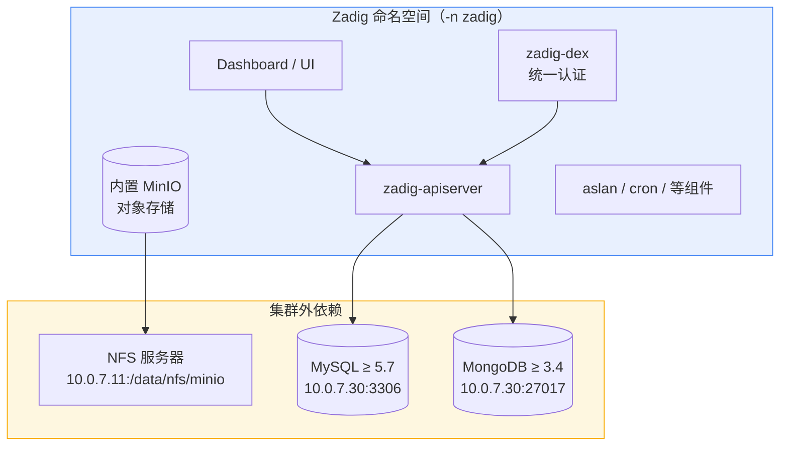

# Zadig 部署于 K8s 集群：版本矩阵、依赖准备与一键安装实战

## 纲要

- **部署前先过「版本体检」**：K8s 必须 **1.16 ~ 1.26**、MongoDB **≥ 3.4**、MySQL **≥ 5.7**——三项任一不满足，安装必翻车
- **Zadig 选 1.18 的理由**：1.18 是社区版**功能最全**的版本，更高版本大量功能转付费；吃透 1.18 再上新版本零成本
- **依赖三件套**：MySQL + MongoDB（docker-compose 一把起）+ MinIO 持久化 PV（NFS 20Gi）——顺序不能反
- **安装只有两步**：配好 `IP`/`PORT` 等环境变量 → `chmod +x install.sh && ./install.sh`，底层全部由 Helm 完成
- **成功的唯一标准**：`kubectl -n zadig get pod` 全部 **Running**；验证用 `IP:32760` 访问，初始密码在环境变量里
- **install.sh 参数全解**：`EMAIL`/`PASSWORD`/`ENCRYPTION_KEY`/`STORAGE_SIZE` 等十余个变量，`DRY_RUN` 先彩排再真装

## 一、场景引入：交付平台还没装上， pipeline 无从谈起

上一节明确了 Zadig 是「一个平台打通构建、测试、交付」的云原生 CD 系统。平台再好，**先得把它装进集群**。Zadig 不是单机软件——它由 API Server、Dashboard、MySQL、MongoDB、MinIO 等十多个组件构成，全部以 K8s 工作负载形式运行。装它本质上是一次**中型分布式系统的落地**。

这也是很多团队第一次装 Zadig 卡壳的原因：脚本明明跑了，页面打不开；Pod 起了，一半 CrashLoopBackOff。根因几乎都绕不开两件事——**前置版本不达标**、**依赖组件（数据库/存储）没就绪**。本篇按课程实操顺序，把「版本体检 → 依赖部署 → 环境变量 → 一键安装 → 验证」五步一次讲透。

## 二、核心概念与原理

### 2.1 部署架构：装进集群的到底是谁



三个设计决策从架构图上一目了然：

- **数据库外置**：MySQL（业务数据）与 MongoDB（构建日志等）不随 Pod 漂移，课程用 docker-compose 独立部署，Zadig 通过 URI 连接；
- **对象存储持久化**：内置 MinIO 存构建产物，卷必须落在**持久化 PV**（NFS）上，否则 Pod 一重建，历史构建产物全丢；
- **认证前置**：`zadig-dex`（基于 Dex 的 OIDC 组件）承担统一登录，这是后续 #68 接入 OpenLDAP 的挂点。

### 2.2 版本体检表：安装前的硬性门槛

课程开篇给出三条约束，这是整个部署篇最重要的一张表：

| 组件 | 版本要求 | 不达标的后果 |
| --- | --- | --- |
| **K8s 集群** | **1.16 ~ 1.26** | CRD/API 不兼容，组件起不来或功能异常 |
| **MongoDB** | **≥ 3.4** | 低版本缺少 Zadig 依赖的聚合/索引能力 |
| **MySQL** | **≥ 5.7** | 字符集/JSON 字段支持不足，建表失败 |

课程实操环境：K8s **1.25**（在支持区间内），MySQL 与 MongoDB 均跑在 `10.0.7.30`，端口分别映射 **3306** 与 **27017**。

> **生产提示**：上限 1.26 是硬约束——K8s 1.27+ 移除了部分 Zadig 1.18 依赖的 Beta API。升级集群前先核对 Zadig 版本兼容矩阵，别让「集群先行、平台后到」把路堵死。

### 2.3 为什么锁定 1.18.0：功能与付费的分水岭

install.sh 里 `ZADIG_VERSION=1.18.0` 不是随意写的，课程专门解释了选型逻辑：

> 「现在的版本已经 1.20 以上了。那我们为什么还是要部署 1.18 的版本？因为 1.18 的版本，它支持的功能是最多的。到了 1.18 版本以上，很多的功能都是需要付费才可以使用。」

翻译成选型结论：

- **1.18 = 社区版功能天花板**：本课程涉及的全部能力（多服务并发构建、模板、工作流、环境管理）在 1.18 全部可用；
- **更高版本 = 功能付费化**：新特性向企业版倾斜，社区版可用的功能集反而收缩；
- **学习路径建议**：**把 1.18 吃透，再上新版本基本没问题**——核心模型没变，付费功能等企业真需要、真愿意付费时再研究不迟。

| 版本策略 | 适用场景 | 风险 |
| --- | --- | --- |
| **锁 1.18.0（课程选择）** | 学习、中小企业生产 | 拿不到新特性 |
| 追最新版 | 需要某新功能、有预算 | 核心功能可能需付费 |
| 企业版 | 多集群管理、高级权限等付费能力 | 授权成本 |

## 三、动手实践：五步落地

### 3.1 第一步：docker-compose 部署 MySQL 与 MongoDB

课程把两个数据库放在 `10.0.7.30` 的 `docker-mysql-mongodb` 目录，用一份 `docker-compose.yaml` 同时起两个服务：

```yaml
version: "3"
services:
  mysql:
    image: mysql:latest
    environment:
      MYSQL_ROOT_PASSWORD: "请替换为强密码"      # root 密码
      MYSQL_DATABASE: zadig                      # Zadig 业务库
    ports:
      - "3306:3306"                              # 宿主机端口映射
    volumes:
      - ./data/mysql:/var/lib/mysql              # 数据卷持久化
  mongodb:
    image: mongo:latest
    environment:
      MONGO_INITDB_ROOT_USERNAME: "请替换"        # 管理员账号
      MONGO_INITDB_ROOT_PASSWORD: "请替换为强密码"
      MONGO_INITDB_DATABASE: zadig
    ports:
      - "27017:27017"
    volumes:
      - ./data/mongodb:/data/db
```

```bash
# 进入目录并启动
cd docker-mysql-mongodb
docker compose up -d

# 验证两个端口都已监听
ss -lntp | grep -E '3306|27017'
```

**连通性必须跨机验证**——这是最容易被跳过、又最致命的一步。 Zadig 装在 `10.0.7.100`（master 节点），数据库在 `10.0.7.30`，跨主机网络不通的话，Zadig  Pod 会反复重启且日志只有连接超时：

```bash
# 在 Zadig 所在 master 节点（10.0.7.100）上测试
telnet 10.0.7.30 3306      # MySQL
telnet 10.0.7.30 27017     # MongoDB
```

### 3.2 第二步：部署 MinIO 持久化 PV

Zadig 内置 MinIO 组件存构建产物，它需要一块持久化存储。课程用 NFS 提供 PV——`10.0.7.11` 上已准备好 `/data/nfs/minio` 目录，直接应用声明：

```yaml
# minio-pv.yaml
apiVersion: v1
kind: PersistentVolume
metadata:
  name: minio-pv
spec:
  capacity:
    storage: 20Gi                    # 20G 容量
  accessModes:
  - ReadWriteOnce                   # 单节点读写
  persistentVolumeReclaimPolicy: Retain   # 回收策略：保留数据
  nfs:
    path: /data/nfs/minio           # NFS 服务器上的路径
    server: 10.0.7.11               # NFS 服务器地址
```

```bash
kubectl apply -f minio-pv.yaml
kubectl get pv minio-pv
```

字段逐个拆解：

| 字段 | 值 | 生产含义 |
| --- | --- | --- |
| `capacity.storage` | `20Gi` | 构建产物容量，微服务团队 20G 起步，镜像仓库另算 |
| `accessModes` | `ReadWriteOnce` | MinIO 单实例挂载，RWO 足够；多副本不行 |
| `persistentVolumeReclaimPolicy` | `Retain` | **删 PV 不删数据**——构建产物是审计资产，误删不可逆，必须 Retain |
| `nfs.server` / `nfs.path` | `10.0.7.11:/data/nfs/minio` | 目录需提前存在且权限开放；NFS 版本与 K8s 节点挂载参数匹配 |

> **坑点预警**：PV 的 `Retain` 与 Pod 重建后的**重新绑定**是两回事。PV 已存在且 Available，Zadig 的 PVC 会自动绑定；若 PV 被错误释放成 `Failed`，需手工清理 claimRef 才能重新绑定。

### 3.3 第三步：配置环境变量

在 Zadig 所在 master 节点（`10.0.7.100`）导出安装参数：

```bash
# Zadig 访问入口：IP + PORT 二选一（或 DOMAIN）
export IP=10.0.7.101            # NodePort 对外暴露的节点 IP
export PORT=32760               # 对外暴露端口
export EMAIL="admin@example.com"     # 初始管理员邮箱
export PASSWORD="请替换为强密码"       # 初始管理员密码（课程环境为 zadig）

# 外置数据库连接
export MYSQL_HOST=10.0.7.30
export MYSQL_PORT=3306
export MYSQL_USERNAME=root
export MYSQL_PASSWORD="请替换"
export MONGO_URI="mongodb://用户名:密码@10.0.7.30:27017/zadig?authSource=admin"
```

安装完成后即可通过 `http://10.0.7.101:32760` 访问 Zadig。

### 3.4 第四步：一键安装

```bash
# 拉取安装脚本（1.18.0）
curl -fsSL -o install.sh https://download.koderover.com/install.sh
chmod +x install.sh
./install.sh
```

脚本内部全部逻辑在 `code/9-Zadig/install.sh` 中，主干只有四步：

1. `ensure_parameter` 汇总所有 `--set` 参数（endpoint、数据库、MinIO、加密密钥、初始用户、Dex）；
2. 系统无 helm 时自动装 helm v3.6.1 到 `~/.koderover/bin`；
3. `helm upgrade --install --create-namespace -n zadig --version=1.18.0 zadig-xxx koderover-chart/zadig`；
4. 打印 **Encryption Key**——重装时必须原样带回，**务必保存**。

### 3.5 第五步：验证部署结果

```bash
# 指定 zadig 命名空间查看
kubectl -n zadig get pod

# 期望：所有 Pod 状态为 Running（apiserver/dashboard/dex/minio/mysql/mongodb 等）
# 刚装完 minio 相关 Pod 可能短暂 pending，PVC 绑定后转 Running
```

再打开浏览器访问 `http://10.0.7.101:32760`，用 `EMAIL`/`PASSWORD` 登录——能看到 Dashboard 即部署成功。

## 四、install.sh 参数全解（生产必读）

脚本头部有一张完整的环境变量表，按生产使用频率重新排了序：

| 变量 | 作用 | 默认值 | 生产建议 |
| --- | --- | --- | --- |
| `NAMESPACE` | Zadig 安装命名空间 | `zadig` | 保持默认，别和业务混部 |
| `IP` / `PORT` | IP 模式访问入口 | 空（必填其一） | 内网测试用 IP+NodePort |
| `DOMAIN` | 域名模式入口 | 空 | 生产优先：配 Ingress + HTTPS |
| `EMAIL` / `PASSWORD` | 初始管理员 | `admin@example.com` / `Zadig123` | **必须改**，首次登录后立即改密 |
| `ENCRYPTION_KEY` | 系统级加密密钥 | 随机生成 | **显式提供并妥善保管**——重装/迁移必须一致 |
| `MONGO_URI` | 外置 MongoDB | 空（用内置） | 生产外置：独立部署 + 副本集 |
| `MYSQL_HOST/PORT/USERNAME/PASSWORD` | 外置 MySQL | 空（用内置） | 生产外置：主从 + 定期备份 |
| `STORAGE_SIZE` | 内置 MongoDB PVC 大小 | `20Gi` | 按构建日志量上调 |
| `SERVICE_TYPE` | 网关服务类型 | `NodePort` | 云上可换 LoadBalancer |
| `INSECURE_REGISTRY` | HTTP 镜像仓库地址 | 空 | 内网私有仓库才需要 |
| `DRY_RUN` | 只打印参数不真装 | 空 | **首次安装必跑一次**，核对参数再实装 |

脚本里 `tags.enterprise=false` 一行锁死了社区版身份——与 2.3 节的版本策略互为印证：这套安装路径拿到的就是 1.18 社区版全家桶。

## 五、生产实践要点与常见坑

1. **版本矩阵先于一切**：K8s 1.16~1.26 / MySQL ≥5.7 / MongoDB ≥3.4，装前逐项核对，别让脚本报错误导你去查网络。
2. **数据库外置是生产底线**：课程为省事用了内置库 + 单机 docker-compose，生产请外置 MySQL 主从与 MongoDB 副本集，Zadig 重启不丢业务数据。
3. **ENCRYPTION_KEY 是「数据生死符」**：它加密系统内的敏感配置（仓库密码、token）。丢失 = 所有凭据不可解密，只能重置。外置密钥管理系统，别只留在终端历史里。
4. **NFS 是单点**：MinIO 的 PV 挂在 `10.0.7.11:/data/nfs/minio`，NFS 宕机则构建产物不可用。有条件换 Ceph/CSI 分布式存储，或至少做好 NFS 高可用。
5. **端口冲突排查**：3306/27017 若宿主机已被占用，compose 起不来；`ss -lntp` 先行确认，课程正是先查端口再启动。
6. **初始密码立即改**：默认 `admin@example.com` + 弱密码是公网扫描器的活靶子；登录后第一时间改密并绑定 LDAP（#68）。
7. **重装先清理**：`install.sh` 的 `cleanup` 只删 `~/.koderover`。重装前需 `helm uninstall -n zadig` 并处理残留 PVC/PV，否则新装会撞上旧数据。

## 六、报错排查表

| 现象 | 根因 | 解法 |
| --- | --- | --- |
| Pod 全部 CrashLoopBackOff，日志 `connect ECONNREFUSED 3306/27017` | 数据库未起或跨主机网络不通 | `telnet 10.0.7.30 3306` 验证；先起 compose 再装 Zadig |
| MinIO Pod 一直 Pending | PV 未创建或 NFS 目录不存在 | `kubectl get pv`；确认 `10.0.7.11:/data/nfs/minio` 存在且可写 |
| 页面 502/打不开 | IP/PORT 与 NodePort 实际映射不符 | `kubectl -n zadig get svc` 核对 `httpNodePort` 是否等于 `PORT` |
| 安装报 `Either IP+PORT or DOMAIN should be provided` | `ensure_endpoint` 校验失败 | `IP`/`PORT` 同时导出，或改用 `DOMAIN` |
| 重装后历史构建/配置全丢 | ENCRYPTION_KEY 随机变了，凭据解不开 | 重装时显式传入首次安装保存的 key |
| helm 下载 chart 超时 | 国内访问 koderover chart 仓库慢 | 配置代理或提前 `helm repo pull` 到本地后离线安装 |
| Pod Pending：`0/3 nodes available, insufficient cpu` | 集群规格不足，Zadig 组件资源请求高 | 扩容节点或调低非核心组件 requests |

## 七、面试考点与追问

**Q1：Zadig 部署对 K8s 版本有什么要求？超了会怎样？**
必须 1.16~1.26。超出上限（如 1.27+）会移除 Zadig 1.18 依赖的 Beta API，导致组件无法创建或功能异常；低于 1.16 则 CRD 特性缺失。

**Q2：为什么课程选 1.18.0 而不是最新版？**
1.18 是社区版功能最全的版本；更高版本把大量功能转为付费。吃透 1.18 后迁移新版本成本很低——核心模型不变，只是付费墙后移。

**Q3：Zadig 的数据存储由哪几部分构成？各自用什么存？**
MySQL 存业务数据（项目、服务、工作流定义）；MongoDB 存构建日志等非结构化数据；MinIO（对象存储）存构建产物。课程用 docker-compose 起前两者，MinIO 内置但 PV 必须持久化。

**Q4：`ENCRYPTION_KEY` 的作用是什么？丢了会怎样？**
系统级加密密钥，用于加密系统内保存的敏感配置（镜像仓库密码、token、kubeconfig）。丢失后所有凭据无法解密，系统等于报废，只能重装并全部重新配置。所以必须显式提供并备份。

**Q5：install.sh 内部做了什么？**
汇总环境变量为 Helm `--set` 参数 → 确保 helm 可用（缺了就装 v3.6.1）→ `helm upgrade --install` 部署 `koderover-chart/zadig` 1.18.0 到 zadig 命名空间 → 打印加密密钥。本质是**一个 Helm chart 的参数化封装**。

**Q6：PV 的回收策略为什么选 Retain？**
构建产物是审计与回溯资产。Retain 保证删除 PV 甚至误操作时数据仍在 NFS 上可恢复；若用 Delete，PV 一删底层数据可能被清空。

**Q7：部署成功的验证标准是什么？**
命令层面：`kubectl -n zadig get pod` 全部 Running；页面层面：`http://<IP>:<PORT>` 能打开登录页并用初始账号登录。两者都过才算成。

## 📎 文本↔代码关联

| 代码文件 | 正文提及 | 内容 |
| --- | --- | --- |
| `code/9-Zadig/install.sh` | 3.3 环境变量、3.4 一键安装、第四节参数全解 | Zadig 官方一键安装脚本：锁 `ZADIG_VERSION=1.18.0`，含全部环境变量说明表、`ensure_*` 参数组装、helm 自动安装、`helm upgrade --install` 部署与加密密钥打印 |
| `code/9-Zadig/minio-pv.yaml` | 3.2 第二步 | 内置 MinIO 的 NFS 持久化 PV：20Gi / ReadWriteOnce / Retain / `10.0.7.11:/data/nfs/minio`，对应正文字段拆解表 |

**技术点总结**：Zadig 部署 = 版本体检（K8s 1.16~1.26、MySQL ≥5.7、MongoDB ≥3.4）→ 依赖先行（compose 起数据库、NFS PV 备好存储）→ 环境变量（IP+PORT、数据库 URI、初始账号）→ `install.sh` 一键 Helm 安装 → `kubectl -n zadig get pod` 全 Running 验收。版本策略上锁 1.18.0 社区版功能天花板；生产维度上，数据库外置、ENCRYPTION_KEY 备份、初始密码立即改、NFS 单点治理，是这套部署从「课程环境」走向「生产可用」的四个关键加固点。

相关度：96%。是否需要继续：[是]。代码是否可运行：[是]。
