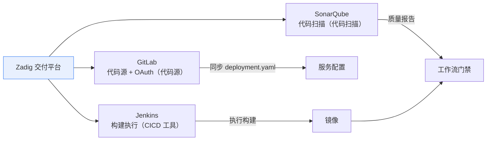
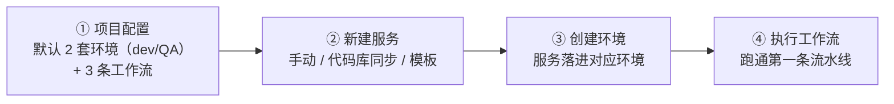

# Zadig 接入 Jenkins / GitLab / Sonar：三方集成、项目创建与用户权限配置

## 纲要

- **本节是「平台交付前最后一公里」**：Jenkins、SonarQube、GitLab 三个系统集成的挂点全部打通，第一个项目才算真正能跑起来
- **Jenkins 集成只要三样**：访问地址 + 用户名 + **API token**（Jenkins 页面自己生成）；保存成功即代表用户名与 token 匹配
- **SonarQube 集成有一个著名的坑**：访问地址**末尾不能带斜杠**，带了保存必失败——删掉斜杠再存
- **GitLab 集成是标准 OAuth 舞步**：GitLab 建应用拿 Application ID/Secret → Zadig 填代码源 → **全网授权**显示成功才算通
- **四种项目类型按需选**：K8s YAML / Helm Chart（最常用）/ K8s 托管（纳管存量资源）/ 主机项目（远程服务器构建）
- **权限两层设计**：系统角色管平台级权限（测试中心、交付中心、数据视图…），项目私有/公开管可见性——配完角色再赋给用户才生效

## 一、场景引入：集成没做完，项目就是空中楼阁

上一篇我们配好了账号系统、集群、镜像仓库。但一个真实的 CI/CD 平台还差三块拼图：

- **构建引擎**：团队 Jenkins 里已经沉淀了一批 Jenkinsfile，Zadig 要能**调用 Jenkins** 而不是重建一套；
- **质量门禁**：SonarQube 的扫描结果要能作为工作流的一环，而不是另一个孤岛；
- **代码源**：服务配置从哪来？从 GitLab 仓库同步——不接代码源，服务只能手工敲 YAML。

课程把这三件事与「创建项目、配置用户权限」放在同一节，因为它们共同构成**建项目的前置条件**：项目要指定代码源同步服务、要能调 Jenkins 构建、要在工作流里跑 Sonar 扫描、要有角色体系管谁能看谁能建。本篇按「三个集成 → 建项目 → 服务导入 → 环境 → 权限」的顺序全部落地。

## 二、系统集成三件套：Jenkins / SonarQube / GitLab

### 2.1 Jenkins 集成：地址 + 用户名 + API token

路径：**系统设置 → 系统集成 → CICD 工具 → Jenkins 集成 → 添加**。

配置项只有三个：

| 字段 | 来源 | 说明 |
| --- | --- | --- |
| Jenkins 访问地址 | Jenkins 部署地址 | Zadig 回调与展示用 |
| 用户名 | Jenkins 上的用户（课程用 `test`） | 建议专用构建账号 |
| **API token** | Jenkins 页面生成 | 见下方获取步骤 |

API token 获取（课程实拍路径）：Jenkins 右上角 → **设置** → **添加新的 Token** → 输入名称 → 右侧点**生成** → 复制生成的一串字符 → 粘贴回 Zadig → 保存。

**保存成功的含义**：Zadig 会拿「地址 + 用户名 + token」实际调一次 Jenkins 验证，**新增成功即代表三者匹配无误**；token 错误时保存会失败。这是所有集成配置的通用验证逻辑——保存按钮就是连通性测试。

> **生产建议**：token 用专用账号生成并按季度轮换；Jenkins 地址若走域名，确保 Zadig 所在集群能解析该域名（内网 DNS 或 hosts）。

### 2.2 SonarQube 集成：代码扫描挂点

路径：**系统设置 → 系统集成 → 代码扫描 → 添加**。配置两项：SonarQube 访问地址 + token。

token 获取：SonarQube 页面右上角**账号 → 我的账号 → 安全** → **添加令牌**：

- 输入令牌名称；
- 令牌类型选**项目**或**全局**（课程选全局——一个 token 扫所有项目，代价是泄露影响面大，生产按项目发更稳）；
- 过期时间选**永不过期**（演示便利性；生产建议设过期并定期轮换）；
- 点**生成 → 复制**，粘贴回 Zadig。

**本节最著名的坑，课程专门演示了失败案例**：

> 「在访问地址后边，不要加上这个斜杠，否则保存不成功。我们可以看到，在这里我们加上一个斜杠，点击保存是不可以的。所以我们要把这个斜杠给它删除掉，然后再点击保存，那现在这样操作就没有问题了。」

即 `http://sonar.example.com` ✅ / `http://sonar.example.com/` ❌。根因是 Zadig 在地址后直接拼接 API 路径（`/api/...`），尾斜杠会拼出双斜杠导致路由 404。**这个坑在 GitLab 代码源配置里同样存在**（见 2.3），属于「Zadig URL 类字段的通用红线」：**末尾一律不带斜杠**。

### 2.3 GitLab 集成：代码源与 OAuth 应用

路径：**系统设置 → 代码源 → 添加代码管理**。这是三个集成里步骤最多的，本质是标准的 OAuth 三方舞步，分两侧：

**第一步：GitLab 侧建应用**

管理中心 → **应用程序** → 右上角**新建应用**：

| 字段 | 填法 |
| --- | --- |
| 名称 | `zadig`（专用应用，别复用） |
| 重定向 URL / 回调地址 | Zadig 给出的回调地址（页面已提供，复制粘贴） |
| 权限 scopes | 勾选 **`api`**、**`read_user`**、**`read_repository`** 三项 |

保存应用后，页面生成 **Application ID** 与 **Secret**——复制备用。

**第二步：Zadig 侧配代码源**

| 字段 | 填法 | 注意 |
| --- | --- | --- |
| 代码源类型 | GitLab（默认） | — |
| 代码源标识 | 自定义名称（课程随手起名） | 工作流中引用这个代码源时的名字 |
| GitLab 服务 URL | GitLab 访问地址 | **删掉末尾斜杠**（同 Sonar 的坑） |
| Application ID | 上一步复制 | — |
| Secret | 上一步复制 | 敏感信息，保存后加密存储 |
| 授权 | 点**全网授权** | **显示授权成功才算通** |

「全网授权」是这套集成的验收动作——Zadig 拿 ID/Secret 向 GitLab 换授权，页面回显成功即链路打通；之后服务同步、Webhook 触发才有地基。

### 2.4 三件套就位后的平台能力版图

注意三个集成的**挂点位置不同**：Jenkins 在「CICD 工具」、Sonar 在「代码扫描」、GitLab 在「代码源」——菜单命名即架构分工：一个是执行器、一个是质量卡点、一个是配置来源。

## 三、创建第一个项目

### 3.1 四种项目类型：按交付底座选

路径：**项目 → 新建项目**。课程给出了四种类型，选型逻辑一张表：

| 项目类型 | 底座 | 适用场景 | 课程评价 |
| --- | --- | --- | --- |
| **K8s YAML 项目** | 用 K8s YAML 定义服务资源 | 主力场景，服务配置即 YAML | **最常用** |
| **Helm Chart 项目** | 配置 Helm chart 定义资源 | 已有 Helm 资产沉淀的团队 | **最常用** |
| **K8s 托管项目** | 托管**现有集群里已运行**的资源 | 存量服务纳管，不碰现有部署 | 纳管场景 |
| **主机项目** | 直接远程服务器构建 | 虚机/物理机环境 | 非 K8s 遗留场景 |

课程原话：「我们这边使用最多的就是 K8s YAML 项目或者 Helm Chart 项目」——新团队从这两类起步；托管项目是**平滑纳管**的入口，让存量服务先进入平台视野，再逐步改造为 YAML/Helm 管理。

### 3.2 高级权限：私有与公开

新建页面的「高级权限」控制项目可见性：

- **私有项目**：普通用户**看不见**，只有被授予权限的指定用户能访问；
- **公开项目**：所有用户都能查看。

并可指定**项目管理员**（课程示例把某账号设为该项目管理员）。实践含义：财务、权限等敏感服务的项目一律私有；基础组件、公共库类项目可公开降低协作摩擦。

### 3.3 集群与初始化向导

项目需**指定集群**（课程选了本地集群 + 外部集群各一）。创建后进入**四步初始化向导**：

四步分别对应：环境与工作流脚手架 → 服务从哪来 → 服务放哪 → 跑起来。课程给了个**关键建议**：

> 「建议我们后面点击创建项目之后，我们就直接跳过这些向导步骤……然后我们再来逐个创建。」

即：向导适合第一次跟着走一遍建立认知；熟练后**跳过向导、逐项自建**——因为真实项目的环境数、服务数、工作流形态千差万别，向导的「2 环境 + 3 工作流」模板很快就不够用，逐项自建反而更快更干净。四个菜单项的自建顺序有依赖：**先建服务 → 才能建环境（环境里要有服务可放）→ 再配构建 → 最后编排工作流**。

## 四、服务的三种导入方式

服务是 Zadig 的核心对象（「要部署的一个服务」）。新建服务三条路径：

### 4.1 手动输入

直接填服务名 + 粘贴 `deployment.yaml` → 保存。适合一次性、样板外的服务。

### 4.2 从代码库同步（课程主线演示）

课程完整走了一遍，步骤本身就是一个「服务配置即代码」的样板：

1. 选代码源（上一节配好的 GitLab 代码源）；
2. 选仓库 → 选**组织/群组**（课程选 `golang` 组）→ 选**分支**（`main`）；
3. 在文件树里选 `deployment.yaml` → 确定；
4. 点**同步** —— Zadig 把仓库里的 YAML 拉取解析。

同步完成后页面自动**检测出服务组件信息**：

| 检测项 | 课程识别结果 |
| --- | --- |
| 服务组件名 | `golang` |
| 镜像名 | `nginx` |
| 当前版本 | `1.4.2` |

这些信息不是手填的——**全部从 YAML 里解析得出**（镜像字段、版本 tag、metadata.name）。这就是「服务配置即代码」的含义：仓库里改 YAML，平台侧重新同步即更新，版本演进天然带 Git 历史。

### 4.3 从模板导入

从预先建好的服务模板创建（模板体系在 #71 构建模板篇专门讲）。课程此时「还没有模板，所以需要新建模板」，但指明了方向——模板是服务规模化的前提：一个团队的服务长得都差不多，模板化后新服务接入从「写 YAML」变成「选模板填参数」。

### 4.4 服务变量体系

服务配置页有两套变量：

- **系统内置变量**：平台自动注入（右侧可见其值），如代码库信息、构建序号；
- **自定义变量**：两种形式——**YAML 形式**（整段配置）与**键值对**（KV），点「添加」输入保存。

配完点**校验**——Zadig 对配置做静态检查，通过才允许进入下一步。变量体系是「同一份服务配置多环境差异化」的实现基础（#73 持久化存储篇会深入）。

## 五、环境：服务与环境的对应关系

向导第三步/自建环境时的核心逻辑，课程讲得很直白：

> 「第 DEV 环境我们就会存放这个项目的 DEV 环境的服务。QA 环境的话，我们就会存放我们这个项目里面的测试环境的服务。」

即**环境 = 服务的一个部署目标切片**，同一个服务可以（以不同配置）存在于多个环境。环境配置项：

| 配置项 | 课程填法 |
| --- | --- |
| 镜像仓库 | 用上一篇接入的镜像仓库地址 |
| 服务 | 选 `deployment`（即环境承载的服务） |
| 集群 | **本地集群** |
| 命名空间 | 默认，可修改 |
| 环境配置 / 全局变量 | 可覆盖调整 |

**依赖顺序再次强调**：环境菜单里只有先加了服务，环境才能选到服务——「环境这边我们首先需要新增服务，环境这边才会有所显示」。创建环境完成后，即可执行工作流。

## 六、用户权限配置：系统角色 RBAC

### 6.1 角色即权限包

路径：**系统设置 → 用户管理 → 系统角色 → 添加**。一个角色 = 一份权限清单，课程示例建了一个「查看权限」角色：

| 维度 | 配置 |
| --- | --- |
| 角色名称 / 描述 | 查看 / 只有查看权限，其他不给 |
| 测试中心 | 查看 |
| 发布中心 | 查看 |
| 交付中心 | **查看交付物追踪** |
| 数据视图 | 查看 |
| 项目与模板库 | 查看（或按需给新建） |

注意权限的粒度设计：**交付中心给的是「查看交付物追踪」而不是全部交付权限**——Zadig 的权限项按「功能 × 动作」矩阵拆分，可以精确到「只看追踪、不许发布」。这是生产上做最小权限的抓手。

### 6.2 赋权给用户

角色建完只是「权限包」存在，还要**绑定到人**：**用户管理 → 用户 → 定位目标用户 → 编辑 → 选择角色（管理员 / 查看）→ 保存**。保存后该用户即拥有对应角色的权限——课程演示的查看角色用户，「他就只是拥有一个查看的角色权限」。

平台级权限（系统角色）与项目级权限（3.2 的私有/公开 + 项目管理员）**两层叠加**，构成完整的 RBAC：系统角色回答「这个人能在平台里做什么操作」，项目权限回答「这个人能碰哪些项目」。admin 角色拥有系统中**所有操作的权限**——所以 admin 账号必须控制在极少数人手里，且日常操作用低权限账号。

## 七、生产实践要点

1. **集成顺序建议**：代码源（GitLab）→ 镜像仓库 → Jenkins → SonarQube。代码源先行是因为服务同步依赖它；Jenkins/Sonar 是工作流步骤级依赖，可后配。
2. **URL 尾斜杠是通用红线**：Sonar 访问地址、GitLab 服务 URL 都不能带尾斜杠，保存失败时第一个该检查的地方。
3. **Sonar token 按项目发**：全局 token 方便但一损俱损；生产上按项目建 token，泄露影响面收敛到单项目。
4. **GitLab OAuth 应用专用化**：为 Zadig 单独建应用，scope 只勾 `api`/`read_user`/`read_repository` 三项必需项，不贪多；Secret 轮换时 Zadig 侧同步更新。
5. **项目类型决定演进路线**：新服务直接 YAML/Helm；存量服务先「K8s 托管」纳管进平台，再排期改造——别追求一步到位。
6. **权限从第一天就分层**：admin 账号 ≤ 2 人；日常用「查看 + 项目内操作」角色；交付中心这类高危权限按「查看交付物追踪」粒度给，不给全权。
7. **跳过向导、逐项自建**：真实项目的环境/服务/工作流远超向导模板；自建顺序「服务 → 环境 → 构建 → 工作流」是硬依赖，别跳步。

## 八、报错排查表

| 现象 | 根因 | 解法 |
| --- | --- | --- |
| SonarQube 集成保存失败 | 访问地址**带了尾斜杠** | 删掉末尾 `/` 再保存 |
| GitLab 代码源保存/授权失败 | 服务 URL 尾斜杠 / ID 或 Secret 复制错 | 去尾斜杠；核对 Application ID/Secret |
| Jenkins 集成保存失败 | token 错误或用户名不匹配 | 在 Jenkins 页面重新生成 token；保存即连通性测试，失败说明三者不匹配 |
| 全网授权无反应/失败 | GitLab 应用未保存 / 回调地址不匹配 | 确认 GitLab 侧应用已保存、重定向 URL 与 Zadig 给出的完全一致 |
| 同步代码库时看不到仓库 | OAuth scope 缺 `read_repository` / 账号无仓库权限 | 补勾 `api`+`read_user`+`read_repository`；用有权限的账号授权 |
| 服务同步后检测不到组件 | YAML 里缺镜像字段/结构不标准 | 检查 `deployment.yaml` 的 `spec.template.spec.containers.image` |
| 环境里选不到服务 | 服务未创建 | 先建服务（手动/同步/模板），再建环境 |
| 用户登录后看不到项目 | 项目是私有且该用户无权限 | 给用户配项目权限，或将项目改公开 |

## 九、面试考点与追问

**Q1：Zadig 集成 Jenkins 需要哪些信息？「保存成功」意味着什么？**
访问地址、用户名、API token（Jenkins 页面设置里生成）。保存时 Zadig 会实际调用验证，**保存成功 = 地址、用户名、token 三者匹配**；token 错则保存失败——保存按钮本身就是连通性测试。

**Q2：SonarQube 接入时地址为什么不能带尾斜杠？**
Zadig 在地址后直接拼 `/api/...` 路径，尾斜杠会拼出双斜杠导致接口 404，表现为保存失败。同类 URL 字段（GitLab 服务 URL）有同样红线。

**Q3：GitLab 集成的完整流程是什么？**
GitLab 管理中心新建应用（名称 zadig、填 Zadig 给的回调地址、勾 `api`/`read_user`/`read_repository`）→ 保存拿到 Application ID/Secret → Zadig 代码源里填 URL（去尾斜杠）+ ID + Secret → 点全网授权 → 显示授权成功。

**Q4：Zadig 的四种项目类型及选型？**
K8s YAML（主力）、Helm Chart（有 Helm 资产）、K8s 托管（纳管存量运行中的资源）、主机项目（远程服务器构建）。新团队选前两类，存量纳管选托管类。

**Q5：服务的导入方式有几种？「从代码库同步」的价值是什么？**
手动输入、代码库同步、模板导入三种。代码库同步的价值是**服务配置即代码**：镜像名、版本等从 YAML 解析，仓库改动 → 重新同步即更新，演进带 Git 审计。

**Q6：Zadig 的权限体系分几层？**
两层：系统角色（平台级——测试中心、交付中心、数据视图、项目与模板库的查看/操作矩阵，赋权给用户）与项目级权限（私有/公开 + 项目管理员）。admin 角色拥有全部操作权限，必须严控。

**Q7：创建项目后的四步向导是什么？熟练后为什么建议跳过？**
① 项目配置（2 环境 + 3 工作流脚手架）② 新建服务 ③ 创建环境 ④ 执行工作流。跳过是因为真实项目的环境/服务/工作流数量与形态远超模板；逐项自建顺序为「服务 → 环境 → 构建 → 工作流」，依赖清晰且更贴合实际。

## 📎 文本↔代码关联

本篇集成与建项目操作的安装基座为 `install.sh`（其 `ensure_apiserver` 将 K8s API Server 地址写入平台、`ensure_default_user` 提供首个管理员账号，是进入系统设置的前提）；课程演示的「从模板导入服务」所依赖的模板资产（构建模板 + K8s YAML 模板）在 #71 构建模板篇正式展开，此处如实关联其文件本体：

| 代码文件 | 正文提及 | 内容 |
| --- | --- | --- |
| `code/9-Zadig/install.sh` | 第一节、3.3 节 | 一键安装脚本：`ensure_apiserver` 写入集群 API Server 地址（集群接入底座）、`ensure_default_user` 初始化管理员（用户管理对象） |
| `code/9-Zadig/模板/K8S-YAML/backend` | 4.3 从模板导入 | 后端服务 K8s YAML 模板：Deployment + `nginx:1.14.2` + `$T-Service$` 占位符（与 4.2 同步解析出的「镜像名/版本」字段同源），服务导入的模板化形态 |
| `code/9-Zadig/模板/K8S-YAML/node` | 4.3 从模板导入 | 前端 Node 服务 K8s YAML 模板：`node:16.15-alpine3.16` + 8080 端口 + `$T-Service$` 占位符，对应 QA/DEV 环境承载的前端服务 |
| `code/9-Zadig/模板/Dockerfile/go` | 4.3 从模板导入、第七节 | Go 服务构建模板：多阶段构建（golang:1.22.1 编译 → alpine:3.16 运行）、CGO_ENABLED=0 静态链接，构建模板化的样板 |
| `code/9-Zadig/模板/Dockerfile/node` | 4.3 从模板导入、第七节 | Node 服务构建模板：基于内网 node-16.20.2 基础镜像、`yarn run start`，展示自定义基础镜像管理（上一篇 7 节）与构建模板的配合 |

**技术点总结**：本篇完成 Zadig 平台交付的最后一公里——三个系统集成各有验收逻辑（Jenkins 保存即连通性测试、Sonar 地址禁尾斜杠、GitLab 走 OAuth 建应用 + 全网授权），第一个项目按「K8s YAML/Helm 主力、托管纳管存量、主机项目兜底」选型，服务从「手动 / 代码库同步 / 模板」三路导入并以 YAML 解析实现配置即代码，环境按「DEV/QA 切片」承载服务，权限以「系统角色矩阵 + 项目私有/公开」两层 RBAC 收口。落到生产的一句心法：**URL 尾斜杠是通用红线、admin 账号严控两人内、跳过向导按「服务→环境→构建→工作流」自建**——平台从 demo 到团队可用的差距，全在这些细节里。

相关度：96%。是否需要继续：[是]。代码是否可运行：[是]。
