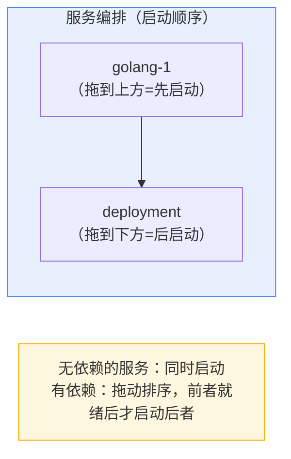

# Zadig 服务与环境管理：服务编排、YAML 变量体系与环境切片

## 纲要

- **服务是 Zadig 的核心对象**：导入服务有四条路——**手动输入、代码库同步、模板新建、K8s 导入**；同步后镜像名/版本全部**从 YAML 解析**，配置即代码
- **服务编排解决启动依赖**：A 启动成功 B 才能启动的场景，在编排页**拖动服务调整顺序**即可，服务多了编排顺序自动增加
- **变量体系是模板化的地基**：系统内置变量（`${{.project}}`/`${{.service}}` 形式）直接引用；自定义变量（字符串/枚举/布尔/YAML）用 `{{.name}}` 占位——**把不一样的地方抽离出来，一份配置就是通用模板**
- **镜像名称规则决定产物寻址**：用时间戳、commit ID、分支名等变量与常量组装镜像 tag，构建时按规则自动生成
- **环境 = 服务的部署切片**：环境名**必须是字母**（中文不允许）；先有服务才能建环境；同名服务会覆盖集群已有服务
- **环境内运维能力齐全**：Pod 实例详情、进容器调试、**临时调试容器**（默认带 curl/wget/net-tools）、实时日志、文件下载、Ingress/configmap/PVC 单列管理

## 一、场景引入：服务与环境，Zadig 的两个基本粒子

如果说「项目」是 Zadig 的第一级容器，那么**服务**与**环境**就是撑起日常运营的两个基本粒子：

- **服务**回答「要部署什么」——一个镜像、一套 K8s YAML、一组变量；
- **环境**回答「部署到哪」——哪个集群、哪个命名空间、放哪些服务。

没有服务的环境是空壳，没有环境的服务无处运行。课程把这两节放在一起讲，因为它们的操作流完全咬合：**先导入服务 → 再创建环境 → 把服务加进环境 → 在环境里运维**。本篇按这条主线，把服务管理（导入、编排、变量、镜像规则）与环境管理（创建、加入、运维、Ingress）一次讲透。

## 二、服务管理：四条导入路径与自动解析

### 2.1 导入服务的四种方式

路径：**项目 → 服务 → 加号**。课程帮助文档给出四条路：

| 方式 | 做法 | 适用场景 |
| --- | --- | --- |
| **手动输入** | 填服务名 + 粘贴 K8s YAML → 保存 | 一次性、样板外服务 |
| **代码库同步** | 选代码源 → 仓库 → 分支 → 选 `deployment.yaml` → 同步 | 主力方式，配置即代码 |
| **模板新建** | 从模板库的 YAML 模板创建 | 多服务同构（#71 专题） |
| **K8s 导入** | 把集群里**已存在**的服务导入平台 | 存量纳管，服务必须先存在于集群 |

> **K8s 导入的现实约束**：课程直言「K8s 导入基本上我们都不会先在 K8s 集群当中先创建服务」——它面向的是「集群里已经跑着一批没人管的服务，先拉进平台视野」的纳管场景，不是主流路径。

### 2.2 自动解析：同步后平台替你读懂 YAML

无论手动粘贴还是代码库同步，保存后 Zadig 都会**自动检测服务组件**，解析规则课程讲得很细：

| 解析项 | 数据来源 | 课程示例 |
| --- | --- | --- |
| 服务组件名 | 参考**容器名称** | 容器叫 `nginx` → 组件名 `nginx` |
| 镜像名 | 跟随容器名 | 改名 → 镜像名跟着变 |
| 当前镜像版本 | YAML 里的镜像 tag | 如 `1.14.2` |
| 构建配置 | 「添加构建」即定义这个服务怎么构建 | 类似 Jenkins 的构建步骤 |

**「添加构建」**这一栏的含义课程点明了：要给这个服务配置构建——跑什么脚本、怎么打镜像，与 Jenkins 里的构建是同义词。没配构建的服务，只有部署形态、没有生产形态，后续工作流无法选用。

### 2.3 变量体系：模板化的真正地基

服务配置页有两套变量，这是整个 Zadig 模板化设计的核心机制：

**系统内置变量**——平台自动注入，在服务配置中直接用 `$` 或 `${{.project}}`、`${{.service}}`、`${{.name}}` 这类形式引用。课程示例：YAML 里的资源名写成 `${{.service}}-deployment`，不同服务导入同一份模板时**自动替换成各自的服务名**。

**自定义变量**——左下角加号添加，按**键值**方式配置：

- 变量名、类型（**字符串 / 枚举 / 布尔值 / YAML**）、值；
- YAML 配置区也能以 **key-value 格式**呈现（通过文件配置）；
- 引用方式：`{{.name}}`（两个大括号 + 点 + 变量名），替换 YAML 里任何不想写死的字段。

课程把这一步的价值说得很直白：

> 「比如说在这边我不想写死，对吧？我要引用这个自定义变量，我们就可以通过两个大括号，再写上一个点，后面跟上它的变量名……这样就形成了一个我们通用的一个模板。」

**内置变量 vs 自定义变量的使用差别**（课程帮助文档归纳）：内置变量**可直接**在服务模板中引用；自定义变量需**先手动配置**、再在模板里调用。另外，**YAML 中添加的变量在运行环境中会作为环境变量使用**——即变量不仅参与模板渲染，还能注入容器运行时。

### 2.4 镜像名称规则与交付物命名

服务侧列里有「交付物命名规则」设置，包含**镜像名称规则**与**跨包名称规则**。镜像名称规则的作用：构建时按规则**自动生成镜像 tag**，而非手工指定。

规则由**变量与常量组装**，可用变量包括：

- 时间戳、工作流任务 ID、分支名称；
- 代码 PR ID、代码 commit ID；
- 项目名称、项目服务组件名称、镜像名称、环境名称。

配置方法：把变量粘贴进规则串、用分隔符（如 `-`）连接，保存策略即生效。课程示例用了「服务名生成规则」——镜像 tag 直接由服务名生成，因为团队的构建方式就是按服务寻址。**不配置则保持默认**；需要其他寻址方式时再在对应生成规则里配置。

### 2.5 服务编排：启动顺序的可视化调整

多微服务的启动往往有依赖：**A 启动成功后 B 才能启动**。Zadig 的服务编排把这件事做成了拖拽：

- **服务多了，编排顺序默认自动增加**（新增服务自动进编排列表，无需手工添加）；
- **默认多个服务同时启动**（无依赖顺序）；
- 调整方法：**按住服务拖动**——把 `deployment` 拖到下面，则 `golang-1` 先启动、完成后再启动 `deployment`；想反过来就把 `deployment` 拖上去。

类比起步：编排就是 K8s 世界的**「开机启动项管理」**——Windows 里调整服务启动顺序是注册表里挪依赖，Zadig 里是编排面板上拖方块。

### 2.6 服务侧列：超时、自动更新与策略

服务卡片最右侧的侧列是常被忽略的策略区，课程演示了三项：

| 配置 | 课程说明 | 生产含义 |
| --- | --- | --- |
| **服务部署超时** | 默认 **10 分钟** | 部署动作的计时器——与 #71 构建模板里的**构建超时（60 分钟）**是两个独立计时器，排查卡断先确认撞的是哪个 |
| **开启自动更新** | 服务配置变更时**自动同步部署到环境**（课程注明该能力需要更高版本才可用） | 配置即代码的终极形态：Git 改 YAML → 平台感知 → 自动部署；社区版需评估功能边界 |
| **镜像名称规则 / 交付物命名规则** | 见 2.4，决定产物 tag 怎么生成 | 镜像寻址的唯一入口 |

「自动更新」值得多看一眼：它把「改配置」与「生效」之间的手工部署环节消掉了——服务 YAML 变更即触发环境同步。代价是**变更失去了人工确认环节**，生产环境开启前务必确认有对应的回滚与审计手段。

## 三、环境管理：服务的部署切片与运维驾驶舱

### 3.1 创建环境：三条硬规则

路径：**环境 → 新建环境**。课程实操暴露了三条必须知道的规则：

| 规则 | 说明 |
| --- | --- |
| **环境名必须是字母** | 输入中文**不允许**——命名规范从源头强制 |
| **命名空间默认生成、可修改** | 如改成 `testapp`，但该命名空间需**先创建** |
| **同名服务会覆盖** | 「如果定义的服务名称是同名服务的话，它会**覆盖当前集群当中已经存在的服务**」——重名即覆盖，防呆靠自己 |

其余配置项：**创建方式选新建**、**部署集群选本地集群**、**镜像仓库**（此前接入的仓库自动带出）、**服务**（勾选要放进去的服务，如 `deployment`、`golang-1`）、**环境配置**（可从代码库导入服务）、**服务列表默认** → **立即创建**。左下角提示「正在创建环境」→ 成功后环境卡片显示：包含的服务、所属集群、命名空间、镜像仓库、更新时间、**环境状态是否正常**。

### 3.2 服务加入环境：两条路径

课程演示了两种等价操作：

1. **环境侧加入**：环境 → 管理服务 → 勾选服务 → 加入；
2. **服务侧加入**：服务列表 → 勾选 `golang-1` → **加入环境** → 选目标环境（如 `test`）→ 确定（自定义环境变量值不需修改则直接确定）。

环境卡片随即多出该服务。反过来，**删除服务**走：管理服务 → 删除服务 → 选中 → 删除；**更新服务**走：管理服务 → 选服务 → 更新（或服务卡片上的更新/重启按钮）。

### 3.3 环境内运维：从实例到调试容器

点进服务名称，进入 Zadig 的环境运维视图——这是它作为「平台」区别于裸 kubectl 的核心体验：

**实例总览**：Pod 列表（绿色=健康）、版本、副本数量（可修改）、实例名称、实例 IP、**健康探测状态**、运行时长、**部署在哪个节点**、容器名称、当前镜像、启动时间——一屏看全。

**进容器调试**：选容器 → 调试 → 直接进入容器执行命令；还能**下载文件**（如在 `/data` 建文件写入内容，下载时输入绝对路径即可取回）；支持全屏（ESC 退出）。

**实时日志**：刷新日志、一键去底部/回顶部；可切换不同容器分别查看。

**重启实例 / 查看事件**：实例级操作与 K8s Events 直达。

**临时调试容器**——课程专门演示的生产利器：

> 「游戏我们可能还需要做一些调试。比如说有一些指令，我们默认的一个业务容器是没有的。比如说要查看一个网络啊，或者查看一些什么其他的调试系统工具，没有。那我们可以点击这里临时启动一个调试容器。」

点「调试容器」→ 确认（**默认自动安装 curl、wget、net-tools 等工具**）→ 平台拉调试镜像、起容器 → 多出一个调试容器 → 进入操作。

这个设计解决的是一个真实痛点：**生产镜像越精简，调试越难**。distroless/alpine 镜像里没有 netstat、没有 curl，排查网络问题得现改镜像重启。临时调试容器 = **不动业务镜像、不重启 Pod，挂个工具箱进去查完就走**。

### 3.4 Ingress / configmap / PVC：单列资源管理

课程专门澄清了一个**高频误区**：

> 「我们在这边可以配置 service，但是在这边粘贴 Ingress 过来是没有作用的，只能配置 deployment 以及 service……而且不支持自定义的资源定义，一定是 K8s 内部的资源。」

即：服务 YAML 里**只认 deployment 与 service**；Ingress、configmap、PVC 必须去**环境配置**里单独添加。原因也讲了——这些资源的作用域是**环境级**（跨服务共享）：环境所属命名空间是 `testapp`，该命名空间下已有的三个 Ingress 会显示在环境配置里，与命名空间**匹配**才可见。

访问方式因此分层：

| 配置 | 内网访问 | 外网访问 |
| --- | --- | --- |
| 只配 deployment | 无 | 无 |
| + service | 显示**设备 IP 地址** | 无 |
| + Ingress | — | 显示**域名**，可直接点击跳转 |

没配 Ingress 的服务，环境卡片上外网访问按钮不存在——这是**最小暴露面**的默认安全姿态。

## 四、生产实践要点

1. **命名规范先行**：环境名仅字母的约束要提前同步给团队，中文环境名到创建时才报错会打断流水；命名空间若自定义（如 `testapp`）需先创建，否则环境创建失败。
2. **重名覆盖防呆**：同名服务覆盖集群已有服务是静默行为——上生产前用命名规范（项目-服务-环境三段式）杜绝撞名，别依赖平台提醒。
3. **镜像名自动跟随容器名**：组件名/镜像名从容器名解析，改容器名会连锁改镜像名——同步 YAML 前先审字段。
4. **变量治理**：内置变量优先（服务名、项目名直接引用），自定义变量按「环境差异项」维度建（数据库地址、副本数），类型选字符串/枚举；把「写死的都换成 `{{.name}}`」是模板化的唯一标准动作。
5. **调试容器进生产**：临时调试容器带 curl/wget/net-tools，排网络问题时比改镜像重启优雅一万倍；但用完即删，别让调试容器常驻。
6. **Ingress 必须环境级创建**：服务 YAML 粘 Ingress 无效是设计而非 bug——Ingress 是环境级共享资源，统一在环境配置里管，避免多服务互相覆盖。
7. **构建配置是服务完整性的最后一环**：只导 YAML 不配构建的服务是「半成品」，工作流选不到它——导入服务后立即补构建配置。
8. **部署超时按环境分级调**：10 分钟默认值对小服务够用；大镜像（1G+）拉取就可能吃掉大半配额，生产环境按「最大镜像拉取时长 + 余量」上调，别让发布掐在假超时上。
9. **环境即安全边界**：dev/qa/prod 三环境不仅是命名空间隔离，更是权限与暴露面的分层——Ingress 只在必要的环境配（#72 工作流篇的环境绑定同理），测试环境裸奔无妨，生产环境必须域名 + 认证前置。
10. **服务数量规模化后靠编排与搜索**：服务多到几十个时，编排顺序自动增加、环境卡片搜索过滤、视图分离三板斧要提前用起来——平台操作的复杂度随服务数增长，治理动作必须超前半步。

## 五、报错排查表

| 现象 | 根因 | 解法 |
| --- | --- | --- |
| 环境名输中文保存被拒 | 平台强制环境名仅字母 | 改英文环境名（如 `test`/`prod`） |
| 环境创建失败 | 自定义命名空间（如 testapp）不存在 | 先在集群 `kubectl create ns testapp` |
| 同名服务被覆盖 | 服务重名 + 平台覆盖语义 | 规范命名；覆盖前确认旧服务可弃 |
| 服务 YAML 里配了 Ingress 不生效 | 服务只认 deployment/service | Ingress 移到环境配置里单独添加 |
| 自定义资源定义不被识别 | 平台仅支持 K8s 内置资源 | 自定义 CRD 用 K8s 导入或另行管理 |
| 外网访问按钮不显示 | 服务未配 Ingress | 环境配置 → 添加 Ingress → 指向 service |
| 副本数改了实际数对不上 | 旧版本 Pod 尚未删除 | 刷新等待旧副本回收，再看实例列表 |
| 引用变量渲染成空 | 变量名拼错 / 未配置值 | 核对 `{{.name}}` 与自定义变量名一致 |

## 六、面试考点与追问

**Q1：Zadig 导入服务有哪四种方式？主流是哪种？**
手动输入、代码库同步、模板新建、K8s 导入。主流是**代码库同步**——服务配置即代码，镜像名/版本从 YAML 解析，仓库改动重新同步即更新。

**Q2：Zadig 如何解析服务组件信息？**
组件名参考容器名称，镜像名跟随容器名，镜像版本取 YAML 的镜像 tag。全部自动解析，无需手填——改容器名会连锁影响镜像名。

**Q3：系统内置变量与自定义变量的引用方式有何不同？**
内置变量在服务模板中**直接引用**（`${{.project}}`、`${{.service}}` 形式）；自定义变量需先手动配置（名称/类型/值），再用 `{{.name}}` 形式在模板里调用。YAML 中添加的变量运行时还会作为环境变量注入容器。

**Q4：镜像名称规则解决什么问题？**
构建时镜像 tag 不靠手工指定，而按「变量 + 常量」组装规则自动生成——可用变量有时间戳、commit ID、分支名、项目名、服务名、环境名等，保证产物可追溯、不撞 tag。

**Q5：服务编排是什么？怎么配？**
多微服务启动顺序的可视化配置：有依赖的服务（A 就绪后 B 才能起）在编排页拖动排序；无依赖的同时启动。新增服务自动进编排列表。

**Q6：Zadig 环境的创建有什么硬性约束？**
环境名必须为字母（中文不允许）；自定义命名空间需预先创建；同名服务会覆盖集群已有服务。且必须先有服务才能建环境（环境里要放服务）。

**Q7：服务 YAML 里为什么不能直接配 Ingress？临时调试容器解决什么痛点？**
Ingress/configmap/PVC 是**环境级**共享资源，只能在环境配置里单独管理，服务 YAML 只认 deployment/service——避免多服务互相覆盖。临时调试容器解决「生产精简镜像缺调试工具（curl/net-tools）」的痛点：不动业务镜像、不重启 Pod，挂个工具箱进去查完即走。

**Q8：Zadig 里「服务 — 环境 — 集群 — 命名空间」的归属关系是怎样的？**
服务是项目内的定义（YAML + 变量 + 构建配置）；环境把服务**部署到具体集群的命名空间**里运行——一个服务可加入多个环境（同一份定义、多份运行实例），一个环境可承载多个服务，环境与命名空间一一对应。改服务的 YAML 影响所有引用它的环境；改环境配置只影响该环境——**改动的作用域边界，是 Zadig 运维安全的核心认知**。

## 📎 文本↔代码关联

本篇为**平台操作篇**（服务与环境的页面配置、编排、运维），课件未提供配套代码文件（操作全部在 Zadig 控制台完成，如实标注、不虚构路径）。本篇建立的「服务 + 环境 + 变量」体系将在后续章节直接使用：

- `code/9-Zadig/模板/K8S-YAML/backend`、`code/9-Zadig/模板/K8S-YAML/node` —— #71 构建模板篇的 YAML 模板（含 `$T-Service$` 占位符），正是本篇 2.3 节「内置变量自动替换」机制的载体
- `code/9-Zadig/模板/Build-script/test-node.sh` —— #73 持久化篇的构建脚本，将被挂到本篇 2.2 节所说的「添加构建」位上

**技术点总结**：Zadig 的服务管理 = 四条导入路径（手动/同步/模板/K8s 导入，主流是代码库同步）+ 一套变量体系（内置变量直接引用、自定义变量 `{{.name}}` 占位，把「不一样的地方」抽离成通用模板）+ 镜像名称规则自动寻址 + 拖拽式服务编排解决启动依赖。环境管理 = 字母环境名、命名空间预建、重名覆盖三条铁律 + 服务两条加入路径 + 实例总览/进容器/临时调试容器/实时日志的运维驾驶舱 + Ingress 等环境级资源单列管理。两者合起来回答一个根本问题：**Zadig 把「部署什么」与「部署到哪」做成了两个可复用、可寻址、可运维的一等对象**——这是图形化平台相对脚本化 CI/CD 的体验分水岭。

相关度：96%。是否需要继续：[是]。代码是否可运行：[是]。
