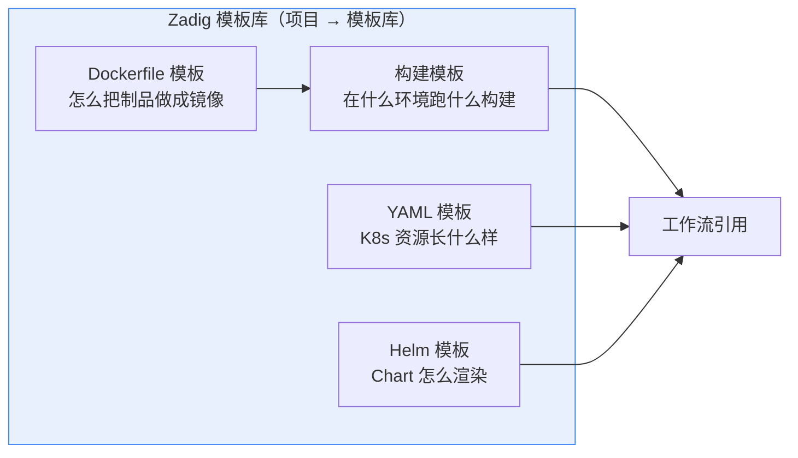
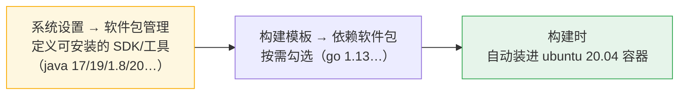

# 71. Zadig 构建模板实战：Dockerfile / 构建 / YAML / Helm 四类模板与变量抽离

## 纲要

- **模板是 Zadig 的灵魂**：四类模板——**Dockerfile 模板、构建模板、YAML 模板、Helm 模板**——共同回答一个问题：**「不一样的地方」只配一次，相同的地方全团队复用**
- **Dockerfile 模板消灭仓库里的 Dockerfile**：所有仓库一致引用模板库的 Dockerfile，PHP/Go/Node 各一份，**不用每个代码仓库各建各的**
- **构建模板是「构建说明书」**：构建环境（ubuntu 20.04 容器）+ 依赖软件包（go 1.13 等，来源=系统设置的软件包管理）+ 构建变量 + 脚本 + 镜像构建步骤，五段式
- **超时有俩，别搞混**：构建模板里配的是**构建策略超时（60 分钟）**；服务侧策略里配的是**服务部署超时**——两个不同的计时器
- **YAML 模板靠 `${{.service}}` 等内置变量抽离差异**：deployment name、label 全部变量化，同一份模板服务名一换全部跟着换
- **项目类型与模板强绑定**：K8s YAML 项目**只能引用 YAML 模板**，Helm 项目反之——建项目时就要想清楚路线

## 一、场景引入：没有模板的团队，每个仓库都在重复造轮子

先看两个没有模板的真实团队日常：

- **Dockerfile 泛滥**：十个 Go 微服务，十个仓库里躺着十份「几乎一样」的 Dockerfile——基础镜像版本各异、构建参数不一，CVE 修一遍要改十处；
- **构建配置漂移**：每个服务一套构建脚本，A 服务用 go 1.20、B 服务用 go 1.22，某天安全扫描要求全局升级编译工具链，逐个仓库改到天亮。

Zadig 的模板体系就是来终结这种重复的。课程对模板价值的表述一针见血：

> 「我们就不需要在我们自己的每一个代码仓库里面去创建 Dockerfile 了。我们所有的代码仓库一致去引用 Dockerfile 模板里面的一个 Dockerfile。」

四类模板各管一段，合起来覆盖「构建 + 部署」全链路的标准件化：



## 二、Dockerfile 模板：仓库里不再需要 Dockerfile

### 2.1 创建与引用

路径：**项目 → 模板库 → Dockerfile → 新建模板**。课程创建了一个名为「购」的模板（专门用于购物项目）：

1. 输入模板名称；
2. 粘贴 Dockerfile 内容；
3. 保存——模板库即多一份可引用的 Dockerfile。

之后在任何构建配置里，**Dockerfile 来源选「模板库」**即可引用，不必在代码仓库放 Dockerfile。课程原话：「凡是 PHP 的项目，我们都可以来引用这个 Dockerfile 模板，我们就不需要再去单独为每个项目创建 Dockerfile——如果我们的 Dockerfile 需求是一样的，直接引用就可以。」

### 2.2 课件模板样例拆解

课程提供的两份 Dockerfile 模板恰好覆盖**编译型**与**解释型**两类技术栈，是模板化设计的最佳教材：

**Go 模板（多阶段构建，产物最小化）**：

```dockerfile
FROM golang:1.22.1 AS build
WORKDIR /app
COPY main.go .
RUN CGO_ENABLED=0 GOOS=linux GOARCH=amd64 go build -o main -a -installsuffix cgo -ldflags '-extldflags "-static"' main.go

FROM alpine:3.16
WORKDIR /opt
COPY --from=build /app/main .
CMD ["/opt/main"]
```

| 行 | 要点 | 生产含义 |
| --- | --- | --- |
| `FROM golang:1.22.1 AS build` | 第一阶段命名 `build` | 编译工具链留在构建阶段，不进最终镜像 |
| `CGO_ENABLED=0 ... -ldflags '-extldflags "-static"'` | **纯静态编译** | 不依赖 glibc，alpine（musl）上也能跑 |
| `FROM alpine:3.16` | 第二阶段极简底座 | 镜像从 ~800MB 压到 ~10MB 级 |
| `COPY --from=build` | 只搬二进制 | 攻击面与体积双降 |

**Node 模板（内网基础镜像 + 包管理器启动）**：

```dockerfile
FROM registry.cn-hangzhou.aliyuncs.com/tool-bucket/tool:node-16.20.2-alpine3.18
WORKDIR /node
COPY . ..
RUN pwd;ls -la
EXPOSE 8080
CMD ["yarn","run","start"]
```

注意它引用了**内网镜像仓库的基础镜像**（`registry.cn-hangzhou.aliyuncs.com/...`）——这正是前面「自定义镜像管理」的落地：团队统一维护带工具链的基础镜像，Dockerfile 只做业务层的事。`CMD ["yarn","run","start"]` 也点明了模板假设项目用 yarn 管理依赖。

## 三、构建模板：五段式「构建说明书」

构建模板是四类模板里字段最多的，课程按「构建环境 → 依赖软件包 → 构建变量 → 脚本 → 镜像构建」五段拆解。路径：**项目 → 模板库 → 构建 → 新建**。

### 3.1 第一段：构建环境

构建在**容器里运行**，这个容器用什么镜像即「构建环境」。课程用**内置的 ubuntu 20.04**，也可以自己添加构建环境镜像。含义：构建不必依赖节点预装环境——要 go 1.13 就起个装了 go 1.13 的容器，**构建环境即代码、随用随起**。

### 3.2 第二段：依赖软件包（来源=软件包管理）

「添加依赖软件包」装到构建环境里——比如选 go 1.13，构建时就把 go 1.13 环境装进 ubuntu 20.04。软件包**来源是系统设置 → 软件包管理**（#68 讲过）：课程实拍里定位到 java，可见 **17 / 19 / 1.8 / 20** 等版本，模板里能搜到的都是管理端已定义的；**没有的版本可自行添加**（名称、版本、路径、安装包地址、安装脚本），之后构建都会装它。



### 3.3 第三段：构建变量与内置环境变量

可自定义构建变量；更有用的是**内置环境变量**，课程点了两个高频的：

| 内置变量 | 含义 |
| --- | --- |
| `$WORKSPACE` | 工作目录 |
| `$REPONAME_<index>` | **代码库名称**，index 为构建配置中代码库的位置，**初始值为 0**——即 `$REPONAME_0` 就是第一个代码库的名字 |

`$REPONAME_0` 为什么重要：构建脚本里 `cd $WORKSPACE/$REPONAME_0` 就能精准进入「第一个代码库拉下来的目录」——**多代码库构建时按 index 寻址，不写死仓库名**，这是脚本可复用的关键。

### 3.4 第四段：构建脚本与镜像构建步骤

需要跑额外内容就写脚本；「添加步骤」有四类：

| 步骤类型 | 用途 | 课程评价 |
| --- | --- | --- |
| **镜像构建** | 执行 Dockerfile 打镜像 | **最常用** |
| 二进制包存储 | 产物存二进制包 | 较少 |
| 文件存储 | 产物存文件 | 较少 |
| 脚本执行 | 跑任意脚本 | 辅助 |

镜像构建步骤的三个关键字段：

- **构建上下文目录**：代码拉下来后的位置——`$WORKSPACE/$REPONAME_0`（课程口述的 import.0 即此路径）；
- **Dockerfile 来源**：代码库 or **模板库**——课程选模板库里的 go Dockerfile，再次印证 2.1 的设计；
- **构建参数**：`--build-arg key=value` 形式，不需要可留空（界面给了示例）。

### 3.5 第五段：高级配置（超时、缓存、资源）

| 配置 | 课程设置 | 说明 |
| --- | --- | --- |
| 策略配置 → 构建超时 | **60 分钟** | 构建策略超时 |
| 缓存配置 | 可开启 + 自定义目录 | 拉依赖包加速，**#73 专题** |
| 资源配置 → 集群 | 本地集群 | 构建跑在哪个集群 |
| 资源配置 → 规格 | 如 **8G** | 单构建的资源配额 |
| 使用数主机 | 企业版 | 社区版不可用 |
| 输出变量 | 默认 | 任务间传参用 |

**两个超时务必分清**（课程专门对比）：

- **构建模板里的 60 分钟 = 构建策略超时**（构建这个动作本身）；
- **服务 → 策略 → 服务部署超时**（#70 讲过，默认 10 分钟）= 部署这个动作。

配错了现象很典型：构建慢吞吞跑到 15 分钟被掐断，去查部署超时——查错地方了。

## 四、YAML 模板：把「不一样」抽离成变量

YAML 模板与 Dockerfile 模板同在模板库创建，做法：

1. 粘贴 `deployment.yaml`；
2. **把不一样的地方改成变量**——课程示例：deployment 的 `name`、label 的 `app` 全部变量化；
3. 更优解：直接用**系统内置变量** `${{.service}}`（服务名称）——「我们这边直接给它替换掉 `${{.service}}` 就可以……它就会默认自动引用这个服务的名称来替换掉这些名称」；
4. image 字段可暂不动，生产按需改；
5. 保存后模板里**多出一个自定义变量**（课程命名 `golang`），构建时可改它的值。

效果验证（课程实拍）：新建服务选该模板 → 预览 → 服务名填 `golang` 则所有资源名显示 `golang-deployment`；改成 `golang-1` 再预览，全部变成 `golang-1-deployment`——**一个模板，服务名一换全线跟着换**，这就是「把不一样的地方抽离出来」的完整闭环。

课件两份 K8s YAML 模板正是这个模式的落地：

```yaml
# backend 模板骨架（关键行）
metadata:
  name: $T-Service$-deployment        # 占位符变量化
spec:
  selector:
    matchLabels:
      app: $T-Service$                 # label 同步变量化
  template:
    spec:
      containers:
      - name: $T-Service$
        image: nginx:1.14.2            # 后端示例镜像
        ports:
        - containerPort: 80
```

```yaml
# node 模板骨架（关键行）
        image: node:16.15-alpine3.16   # 前端示例镜像
        ports:
        - containerPort: 8080
```

两份模板同构不同镜像（nginx:1.14.2 / node:16.15-alpine3.16、80/8080 端口）——**同构服务一套模板打天下，差异只在变量值**。

## 五、Helm 模板与项目类型绑定

Helm 模板通过**导入代码源**创建：输入名称（如 `go`）→ 选代码源 → 选仓库/分支/文件夹，把 Chart 导进来。默认代码源需提前在「代码源」里加好。

课程抛出一个**强绑定规则**，建项目前必须知道：

| 项目类型 | 可引用的模板 | 不可引用 |
| --- | --- | --- |
| **K8s YAML 项目** | YAML 模板 | Helm 模板 |
| **Helm 项目** | Helm 模板 | YAML 模板 |

即模板引用与项目类型**严格匹配**：K8s YAML 项目里导入服务时只展示 YAML 模板，即便建了 Helm 模板也不会出现；Helm 项目反之。所以「建项目时就想清楚走 YAML 路线还是 Helm 路线」——中途切换等于重建项目。

## 六、生产实践要点

1. **Dockerfile 模板按技术栈分治**：Go（多阶段 + 静态链接）、Node（内网基础镜像）、Java（Maven 镜像层缓存）各一份，版本升级只改模板库一处，全仓库生效。
2. **基础镜像收敛到自定义镜像管理**：模板里的 `FROM` 尽量指向团队自管仓库（如内网 `registry.cn-hangzhou.aliyuncs.com/tool-bucket/...`），公网镜像拉取慢 + 不可审计两个问题一次解决。
3. **软件包管理是环境一致性的保险丝**：SDK 版本全部走软件包管理定义，构建模板按需勾选；禁止在脚本里现装现升。
4. **`$REPONAME_0` 进脚本，仓库名不进脚本**：多代码库构建按 index 寻址，换仓库名脚本不用动。
5. **两个超时分清归属**：构建超时（模板里，60 分钟级）与部署超时（服务策略，10 分钟级），排查卡断先确认掐你的是哪个计时器。
6. **YAML 模板变量化要彻底**：name、label、镜像 tag 全部 `${{.service}}`/自定义变量；留一个写死的名字，模板复用就破功。
7. **项目类型一次定终身**：YAML/Helm 路线不兼容，选型时按团队现状（有无 Chart 资产、运维习惯）定，别建完再改。

## 七、报错排查表

| 现象 | 根因 | 解法 |
| --- | --- | --- |
| 构建时 Dockerfile 找不到 | Dockerfile 来源选错/未引模板库 | 镜像构建步骤的来源选「模板库」并指定模板 |
| 依赖包装不上 | 软件包管理里没定义该版本 | 系统设置 → 软件包管理 → 添加后再回模板勾选 |
| 脚本里 `cd $REPONAME_0` 进错目录 | 代码库 index 配错（多个代码库时） | 核对构建配置里代码库的顺序，index 从 0 起 |
| 构建到 15 分钟被掐断 | 撞了构建策略超时（60 分钟）或被规格限制 | 调构建模板超时；确认规格（如 8G）够用 |
| 模板导入服务时看不到 Helm 模板 | 项目是 K8s YAML 类型，强绑定 | 换 Helm 类型项目重建 |
| 预览时资源名没替换 | 写死了常量没用 `${{.service}}` | 把 name/label 改成内置变量 |
| 构建参数不生效 | 格式不是 `--build-arg key=value` | 按界面示例逐行配 key-value |
| 内网基础镜像拉取失败 | 集群没配该仓库凭证 | 镜像仓库接入 + 构建集群配好访问凭证 |

## 八、面试考点与追问

**Q1：Zadig 四类模板分别管什么？**
Dockerfile 模板（怎么做镜像）、构建模板（在什么环境跑什么构建）、YAML 模板（K8s 资源长什么样）、Helm 模板（Chart 怎么渲染）。合起来把「构建 + 部署」的标准件化。

**Q2：Dockerfile 模板解决什么痛点？**
消灭仓库级 Dockerfile 重复：所有仓库一致引用模板库的一份 Dockerfile，同类项目（如全 PHP）共用；工具链升级只改模板一处。

**Q3：构建模板的五段结构是什么？**
构建环境（容器镜像，如 ubuntu 20.04）→ 依赖软件包（来源=软件包管理，如 go 1.13）→ 构建变量与内置变量（`$WORKSPACE`/`$REPONAME_0`）→ 脚本与镜像构建步骤（上下文目录/Dockerfile 来源/构建参数）→ 高级配置（超时 60 分钟、缓存、集群与规格）。

**Q4：构建超时和服务部署超时有什么区别？**
构建模板策略里的 60 分钟是**构建动作**的计时器；服务 → 策略里的部署超时（默认 10 分钟）是**部署动作**的计时器。两者独立配置、独立生效。

**Q5：`$REPONAME_0` 是什么？为什么重要？**
内置环境变量，指构建配置中**第一个代码库的名称**（index 从 0 起）。构建脚本用 `cd $WORKSPACE/$REPONAME_0` 进入代码目录，**不写死仓库名**，多代码库/换仓库名时脚本不用改。

**Q6：YAML 模板如何实现「一个模板多个服务」？**
把差异字段（deployment name、label app 等）变量化——优先用内置变量 `${{.service}}` 自动替换服务名，差异值用自定义变量构建时传入；预览可实时验证替换效果。

**Q7：项目类型与模板引用有什么关系？**
强绑定：K8s YAML 项目只能引 YAML 模板，Helm 项目只能引 Helm 模板。建项目时就要定路线，中途不能切换。

## 📎 文本↔代码关联

| 代码文件 | 正文提及 | 内容 |
| --- | --- | --- |
| `code/9-Zadig/模板/Dockerfile/go` | 2.2 节样例拆解 | Go 多阶段构建模板：golang:1.22.1 编译 → alpine:3.16 运行，CGO_ENABLED=0 静态链接，对应正文逐行生产含义表 |
| `code/9-Zadig/模板/Dockerfile/node` | 2.2 节样例拆解 | Node 构建模板：内网 registry 基础镜像 node-16.20.2-alpine3.18、`yarn run start`、EXPOSE 8080，印证「自定义镜像管理 + 模板库引用」组合 |
| `code/9-Zadig/模板/K8S-YAML/backend` | 第四节 YAML 模板 | 后端服务 YAML 模板：`$T-Service$` 占位符变量化 name/label，nginx:1.14.2 + 80 端口，「差异抽离」模式的落地样例 |
| `code/9-Zadig/模板/K8S-YAML/node` | 第四节 YAML 模板 | 前端 Node 服务 YAML 模板：`$T-Service$` 占位符 + node:16.15-alpine3.16 + 8080 端口，与 backend 同构不同镜像 |
| `code/9-Zadig/模板/Build-script/test-node.sh` | 3.4 节构建脚本段 | Node 项目构建脚本：`cd /$WORKSPACE/node-cache` → 拷 package.json → `npm install --registry=https://registry.npmmirror.com` → 拷回 node_modules → `npm run build`，是「构建脚本 + `$WORKSPACE` 内置变量」的完整实例（#73 持久化篇继续用） |

**技术点总结**：Zadig 模板体系 = 四类模板打配合——Dockerfile 模板让仓库不再各建各的（同类项目一致引用模板库）、构建模板把「环境 + 软件包 + 变量 + 脚本 + 镜像步骤」固化成五段式说明书（依赖软件包走软件包管理、脚本按 `$REPONAME_0` 寻址不写死仓库名、60 分钟构建超时与 10 分钟部署超时是两个计时器）、YAML 模板用 `${{.service}}` 内置变量把差异字段抽离到变量（预览即时验证「golang」→「golang-1」全线替换）、Helm 模板经代码源导入且与项目类型强绑定。模板化的终点是一句可验收的标准：**新增一个同构服务，从「写三件套」变成「选模板、填变量」**——CI/CD 资产从项目私有变成团队公共。

