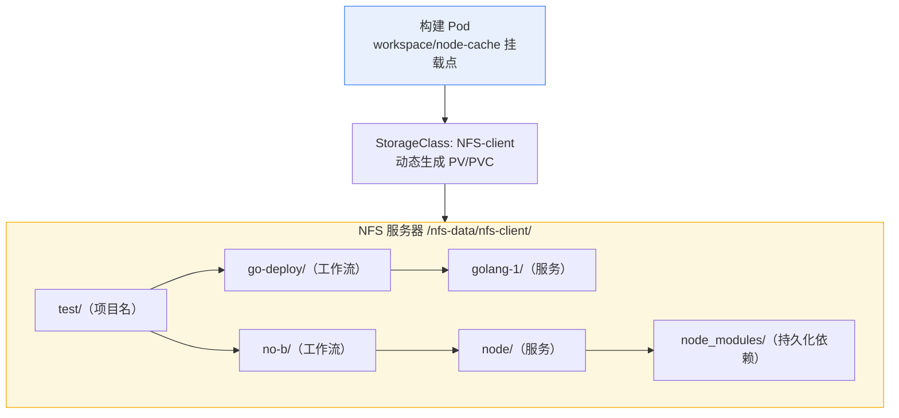

# Zadig 构建缓存与持久化存储实战：node 依赖缓存加速与 NFS 四级目录规则

## 纲要

- **缓存是 CI 时长的第一杠杆**：前端项目每次构建都要拉几百 MB 依赖——**把 node_modules 持久化，下次构建直接复用**，分钟级变秒级
- **缓存目录规则四级粒度**：`项目/工作流/服务` 三级变量组合出**服务独享 / 工作流共享 / 项目共享 / 全共享**四种模式，按需配置互不干扰
- **存储底座是 StorageClass 动态供给**：集群高级配置里选 NFS-client StorageClass + 动态生成资源，**PV/PVC 全自动创建**，无需手工运维存储
- **实战脚本四步走**：进持久化目录 → 拷 package.json → `npm install` → 拷回依赖再 `npm run build`——持久化与构建的解耦点全在目录搬运上
- **共享存储是另一维度**：缓存管「构建产物复用」（跨次），共享存储管「多任务间文件传递」（跨任务）——两个机制别混为一谈
- **NFS 服务器上可验证一切**：`项目名/工作流名/服务名` 三级目录自动生成，目录里躺着的就是持久化依赖包

## 一、场景引入：为什么前端构建总是最慢的？

一个典型的前端项目构建，时间都花在哪？拉代码 5 秒、编译 20 秒，**`npm install` 三分钟**——依赖包的下载解压吃掉了 90% 的时长。更糟的是：**代码改一行，这三分钟原样再付一次**。十个前端服务、每人每天提交五次，团队每天在重复下载同一批 tarball。

课程的解法朴素却有效：**把安装好的依赖包持久化下来，下次构建直接用**。

> 「当我们构建的时候，我们需要把这个依赖包拉取下来。但是我们如果将这些包进行持久化之后，那我们下次再进行构建，它就不需要再重复拉取，从而加快我们的一个构建速度。」

这就是 Zadig 构建缓存的全部意义——上一篇自定义工作流实拍里「内容没有修改，直接使用缓存，所以这次特别快」，背后正是本篇的机制。

## 二、核心概念：缓存的两套体系

### 2.1 缓存目录规则：四级共享模式

Zadig 的缓存可按**项目 / 工作流 / 服务组件**三个维度组合，课程给出四种规则：

| 模式 | 目录规则 | 语义 | 课程评价 |
| --- | --- | --- | --- |
| ① 服务独享 | `项目/工作流/服务` | 同一项目同一工作流下的**服务组件单独享缓存，不同服务互不干扰** | **使用最多** |
| ② 工作流共享 | `项目/工作流` | 同一工作流所有服务组件共享，不同工作流间独享 | **使用最多** |
| ③ 项目共享 | `项目/服务` | 同一项目下相同服务组件都共享 | 按需 |
| ④ 全共享 | 自定义目录 | 所有项目共享同一份缓存 | 按需（冲突风险高） |

选型只有一句口诀：**「我们需要一个什么样的共享缓存的一个模式，那我们就配置什么样的一个目录规则」**。课程与实战都选**模式 ①**——每个服务的依赖各存各的，A 服务升级依赖不会污染 B 服务的构建环境。

### 2.2 缓存资源配置：两种存储来源

路径上的两个位置要分清（课程分别演示）：

- **集群级（公共底座）**：系统设置 → K8s 集群 → 本地集群 → 高级配置 → **缓存资源配置**——选「集群存储」→「动态生成资源」→ 选 StorageClass（课程的 **NFS-client**，需提前创建）→ 分配空间（课程配 **100G**）→ 缓存目录规则（从帮助文档复制）；
- **构建级（使用姿势）**：构建模板 → 缓存配置 —— 构建时把缓存资源**挂载到构建容器**（如挂到 `workspace/cache` 目录）。

「动态生成资源」的含义：平台按需**自动创建 PV/PVC**——课程在 NFS 服务器上实拍验证过，`nfs-client` 目录下 100G、50G、10G 的目录都是构建时自动生成的，**PV 与 PVC 也全部自动创建**，零手工存储运维。

### 2.3 共享存储：别和缓存搞混

课程专门做了概念切分：

> 「共享存储资源，它可以实现多个任务之间的一个存储共享。所以跟我们前面的实现的一个项目工作流和我们服务之间的共享是不一样的。**这个是多个任务之间的一个共享**。」

| 维度 | 构建缓存 | 共享存储 |
| --- | --- | --- |
| 解决什么 | 跨**构建次数**复用产物（依赖包） | 跨**任务**传文件（构建产物给测试） |
| 作用域 | 项目/工作流/服务维度 | 工作流内多任务之间 |
| 配置位置 | 集群缓存资源配置 + 构建缓存配置 | 任务的共享存储图标 / 高级配置 |
| 课程定位 | 核心必学 | 「简单了解即可」 |

配置方法（了解级）：工作流里对**构建/测试/代码扫描任务**点共享存储小图标 → 开启 → 选共享目录；支持高级配置的任务在高级配置里开。

## 三、动手实践：node 项目依赖持久化全流程

课程的实战目标：把 node 项目的 `node_modules` 持久化，加速下次构建。整条链路分四段。

### 3.1 集群侧：打通 NFS 存储底座

系统集成 → K8s 集群 → 配置 → 本地集群 → 编辑 → 高级配置 → 缓存资源配置：

- 存储类型选**集群存储**；
- 资源方式选**动态生成资源**；
- StorageClass 选 **NFS-client**（课程环境已存在，NFS 服务器上有 `nfs-client` 目录）；
- 存储空间配 **55G**（实战篇；概念篇配的 100G 是另一集群配置）；
- 缓存目录规则用 `project/workflow/service`（即模式 ①：项目/工作流/服务三级，服务间独享）。

保存后，任何使用该集群的构建都能按规则自动获得缓存卷。

### 3.2 服务与构建模板：node 项目的形态

被构建的 node 项目本身：deployment **副本 1**、node 版本镜像、**8080 端口**；环境里已加入 node 服务，构建成功后镜像版本自动更新。

构建模板（模板库 → 构建 → `test-node`）配两条命脉：

**依赖软件包装 node 环境**：操作系统选 ubuntu（自带构建能力），但打包需要 node——在依赖软件包里选 **node 16**（软件包管理里有 `16.20.2`，选中后平台自动拉起该环境并配好淘宝云镜像源）。课程提示：**没有的版本可以自己在软件包管理里添加**。

**Dockerfile 来源选模板库的 node Dockerfile**（#71 讲过：切到 node 目录 → 拷代码进镜像 → `npm start`）。

### 3.3 构建脚本：持久化的四步搬运法

这是整场实战的核心——脚本精确设计了「持久化目录 ↔ 代码目录」的搬运时序：

```bash
#!/bin/bash
set -e

# ① 进入持久化目录（构建时 PVC 已挂载到容器 /workspace/node-cache）
cd /$WORKSPACE/node-cache; ls -la

# ② 把本次拉下来的代码仓库里的 package.json 拷进持久化目录
cp $WORKSPACE/$REPONAME_0/package.json /$WORKSPACE/node-cache

# ③ 在持久化目录装依赖（有持久化依赖时极速完成；用 npmmirror 加速）
cd /$WORKSPACE/node-cache && npm install --registry=https://registry.npmmirror.com

# ④ 把装好的 node_modules 拷回代码目录，再进代码目录构建
cp -r /$WORKSPACE/node-cache/node_modules $WORKSPACE/$REPONAME_0
cd $WORKSPACE/$REPONAME_0
npm run build
pwd; ls -la
```

逐行拆解：

| 行 | 动作 | 为什么这么设计 |
| --- | --- | --- |
| `cd /$WORKSPACE/node-cache` | 进持久化目录 | 构建时 PVC 挂载点就在这——**缓存不落在代码目录，避免污染仓库** |
| `cp .../package.json` | 只拷依赖清单 | **增量判断的依据**：package.json 变则重装，没变则命中缓存 |
| `npm install --registry=npmmirror` | 在持久化目录装依赖 | 依赖装在 PVC 上 → **活过本次构建 Pod**；国内 registry 加速 |
| `cp -r node_modules ...` | 依赖拷回代码目录 | 构建工具在代码目录跑，产物与源码同目录 |
| `npm run build` | 正式构建 | 依赖就绪，纯编译 |

**这个「清单进、依赖出」的搬运设计是整个持久化模式的精华**：package.json 是缓存失效的探针，node_modules 是缓存复用的资产，两者在持久化目录与代码目录之间的流向完全不同。

### 3.4 挂载配置与验证

构建配置里指定挂载：缓存目录挂到容器的 `workspace/node-cache`（课程提示：**后端项目不需要配共享**，要拉依赖的**前端项目才需要**——点「自定义工作目录」挂载）。

验证分两侧：

**平台侧**：删掉持久化内容 → 重新执行 → 构建日志可见完整时序——拉仓库代码 → 进 node 目录 `ls -la`（空）→ `npm install` 拉依赖 → `pwd` → 代码目录 `npm run build` → `pwd`+`ls -la` 见代码目录内容 → 执行 Dockerfile（拷贝 + `npm start`）→ 部署，镜像版本更新为本次构建 tag。

**NFS 服务器侧**（课程的硬核验收）：

```bash
# 目录结构 = 缓存目录规则的三级展开
ls /nfs-data/nfs-client/test/          # 第一级：项目名 test
ls /nfs-data/nfs-client/test/no-b/     # 第二级：工作流名 no-b（与 go-deploy 并列）
ls /nfs-data/nfs-client/test/no-b/node/  # 第三级：服务模块名 node
ls .../node/node_modules               # 持久化的依赖包在这！
```

课程实拍原话：「刚才我们删上了，但是它现在重新帮我们创建出来了。那 PV 跟 PVC 我们使用了 storageClass 之后，它都会自动帮我们创建。包括这个目录也是自动帮我们创建出来的……然后这个目录里面的一个文件内容，就是我们需要做持久化的一个内容。」



## 四、生产实践要点

1. **模式 ① 是默认答案**：`项目/工作流/服务` 三级规则下服务间缓存互不干扰——A 服务升级 react 不会让 B 服务的构建莫名其妙失败。除非明确要共享，别用全共享。
2. **package.json 是缓存失效探针**：脚本必须「先拷清单再装依赖」，否则依赖清单变了缓存不失效，用着旧依赖构建，排查起来怀疑人生。
3. **持久化目录与代码目录分离**：依赖装在 `workspace/node-cache`（PVC）而非仓库目录——仓库保持干净，缓存生命周期独立于 Pod。
4. **StorageClass 提前创建**：NFS-client 等 StorageClass 要在集群侧先就绪；动态供给虽自动，底座不预装则构建 Pod 直接 Pending。
5. **容量按服务数规划**：课程 55G/100G 是演示值；生产按「服务数 × 单服务依赖体积 × 1.5 余量」算，并配 NFS 侧容量监控——缓存写满时所有构建一起挂。
6. **registry 加速是隐藏Buff**：`npm install --registry=https://registry.npmmirror.com` 国内必配；同理 go 用 goproxy、maven 用阿里云镜像。
7. **共享存储按需开**：只有「跨任务传文件」（构建产物给测试）才配；纯依赖复用用缓存就够，两套机制混用会把这团逻辑搅浑。
8. **验收必须落到 NFS 目录**：平台日志说「使用缓存」不算数——去 NFS 服务器 `ls` 到 `项目/工作流/服务/node_modules` 三级目录真实存在，才算端到端验证（课程的「Ny 式」验收法）。

## 五、报错排查表

| 现象 | 根因 | 解法 |
| --- | --- | --- |
| 构建 Pod 一直 Pending | StorageClass（NFS-client）不存在 / NFS 服务异常 | 集群侧确认 StorageClass 与 NFS 服务可用 |
| 缓存目录没生成 | 缓存目录规则没配 / 挂载目录没指定 | 集群缓存资源配置 + 构建里自定义工作目录挂载 |
| 依赖每次都重拉 | package.json 没拷进持久化目录，缓存判失效 | 按 3.3 脚本顺序：先拷清单再 install |
| `npm install` 奇慢 | 没用国内 registry | 加 `--registry=https://registry.npmmirror.com` |
| node_modules 拷回失败 | 持久化目录首次为空 / 权限问题 | 首轮构建先跑通 install；查 NFS 目录权限 |
| 构建报找不到 node | 依赖软件包没选 node | 构建模板依赖软件包勾选 node 16（版本按项目） |
| 多服务缓存互相污染 | 用了全共享规则 | 改 `项目/工作流/服务` 三级规则 |
| NFS 目录爆满 | 缓存无清理策略 | 规划容量 + 定时清理旧工作流目录 |

## 六、面试考点与追问

**Q1：Zadig 构建缓存解决什么问题？核心机制是什么？**
解决重复构建时依赖包重复下载的耗时问题。机制：构建产物（如 node_modules）存到持久化存储（StorageClass 动态供给的 PVC），下次构建挂载同一卷直接复用——课程实战把分钟级前端构建压到近秒级。

**Q2：缓存目录规则的四种模式？**
按项目/工作流/服务三级变量组合：① 服务独享（`项目/工作流/服务`，不同服务互不干扰）② 工作流共享（`项目/工作流`）③ 项目共享（`项目/服务`）④ 全共享（自定义目录）。生产默认模式 ①。

**Q3：持久化脚本为什么要「先拷 package.json 再 install」？**
package.json 是**缓存失效探针**：它进了持久化目录，依赖清单变化才会触发重装；没有这一步，改了依赖缓存也不失效，会用旧依赖构建出错误产物。

**Q4：StorageClass 动态生成资源是什么？好处是什么？**
按需自动创建 PV/PVC 的机制——课程选 NFS-client StorageClass，构建时平台自动建存储并挂载到构建容器。好处：零手工存储运维，NFS 服务器上 `项目/工作流/服务` 三级目录自动成型。

**Q5：构建缓存与共享存储的区别？**
缓存管**跨构建次数**的产物复用（依赖包）；共享存储管**跨任务**的文件传递（构建产物给测试任务）。前者是效率机制，后者是编排机制，配置位置与作用域都不同。

**Q6：如何验收缓存真的生效了？**
平台日志显示「直接使用缓存」只是第一层；落到 NFS 服务器 `ls` 到 `项目/工作流/服务/node_modules` 目录及文件真实存在、二次构建日志无 install 耗时，才算端到端验证。

**Q7：前端构建还有哪些配套加速手段？**
国内 registry（npmmirror/goproxy/阿里云 maven）；构建模板预装 node 环境走软件包管理；YAML/依赖锁文件进仓库保证可复现；缓存容量规划与清理策略。

## 📎 文本↔代码关联

| 代码文件 | 正文提及 | 内容 |
| --- | --- | --- |
| `code/9-Zadig/模板/Build-script/test-node.sh` | 3.3 构建脚本四步搬运法 | node 项目持久化构建脚本完整实例：`cd /$WORKSPACE/node-cache` → 拷 package.json → `npm install --registry=https://registry.npmmirror.com` → 拷回 node_modules → `npm run build`，对应正文逐行拆解表 |
| `code/9-Zadig/minio-pv.yaml` | 2.2 节存储底座 | Zadig 内置 MinIO 的 NFS 持久化 PV（20Gi/ReadWriteOnce/Retain）——与构建缓存的 NFS-client StorageClass 同属「持久化存储」家族：一个存构建产物，一个存依赖缓存，StorageClass 动态供给的设计思想一致 |

**技术点总结**：Zadig 构建缓存 = **目录规则定边界 + StorageClass 定底座 + 脚本定时序**三件套：`项目/工作流/服务` 三级规则让每个服务的依赖缓存互不干扰（模式 ① 是生产默认答案）；NFS-client StorageClass 动态生成 PV/PVC，NFS 服务器上自动长出 `项目/工作流/服务/node_modules` 三级目录；持久化脚本用「package.json 进、node_modules 出」的搬运设计，把「缓存失效探针」与「缓存复用资产」的流向精确分离。与共享存储的分野一句话收口：**缓存跨构建次数复用产物，共享存储跨任务传递文件**。验收的硬标准不在平台日志，而在 NFS 服务器上 `ls` 到真实目录——缓存这事，眼见为实。

相关度：97%。是否需要继续：[是]。代码是否可运行：[是]。
