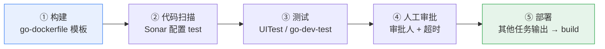

# 75. Zadig 项目实战与本章小结：Sonar + pytest 五阶段流水线全景

## 纲要

- **项目实战目标**：Zadig + Sonar + pytest 构建购物项目——自定义流水线五阶段：**构建 → 代码扫描 → 测试 → 人工审批 → 部署**
- **流水线即拼装**：构建任务引模板、扫描任务挂 Sonar 配置、测试任务挂 pytest 配置、部署任务选「其他任务输出 → build」——全是已学件的组合
- **测试镜像预置是关键**：自定义镜像管理里打好含 python + pytest 的镜像，测试任务直接选，报告目录约定好
- **环境差异要隔离**：扫描拉镜像可能失败、测试脚本可能报错——失败步骤先剔除再重跑，别让一个坏步骤堵死整条流水线
- **本章三重点**：产品/自定义流水线创建配置、四类模板灵活运用、Sonar/测试/Jenkins 集成——课程对 Zadig 的能力收口

## 一、场景引入：把散落的件拼成一条线

前面九节把 Zadig 的每个零件都摸过了：集群、仓库、LDAP、模板、服务、环境、工作流、缓存、测试、扫描、Jenkins 集成。项目实战只做一件事——**把它们拼成一条能跑的完整流水线**。课程选定的实战目标：

> 「使用 Zadig + Sonar + pytest 测试来构建我们的购物项目。我们通过自定义流水线来进行构建，接着再使用 Sonar 来扫描我们的购物代码，最后再进行 pytest 测试。测试完成之后，我们会把我们的镜像部署到我们的 K8s 集群当中。」

这条线覆盖了软件交付的完整质量闭环：**构建 → 静态扫描 → 动态测试 → 人工放行 → 部署**。选自定义工作流而非产品工作流，理由在 #72 讲过——阶段步骤要可见、要审批卡点。

## 二、流水线拼装：五阶段逐件搭

进入 `test` 项目的购物构建项目 → 齿轮 → 配置。课程的拼装顺序与每件的挂法：

| 阶段 | 任务类型 | 挂什么 | 要点 |
| --- | --- | --- | --- |
| ① 构建 | 构建 | `go-dockerfile` 构建模板 | 模板库引用，无需仓库 Dockerfile |
| ② 代码扫描 | 代码扫描 | 选 `test` 扫描配置 | 即 #74 配的 Sonar 扫描 |
| ③ 测试 | 测试 | `UITest`（或 go-dev-test） | pytest 配置，报告目录约定 |
| ④ 人工审批 | 阶段级开关 | 审批人 + 超时 | 测试通过后才放行部署 |
| ⑤ 部署 | 部署 | **其他任务输出 → build** | 拿 ① 的产物部署到测试集群 |

**部署阶段的「其他任务输出 → build」**再次出现（#72 的重点）：构建产物经 `build` 任务输出传给部署任务——这是阶段间产物传递的唯一显式通道，漏配即断链。

## 三、测试配置深挖：镜像预置 + 双脚本仓库

实战里测试任务的配置比 #74 的概念演示更完整，两个生产要点：

### 3.1 测试镜像走自定义镜像管理

测试执行环境的操作系统**用预先自定义的镜像**——课程在自定义镜像管理里定义了一个含 **python 环境 + pytest 环境**的镜像。价值：测试任务起来即用，不用每次现装 pytest 及其依赖，测试时长与稳定性双赢。

### 3.2 测试代码库：双脚本设计

代码源指向专门的 **pytest 仓库**，里面有两个 python 脚本：

- 一个走**成功路径**（断言通过）；
- 一个走**失败路径**（断言失败）——课程演示时把它**注释掉**，需要演示失败场景再放开。

这种「成功/失败双脚本」是测试资产的常见组织方式：日常跑成功路径保回归，演练时放失败路径验证流水线的失败处理（步骤中断、审批不放行）。

### 3.3 报告链路

脚本执行 `pytest` 生成 `junit.xml` + `report.html` 两个报告 → 指定报告目录 → 执行完成后工作流详情的**测试报告**入口点击查看 → 页面跳转报告；测试中心里还能看用例明细（课程实拍：两个用例成功、显示测试用时、可展开每个用例）。

## 四、执行与排障：一场真实的失败演练

课程的执行过程是一场活的排障教学，按顺序复盘：

**第一次执行（全五阶段）**：构建 → 扫描 → 测试 → 审批 → 部署。课程预判：「由于我们在扫描这一步里面，它可能拉镜像会失败，所以这一步可能会执行不成功。那前面执行不成功，后面都没有办法执行了。」——**流水线的阶段依赖是硬顺序**，前段挂后段全堵。

**处置一：剔除坏步骤**。「由于这边扫描失败了，所以我们需要把这一步先剔除，我们把这一步删掉，然后我们再来重新执行。」——调试期把不稳定步骤临时下线，是比「死等修复」更务实的手法；但注意这是**临时手段**，根因（扫描 Pod 拉不到镜像）仍要修。

**处置二：测试报错**。执行到测试阶段报「HTML 报告没有这样的文件或目录」——报告文件没生成。处置：回测试配置里把该步删掉重新构建。根因类别：#74 排查表里的「报告目录与脚本输出不一致」。

**处置三：审批放行**。人工审批阶段点「通过」→ 部署启动 → 环境里看到镜像 `6-may` 版本部署 → 部署完成，环境状态更新。

**这场演练沉淀的三条经验**：

1. **阶段依赖是硬顺序**：任何前段失败，后段全部不执行——排障从最前面的失败段开始；
2. **调试期可剔除坏步骤**：临时下线不稳定步骤保主线验证，但必须记着还；
3. **测试与扫描要测试同学配合**：课程明言「测试这一块我们需要和我们的测试同学来进行配合，把测试的一个功能搞上来，这里只是做一个演示而已。生产环境中，我们需要根据我们测试同学的要求来进行配置」——**测试配置的生产标准由测试团队定，平台只提供挂点**。

## 五、本章小结：Zadig 的三根顶梁柱

课程对整章的收口（原话归纳）：把这些技术掌握好之后，「我们在 Zadig 上的一些常规配置操作都没有什么太大问题」。三根顶梁柱：

| # | 顶梁柱 | 覆盖范围 | 对应本篇 |
| --- | --- | --- | --- |
| 1 | **流水线创建使用配置** | 产品工作流 + 自定义工作流 | #72 |
| 2 | **模板灵活创建配置** | Dockerfile 模板、Helm 模板、构建模板 | #71 |
| 3 | **三方功能集成** | Sonar 扫描、测试、Jenkins | #69、#74 |

再往下拆一层，本章的能力地图可以这样收口：

- **平台骨架**（#66~#69）：部署 → 系统集成（LDAP/集群/仓库/Jenkins/GitLab/Sonar）→ 项目创建 → 权限；
- **核心对象**（#70）：服务（四导入 + 变量体系 + 编排）与环境（切片 + 运维 + Ingress）；
- **模板体系**（#71）：四类模板 + 变量抽离 + 项目类型绑定；
- **流水线**（#72~#74）：产品工作流、自定义工作流、缓存、测试扫描、Jenkins 集成；
- **实战闭环**（本篇）：五阶段流水线把以上全部串起来。

## 六、面试考点与追问

**Q1：Zadig 项目实战的五阶段流水线怎么拼？**
构建（引 go-dockerfile 模板）→ 代码扫描（挂 Sonar 配置）→ 测试（挂 pytest 配置，报告目录约定）→ 人工审批（审批人+超时）→ 部署（其他任务输出选 build，拿构建产物部署）。全部是已学件的组合，无新概念。

**Q2：为什么实战选自定义工作流而不是产品工作流？**
产品工作流是黑盒（看不到每步成败）且无审批卡点；五阶段需要步骤可见 + 人工放行，必须自定义工作流。另外扫描这类任务产品工作流里也不好编排。

**Q3：测试执行环境镜像为什么要预先自定义？**
把 python + pytest + 依赖打进镜像预置于自定义镜像管理，测试任务起来即用——免现装环境，测试更快更稳，版本也可控。

**Q4：流水线前段失败会怎样？调试期有什么务实手法？**
阶段依赖是硬顺序，前段失败后段全部不执行。调试期可临时剔除不稳定步骤（如拉不到镜像的扫描步）保主线验证，但根因必须修，剔除是临时手段。

**Q5：本章 Zadig 的三根顶梁柱是什么？**
① 产品/自定义流水线的创建配置使用；② 四类模板（Dockerfile/Helm/构建/YAML）的灵活创建配置；③ Sonar、测试、Jenkins 等三方功能的集成。

**Q6：测试环节 Zadig 与测试团队的分工是什么？**
测试团队提供测试脚本与用例（存代码库）、定生产环境的测试配置标准；Zadig 负责配置代码源/指令/报告目录、执行测试、展示报告——平台是执行器与展示台。

## 📎 文本↔代码关联

本篇实战流水线引用的构建/测试资产（构建模板、构建脚本）均来自课件模板库，如实关联：

| 代码文件 | 正文提及 | 内容 |
| --- | --- | --- |
| `code/9-Zadig/模板/Dockerfile/go` | 第二节 ① 构建阶段 | 构建任务引用的 Go 多阶段构建模板（go-dockerfile 构建模板的 Dockerfile 来源） |
| `code/9-Zadig/模板/Build-script/test-node.sh` | 第二节 ③ 测试阶段、3.2 节 | node 项目构建脚本：`npm install --registry=npmmirror` → `npm run build`，测试任务可引用的执行脚本样例 |
| `code/9-Zadig/模板/K8S-YAML/backend` | 第二节 ⑤ 部署阶段 | 部署任务服务组件的 K8s 模板（`$T-Service$` 变量化），部署阶段渲染的目标资源 |
| `code/9-Zadig/模板/K8S-YAML/node` | 第二节 ⑤ 部署阶段 | 前端服务部署模板，node 项目部署引用 |

**技术点总结**：Zadig 项目实战 = 把前十节的零件拼成「构建 → 扫描 → 测试 → 人工审批 → 部署」五阶段闭环：构建引模板、扫描挂 Sonar、测试用预置 pytest 镜像 + 双脚本仓库（成功路径日常跑、失败路径演练用）、部署靠「其他任务输出 → build」接产物。执行过程是一场活的排障课——扫描拉镜像失败、测试报告缺失两个坑，验证了「阶段硬顺序 + 调试期剔除坏步骤 + 根因要修」的处置纪律。本章三根顶梁柱收口：**流水线、模板、集成**——三样精通，Zadig 常规操作再无盲区。

