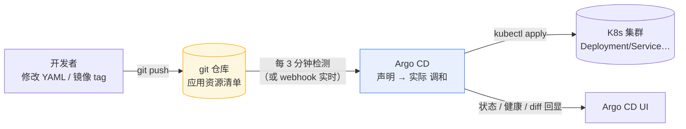
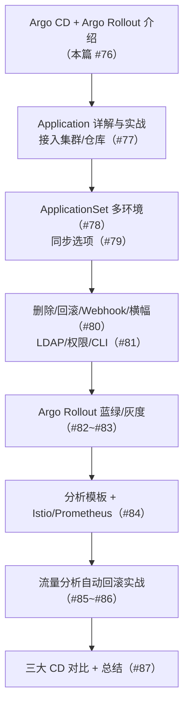

# 76. Argo CD 概述、介绍与部署：GitOps 部署工具入门

## 纲要

- **Argo CD 是 K8s 的声明式 GitOps 部署工具**：应用资源清单放 **git 仓库**，Argo CD 接入仓库后**自动同步**到 K8s——仓库即唯一事实源
- **GitOps 四大收益**：版本管理（git 历史即部署历史）、git 维护应用、声明式配置、**多集群环境统一管理**
- **部署五步走**：建 `argocd` 命名空间 → apply 安装清单 → 装 `argocd` CLI → `argocd-server` 改 NodePort → 取初始密码登录
- **初始密码的获取路径**：`argocd-initial-admin-secret` 这个 Secret 里藏着 admin 的初始密码，登录后立即改
- **本章路线图**：Argo CD + Argo Rollout 介绍 → 权限控制 → 接入 git 仓库与同步选项 → 蓝绿/灰度发布 → 流量分析自动回滚
- **定位先行**：Argo CD 只做**持续部署**（CD），没有构建功能——CI 产出的镜像 tag 写进 git，Argo CD 负责同步落地

## 一、场景引入：部署的「最后一步」还缺一块

课程到这里，CI 侧（Jenkins/Tekton/Drone）与 CD 侧（KubeVela/Zadig）都已讲过。Argo CD 代表的是第三种 CD 哲学——**GitOps**。先看它解决的场景：

团队用 Jenkins 把镜像打好了，然后呢？传统做法是 Jenkins 里配 kubeconfig，`kubectl apply` 一把推。问题随之而来：

- **集群里跑的到底是什么，没人说得清**——apply 是推送动作，不留声明记录；
- **回滚靠翻 Jenkins 历史**——构建 #328 对应哪个 YAML 状态？查去吧；
- **多集群各自为政**——每套集群一份 kubeconfig 散落各处，权限与状态都不透明。

Argo CD 的答案：**把「部署什么」写成 git 仓库里的 YAML，把「怎么部署」交给一个常驻集群的控制器**。人改 git，控制器负责让集群与 git 一致——这就是 GitOps。

## 二、核心概念与原理

### 2.1 Argo CD 是什么：一句话定义

课程定义：「Argo CD 它是一个**用于 K8s 的声明式 GitOps 的一个部署工具**。」拆开三个关键词：

- **用于 K8s**：管理对象就是 K8s 资源，不兼容虚机部署；
- **声明式**：应用的期望状态写在 YAML 里，Argo CD 做「调和（reconcile）」——集群现状与声明不一致就动手，一致就歇着；
- **GitOps**：git 仓库是唯一事实源，所有部署变更走 git 提交。

### 2.2 工作闭环：git 仓库 → Argo CD → K8s 集群



课程对闭环的描述：「本地仓库的资源清单文件发生变化的时候，那我们的资源清单配置就会**自动同步到我们的 K8s 集群当中**，从而实现 GitOps 的方式来部署我们的 K8s 应用。」

注意那个「每 3 分钟」——Argo CD 默认轮询 git 仓库的间隔，配 webhook 后可做到提交即同步（#80 讲）。

### 2.3 为什么要学：GitOps 的四大收益

课程列了两条，扩展为四条：

| 收益 | 说明 |
| --- | --- |
| **版本管理** | 资源清单进 git，**每次部署都有 commit 对应**——回滚 = git revert，审计 = git log |
| **git 维护应用** | 应用的整个生命周期（创建、变更、回滚）都通过 git 操作完成，不需要登集群 |
| **声明式配置** | 期望状态声明在 YAML，控制器持续调和；集群被手工改歪了能拉回来（selfHeal，#79） |
| **多集群统一管理** | 「支持多个不同的 K8s 集群环境……将我们不同的 K8s 集群的应用部署在我们不同的集群当中」——一个 Argo CD 管 N 个集群 |

「集群被改歪能拉回来」值得强调：有人在集群里手工 `kubectl edit` 改了副本数，开启 selfHeal 后 Argo CD 会自动改回 git 声明的值——**git 是唯一事实源**从口号变成机制。

### 2.4 定位边界：Argo CD 不造镜像

本章最后（#87）会做三大 CD 工具对比，这里先立个边界：**Argo CD 只做持续部署，没有构建功能**。典型流水线形态：

> Jenkins/Tekton 构建镜像 → 推送仓库 → **更新 git 里的镜像 tag**（CI 的最后一招）→ Argo CD 感知 git 变化 → 同步部署到 K8s。

CI 与 CD 的接缝就是「git 里的那一行 image tag」——#89 综合实战的 Jenkins + Argo CD 组合会把这条线完整跑通。

### 2.5 本章路线图

课程开篇给出全章路径，先建立全景：



## 三、动手实践：五步部署

### 3.1 第一步：创建命名空间并安装

```bash
kubectl create namespace argocd
kubectl apply -n argocd -f https://raw.githubusercontent.com/argoproj/argo-cd/stable/manifests/install.yaml
```

> ⚠️ **国内环境可达性**：`raw.githubusercontent.com` 在国内常被阻断。拉不到时任选其一：
> ① 用镜像前缀 `https://gh-proxy.com/https://raw.githubusercontent.com/...` 或 `https://raw.gitmirror.com/...`；
> ② 先把 `install.yaml` 拉到能出网的机器再 `kubectl apply -f install.yaml`；
> ③ 走 Helm：`helm repo add argo https://argoproj.github.io/argo-helm`（同样建议换国内 chart 镜像源）。
> **装之前先看一眼版本兼容矩阵**——Argo CD 与 K8s 版本有对应关系，别让 CD 工具成为集群升级的 blocker。

课程实拍：「我们先来创建 argocd 的一个命名空间……然后再把这个样本（install.yaml）拉到集群里面就可以」——Pod 陆续创建中。

### 3.2 第二步：安装 argocd CLI

```bash
# 下载二进制（按系统选版本），移到 PATH 并加执行权限
mv argocd /usr/local/bin/
chmod +x /usr/local/bin/argocd
# 验证：敲 argocd 有输出即正常
argocd
```

CLI 是后续所有终端操作（登录、集群/仓库管理、应用操作）的入口，#81 专题讲。

### 3.3 第三步：暴露服务（NodePort）

`argocd-server` Service 默认 ClusterIP，外网访问不了——改类型：

```bash
kubectl patch svc argocd-server -n argocd -p '{"spec": {"type": "NodePort"}}'
# 获取映射端口（课程环境为 31650）
kubectl get svc argocd-server -n argocd
```

### 3.4 第四步：获取初始密码

```bash
# 初始密码藏在 argocd-initial-admin-secret 里（base64 解码）
kubectl get secret argocd-initial-admin-secret -n argocd -o jsonpath="{.data.password}" | base64 -d
```

课程实拍路径：「我们再点这个 shocking（secret）来获取到它的一个初始化的一个密码」。

### 3.5 第五步：登录验证

浏览器访问 `http://<节点IP>:<NodePort>`（课程环境 `http://node1.example.com:31650`）→ 高级/继续访问 → 登录页 → 用户名 **admin** + 初始密码 → 登录成功，页面 UserInfo 显示 admin。

> **安全第一步**：登录后立即改密码（#81 的 `argocd account update-password`），初始密码是公开文档里写明的，暴露在公网等于没锁门。

## 四、生产实践要点

1. **命名空间独立**：Argo CD 全家桶装 `argocd` 命名空间，不与业务混部；多租户场景可装多实例（一套管一批集群）。
2. **NodePort 只是权宜**：生产暴露建议 Ingress + HTTPS + 前置认证，NodePort 裸奔在内网可以、公网不行。
3. **初始密码立即改**：`argocd-initial-admin-secret` 是公开常识，登录第一件事改密。
4. **版本兼容矩阵先查**：Argo CD 版本与 K8s 版本有兼容表，升级集群前先核对，别让 Argo CD 成为集群升级的 blocker。
5. **高可用部署**：生产用 HA 清单（多副本 + Redis），官方 install.yaml 是非 HA 的起点，先跑通再加固。
6. **git 仓库先行**：装 Argo CD 之前就把应用配置仓库（如 `appconfig`）建好——装完第一件事就是接仓库（#77），没仓库 Argo CD 是空转的控制器。

## 五、报错排查表

| 现象 | 根因 | 解法 |
| --- | --- | --- |
| 页面打不开 | Service 还是 ClusterIP / 端口没取对 | `kubectl patch svc` 改 NodePort；核对映射端口 |
| Pod 起不来 | K8s 版本不兼容 / 镜像拉取失败 | 查版本兼容矩阵；确认镜像仓库可达 |
| `argocd` 命令找不到 | 二进制没进 PATH 或没加执行权限 | `mv /usr/local/bin` + `chmod +x` |
| 初始密码解不出来 | Secret 名记错 / base64 参数错 | `kubectl get secret -n argocd` 核对名字 |
| 登录成功但看不到应用 | 没建 Application / 没接仓库集群 | 按 #77 接集群 + 仓库 + 建 Application |

## 六、面试考点与追问

**Q1：什么是 GitOps？Argo CD 如何体现？**
GitOps 是以 git 仓库为唯一事实源的部署模式：期望状态声明在 git，控制器持续把集群调和到与 git 一致。Argo CD 的体现：应用资源清单存 git → Argo CD 轮询/webhook 感知变化 → 自动同步 K8s → UI 回显 diff 与健康状态。

**Q2：Argo CD 的部署步骤？**
建 `argocd` 命名空间 → apply install.yaml → 装 argocd CLI → `argocd-server` 改 NodePort 暴露 → 从 `argocd-initial-admin-secret` 取初始密码登录 admin。

**Q3：Argo CD 默认多久检测一次 git 变化？能更快吗？**
默认约 3 分钟轮询；配 webhook 后可提交即触发同步（#80）。

**Q4：Argo CD 有构建功能吗？CI 与它怎么衔接？**
没有构建功能，只做持续部署。衔接方式：CI（Jenkins/Tekton）构建镜像 → 更新 git 里的镜像 tag → Argo CD 感知 git 变化同步部署。「git 里那一行 image tag」就是 CI/CD 接缝。

**Q5：GitOps 相比「Jenkins 直接 kubectl apply」的优势？**
部署有 git 历史（可审计、可 revert）、声明式可调和（集群被改歪能拉回）、多集群统一管理、权限收敛在 git 而非散落 kubeconfig。

**Q6：多集群场景 Argo CD 的价值？**
一个 Argo CD 实例管理多个目标集群，应用声明里指定 destination.server 即可落到任意集群——集群接入是一次性动作，后续部署全是 git 操作。

## 📎 文本↔代码关联

本篇为**部署入门篇**，课件代码从 Application 篇开始提供（`application-1.yaml` 等），如实标注、不虚构路径。本篇装好的 Argo CD 是后续所有章节的运行底座：

- `code/10-Argocd/application/application-1.yaml` —— #77 Application 详解篇的最小可用 Application（本篇部署完成后第一件要 apply 的资源）
- `code/10-Argocd/applicationset/applicationset.yaml` —— #78 ApplicationSet 篇的多集群生成器样例
- `code/10-Argocd/blue-green/`、`code/10-Argocd/canary/` —— #83 起 Argo Rollout 蓝绿/灰度发布的资源清单

**技术点总结**：Argo CD 是用于 K8s 的声明式 GitOps 部署工具——应用资源清单住进 git 仓库，Argo CD 轮询（默认 3 分钟，可 webhook 加速）感知变化并自动同步到集群，人只碰 git、不碰集群。部署五步：命名空间 → apply 安装清单 → CLI → NodePort 暴露 → 初始密码登录（第一件事改密）。它的能力边界同样清晰：**只做 CD 不做 CI**，与 Jenkins/Tekton 的接缝是「git 里那一行 image tag」——这条接缝在 #89 综合实战会完整跑通。

