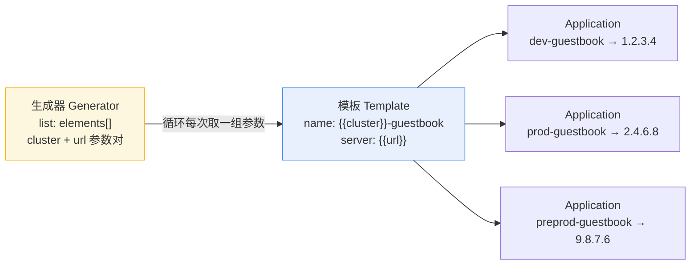

# ApplicationSet 介绍与实战：一个 YAML 管理多环境多集群部署

## 纲要

- **ApplicationSet 解决 Application 的「N 份复制」痛点**：一个 Application 只能同步一个环境，ApplicationSet 用**生成器（generator）**把一份模板渲染成 N 个 Application
- **核心机制 = 生成器 + 模板**：生成器产出参数列表（集群名、URL…），模板用 `{{cluster}}`、`{{url}}` 占位——一次声明，多环境落地
- **列表生成器最常用**：`elements` 里显式列出集群名与地址，循环渲染，dev/prod/preprod 三个集群三行搞定
- **同仓不同目录结构**：多个环境读同一仓库，靠 `path` 里的 `{{cluster}}` 区分目录——目录结构即环境映射
- **删除只能走 YAML**：页面删不掉（删了会被重新生成同步回来）——**要删就连模板一起删**，批量生效
- **适用边界**：环境高度同构、批量分发场景收益最大；环境差异大时仍用多个 Application 精细管

## 一、场景引入：Application 的复制粘贴困局

#77 的 Application 很优雅，但它有一个结构性限制：**一个 Application 只能同步一个环境**。三个环境（dev/test/prod）就要三份几乎一样的 YAML——改个镜像 tag 要改三处，加个环境要复制一份。应用一多（几十个服务 × 四五个环境），Application 数量爆炸，维护成本重回「复制粘贴即代码」。

ApplicationSet 就是来消灭这份重复的。课程定义：

> 「ApplicationSet 是一个实现 GitOps 自动多环境管理的工具。我们可以使用 Application 线（ApplicationSet）来进行同步我们的多个不同环境的一个配置。它的核心组件是**生成器**，通过这个生成器来根据不同的需求和环境的差异来定制应用程序的生成和部署过程。」

一句话：**ApplicationSet = Application 的工厂**——你写一份「应用模板」+ 一组「环境参数」，它负责生成 N 个 Application。

## 二、核心概念与原理

### 2.1 架构：生成器 → 参数 → 模板渲染



三个部件各司其职：

| 部件 | 职责 | 课程讲解 |
| --- | --- | --- |
| **生成器** | 产出参数列表（集群名、URL 等） | 「根据集群名称、URL 等词来生成参数」 |
| **模板** | 用 `{{参数}}` 占位的 Application 骨架 | 名字、destination、source 全部可参数化 |
| **渲染循环** | 每个参数组合生成一个 Application | 「引用这些集群的变量来循环这个列表」 |

### 2.2 变量引用语法

课程实拍的引用方式：**两个花括号 + 变量名**——`{{cluster}}` 引用 cluster 的值、`{{url}}` 引用 url 的值。模板里所有需要随环境变化的地方（应用名、destination.server、source.path）都可以插占位符。

### 2.3 同仓不同目录：环境映射的落地方式

多个环境读**同一个仓库**，但**目录结构不一样**——模板的 `path` 里带 `{{cluster}}`：

```text
appconfig/guestbook/engineering-dev/     # dev 集群读这个目录
appconfig/guestbook/engineering-prod/    # prod 集群读这个目录
appconfig/guestbook/finance-preprod/     # preprod 集群读这个目录
```

第一次循环部署到 dev 集群（1.2.3.4）读 dev 目录；第二次到 prod 集群（2.4.6.8）读 prod 目录——**目录结构即环境映射**，与 #77「对应目录」存储模式天然咬合。

## 三、动手实践：三集群列表生成器

课件 `applicationset.yaml` 是官方 list-generator 范例的完整落地：

```yaml
apiVersion: argoproj.io/v1alpha1
kind: ApplicationSet
metadata:
  name: guestbook
spec:
  generators:
  - list:
      elements:
      - cluster: engineering-dev        # 参数对①
        url: https://1.2.3.4
      - cluster: engineering-prod       # 参数对②
        url: https://2.4.6.8
      - cluster: finance-preprod        # 参数对③
        url: https://9.8.7.6
  template:                              # 被渲染的 Application 模板
    metadata:
      name: '{{cluster}}-guestbook'      # 应用名带集群前缀
    spec:
      project: default
      source:
        repoURL: https://github.com/argoproj/argo-cd.git
        targetRevision: HEAD
        path: applicationset/examples/list-generator/guestbook/{{cluster}}   # 目录带集群变量
      destination:
        server: '{{url}}'                # 目标集群地址
        namespace: guestbook
```

逐段拆解：

| 段 | 作用 | 要点 |
| --- | --- | --- |
| `generators[0].list.elements` | 三组参数对 | cluster（名字）+ url（集群地址）成对出现 |
| `template.metadata.name` | 渲染出的应用名 | `engineering-dev-guestbook` 等三个名字 |
| `template.spec.source.path` | 清单目录 | 尾部 `{{cluster}}` 让每个集群读各自目录 |
| `template.spec.destination.server` | 目标集群 | `{{url}}` 循环取三组地址 |

apply 之后，Argo CD 自动生成三个 Application 并各自同步——**一份 YAML = 三个环境全套部署**。加环境？elements 里加一行。改镜像 tag？模板里改一处。

## 四、删除的特殊性：只能走 YAML

课程专门强调了一个**反直觉行为**：

> 「通过这种方式来部署的话，当我们要删除应用的时候，我们不可以只删除其中一个应用。比如说我们要删除 `dev-guestbook` 这个应用，我们不能够在页面上直接删除……它会自动再进行读取，然后同步。因为它这个是一体的，它是放在同一个 YAML 文件，要删除的话，就只能通过这个 YAML 文件删除。那这三个应用才会彻底地被删除。」

即：**页面删单个 Application 无效**——ApplicationSet 控制器发现「模板里有、集群里缺」会重新生成同步回来。要删就连模板（ApplicationSet YAML）一起删：

```bash
# 删 ApplicationSet 资源 = 级联删除它生成的所有 Application
kubectl delete -f applicationset.yaml
```

这个特性是「声明式」的必然：**页面操作是命令式动作，控制器只认 git/YAML 里的声明**。它提醒使用者：ApplicationSet 管理的一切变更都必须回到 YAML——这正是 GitOps 的纪律。

## 五、生产实践要点

1. **同构环境批量分发是主场**：多集群（多地域、多机房、多客户）部署同一套应用，ApplicationSet 一份模板通吃；环境差异大（不同副本数、不同配置）时谨慎——模板会被差异字段撑爆，退回多 Application。
2. **集群清单集中管理**：elements 里的集群名 + 地址建议来自统一的集群清单（Git 仓库或配置中心），避免三处维护。
3. **命名规范防撞车**：`{{cluster}}-{{app}}` 的前缀式命名保证多应用多集群下名字唯一可辨。
4. **删除必须级联**：培训团队「ApplicationSet 生成的应用不能在页面删」——误删演示只会制造「删了又回来」的困惑。
5. **与对应目录模式组合**：ApplicationSet 的 path 参数化 + #77 的目录存储 = 一套集群清单驱动多环境部署的完整方案。
6. **生成器按需选型**：列表生成器（显式 elements）适合集群少而固定；集群多而动态时了解 Cluster/SCM/Git 等其他生成器（本课程主线是 list）。

## 六、报错排查表

| 现象 | 根因 | 解法 |
| --- | --- | --- |
| 页面删了应用又出现 | ApplicationSet 控制器按模板重新生成 | 删 ApplicationSet YAML 级联删除 |
| 生成的 Application 读错目录 | `path` 的 `{{cluster}}` 与目录结构不匹配 | 核对仓库目录名与 elements 的 cluster 值 |
| 集群地址连不上 | elements 的 url 错/集群未接入 | 核对 url；确认集群在 Argo CD 集群列表 |
| 多个应用名冲突 | 模板 name 缺集群前缀 | name 加 `{{cluster}}-` 保证唯一 |
| 新环境不生效 | elements 没加新集群 | 补一行 cluster + url 参数对 |

## 七、面试考点与追问

**Q1：ApplicationSet 与 Application 的关系？**
Application 是单个部署契约；ApplicationSet 是 Application 的工厂——生成器产出参数、模板定义骨架，渲染出 N 个 Application。解决多环境重复配置问题。

**Q2：ApplicationSet 的核心组件是什么？怎么工作？**
生成器（generator）+ 模板（template）。生成器（如 list）产出参数对（cluster/url），模板用 `{{cluster}}`、`{{url}}` 占位，循环渲染每个参数组合生成一个 Application。

**Q3：为什么 ApplicationSet 生成的应用不能在页面单独删除？**
控制器持续调和「模板声明 vs 集群现状」——页面删掉单个应用后，控制器发现缺失会按模板重新生成同步。删除必须删 ApplicationSet YAML 本身，级联删除全部生成物。

**Q4：多环境如何读同一仓库的不同目录？**
模板 `source.path` 里带 `{{cluster}}` 变量，仓库目录按集群名组织（`guestbook/<cluster>/`）——目录结构即环境映射，与「对应目录」存储模式配合。

**Q5：什么场景不适合用 ApplicationSet？**
环境差异大（各环境副本数、配置、步骤都不同）时，模板会被差异字段撑爆、可读性骤降；集群少且稳定时直接写几个 Application 反而更直观。它适合**同构环境的批量分发**。

## 📎 文本↔代码关联

| 代码文件 | 正文提及 | 内容 |
| --- | --- | --- |
| `code/10-Argocd/applicationset/applicationset.yaml` | 第三节动手实践 | ApplicationSet 完整样例：list 生成器三组参数（engineering-dev/1.2.3.4、engineering-prod/2.4.6.8、finance-preprod/9.8.7.6）+ 模板（`{{cluster}}-guestbook` 命名、path 尾部 `{{cluster}}`、destination `{{url}}`），对应正文逐段拆解表 |

**技术点总结**：ApplicationSet = Application 的批量工厂，机制是**生成器产参数 + 模板吃占位符**：list 生成器显式列出「集群名 + 地址」对，模板用 `{{cluster}}`、`{{url}}` 渲染出 N 个 Application，path 里的 `{{cluster}}` 让多环境读同仓不同目录。它把「改一处生效全部环境」从理想变成日常，但纪律同样鲜明：**生成物只能通过模板管理，页面删单个应用会被控制器自动生成回来**——要删就连 YAML 一起删。适用边界清晰：同构环境批量分发是主场，环境差异大时退回多 Application 精细管。

相关度：96%。是否需要继续：[是]。代码是否可运行：[是]。
