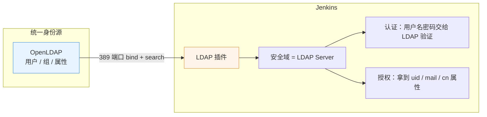
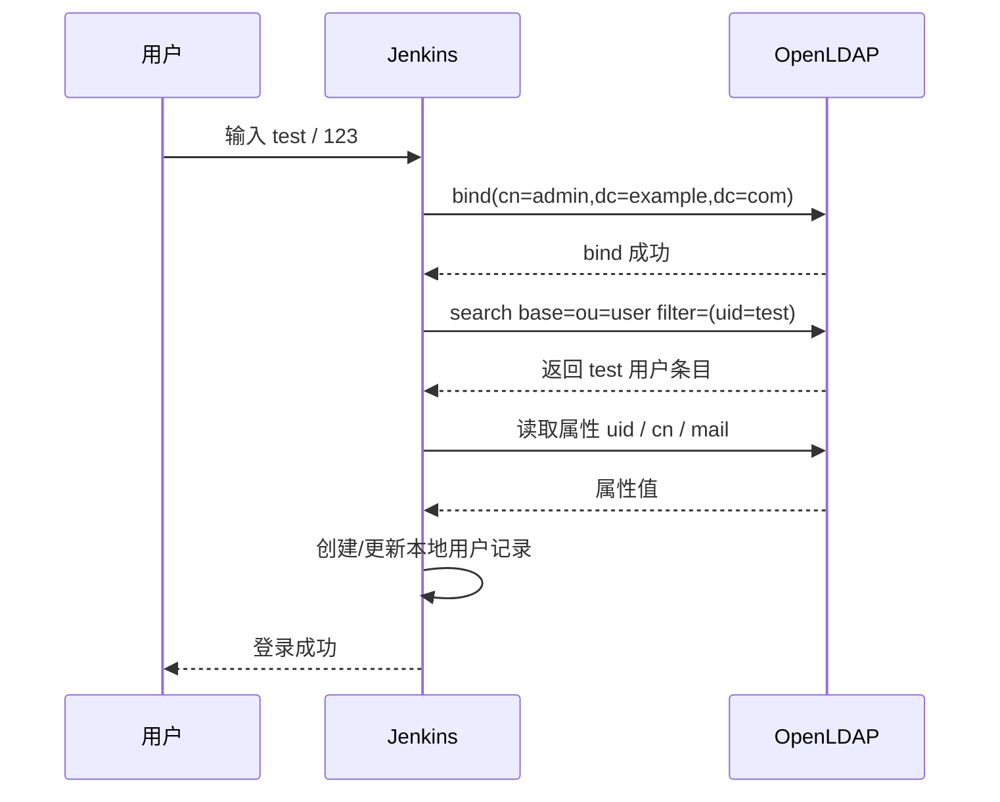

# 7. Jenkins 接入 OpenLDAP 统一认证：从插件安装到用户登录全流程

## 纲要

- **Jenkins 的一切功能都靠插件**：LDAP 也不例外，不装 LDAP 插件就没有"安全域"这个选项——这是插件化架构的直接体现
- **配置位置固定在「全局安全配置」**：系统管理 → 全局安全配置 → 安全域下拉选 `LDAP Server`，而不是在用户管理里
- **四个必填项**：LDAP 服务器地址（默认端口 389）、用户搜索基础（Base DN）、用户搜索过滤器（靠 `uid` 属性匹配）、管理员 DN 与密码
- **`mail` 属性是隐藏陷阱**：Jenkins 默认要读用户的 `mail` 属性，LDAP 里的用户**必须建这个属性**，否则登录后拿不到邮箱信息
- **验证方式**：先用 LDAP 里的测试账号密码点"Test"，显示验证成功再保存，避免把自己锁在门外
- **插件装完要重启**：提示"部分插件缺少依赖，无法加载"时，浏览器地址栏输 `/restart` 回车即可
- **安全收益**：接入 LDAP 后 Jenkins 不再有独立的本地账户体系，人员入离职只在 LDAP 侧管控一次

## 一、为什么 Jenkins 要接 LDAP

Jenkins 默认有一套自己的本地用户库（`admin` + 你在初始化时建的账户）。小团队无所谓，但公司里有几十上百人时问题就来了：

- **人员入离职要手动改 Jenkins**：新人来了要建账号，人走了要记得删——漏一次就是安全隐患；
- **密码策略不统一**：Jenkins 的密码规则和公司域控策略是两套；
- **审计困难**：谁在 Jenkins 做了什么，无法和公司统一身份体系对上。

接入 LDAP 后，**Jenkins 不再维护自己的账户库，所有用户身份由 LDAP 统一提供**。人员变动只在 LDAP 侧操作一次，Jenkins 自动生效。



## 二、第一步：安装 LDAP 插件

**Jenkins 是一个插件化的系统，不管你使用任何功能，都需要安装对应功能的插件。**

回想初始化时那一步——系统提示"安装推荐的插件"还是"自定义插件安装"，说的就是这个道理：**只有安装了对应功能的插件，才能使用具体的功能**。

- 想用 Git 拉代码 → 装 **Git 插件**
- 想写声明式流水线 → 装 **Pipeline 插件**
- 想接 LDAP 认证 → 装 **LDAP 插件**

安装路径：**系统管理 → 插件管理 → 可选插件**，搜索 `LDAP`，选中第一个安装。

> **常见状况**：装完提示"部分插件缺少依赖，无法加载"。解决办法是重启 Jenkins——浏览器地址栏输入 `/restart` 回车，等待重启完成即可。这一步在装任何插件后都可能遇到，属于正常现象。

## 三、第二步：配置安全域

装好插件后，进入 **系统管理 → 全局安全配置**，找到**安全域（Security Realm）**区域，下拉选择 **`LDAP Server`**。

选完之后会展开出一堆配置项。我们逐个对着 LDAP 的目录结构来填。

### 3.1 先看清楚 LDAP 侧有什么

课件里的 LDAP 结构是这样的：

```text
DC=example,DC=com                        ← 根域（后缀）
└── OU=user                              ← 组织单位（用户都放在这里）
    └── cn=test                          ← 一个测试用户
        属性：uid = test
        属性：mail = test@example.com
        属性：cn  = test
```

对应到 Jenkins 的配置项：

| Jenkins 配置项 | 填什么 | 说明 |
| --- | --- | --- |
| **Server** | `ldap://gitlab.example.com:389` | LDAP 服务器地址，**默认端口 389** |
| **root DN** | `dc=example,dc=com` | 根域，对应 LDAP 的后缀 |
| **User search base** | `ou=user` | **用户搜索基础**，用户放在哪个 OU 下就填哪个 |
| **User search filter** | `(&(objectClass=inetOrgPerson)(uid={login}))` | **通过 `uid` 属性搜索到具体用户** |
| **Group search base** | （留空） | 不通过组过滤就留空 |
| **Manager DN** | `cn=admin,dc=example,dc=com` | **管理员的账号域**，Jenkins 用它 bind 到 LDAP |
| **Manager Password** | 管理员密码 | 上面那个账号的密码 |
| **LDAP mail 属性** | `mail` | **默认是 `mail`**，用户里也必须建这个属性 |

### 3.2 三个最容易填错的地方

**① User search filter 的 `{login}` 占位符。** Jenkins 会用登录时输入的用户名替换 `{login}`，拼成完整的 LDAP 过滤器去查找用户。**这个占位符不能改成别的名字**，否则永远匹配不上。

**② mail 属性不是可选项。** Jenkins 默认要从 LDAP 读用户的邮箱。**如果 LDAP 里的用户没有 `mail` 属性，认证可能通过但用户信息不完整**。所以建用户时必须把 `mail` 属性一起建上。

**③ Group search base 留空的含义。** 留空表示"不通过组来过滤用户"——只要能在 User search base 下通过过滤器找到，就允许认证。如果需要按组授权（比如只有 `devops` 组能登录），才需要填这里并配 Group search filter。

### 3.3 完整的 LDAP 配置参考

课件里给出的 SonarQube 侧 LDAP 配置（结构完全一致，可对照理解）：

```properties
# LDAP configuration
# General Configuration
ldap.url=ldap://gitlab.example.com:389
ldap.bindDn=cn=admin,dc=example,dc=com
ldap.bindPassword=${GIT_PASSWORD}

# User Configuration
ldap.user.baseDn=ou=user,dc=example,dc=com
ldap.user.request=(&(objectClass=inetOrgPerson)(uid={login}))
ldap.user.realNameAttribute=cn
ldap.user.emailAttribute=mail
```

对照 Jenkins 的配置项看：

- `ldap.url` ↔ Jenkins 的 **Server**
- `ldap.bindDn` ↔ Jenkins 的 **Manager DN**
- `ldap.user.baseDn` ↔ Jenkins 的 **User search base**
- `ldap.user.request` ↔ Jenkins 的 **User search filter**
- `ldap.user.emailAttribute` ↔ Jenkins 的 **LDAP mail 属性**

**一套概念，两种工具，别被不同的配置名绕晕。**

## 四、第三步：验证与保存

配置填完后，页面下方有测试区域：

1. 输入 LDAP 里的测试账号（如 `test`）和密码（课件里是 `123`）；
2. 点击验证；
3. **显示"验证成功"就代表没有问题**，再点保存。

> **顺序很重要**：一定要先 Test 成功再 Save。如果配置填错直接保存，而 Jenkins 又只允许 LDAP 登录，你会把自己锁在门外——这时候只能去服务器上改 `config.xml` 或重启重置。

## 五、第四步：用 LDAP 账户登录

保存后退出当前登录的 `admin`，用 LDAP 里的账号登录：

```text
用户名：test
密码：123
```

登录成功即代表接入完成。

**再验证一个只读场景**：创建一个不需要登录的账号（如 `test2`），设 `no login`，家目录放 `home`，配一个邮箱。用 `test2` 登录同样没问题——这说明配置对所有 LDAP 用户生效，不只是某一个。



## 六、接入之后：权限才是真正的开始

很多教程到这里就结束了，但这恰恰是**最容易踩坑的地方**。

接入 LDAP 只解决了"**谁能登录**"，没有解决"**登录后能干什么**"。Jenkins 的默认行为是：**LDAP 用户登录后没有任何权限**——看不到视图、看不到构建、什么操作都做不了。

> 这不是 bug，而是安全设计。**不是说你接入了 LDAP，用户登录就可以做任何操作；必须得分配了权限之后，你才可以做某些操作。**

所以接入 LDAP 之后，下一步必须做权限分配（Role-Based Strategy 插件 + 管理角色/分配角色），这部分在下面详细展开。

## 七、常见报错与排查

| 现象 | 根因 | 解法 |
| --- | --- | --- |
| 安全域里没有 `LDAP Server` 选项 | 没装 LDAP 插件 | 插件管理搜 `LDAP` 安装，装完 `/restart` |
| 提示"部分插件缺少依赖，无法加载" | 插件依赖未就绪 | 地址栏输 `/restart` 回车重启 |
| Test 验证失败 | Server 地址/端口错，或 Manager DN 无权 | 检查 `ldap://host:389` 与 `Manager DN` |
| 验证成功但登录后报错 | 用户缺 `mail` 属性 | 在 LDAP 给用户补 `mail` 属性 |
| 用 `{0}` 之类占位符匹配不到用户 | 占位符写错 | 必须用 `{login}` |
| 能登录但什么都看不到 | 未分配任何权限 | 配置 Role-Based Strategy 并分配角色 |
| 保存后自己被锁在门外 | 配置错还直接保存 | 先 Test 再 Save；已锁则改 `config.xml` |

## 八、面试考点与追问

**Q1：Jenkins 接入 LDAP 的完整步骤是什么？**
① 装 LDAP 插件（插件化架构，无插件无功能）；② 系统管理 → 全局安全配置 → 安全域选 `LDAP Server`；③ 填 Server（默认 389）、User search base、User search filter（`uid={login}`）、Manager DN 与密码、mail 属性；④ Test 验证成功再保存；⑤ 用 LDAP 账号登录验证。

**Q2：User search filter 里的 `{login}` 是什么？为什么不能改？**
它是 Jenkins 的**占位符**，登录时会被用户输入的用户名替换，拼成完整 LDAP 过滤器去 search 用户。改名后 Jenkins 不再做替换，永远匹配不到用户。

**Q3：为什么 LDAP 用户必须有 `mail` 属性？**
Jenkins 默认通过配置的 mail 属性名（默认 `mail`）从 LDAP 读取用户邮箱，用于通知、审计等。缺这个属性会导致用户信息不完整，某些依赖邮箱的功能异常。

**Q4：接入 LDAP 后用户能直接使用 Jenkins 吗？**
不能。接入 LDAP 只解决认证（谁能登录）。**授权需要单独配置**——Jenkins 默认不给 LDAP 用户任何权限，必须通过 Role-Based Strategy 等插件分配角色，用户才能看到视图、执行构建。

**Q5：为什么强调"先 Test 再 Save"？**
因为一旦保存且安全域被设为 LDAP，本地账户可能被禁用。若配置有误，管理员会被锁在门外，只能登服务器改 `config.xml` 恢复。先 Test 成功再 Save 是可逆的安全操作顺序。

**Q6：`bindDn` 和 `user.baseDn` 的区别？**
`bindDn`（Manager DN）是 Jenkins 用来**连接并查询 LDAP 的服务账号**，需要读权限；`user.baseDn` 是**用户条目所在的目录位置**，限定 search 范围。前者是"用什么身份查"，后者是"去哪里查"。

## 📎 文本↔代码关联

本篇对应课件源码（`code/3-基础-Jenkins/`，已做去品牌化处理）：

| 代码文件 | 正文提及 | 内容 |
| --- | --- | --- |
| `code/3-基础-Jenkins/课件/教学课件.md` | 第 3.3 节 | LDAP 配置完整参数：`ldap.url` / `ldap.bindDn` / `ldap.user.baseDn` / `ldap.user.request` / `ldap.user.emailAttribute` |

**技术点总结**：Jenkins 接入 LDAP 四步——装 LDAP 插件（插件化架构决定无插件无功能）、全局安全配置里选 `LDAP Server` 安全域、填 Server/User search base/User search filter（`uid={login}`）/Manager DN/mail 属性、先 Test 验证再保存。两个关键认知：**mail 属性是必建项**（Jenkins 默认要读）、**接入 LDAP 只解决认证不解决授权**（默认零权限，必须再配角色分配）。

