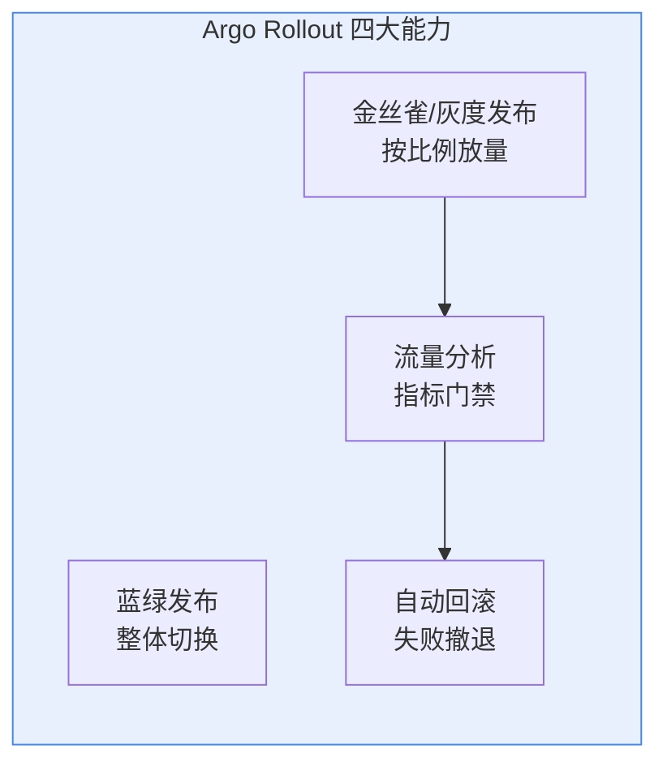
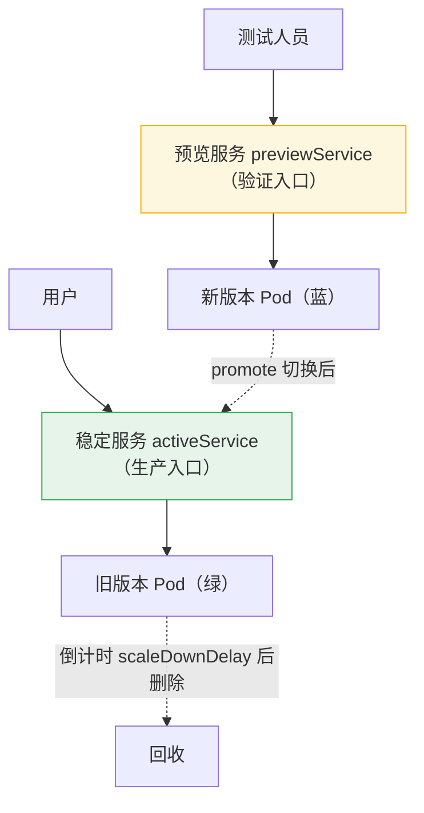
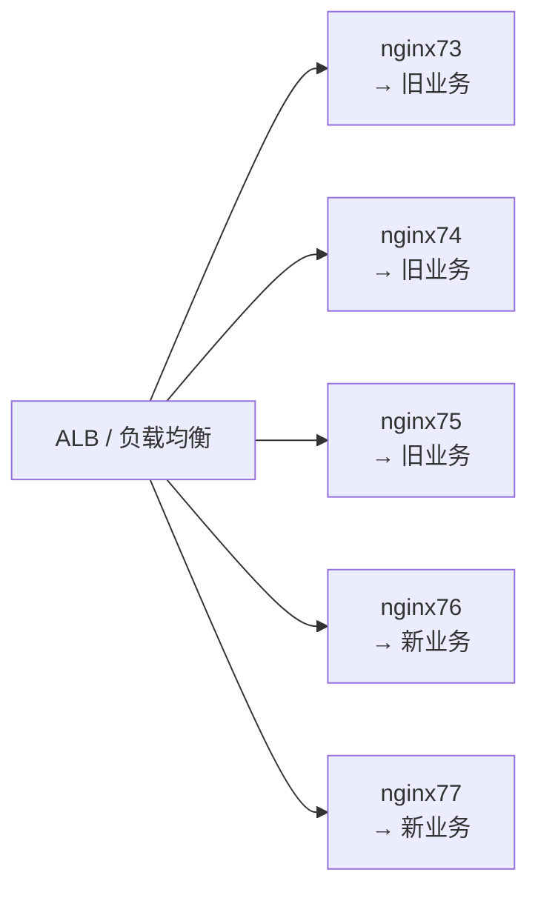
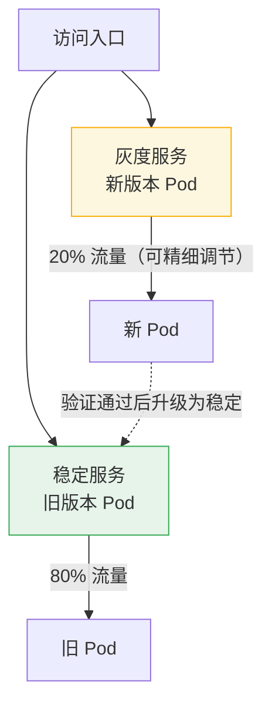

# 82. Argo Rollout 与蓝绿 / 灰度发布概念：为什么滚动更新不够用

## 纲要

- **Argo Rollout 是 K8s 的高级部署控制器**：蓝绿发布、金丝雀（灰度）发布、流量分析、自动回滚四件能力，替换默认 Deployment 的滚动更新
- **滚动更新的三宗罪**：无法快速回滚、无法精细控制流量比例、发布期新旧混跑不可控——大流量业务扛不住
- **蓝绿 = 两套环境整体切换**：稳定服务（旧 Pod，用户入口）+ 预览服务（新 Pod，测试入口）——切流量是一瞬间，回滚也是一瞬间
- **灰度 = 按比例渐进放量**：10% → 20% → …每级可暂停观察，人工审核通过才全量——风险被切成小份
- **传统灰度 vs Rollout 灰度**：传统靠服务器分组 + 负载均衡比例；Rollout 靠**两个 Service 精确引流**，流量比例由运维精细控制
- **流量切换的两种模式**：`autoPromotionEnabled: true` 全自动 vs `false` 人工 promote——可靠性优先选手动

## 一、场景引入：滚动更新的「三座大山」

K8s 默认的 Deployment 滚动更新（RollingUpdate）用起来无感，但课程开篇就点出它的三个不适配生产的短板：

> 「我们现在默认用的是滚动更新的一个功能。那这种滚动更新的功能，它没有办法进行快速的**回滚**，以及也没有办法让我们进行一个更加可靠的**灰度发布**的一个操作。所以当我们的业务流量大的时候，我们更加需要一个更高级的一个部署方式来稳定我们的一个部署环境。」

拆成三座大山：

| 大山 | 滚动更新的表现 | 业务后果 |
| --- | --- | --- |
| **回滚慢** | 回滚 = 再滚一次（推旧镜像重新滚动） | 故障期间用户持续受伤，MTTR 拉长 |
| **灰度粗** | 只能按 Pod 比例滚动，无法按**流量**比例 | 5% Pod 新版本可能扛 50% 流量（负载不均） |
| **发布不可控** | 新旧 Pod 同时服务，无暂停观察点 | 新版本有 bug 时没有任何刹车片 |

**大流量业务**对这三点的容忍度最低——一次故障发布就是事故。Argo Rollout 就是为此而生。

## 二、Argo Rollout 是什么

课程定义：「Argo Rollout 它是为 K8s 提供了一个更加高级的部署能力，包括它提供了一个**蓝绿发布、金丝雀发布、流量分析以及自动回滚**的功能。通过提供了这些高级的部署功能，使我们生产环境发布的时候，提供了一个更加可靠的一个部署环境。」

技术形态：一个 CRD（`kind: Rollout`）+ 控制器，**替换 Deployment 作为部署入口**——Pod 模板、副本数等字段与 Deployment 同构，策略部分换成 `blueGreen`/`canary`。它不与 Argo CD 绑定（可独立用），但与 Argo CD 配合是课程主线（Argo CD 管 git 同步，Rollout 管发布策略）。

四大能力的关系：灰度/蓝绿是**放量手段**，流量分析是**放量判据**（指标不过关不放），自动回滚是**失败兜底**。四件套合起来才是「可靠的发布」。

## 三、蓝绿发布：两套环境，瞬间切换

### 3.1 概念

蓝绿发布维护**两套完整环境**：

- **绿色（稳定）**：当前生产版本（旧 Pod），用户流量入口；
- **蓝色（预览）**：新版本 Pod，**不对用户开放**，供测试验证。

部署新版本时：起蓝环境 → 预览服务测试 → 确认 OK → **稳定服务一刀切到蓝 Pod** → 旧 Pod 倒计时删除。整个过程**用户侧只有一个瞬间的切换**，且**回滚同样只是一瞬间**（切回绿）。

### 3.2 架构：两个 Service 的分工

关键配置项（#83 实战详拆）：**activeService**（稳定服务）+ **previewService**（预览服务）**两个 Service 必须配**；`autoPromotionEnabled` 决定切换是自动还是人工 promote；`scaleDownDelaySeconds` 是旧 Pod 的倒计时删除窗口。

### 3.3 蓝绿的两个「一瞬间」

- **发布一瞬间**：promote 后稳定服务指向新 Pod——不是渐进混合，是整体切换；
- **回滚一瞬间**：发现问题 abort/rollback，稳定服务指回旧 Pod——**这才是蓝绿对滚动更新的降维打击**：回滚不需要重新推镜像重新滚动，改个 Service 指向即可。

## 四、灰度发布：按比例渐进放量

### 4.1 概念

灰度发布（金丝雀发布）是一种**平滑过渡**的发布方式：

> 「我们要发布一个应用，那现在它升级到了一个 v2 的版本。但是我们并不是说所有用户他都会切换到这个新版本里面。我们只是让其中一部分用户来访问这个新版本。那当测试没问题之后，我们再将原有的一些用户让他们全部迁移到新的一个应用上来。」

核心思想：**一部分流量先走新版本，验证无问题再全量**——新版本的伤害半径被限制在「这部分流量」内。

### 4.2 传统灰度 vs Argo Rollout 灰度

课程专门对比了两种实现：

**传统灰度（服务器分组 + 负载均衡）**：

五台 nginx，只更新 n76/n77 到新版本 → 访问五次约三次旧两次新。问题：比例是**粗略的服务器份数比**，流量是否均匀取决于负载均衡策略，且**新版本服务器数量=灰度比例**，粒度粗。

**Argo Rollout 灰度（双 Service 精确引流）**：

「这个流量可以由运维人员来精细控制。比如说我们要多少流量访问到我们的新版本，又有多少流量是只访问旧的 Pod，这个流量都可以由我们的运维人员来进行精细控制。」——**流量比例与 Pod 数量解耦**，10% 流量可以由 1 个新 Pod 承担（其余扩旧 Pod），这是 Rollout 灰度对传统方式的代差。

### 4.3 渐进步骤与暂停

灰度的步骤列表（steps）是「放量曲线」：`setWeight: 10` → `pause` → `setWeight: 20` → `pause` → …每级都可配**持续时间暂停**或**人工审核暂停**——「前面两个 Pod 没有问题了，通过了之后我再继续部署后面的 Pod」。**暂停即刹车片**，这是滚动更新没有的机制。

验证通过后：新 Pod **升级为稳定服务**，旧 Pod 删除——流量入口不变（稳定服务），后端完成换代。

## 五、两种发布方式对照与选型

| 维度 | 蓝绿发布 | 灰度发布 |
| --- | --- | --- |
| 新版本验证方式 | 预览服务整体测试 | 小比例真实流量验证 |
| 切换方式 | 瞬间整体切换 | 按比例渐进（10%→20%→…） |
| 资源开销 | **双倍**（两套 Pod 并存） | 增量式（按比例扩容） |
| 回滚速度 | 极快（切回稳定服务） | 快（流量调回 0 + 删新 Pod） |
| 风险暴露 | 切换前零暴露 | 按比例暴露（可控） |
| 适用 | 版本差异大、需完整验证 | 版本差异小、需真实流量验证 |
| 流量控制 | 全有或全无 | **精细比例** |

**选型经验**：大版本、架构变更用蓝绿（先在预览环境完整验证再切）；常规迭代用灰度（真实流量小火慢炖）；两者都可叠加流量分析（#84~#86）实现「指标不过关自动回滚」。

## 六、面试考点与追问

**Q1：滚动更新有什么不适配生产的问题？**
无法快速回滚（要重新滚动）、无法按流量比例灰度（只按 Pod 比例）、发布过程无暂停观察点——大流量业务故障代价高。

**Q2：Argo Rollout 提供哪些能力？**
蓝绿发布、金丝雀（灰度）发布、流量分析、自动回滚——四件套合起来实现可靠发布。

**Q3：蓝绿发布的核心架构？两个 Service 分别干什么？**
稳定服务（activeService）= 生产入口，指向当前稳定版本 Pod；预览服务（previewService）= 验证入口，指向新版本 Pod。测试通过后 promote 切换稳定服务指向，旧 Pod 倒计时删除。两个 Service 必须配。

**Q4：灰度发布的步骤列表怎么设计？**
steps 里 setWeight 逐级放量（10%→20%→…），每级可配 duration 暂停或 `pause: {}` 人工审核——暂停是刹车片，人工审核是放行闸。

**Q5：Argo Rollout 灰度与传统灰度（服务器分组）的区别？**
传统靠负载均衡按服务器份数粗略分流，灰度比例=服务器比例；Rollout 靠稳定/灰度双 Service 精确引流，**流量比例与 Pod 数量解耦**，运维可精细控制。

**Q6：autoPromotionEnabled 两个取值的行为差异？**
true：新 Pod 就绪后稳定服务自动切换（无人值守）；false：等人工 promote（可靠性优先）——生产大版本用手动，常规迭代可自动。

## 📎 文本↔代码关联

本篇为**概念篇**，课件代码从实战篇开始提供（蓝绿/灰度的 Rollout 资源清单），如实标注、不虚构路径。本篇建立的「双 Service + 步骤列表 + 暂停」模型将在后续章节直接落地：

- `code/10-Argocd/blue-green/BlueGreen-Deploy.yaml` —— #83 蓝绿实战的 Rollout 资源（activeService/previewService/autoPromotionEnabled/scaleDownDelaySeconds 的原样）
- `code/10-Argocd/canary/Canary-Deploy.yaml` —— #83 灰度实战的 Rollout 资源（maxSurge/maxUnavailable/steps 的原样）
- `code/10-Argocd/canary-analysis/Canary-Deploy.yaml`、`code/10-Argocd/blue-green-analysis/Blue-Green-Deploy.yaml` —— #85/#86 流量分析自动回滚的完整配置

**技术点总结**：Argo Rollout 用「双 Service 分流 + 步骤化放量」补齐了滚动更新的三块短板——**回滚慢**（蓝绿切 Service 一瞬间完成）、**灰度粗**（流量比例与 Pod 数解耦、运维精细控制）、**发布不可控**（步骤级暂停=刹车片、人工审核=放行闸）。蓝绿适合大版本完整验证（代价是双倍资源），灰度适合常规迭代真实流量小火慢炖（10%→20%→…逐级放量）。再往上一层，两者都能挂流量分析模板（#84）实现「指标不过关自动回滚」——那是可靠发布的终极形态。

