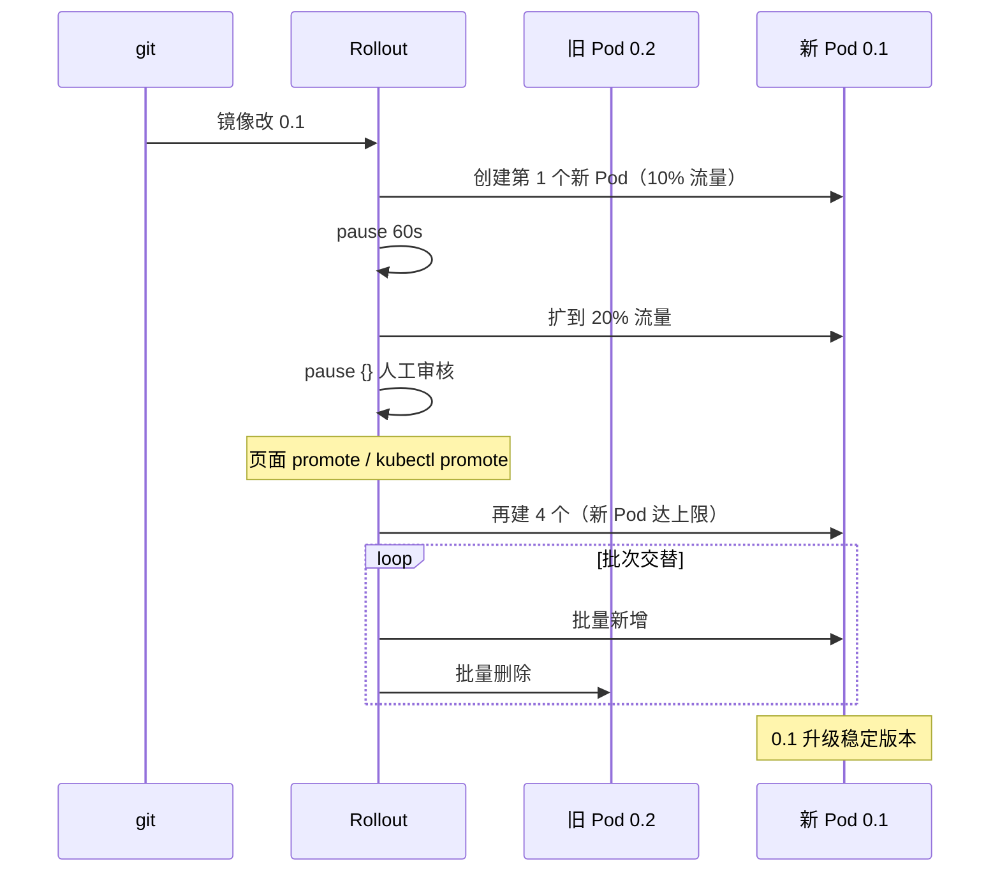

# 83. Argo Rollout 蓝绿与灰度发布实战：从配置到切流量全流程

## 纲要

- **部署四件套**：Argo Rollout 控制器 + Argo Rollouts Dashboard（页面操作）+ kubectl 插件（终端操作）——三者齐了才具备实战条件
- **蓝绿五配置**：activeService + previewService + autoPromotionEnabled + scaleDownDelaySeconds + revisionHistoryLimit——**两个 Service 是硬性要求**
- **蓝绿切换两模式**：`autoPromotionEnabled: false` 人工 promote（可靠优先）/ `true` 全自动——出问题 abort 秒回滚
- **灰度三配置**：maxSurge 25%（新 Pod 上限）+ maxUnavailable 0（不允许离线）+ steps 步骤列表（10%→20%→…暂停观察）
- **灰度的批次节奏**：新 Pod 一批批创建、旧 Pod 一批批删除——比例爬升可视化，暂停点就是人工卡点
- **插件命令行**：`kubectl argo rollouts` 支持 promote/pause/abort/status/restart/history——终端与页面双通道

## 一、场景引入：概念落地前的环境准备

#82 讲清了蓝绿/灰度的模型，本篇进入实弹演习。但先要补齐运行环境——课程第一节就是部署四件套，缺一件战斗打响时才发现就晚了。

## 二、环境准备：Rollout 四件套

| 组件 | 作用 | 部署方式 |
| --- | --- | --- |
| **Argo Rollout 控制器** | Rollout CRD + 调和逻辑 | 建命名空间 + apply 安装清单 |
| **Argo Rollouts Dashboard** | 页面发布/回滚/查看部署情况 | apply 安装清单（端口 **31517**） |
| **kubectl argo rollouts 插件** | 终端操作 Rollout | 下载二进制 mv 到 `/usr/local/bin` |
| （依赖）Argo CD | git 同步 Rollout 资源 | 前面已装 |

Dashboard 访问：`http://<IP>:31517` → 切到 `default` 命名空间即可看到 Rollout 应用。插件的意义：**页面点 promote 之外的一切都能脚本化**——`promote`/`pause`/`abort`/`status`/`restart`/`history`，CI 里无人值守发布靠它。

课程实拍的一个细节值得学：apply 蓝绿 Application 后「为什么我这边直接部署会部署成功？因为我这边之前已经部署了我们的 Argo Rollout」——**先验证控制器在位再 apply 业务资源**，是 Rollout 实战的第一纪律。验证方式：

```bash
# 控制器 CRD 在位？
kubectl get crd rollouts.argoproj.io

# Rollout 资源与其管理的 Service/Deployment 都在？
kubectl get rollout,svc,deploy | grep guestbook
```

缺控制器就 apply 安装清单；资源缺了先查 Application 的同步状态（#77/#79），别反复重复 apply。

## 三、蓝绿发布实战

### 3.1 配置详解（对照课件 BlueGreen-Deploy.yaml）

```yaml
apiVersion: argoproj.io/v1alpha1
kind: Rollout
metadata:
  name: pro-store
spec:
  strategy:
    blueGreen:
      activeService: guestbook-ui              # 稳定服务（用户入口）
      previewService: guestbook-ui-preview     # 预览服务（测试入口）
      autoPromotionEnabled: true               # true=自动切换 / false=人工 promote
      scaleDownDelaySeconds: 1200              # 旧 Pod 倒计时删除（1200秒=20分钟）
  revisionHistoryLimit: 6                      # 保留 6 个历史版本
  replicas: 1
  selector:
    matchLabels:
      app: guestbook-ui
  template:
    metadata:
      labels:
        app: guestbook-ui
    spec:
      containers:
      - image: gcr.io/heptio-images/ks-guestbook-demo:0.2
        name: guestbook-ui
        ports:
        - containerPort: 80
```

五个配置项逐个看（课程讲解顺序）：

| 字段 | 含义 | 课程讲解 |
| --- | --- | --- |
| `activeService` | 稳定服务 | 「稳定 service 指向旧版本的 Pod，是用户访问入口」 |
| `previewService` | 预览服务 | 「指向新版本的 Pod，通过它访问新版本测试有没有问题」 |
| `autoPromotionEnabled` | 是否自动切换 | **false**：点 promote 通过才切流量；**true**：新 Pod 部署成功稳定服务自动切换 |
| `scaleDownDelaySeconds` | 旧 Pod 删除倒计时 | 「流量切换后旧版本 Pod 倒计时 1200 秒删除」——**回滚的黄金窗口** |
| `revisionHistoryLimit` | 历史版本数 | 「保存 6 个历史版本，回滚时找到版本点 rollback」 |

**两个 Service 必须配**（课程反复强调：「一定要配两个 Service，配一个设备是不行的」）——课件文件尾部正是这两个 Service 的声明（`guestbook-ui` + `guestbook-ui-preview`，selector 同为 `app: guestbook-ui`）。

### 3.2 Application 挂载与同名坑

蓝绿的 Application（`BlueGreen-Application.yaml`）source 指向 appconfig 仓库的 `guestbook-blue-green` 目录。课程实拍踩坑：**应用名与已有应用同名导致状态异常**——改名 `guestbook-blue` 重新 apply 才正常（与 #77 同名坑同一教训：**Argo CD 实例内应用名必须唯一**）。

### 3.3 完整动线：从 0.1 到 0.2

1. **apply Application** → 蓝绿应用出现，Rollout 按 0.1 版本拉起 Pod；
2. **改镜像 0.1 → 0.2**（git 提交）→ Argo CD 同步 → Rollout 创建新版本 Pod；
3. **观察切换行为**（`autoPromotionEnabled: false` 时）：稳定版本**仍是 0.1**，流量没切——新 Pod 在预览服务后面等着；
4. **预览验证**：通过 `guestbook-ui-preview` 访问 0.2 的 Pod，测试有没有问题。页面上的两个观察技巧：**鼠标悬停版本徽标**可见 0.1/0.2 两个版本并存；切到**网络架构视图**可见两个 Service（`guestbook-ui` 用户入口 + `guestbook-ui-preview` 预览入口）分别指向新旧 Pod——「第一个设备是我们用户的一个访问入口，第二个设备是我们的一个预览版的入口，是提供给我们测试使用的」；
5. **promote**：页面点 promote（yes）→ 流量切到 0.2 → **旧 Pod 进入 1200 秒倒计时**；
6. **有问题 abort**：切过去发现不对，马上点 abort → 稳定版本切回 0.1；
7. **自动模式**：把 `autoPromotionEnabled` 改 `true` 提交 → Argo CD 检出 diff → 点同步 → 每次发布自动切流量，「有问题的时候，我们可以在这边马上点击 rollback」。架构图上可见两个 Service **同时指向新版本 Pod**，旧 Pod 等倒计时删除。

**1200 秒倒计时是蓝绿的安全气囊**：切换后 20 分钟内随时可 abort 回退，旧 Pod 还没删——这是「回滚一瞬间」的物质基础。

### 3.4 终端插件操作

```bash
# 查看 Rollout 及应用
kubectl argo rollouts list
kubectl argo rollouts history $ROLLOUT_NAME

# 常用动作（对应页面按钮）
kubectl argo rollouts promote $ROLLOUT   # 通过/切换流量
kubectl argo rollouts pause $ROLLOUT
kubectl argo rollouts abort $ROLLOUT     # 中止并回滚
kubectl argo rollouts status $ROLLOUT
kubectl argo rollouts restart $ROLLOUT
```

课程实拍：`kubectl argo rollouts` 下有两个应用——`购物-API-蓝绿`（不健康，另一个实验遗留）+ 刚创建的蓝绿应用（健康）；`history` 显示版本历史。

### 3.5 课件 YAML 全文：Rollout + 双 Service 一体

课程讲解时特意把课件文件拉到底部——**Rollout 与两个 Service 写在同一个文件里**，用 `---` 分隔（这正是「一定要配两个 Service」的实物证据）：

```yaml
apiVersion: argoproj.io/v1alpha1
kind: Rollout
metadata:
  name: pro-store
spec:
  strategy:
    blueGreen:
      activeService: guestbook-ui              # 稳定服务：指向旧版本 Pod
      previewService: guestbook-ui-preview     # 预览服务：指向新版本 Pod
      autoPromotionEnabled: true
      scaleDownDelaySeconds: 1200
  revisionHistoryLimit: 6
  replicas: 1
  selector:
    matchLabels:
      app: guestbook-ui
  template:
    metadata:
      labels:
        app: guestbook-ui
    spec:
      containers:
      - image: gcr.io/heptio-images/ks-guestbook-demo:0.2
        name: guestbook-ui
        ports:
        - containerPort: 80
---
apiVersion: v1
kind: Service
metadata:
  name: guestbook-ui                        # 与 activeService 同名同 selector
spec:
  ports:
  - port: 80
    targetPort: 80
  selector:
    app: guestbook-ui
---
apiVersion: v1
kind: Service
metadata:
  name: guestbook-ui-preview                # 与 previewService 同名同 selector
spec:
  ports:
  - port: 80
    targetPort: 80
  selector:
    app: guestbook-ui
```

三个易错点（课程实拍 + 生产共性）：

1. **Service 名必须与策略字段严格对应**——`activeService: guestbook-ui` 就配 `name: guestbook-ui` 的 Service，「下边的 `guestbook-ui` 这个名称必须要保持一致」；名字对不上，控制器找不到服务，切流量静默失败；
2. **两个 Service 的 selector 相同**（都是 `app: guestbook-ui`）——新旧 Pod 打同一组标签，靠 Service 名区分角色，不靠标签区分；
3. **`---` 分隔的多文档 YAML 可直接 apply**——`kubectl apply -f BlueGreen-Deploy.yaml` 一次建 Rollout + 双 Service，省去分三次 apply 的顺序烦恼。

## 四、灰度发布实战

### 4.1 配置详解（对照课件 Canary-Deploy.yaml）

```yaml
spec:
  replicas: 10                        # 灰度至少 2 副本（10 副本演示更直观）
  minReadySeconds: 30
  strategy:
    canary:
      maxSurge: "25%"                 # 新 Pod 上限 = 当前 Pod 数的 25%
      maxUnavailable: 0               # 滚动期间不允许任何离线
      steps:
      - setWeight: 10                 # 10% 流量给新版本
      - pause:
          duration: 1h                # 暂停观察 1 小时（可配分/秒）
      - setWeight: 20                 # 20% 流量
      - pause: {}                     # 人工审核（空 pause = 等 promote）
```

三个配置项（课程拆解）：

| 字段 | 含义 | 课程讲解 |
| --- | --- | --- |
| `maxSurge: 25%` | 同时启动新 Pod 的上限 | 「当前 Pod 数量的 25%」——10 副本最多多起 2~3 个新 Pod |
| `maxUnavailable: 0` | 滚动更新不允许离线 | 「不允许任何的误离线」——存量服务不缩水 |
| `steps` | 放量曲线 | setWeight 设比例 + pause 暂停（duration 定时 / `{}` 人工） |

### 4.2 完整动线：从 0.2 到 0.1

1. **apply**（Application + Canary-Deploy）→ 仓库目录里的 Rollout 生效，5 个副本起 0.2 版本；
2. **改镜像 0.2 → 0.1** → 第一个新 Pod 创建，**10% 流量**接入新版本；
3. **第二步**：等 60 秒（演示把 1h 改短）→ **20% 流量**；
4. **观察状态**：当前 6 个 Pod（5 旧 + 1 新），10% 流量进新 Pod、90% 进旧 Pod；左上角**暂停图标**亮起；
5. **人工审核**：60 秒后到第四步——`pause: {}` 等 promote；点 promote（页面上「yes」）→ **再创建 4 个新 Pod**（最多到 5 个新 Pod 上限）；
6. **批次交替**：新 Pod 一批批创建、旧 Pod 一批批删除——「新增的一批再删除旧的一批」。旧 Pod 删除前会先进入 **Terminating（中断）状态**，等 graceful shutdown 走完才真正消失——页面看到 Terminating 别急着当故障；
7. **收官**：0.1 版本**升级为稳定版本**，旧 Pod 删除完毕。



**灰度的刹车哲学**：每级 setWeight 都是「再信一点」，每个 pause 都是「停下来看看」——人工审核那一步（`pause: {}`）把最终放量权留给人。

### 4.3 灰度实战的终端视角

页面看得爽，CI 里却要用终端。灰度发布全程可以用插件一条命令盯到底：

```bash
# 实时盯一个灰度 Rollout 的状态（Pod 增减、流量比例、暂停点一目了然）
kubectl argo rollouts get rollout guestbook-canary --watch

# 常用灰度动作
kubectl argo rollouts promote guestbook-canary   # 人工审核通过（跳过 pause {}）
kubectl argo rollouts pause guestbook-canary     # 临时叫停放量
kubectl argo rollouts abort guestbook-canary     # 中止灰度，流量回退稳定版本
kubectl argo rollouts status guestbook-canary    # 一次性看当前状态（脚本友好）
```

三个实战判断：

- **`promote` 是灰度的人工卡点开关**——`pause: {}` 处页面点 yes 与终端 `promote` 等价，无人值守流水线（如 Jenkins 调 kubectl）就靠这条命令续跑；
- **`abort` 是灰度版回滚**——一旦新版本指标劣化，abort 让流量回到稳定版本，比「改回旧镜像再走一遍同步」快一个数量级；
- **`status` 输出可被脚本解析**——配合 #86 的部署状态获取思路，能把「灰度到哪一步了」接进值班告警，不必人肉盯 Dashboard。

## 五、蓝绿 vs 灰度实战差异

| 维度 | 蓝绿实战 | 灰度实战 |
| --- | --- | --- |
| 策略字段 | `strategy.blueGreen` | `strategy.canary` |
| Service | 两个（active + preview） | 两个（稳定 + 灰度，Rollout 自动管理） |
| 放量方式 | 二值切换（ promote 一刀切） | 逐级 setWeight（10%→20%→…） |
| 暂停机制 | 切换前人工 promote | 步骤级 pause（定时/人工） |
| 副本变化 | 新旧双份并存 | 按 maxSurge 增量扩容 |
| 回滚 | abort 切回稳定服务 | abort + 流量调 0 |
| 历史版本 | revisionHistoryLimit 6 | 同 |

## 六、生产实践要点

1. **副本数是灰度的前提**：canary 策略**至少 2 副本**（课程演示用 10 副本更直观）；1 副本服务玩不了灰度。
2. **scaleDownDelaySeconds 按回滚 SLA 设**：1200 秒（20 分钟）是「切换后还能 abort 回退」的窗口——团队回滚决策慢就调大。
3. **maxSurge/maxUnavailable 按容量设**：资源紧的集群 maxSurge 调小（放量变慢但安全）；要求服务不缩水就 maxUnavailable: 0。
4. **autoPromotion 按版本风险分级**：大版本/架构变更用 false（人工 promote）；日常小迭代用 true + 流量分析兜底（#85）。
5. **pause duration 生产别照抄 1h**：演示可缩到 60 秒；生产按「观察指标需要的时长」定，常规 5~15 分钟。
6. **Dashboard + 插件双通道**：日常页面点 promote，CI/CD 无人值守用 `kubectl argo rollouts promote/abort` 脚本化。
7. **应用名唯一性**：与已有应用重名会状态异常——命名规范 `<服务>-<策略>`。
8. **历史版本管理**：revisionHistoryLimit 6 提供回滚列表；回滚认版本号 + 镜像 tag 双确认。
9. **先验控制器再 apply**：`kubectl get crd rollouts.argoproj.io` 确认 CRD 在位，缺了先装——课程「为什么直接部署成功」的答案就是提前装好了控制器。
10. **灰度副本数与容量一起规划**：maxSurge 25% 意味着发布峰值要多占 1/4 容量——副本多的高流量服务，maxSurge 可下调至 10% 换安全，容量宽裕可上调换速度。
11. **Pod 打反亲和标签**：新旧版本 Pod 尽量落不同节点（podAntiAffinity），避免一次节点故障同时打死新旧两批——蓝绿双份并存期间这点尤其重要。
12. **Dashboard 只读化生产**：31517 裸奔适合内网学习环境；生产用 Ingress + SSO 收口，或干脆只用 CLI 脚本通道，减少一个暴露面。

## 七、报错排查表

| 现象 | 根因 | 解法 |
| --- | --- | --- |
| Rollout 不生效 | 控制器没装 / CRD 缺失 | apply Argo Rollout 安装清单 |
| 蓝绿状态异常 | 应用名与已有应用重名 | 改唯一名重新 apply |
| 新 Pod 不创建 | 镜像 tag 没变 / 同步没触发 | 确认 git 镜像 tag 真变了；等 sync 或 webhook |
| 切流量后没反应 | promote 没点（false 模式） | 页面 promote 或 `kubectl argo rollouts promote` |
| 旧 Pod 不删 | 还在 scaleDownDelay 倒计时 | 等 1200 秒；急删可手动清理 |
| 灰度卡在某一步 | pause 在等（duration/人工） | 到时自动继续；`pause: {}` 需 promote |
| 新 Pod 起不来 | 镜像拉取失败/资源不足 | 查 Pod 事件；核对镜像仓库与 maxSurge |
| 插件命令找不到 | 二进制没装/没进 PATH | mv 到 /usr/local/bin + chmod +x |

## 八、面试考点与追问

**Q1：Argo Rollout 实战前要部署哪些组件？**
Rollout 控制器（CRD + 调和）、Rollouts Dashboard（页面操作，端口 31517）、kubectl argo rollouts 插件（终端操作）。Argo CD 负责 git 同步。

**Q2：蓝绿发布的五个配置项？**
activeService（稳定服务）、previewService（预览服务）、autoPromotionEnabled（自动/人工切换）、scaleDownDelaySeconds（旧 Pod 删除倒计时，回滚窗口）、revisionHistoryLimit（历史版本数）。两个 Service 硬性必配。

**Q3：灰度发布的 maxSurge/maxUnavailable/steps 分别控制什么？**
maxSurge：新 Pod 扩容上限（当前副本 %）；maxUnavailable：滚动期间允许的最小可用缺口（0=不缩水）；steps：放量曲线（setWeight 比例 + pause 暂停，定时或人工）。

**Q4：灰度至少几个副本？为什么？**
至少 2 个——1 副本时新旧无法共存，放量无从谈起；演示常用 5~10 副本让批次节奏可见。

**Q5：promote / abort / pause 分别在什么场景用？**
promote：人工放行（暂停结束后继续/蓝绿切换）；abort：中止发布并回滚到稳定版本；pause：暂停当前步骤（定时或等人工）。

**Q6：蓝绿与灰度在实战配置上的核心差异？**
蓝绿：`strategy.blueGreen` + 双 Service + 二值切换（promote 一刀切）+ 旧 Pod 倒计时删；灰度：`strategy.canary` + maxSurge/maxUnavailable + steps 逐级放量 + 批次交替增减 Pod。

**Q7：为什么两个 Service 的 selector 是相同的？**
新旧 Pod 打同一组标签（`app: guestbook-ui`），Service 靠**名字**区分角色（active/preview）而非靠标签区分版本——这样 Rollout 只需改 Service 的 endpoints 指向即可完成切换，Pod 模板不用动标签，滚动替换时 selector 匹配不会断。

**Q8：灰度发布中 abort 和改回旧镜像重新同步，有什么区别？**
abort 是控制器原地回退——流量立刻切回稳定版本，秒级生效；改回旧镜像是走「git 改 tag → Argo CD 同步 → Rollout 再滚一轮」的完整发布回路，分钟级且消耗一轮 Pod 滚动。**回滚永远优先用 abort**，改 git 只用于「修复后发新版本」的正向场景。

**Q7：旧 Pod 删除前会经历什么状态？**
Terminating（中断）——删除指令下达后先走优雅退出（preStop 钩子、连接 draining），完事才消失。灰度的批次删除里会成批出现 Terminating，这是正常过程不是故障。

**Q8：为什么 apply 蓝绿应用前要确认 CRD 在位？**
Rollout 是 CRD + 控制器模式，控制器没装时 apply Rollout 资源不会报错但永远没人调和——表现是「应用创建了但 Pod 不出现」。先 `kubectl get crd rollouts.argoproj.io` 验控制器，再 apply 业务资源。

**Q9：maxSurge 与集群容量是什么关系？**
maxSurge 25% 意味着发布期间最多额外占用 25% 副本的容量——发布峰值 = 存量 + surge。容量紧的集群把 maxSurge 调小（放量变慢但安全），容量宽裕调大（发布更快）。

## 📎 文本↔代码关联

| 代码文件 | 正文提及 | 内容 |
| --- | --- | --- |
| `code/10-Argocd/blue-green/BlueGreen-Deploy.yaml` | 3.1 蓝绿配置详解 | 蓝绿 Rollout 完整样例：`blueGreen` 策略（activeService `guestbook-ui` / previewService `guestbook-ui-preview` / autoPromotionEnabled / scaleDownDelaySeconds 1200 / revisionHistoryLimit）+ 尾部两个 Service 声明，正文字段表的原样 |
| `code/10-Argocd/blue-green/BlueGreen-Application.yaml` | 3.2 Application 挂载 | 蓝绿的 Argo CD Application：`guestbook-blue-green` 应用，source 指向 appconfig 仓库 `guestbook-blue-green` 目录 |
| `code/10-Argocd/canary/Canary-Deploy.yaml` | 4.1 灰度配置详解 | 灰度 Rollout 完整样例：`canary` 策略（maxSurge 25% / maxUnavailable 0 / steps: setWeight 10 → pause 1h → setWeight 20 → pause {}），replicas 10 |
| `code/10-Argocd/canary/Canary-Application.yaml` | 4.2 Application 挂载 | 灰度的 Argo CD Application：`guestbook-canary` 应用，source 指向 appconfig 仓库 `nginx-canary` 目录 |

**技术点总结**：Argo Rollout 实战 = 环境四件套（控制器 + Dashboard + kubectl 插件 + Argo CD）+ 两套发布策略。蓝绿五配置里**两个 Service 是硬性要求**，`autoPromotionEnabled` 决定自动还是人工切流量，`scaleDownDelaySeconds` 的 1200 秒是回滚黄金窗口。灰度三配置里 **maxSurge 定扩容上限、maxUnavailable 0 保服务不缩水、steps 定放量曲线**——每级 setWeight 都是「再信一点」，每个 pause 都是「停下来看看」，`pause: {}` 把最终放量权留给人。两条实战铁律：**灰度至少 2 副本、应用名实例内唯一**。回滚的终极形态（abort）在这里只是手速，叠加 #84 流量分析后才是自动。

