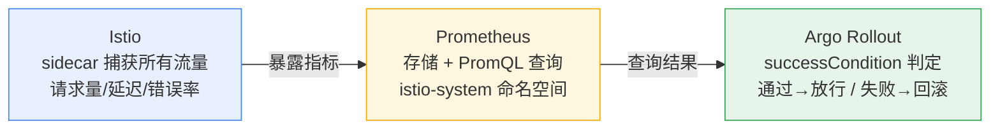

# 分析模板介绍与 Istio / Prometheus 部署：流量分析的观测底座

## 纲要

- **流量分析 = 发布的新裁判**：不再靠「等一会儿看看」，而是用指标说话——成功率 ≥ 0.95 才放行，否则自动回滚
- **三巨头分工**：**Istio** 收流量数据（sidecar 代理捕获请求量/错误率）→ **Prometheus** 存指标 + PromQL 查询 → **Argo Rollout** 按结果放行或回滚
- **AnalysisTemplate 四要素**：metrics（指标列表 + successCondition 表达式）+ provider（Prometheus 地址）+ query（PromQL）+ interval/count/failureLimit（节奏与容忍度）
- **空数据是隐形坑**：无流量时 `result[0]` 索引越界报错——successCondition 必须写 `len(result) == 0 or result[0] != result[0] or ...` 三保险
- **Rollout 里引用模板**：`analysis.templates` + `startingStep`（从第几步开始分析）+ `args`（传服务名）——分析失败即终止后续步骤并回滚
- **部署顺序**：istioctl 客户端 → apply 配置 → 命名空间打 `istio-injection=enabled` 标签自动注入 sidecar → Prometheus（istio-system 命名空间）

## 一、场景引入：灰度到 20% 了，然后呢？

#83 的灰度可以优雅地放量到 10%、20%，但「放不放下一步」靠什么判断？人盯着看？那和传统发布没区别。课程的答案：

> 「当我们分析出来的一个访问流量大于我们指定的一个阈值的时候，这个时候我们就会触发一个自动回滚的机制。」

即把「放行/回滚」的决定权从人眼交给**指标**——这就是流量分析，也是 Argo Rollout 高级发布拼图的最后一块（前两块是蓝绿 #82、灰度 #83）。

## 二、三巨头分工：谁收集、谁分析、谁动手

流量分析依赖三组件，课程的角色划分：



| 组件 | 职责 | 课程原话 |
| --- | --- | --- |
| **Istio** | 「通过 Istio 的服务网格捕获服务的所有流量数据，包括有请求量、延迟、错误率等」 | 数据采集层 |
| **Prometheus** | 「从 Istio 收集到的一个流量数据中提取指标，并通过 Prometheus 的 PromQL 进行查询分析和可视化」 | 存储 + 查询层 |
| **Argo Rollout** | 「用来实现自动回滚的一个关键组件」 | 决策 + 执行层 |

**Istio 的 sidecar 机制**（课程重点）：部署 Istio 后给命名空间打标签（`istio-injection=enabled`），该命名空间每建一个 Pod 就**自动注入一个 istio-proxy 边车容器**——「我们每一个 Pod 里面有两个容器，我们的业务容器要访问其他服务，我们都必须要先通过我们的 istio-proxy 的代理容器……不管进去还是出来都是一样，它都是需要经过这个 istio-proxy 容器」。**所有流量过边车 = 所有流量被计量**，这是数据采集无死角的原因。

Istio 的四大能力课程也点了名：「连接、保护、控制和观测」——本课程只用它的观测面（ Metrics），但注入的 sidecar 同时带来了连接治理能力。

## 三、动手实践：Istio + Prometheus 部署

### 3.1 部署 istioctl 与 Istio 核心

```bash
# ① 下载 istioctl 客户端
curl -L https://istio.io/downloadIstio | sh -
cd istio-1.22.2

# ② 软链接到 PATH
ln -s $(pwd)/bin/istioctl /usr/local/bin/istioctl

# ③ 安装 Istio 到集群
istioctl install

# ④ 验证
kubectl get pods -n istio-system
```

课程实拍拉的是 **1.22.2** 版本；`istioctl install` 后 `istio-system` 命名空间出现组件即成功。

### 3.2 自动注入：命名空间标签

```bash
# 给要自动注入的命名空间打标签（如 default）
kubectl label namespace default istio-injection=enabled
```

「在 default 命名空间，每创建一个 Pod，它都会自动帮我们创建一个 istio 的代理容器。」——**这一步是流量数据产出的前提**，忘了打标签，后面 Prometheus 查 `istio_requests_total` 全是空。

### 3.3 部署 Prometheus

Istio 的扩展目录里自带 Prometheus 安装：

```bash
# 进入 istio 目录的 samples/addons
kubectl apply -f prometheus.yaml
```

部署后 Prometheus 出现在 `istio-system` 命名空间。至此观测底座齐备：**Pod 带 sidecar → 流量指标入 Prometheus**。

## 四、分析模板：AnalysisTemplate 四要素

### 4.1 模板结构（对照课件 Blue-Green-Deploy.yaml 首段）

```yaml
apiVersion: argoproj.io/v1alpha1
kind: AnalysisTemplate
metadata:
  name: go-api-blus-green-analysis
spec:
  args:
  - name: service-name                    # 参数：服务名（Rollout 传入）
  metrics:
  - name: go-api-blus-green-metrics
    successCondition: (len(result) == 0 or result[0] != result[0] or result[0] >= 0.95 )
    interval: 60s                          # 每 60 秒采集一次
    count: 3                               # 共分析 3 次
    failureLimit: 1                        # 1 次失败即判失败
    provider:
      prometheus:
        address: http://prometheus.istio-system.svc.cluster.local:9090
        query: |
          sum(irate(
            istio_requests_total{reporter="source",destination_service=~"{{args.service-name}}",response_code!~"5.*"}[1m]
          )) /
          sum(irate(
            istio_requests_total{reporter="source",destination_service=~"{{args.service-name}}"}[1m]
          ))
```

四要素拆解：

| 要素 | 作用 | 课程讲解 |
| --- | --- | --- |
| **metrics** | 定义要收集分析的指标 | 名称 + successCondition 表达式 |
| **successCondition** | 成功判据 | 「指标中的第一个元素大于 0.95 时分析成功，后面部署正常执行；不满足就回滚到上一个版本」 |
| **provider** | 指标提供者 | Prometheus——address 填 service 名 + 端口（`prometheus.istio-system.svc.cluster.local:9090`） |
| **interval/count/failureLimit** | 节奏与容忍度 | interval 采集间隔（60s）；count 分析次数（3）；failureLimit 最大失败限制（1 = 一次失败就回滚） |

### 4.2 查询语句在算什么

PromQL 的语义（课程一步步推演）：

- 分子：`istio_requests_total{...response_code!~"5.*"}` 的速率——**非 5xx 的请求量**；
- 分母：总请求量速率；
- 比值 = **成功率**。「当我有一百个请求，我有五个是五百，那剩余的九十五个不是五百……九十五除以一百，如果大于 0.95 的话，那这次的分析就是通过了。」

`{{args.service-name}}` 是参数占位——值由 Rollout 侧传入（服务 FQDN）。

### 4.3 空数据三保险（课件注释里的实战精华）

**这是本篇最值钱的生产细节**。无流量时 `result[0]` 会索引越界，报 `reflect: slice index out of range`——分析直接 Error。课件注释给出三种空数据形态与对策：

```yaml
# value: '[NaN]'  → 用 result[0] != result[0]（NaN 不等于任何数）判 NaN
# value: '[]'     → 用 len(result) == 0 判空数组
# 组合三保险：
successCondition: (len(result) == 0 or result[0] != result[0] or result[0] >= 0.95 )
```

即：**没数据 = 视为正常**（没流量不该判发布失败）——「当没有用户访问的时候，我们都把它当成是正常的数据状态」。少了这三保险，低流量服务的发布会被空数据反复打回。

## 五、Rollout 引用：从第几步开始分析

模板建好后，在 Rollout 里引用（灰度的 `analysis` 字段 / 蓝绿的 `postPromotionAnalysis` 字段）：

```yaml
spec:
  strategy:
    canary:
      steps: [...]
      analysis:                              # 灰度：steps 进行中分析
        templates:
        - templateName: go-api-gray-analysis
        startingStep: 2                      # 从第 2 步开始调用分析模板
        args:
        - name: service-name
          value: go-api-service.default.svc.cluster.local
```

课程讲解：「我们要从哪一步开始引用，这边我定义了 2。也就是说我会从第二个步骤就开始调用这个分析模板来进行分析……当我们在第二步对我们的 Prometheus 进行分析之后，当它通过了，我们后边的步骤才会继续执行下去。如果我们在第二步就失败的话，我们后面的步骤它就不会再执行了，然后我们还会回滚到上一个版本的 Pod 里面去。」

**startingStep 是分析介入的时机阀门**：太早（流量还没起来）空数据误判、太晚（已全量）失去意义——通常放在第一级放量暂停后（课程用第 2 步）。

## 六、生产实践要点

1. **命名空间标签先打再发布**：`istio-injection=enabled` 忘打 = 无 sidecar = 无指标 = 分析永远空数据；
2. **空数据三保险必须写**：`len(result) == 0 or result[0] != result[0] or ...`——低流量服务的生命线；
3. **failureLimit 按团队容忍度设**：1 = 严格（一次不过即回滚，演示用）；3 = 宽容（防偶发毛刺，生产常用）；
4. **count/interval 按观察窗口定**：3 次 × 60 秒 = 3 分钟观察窗——太短看不出趋势，太长拖慢发布；
5. **startingStep 卡在第一级放量后**：让新版本先接真实流量再分析，避免空数据误判；
6. **successCondition 阈值按业务定**：0.95 是常用默认；支付类可上 0.99，内部工具可放宽；
7. **Prometheus 地址写 service FQDN**：`prometheus.istio-system.svc.cluster.local:9090`——跨命名空间访问别用短名；
8. **手动造数据验证链路**：发布后 curl 服务接口（200/500）在 Prometheus 里查 `istio_requests_total`，确认数据真的在流（#85 实战的标准动作）。

## 七、报错排查表

| 现象 | 根因 | 解法 |
| --- | --- | --- |
| 分析报 `slice index out of range` | 无流量，`result[0]` 越界 | successCondition 加 `len(result) == 0 or result[0] != result[0]` |
| 查询结果恒为 NaN | 命名空间没打注入标签 | `kubectl label ns <ns> istio-injection=enabled` |
| Prometheus 连不上 | 地址错/命名空间不对 | 核对 `prometheus.istio-system.svc.cluster.local:9090` |
| 指标查不到服务 | service-name 参数传错 | 核对 args.value 为服务 FQDN |
| 分析不介入发布 | startingStep 配大了 | 调到第一级放量后的步骤 |
| 一次偶发失败就回滚 | failureLimit 太严（1） | 生产调到 3 防毛刺 |
| Pod 没注入 sidecar | 标签打在 Pod 创建后 | 先打标签再发布；旧 Pod 重建 |

## 八、面试考点与追问

**Q1：流量分析的三组件分工？**
Istio（sidecar 捕获流量数据：请求量/错误率/延迟）→ Prometheus（存储指标 + PromQL 查询）→ Argo Rollout（按 successCondition 判定放行或回滚）。

**Q2：Istio 怎么让流量数据被采集？**
命名空间打 `istio-injection=enabled` 标签 → Pod 自动注入 istio-proxy 边车 → 进出流量全部过代理 → 代理为每条流量生成指标（`istio_requests_total`）暴露给 Prometheus。

**Q3：AnalysisTemplate 的核心字段？**
args（参数如 service-name）、metrics（名称 + successCondition + interval/count/failureLimit）、provider.prometheus（address + PromQL query）。

**Q4：successCondition 为什么写「空数据三保险」？**
无流量时查询返回 `[]` 或 `[NaN]`，`result[0]` 越界/比较失真会误判失败。`len(result) == 0 or result[0] != result[0] or result[0] >= 0.95` 把「没数据」视为正常，防低流量服务被误回滚。

**Q5：failureLimit 与 count 的区别？**
count = 总共分析几次（观察窗口大小）；failureLimit = 允许失败几次（容忍度）。3 次分析允许 1 次失败 = 防偶发毛刺；允许 0 次 = 严格模式。

**Q6：Rollout 里怎么引用分析模板？startingStep 管什么？**
`analysis.templates`（模板名）+ `startingStep`（从第几步开始分析）+ `args`（传服务名）。startingStep 决定分析介入时机——通常卡在第一级放量暂停后，让新版本先接流量。

## 📎 文本↔代码关联

| 代码文件 | 正文提及 | 内容 |
| --- | --- | --- |
| `code/10-Argocd/blue-green-analysis/Blue-Green-Deploy.yaml` | 4.1 模板结构、第五节 Rollout 引用、4.3 空数据三保险 | AnalysisTemplate + 蓝绿 Rollout 完整样例：`go-api-blus-green-analysis` 模板（successCondition 三保险 + interval 60s + count 3 + failureLimit 1 + Prometheus 地址与 PromQL）+ Rollout 的 `postPromotionAnalysis` 引用（templateName + args service-name）——正文字段表的原样，注释含空数据报错说明 |
| `code/10-Argocd/canary-analysis/Canary-Deploy.yaml` | 4.1 模板结构、第五节 Rollout 引用 | 灰度版 AnalysisTemplate + Rollout：`go-api-gray-analysis`（failureLimit 3 宽容配置）+ `analysis.startingStep: 2` 引用——正文「startingStep 是时机阀门」的原样 |

**技术点总结**：流量分析给发布配了位「指标裁判」——Istio sidecar 捕获全部流量（请求量/错误率），Prometheus 存指标供 PromQL 查询，Argo Rollout 拿「非 5xx 请求 ÷ 总请求 ≥ 0.95」的结果决定放行或回滚。落地三关键：**命名空间注入标签**（数据产出的前提）、**空数据三保险** `len(result)==0 or result[0]!=result[0] or result[0]>=0.95`（低流量服务的生命线）、**startingStep 卡在第一级放量后**（分析介入的时机）。failureLimit 定容忍度（1 严格 / 3 防毛刺），count×interval 定观察窗（3×60s = 3 分钟）——判据、节奏、容错三参数配齐，自动发布才敢无人值守。

相关度：97%。是否需要继续：[是]。代码是否可运行：[是]。
