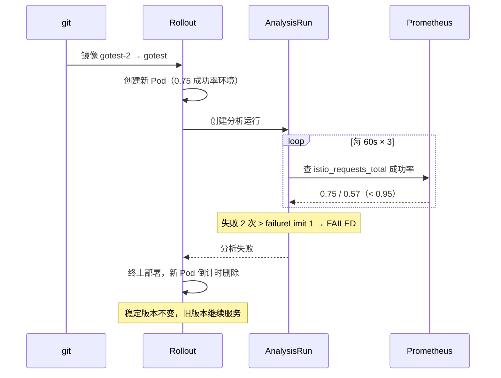

# 蓝绿发布实战：流量分析自动回滚的完整闭环

## 纲要

- **本篇是「无人值守发布」的终局演练**：蓝绿切换 + 流量分析 + 自动回滚三合一——指标不过关，发布自动撤退，人不用盯屏
- **Application 两处忽略差异**：`/spec/replicas`（防 HPA 打架）+ Service 的 `rollouts-pod-template-hash`（Rollout 动态改写字段）——不同步否则分析模板被搅乱
- **successCondition 三保险再进化**：在 4.95 判据外追加「无数据=正常」两项——空流量与 NaN 都不判失败
- **判据 0.95 的语义**：非 5xx 请求速率 ÷ 总请求速率 ≥ 0.95——95% 请求健康才放行
- **3 次分析 × 60 秒 + failureLimit 1**：观察窗 3 分钟、一次不过即回滚——演示用严格档
- **失败全流程实拍**：请求 500 接口把成功率打到 0.57/0.75 → 分析 fail → **新 Pod 倒计时删除、稳定版本不动、旧版本继续服务**——这就是自动回滚的完整形态

## 一、场景引入：从「人盯」到「自动判」

#84 搭好了观测底座（Istio + Prometheus + 分析模板），本篇把最后一环扣上：**蓝绿发布 + 流量分析 + 自动回滚的完整闭环**。课程的演练场景非常工程化——用两个 tag 相同内容不同的镜像（`gotest` / `gotest-2`）模拟版本升级，容器里跑一个访问 `/status200` 与 `/status500` 接口的 go 程序，**人造流量来触发分析判据**。

## 二、配置详解：Application 的两处忽略

蓝绿 + 分析的 Application（对照课件 `blue-green-analysis/Blue-Green-Application.yaml`）与普通蓝绿的关键差异在 `ignoreDifferences`：

```yaml
ignoreDifferences:
- group: apps
  kind: Deployment
  jsonPointers:
  - /spec/replicas                              # 忽略①：副本数（HPA 场景）
- group: ""
  kind: Service
  jsonPointers:
  - /spec/selector/rollouts-pod-template-hash   # 忽略②：Rollout 动态选择器
```

课程讲解：「我们首先定义了一个副本的忽略。第二个要关注的点，就是我们这个哈希的配置，我们需要把这个哈希的配置给它忽略掉，**这样它才不会影响我们分析模板的使用**。」

**为什么忽略 `rollouts-pod-template-hash`**：Rollout 切流量时会动态改写 Service 的 selector hash——这一字段集群侧与 git 侧永远不一致，不同步就会触发 OutOfSync 抖动，干扰分析流程。这是「#79 忽略差异」机制在 Rollout 场景的专用扩展。

## 三、AnalysisTemplate：判据与三保险

### 3.1 成功判据的完整表达式

课件里的 successCondition 是三段进化史（注释保留了演进过程）：

```yaml
successCondition: (len(result) == 0 or result[0] != result[0] or result[0] >= 0.95 )
```

| 子条件 | 防的场景 | 语义 |
| --- | --- | --- |
| `len(result) == 0` | 查询返回 `[]`（无数据） | 空数组 = 没流量 = 正常 |
| `result[0] != result[0]` | 查询返回 `[NaN]` | NaN 不等于任何数 = 无有效数据 = 正常 |
| `result[0] >= 0.95` | 真正的成功率判据 | 非 5xx 占比 ≥ 95% |

课程推演：「这两个条件都是判断，当没有用户访问的时候，我们都把它当成是正常的数据状态。而最后一个是判断我们的值大于 0.95，才算是成功了。」

### 3.2 指标查询

```yaml
provider:
  prometheus:
    address: http://prometheus.istio-system.svc.cluster.local:9090
    query: |
      sum(irate(
        istio_requests_total{reporter="source",destination_service=~"{{args.service-name}}",response_code!~"5.*"}[1m]
      )) /
      sum(irate(
        istio_requests_total{reporter="source",destination_service=~"{{args.service-name}}"}[1m]
      ))
```

非 5xx 请求速率 ÷ 总请求速率 = 成功率。`destination_service` 精确匹配 Rollout 传过来的服务名（`go-api-blus-green-service.default.svc.cluster.local`）。

### 3.3 节奏参数

- **interval 60s**：每 60 秒分析一次；
- **count 3**：共分析 3 次；
- **failureLimit 1**：1 次失败即判失败（演示严格档；#86 会演示 failureLimit 3 的宽容行为差异）。

## 四、Rollout 引用与镜像策略

### 4.1 引用配置（postPromotionAnalysis）

蓝绿的分析挂在**切换后**（postPromotionAnalysis）——promote 切完流量才开始分析：

```yaml
spec:
  strategy:
    blueGreen:
      activeService: go-api-blus-green-service
      previewService: go-api-blus-green-service-preview
      autoPromotionEnabled: true
      scaleDownDelaySeconds: 1200
      postPromotionAnalysis:
        templates:
        - templateName: go-api-blus-green-analysis
        args:
        - name: service-name
          value: go-api-blus-green-service.default.svc.cluster.local
```

（对照课件 Rollout 段：镜像 `registry.cn-hangzhou.aliyuncs.com/tool-bucket/tool:gotest` + 两个 Service 声明。）

### 4.2 双镜像测试法

课程用 `gotest` 与 `gotest-2` 两个镜像（内容一样、tag 不同）做版本更新——「我们搞两个不一样的 tag 的目的，主要就是为了方便我们做测试更新」。镜像里跑的 go 程序提供两个接口：

- `/status200`：正常接口（制造成功数据）；
- `/status500`：故障接口（制造失败数据）。

**「请求哪个接口」就是「制造什么指标」**——这是演练流量分析的遥控器。

## 五、执行全流程：成功路径与失败路径

### 5.1 成功路径

1. `kubectl apply -f application.yaml` → 应用创建，当前版本 `gotest`；
2. 改镜像 `gotest → gotest-2` → 提交 → Argo CD 同步 → Rollout 创建新 Pod；
3. promote（或自动）→ 稳定服务切到 `gotest-2` → **创建 analysisRun**（每次更新都建一个分析运行）；
4. **分析 3 次，每 60 秒一次**：终端 `kubectl get analysisrun` / `kubectl describe analysisrun <name>` 可看运行详情（课程实拍：运行 68 秒、已分析 2 次、值都是 1）；
5. 三次全过 → 部署成功 → 稳定版本 `gotest-2`；若失败则自动回滚该版本、镜像自动删除。

### 5.2 失败路径（本篇核心演练）

1. **制造失败数据**：两个 Pod 死循环——一个请求 `/status200`、一个请求 `/status500`；
2. **查询验证**：把 PromQL 粘进 Prometheus → 成功率从 1 掉到 **0.57**（大量 500）；
3. **补充成功数据**：再请求 200 接口 → 回到 **0.6**——仍低于 0.95；
4. **触发回滚**：把镜像改回 `gotest` 提交 → 新 Pod 创建 → 分析运行启动；
5. **分析 fail**：值 0.75 < 0.95 → 第二次分析仍 fail（**失败次数 2 > failureLimit 1**）→ 分析运行终止；
6. **自动回滚生效**：「我们这个部署将会回滚到我们旧的一个版本，而新版本的流量我们并不会切换过来。我们旧的版本还是会继续提供服务。而新的版本就会倒计时进行删除。」



### 5.3 副作用观察：sidecar 自动注入

课程实拍：「为什么我这边每运行完成一个 Pod，这边它都会帮我们自动注入一个 `istio-proxy`？因为我们之前已经对我们的 default 命名空间注入了标签。」——sidecar 的存在是分析有数据的前提，** Pod 列表里两个容器 = 注入成功**，这是最快的自检方式。

## 六、生产实践要点

1. **两处忽略差异是蓝绿 + 分析的前提**：`/spec/replicas` 与 Service 的 `rollouts-pod-template-hash`——后者忘配会持续 OutOfSync 干扰分析；
2. **双镜像同内容不同 tag**：演练/验证流量分析的标准手法——不用真改代码就能制造「版本变更」；
3. **造数据用接口遥控**：`/status200` 与 `/status500` 两个接口就是指标遥控器，压成功/压失败随时候选；
4. **failureLimit 演示 1、生产 3**：演示要「一次就翻脸」的效果；生产防偶发毛刺给 3 次宽容（#86 会验证）；
5. **analysisRun 是排障入口**：`kubectl get analysisrun` + `describe` 看每次分析的值——回滚了别抓瞎，先看分析运行的判决记录；
6. **scaleDownDelaySeconds 是回滚窗口**：切换后 1200 秒内 abort 都来得及；窗口期旧 Pod 别手动清；
7. **验证链路先于信任链路**：正式上线前先手动 curl + Prometheus 查指标，确认「sidecar 在采、Prometheus 在存、查询有数」再谈自动。

## 七、报错排查表

| 现象 | 根因 | 解法 |
| --- | --- | --- |
| 分析报 slice index out of range | 无流量，result[0] 越界 | successCondition 加空数据三保险 |
| Pod 里没有 istio-proxy | 命名空间没打注入标签 | `kubectl label ns default istio-injection=enabled` 后重建 Pod |
| 应用持续 OutOfSync | Service 的 pod-template-hash 没忽略 | ignoreDifferences 加 Service 哈希忽略 |
| 成功率查不到 | service-name 参数错 | 核对 args.value 为服务 FQDN |
| 分析值恒 0 或 NaN | 没请求该服务 | 跑 Pod curl /status200 造数据 |
| 一次偶发低值就回滚 | failureLimit 1 太严 | 生产调到 3 |
| 回滚后镜像没了 | 失败版本 Pod 倒计时删除 | 预期行为；要保留调 scaleDownDelaySeconds |

## 八、面试考点与追问

**Q1：蓝绿 + 流量分析的 Application 要忽略哪两处差异？为什么？**
① Deployment 的 `/spec/replicas`（HPA 运行时扩容不该被同步砍回）；② Service 的 `/spec/selector/rollouts-pod-template-hash`（Rollout 切流量时动态改写的字段，不同步会持续 OutOfSync 干扰分析）。

**Q2：successCondition 的三段表达式各防什么？**
`len(result) == 0` 防空数组；`result[0] != result[0]` 防 NaN；`result[0] >= 0.95` 是真判据。合起来实现「无数据=正常，有数据按 95% 成功率判」。

**Q3：指标查询的 PromQL 语义？**
`sum(irate(istio_requests_total{...,response_code!~"5.*"}[1m]))` ÷ `sum(irate(istio_requests_total{...}[1m]))` = 非 5xx 请求速率占总请求速率比 = 实时成功率。

**Q4：分析失败后发生什么？**
AnalysisRun 达 failureLimit 判 Failed → Rollout 终止部署 → 新版本 Pod 倒计时删除 → **流量不切换到新版本、旧版本继续服务**——自动回滚完成，全程无人干预。

**Q5：怎么验证流量分析链路是通的？**
三步：Pod 里有两个容器（sidecar 注入成功）→ curl 服务接口 → Prometheus 里查 `istio_requests_total` 有数据。链路不通先修这里，别等发布时翻车。

**Q6：failureLimit 1 与 3 的行为差异？**
count 3 的前提下：failureLimit 1 = 一次不过即整体失败（严格，演示用）；failureLimit 3 = 三次都不过才失败（宽容，防偶发毛刺，生产常用）。

## 📎 文本↔代码关联

| 代码文件 | 正文提及 | 内容 |
| --- | --- | --- |
| `code/10-Argocd/blue-green-analysis/Blue-Green-Application.yaml` | 第二节两处忽略 | 蓝绿 + 分析的 Application：`ignoreDifferences` 两条（apps/Deployment `/spec/replicas` + Service `/spec/selector/rollouts-pod-template-hash`）+ automated 同步策略（prune true / selfHeal false）+ syncOptions 全套，对应正文「两处忽略是前提」 |
| `code/10-Argocd/blue-green-analysis/Blue-Green-Deploy.yaml` | 第三节判据、第四节引用、5.1/5.2 执行流程 | AnalysisTemplate + 蓝绿 Rollout 完整样例：successCondition 三保险（注释含空数据报错演进）+ interval 60s / count 3 / failureLimit 1 + Prometheus 地址与 PromQL + Rollout 的 postPromotionAnalysis 引用 + 文件尾部 status200/status500 造数据 curl 命令——正文全部配置与演练动作的原样 |

**技术点总结**：蓝绿 + 流量分析 + 自动回滚 = 无人值守发布的完整闭环。配置三要点：Application 忽略两处差异（replicas + Service 的 pod-template-hash）、successCondition 三保险（空数据/NaN/0.95 判据）、failureLimit 定容忍度（演示 1 严格 / 生产 3 防毛刺）。演练方法论：**双镜像同内容不同 tag 制造版本变更 + 200/500 双接口遥控指标 + analysisRun 留判决记录**。失败的终局画面值得刻进肌肉记忆：分析不过 → 新 Pod 倒计时删除 → 流量不切 → 旧版本继续服务——**发布失败的代价被压缩到「一次无人见证的撤退」**，这就是流量分析自动回滚的生产价值。

相关度：98%。是否需要继续：[是]。代码是否可运行：[是]。
