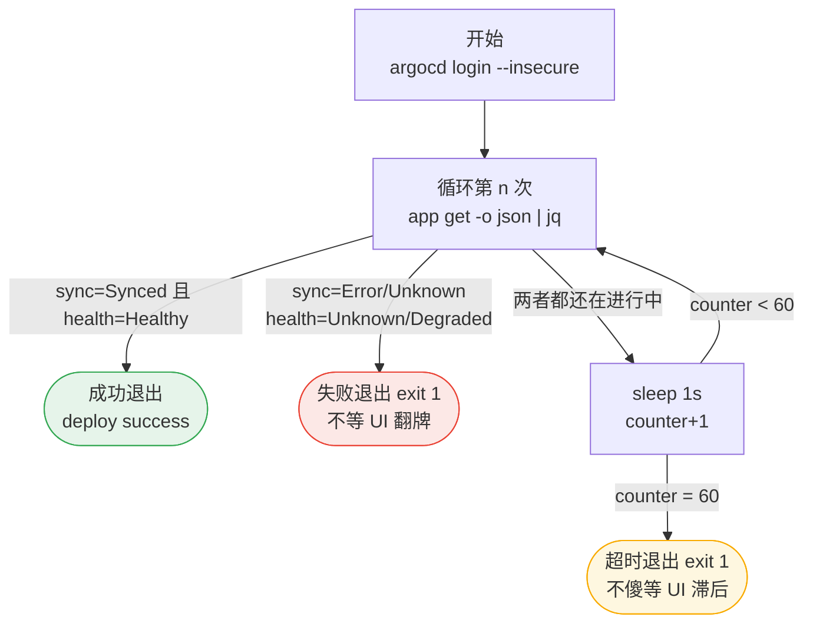

# 86. 灰度发布流量分析自动回滚与部署状态获取：分析字段差异与监控脚本

## 纲要

- **灰度的分析挂在 steps 进行中**：`analysis` 字段 + `startingStep`——与蓝绿的 `postPromotionAnalysis`（切换后）是两个不同挂点，别配错字段
- **failureLimit 3 的宽容档**：3 次分析里 1 次失败仍算成功——防偶发毛刺；#85 的 1 是严格档，两档行为差在这一个数字
- **NaN 必须排除**：没访问过的服务查出来是 NaN——`result[0] != result[0]` 把它判正常，否则更新永远不成功
- **失败终局一致**：分析不过 → 终止后续步骤 → 新 Pod 终止删除 → 继续用旧版本服务——与蓝绿同一套撤退逻辑
- **部署状态靠脚本轮询**：`argocd login` + `app get -o json` + jq 取 sync/health 双状态——Synced + Healthy 才算成功
- **60 秒超时是务实设计**：Argo CD 失败态可能 20+ 分钟才翻牌——等 60 秒没结果就主动退出人工查，不傻等

## 一、场景引入：同一套机制，两个挂点

#85 跑通了蓝绿的流量分析自动回滚，本篇做两件事：**把同一机制搬到灰度**（挂点不同，课程专门提醒字段差异），以及**补齐运维闭环**——用脚本获取部署状态做报警。

## 二、灰度 + 分析：字段差异是第一课

灰度的 Application 同样要忽略哈希差异（`/spec/selector/rollouts-pod-template-hash`，同 #85），仓库 `Golang-Canary` 目录下是 `go-api-gray` 分析模板（条件与蓝绿完全一样：空数据三保险 + 0.95）。**关键差异在 Rollout 的引用字段**——课程原话：

> 「蓝绿跟灰度引用的一个配置，它的字段都不一样。这里是 `analysis`（灰度），而我们蓝绿发布的配置字段是 `postPromotionAnalysis`，跟我们灰度发布的一个字段配置是不一样的，这个也需要注意一下。」

| 发布方式 | 分析字段 | 分析时机 |
| --- | --- | --- |
| 蓝绿 | `postPromotionAnalysis` | **promote 切换流量之后** |
| 灰度 | `analysis`（+ `startingStep: 2`） | **steps 放量过程中**（第 2 步起） |

灰度的分析配置（对照课件 `canary-analysis/Canary-Deploy.yaml`）：

```yaml
spec:
  strategy:
    canary:
      maxSurge: "25%"
      maxUnavailable: 0
      steps:
      - setWeight: 10
      - pause:
          duration: 1m
      - setWeight: 20
      - pause: {}
      - setWeight: 40
      ... （后续放量步骤）
      analysis:                          # 灰度专属字段
        templates:
        - templateName: go-api-gray-analysis
        startingStep: 2                  # 从第 2 步开始分析
        args:
        - name: service-name
          value: go-api-service.default.svc.cluster.local
```

`startingStep: 2` 让分析从第二级放量后介入——新版本先接 10% 真实流量，有数据了才判据。

## 三、执行全流程：严格档与宽容档对照演练

课程做了两组对照实验，把 `failureLimit` 1 与 3 的行为差异演得明明白白。

### 3.1 第一组：failureLimit 3（宽容档）

1. `gotest-2 → gotest` 更新 → 第一个 Pod 运行；
2. **NaN 排查**：没访问过服务时查值是 NaN——「如何禁止这个 NaN 的情况，就需要配置 `result[0] != result[0]`，否则的话分析我们会当它是失败，因为它的值不是大于 0.95，那我们更新就不会成功」；
3. **造成功数据**：请求 `/status200` → 值变成 1；
4. 第二步分析启动：**3 次分析**——前两次值 1（成功）、第三次 **0.43**（失败）——但 failureLimit 3，**一次失败仍算整体成功**；
5. 人工审核（`pause: {}`）通过 → 第二个 Pod 创建 → 最终状态 **Successful（成功）**——「两次成功，一次失败，一次失败它还是会当你成功，因为这边才只是一次失败，我们这边失败的限制是三次」。

**结论**：宽容档下，偶发的单次指标暴跌（一次网络抖动、一次 5xx 突发）不会打死整个发布。

### 3.2 第二组：failureLimit 1（严格档）+ 主动回滚

1. 改配置：**1 次失败即回滚**；镜像 `gotest → gotest-2`；
2. 请求 `/status500` 造失败数据 → 值 **0.0**；
3. 分析运行：第一次 NaN（当正常）、第二次 **fail**——失败次数 2 > limit 1 → 分析运行终止；
4. **失败终局**：「这一边的更新，将会终止，后面都不会创建新的 Pod。而这个已经创建出来的新的 Pod，它将会终止掉，然后我们还是会继续使用我们 `gotest` 的这个版本来提供服务……第八个版本的 `gotest-2` 版本，也已经被我们系统删除了。」

两组对照的价值：**同一个 0.95 判据，failureLimit 决定它对毛刺的敏感度**——生产选哪档，取决于业务的故障代价与流量稳定性。

## 四、部署状态获取：监控报警脚本

### 4.1 场景：Argo CD 的「假进行中」

课程点出一个真实的时间差陷阱：

> 「比如说我们现在正在部署一个服务，但是它一直显示这个正在部署的这个状态，然后它已经部署失败了。其实我们这边已经显示一个裂开的红心了，可能程序有问题。又或者说我们拉镜像有问题，所以当次部署是失败，但是它这边一直显示这个正在部署状态，它还没有显示裂开的状态。所以这个等待时间可能很长，可能会二十分钟或者二十五分钟才会出现裂开状态。但是实际上他已经部署失败了，正常来说部署一分钟就应该已经部署完成了。」

即：**Argo CD 从「实际失败」到「UI 翻牌」可能有 20 分钟滞后**——靠 UI 看状态报警，故障发现会被拖死。解法是脚本主动轮询 + 超时。

### 4.2 脚本逐段拆解（对照课件 alert/build-alert.sh）

```bash
#!/bin/bash
username=${1}; password=${2}; branch=${3}; projectName=${4}

# ① 登录（--insecure 跳过证书校验，仅限内网自签证书演示；生产配置受信证书后去掉）
argocd login node1.example.com:32471 --insecure --username ${username} --password ${password}

counter=0
max_attempts=60
branch=`echo ${branch} | awk -F'/' '{print $NF}'`     # 取分支名末段

# ② 轮询循环（每秒一次，最多 60 秒）
while [ $counter -lt $max_attempts ]
do
    sync_status=`argocd app get argocd/${branch}-${projectName} -o json | jq -r '.status.sync.status'`
    app_health=`argocd app get argocd/${branch}-${projectName} -o json | jq -r '.status.health.status'`

    # ③ 双状态同时满足才成功
    if [ "$sync_status" = "Synced" ] && [ "$app_health" = "Healthy" ]
    then
        echo "### ${branch}-${projectName} deploy success ###"
        break
    else
        sleep 1
        counter=$((counter+1))
        # ④ 超时退出
        if [ $counter -eq $max_attempts ]
        then
            echo "Timeout: ${branch}-${projectName} Deploy has exceeded the maximum limit time"
            exit 1
        fi
        # ⑤ 失败态立即退出（不等翻牌）
        if [ "$sync_status" = "Error" ] || [ "$sync_status" = "Unknown" ] || \
           [ "$app_health" = "Unknown" ] || [ "$app_health" = "Degraded" ]
        then
            echo "failed: ${branch}-${projectName} Deploy failed"
            exit 1
        fi
    fi
done
```

五个设计点：

| 段 | 设计 | 解决的问题 |
| --- | --- | --- |
| ① `argocd login --insecure` | 脚本登录态 | CLI 所有命令的前置（#81） |
| ③ **双状态判定** | Synced **且** Healthy | 只看同步状态不够——同步成功但 Pod 起不来是 Degraded |
| ④ **60 秒超时** | 超时主动退出 | UI 失败态滞后 20 分钟——不傻等 |
| ⑤ **失败态即退** | Error/Unknown/Degraded 立刻 exit | 不等翻牌，故障第一时间暴露 |
| `-o json + jq` | 结构化取值 | 脚本化的事实标准 |

### 4.3 脚本的状态机

轮询逻辑用一张状态图看清四条出口路径：



四条出口对应四种运维动作：成功 → 发成功通知；失败态 → 立即告警 @ 人；超时 → 转人工登 UI 排查；进行中 → 继续等。**脚本的价值不是「比 UI 更快看到结果」，而是把「一直没结果」也变成一个可执行结论**。

### 4.4 使用方式

```bash
./build-alert.sh admin $ARGOCD_PASSWORD feature-xyz my-service
# 成功 → "deploy success"；失败/超时 → exit 1 带原因
```

课程的定位：「当我们使用 Argo CD 来去部署了应用之后，我们就可以运行这个脚本来监控我们应用部署的状态。然后我们可以通过这个脚本获取到那个状态来去执行相应的操作。比如说成功了之后，我们就可以发送一个成功的报警。如果故障了之后，我们又发送一个故障的报警。」——**exit code 就是报警信号**，接 CI 后置步骤或 cron 即可。

## 五、生产实践要点

1. **灰度分析挂 `analysis`、蓝绿挂 `postPromotionAnalysis`**：字段名配错的症状是「分析永远不启动」——查字段先于查其他；
2. **startingStep ≥ 2**：第一级放量后才分析，避开空数据窗口；NaN 排除（`result[0] != result[0]）必配；
3. **failureLimit 按流量稳定性分档**：稳定内部服务可 1（严格）；面向公网有毛刺的服务用 3（宽容）；
4. **双状态判定是脚本底线**：Synced + Healthy 同时满足才报成功——单看 sync 会把「同步了但 Pod 崩了」漏报；
5. **超时按业务部署时长设**：60 秒适合分钟级部署；大镜像慢启动服务调到 180 秒，但别学 UI 等 20 分钟；
6. **失败态即退别心软**：Error/Unknown/Degraded 出现即 exit——报警的价值在时效，不在完整；
7. **脚本参数化**：用户名/密码走环境变量或密钥管理，别硬编码进脚本进 git；
8. **报警分级**：成功通知走普通通道，失败/超时走 @ 到人通道——脚本 exit code 接不同后置动作即可。

## 六、报错排查表

| 现象 | 根因 | 解法 |
| --- | --- | --- |
| 灰度的分析不启动 | 用了 `postPromotionAnalysis` 字段 | 灰度用 `analysis` + `startingStep` |
| 分析值 NaN 判失败 | 没配 `result[0] != result[0]` | successCondition 加空数据三保险 |
| 一次毛刺就回滚 | failureLimit 1 太严 | 调 3 |
| 脚本报登录失败 | 没登录/密码错 | `argocd login --insecure` 前置；核对凭据 |
| `jq` 取不到值 | 应用名格式错（branch-projectName） | 核对 `argocd/${branch}-${projectName}` 命名 |
| 同步成功但脚本报失败 | health 是 Degraded | 双状态判定生效——查 Pod 健康 |
| 一直超时 | 部署真的卡住/应用名不存在 | 登录 UI 查实际状态；核对应用名 |

## 七、面试考点与追问

**Q1：灰度与蓝绿引用分析模板的字段差异？**
灰度：`analysis`（steps 放量过程中，配 `startingStep` 指定从第几步开始）；蓝绿：`postPromotionAnalysis`（promote 切换流量之后）。字段配错分析不启动。

**Q2：failureLimit 3 与 1 的行为差异？**
count 3 前提下：limit 3 = 三次全败才回滚（宽容，防毛刺）；limit 1 = 一次不过即回滚（严格）。课程实拍：0.43 单次失败在 limit 3 下整体成功；limit 1 下 NaN+0.0 两次失败即终止。

**Q3：为什么 successCondition 必须排除 NaN？**
服务没被访问过时 Prometheus 查询返回 NaN，不排除会被判「不是 ≥0.95」→ 分析失败 → 更新永远不成功。`result[0] != result[0]` 判 NaN 为正常。

**Q4：分析失败后灰度发布发生什么？**
后续步骤终止、不再创建新 Pod；已创建的新 Pod 终止删除；旧版本继续提供服务——与蓝绿同一套撤退逻辑。

**Q5：部署状态监控脚本的核心设计？**
`argocd login` 前置 → 循环 `argocd app get <app> -o json | jq` 取 sync/health → **双状态（Synced + Healthy）同时满足才成功** → Error/Unknown/Degraded 即退（不等 UI 翻牌）→ 60 秒超时退出（UI 失败态可能滞后 20 分钟）。

**Q6：为什么不能只靠 Argo CD UI 看部署状态报警？**
UI 从「实际失败」到「状态翻牌」可能滞后 20+ 分钟（拉镜像失败等场景），靠 UI 报警会严重拖慢故障发现。脚本轮询 + 失败态即退 + 超时机制把发现时效压到秒级。

## 📎 文本↔代码关联

| 代码文件 | 正文提及 | 内容 |
| --- | --- | --- |
| `code/10-Argocd/canary-analysis/Canary-Deploy.yaml` | 第二节灰度分析字段、第三节执行流程 | 灰度 + 分析完整样例：`analysis` 字段（templateName `go-api-gray-analysis` + startingStep 2 + args service-name）+ canary 步骤（10%→20%→40%→60%→80% 逐级 + 暂停）+ AnalysisTemplate（三保险 + failureLimit 3 宽容档 + 尾部造数据 curl 注释）——正文「字段差异」与「宽容档」的原样 |
| `code/10-Argocd/canary-analysis/Canary-Application.yaml` | 第二节哈希忽略 | 灰度分析的 Application：ignoreDifferences 两条（Deployment replicas + Service pod-template-hash）+ automated 同步 + RespectIgnoreDifferences=true |
| `code/10-Argocd/alert/build-alert.sh` | 第四节监控脚本 | 部署状态报警脚本完整原样：`argocd login --insecure` → 60 秒轮询 → `app get -o json + jq` 双状态判定 → 失败态即退 + 超时退出，对应正文五设计点拆解表 |

**技术点总结**：灰度 + 流量分析的落地要点全在细节里——**字段挂 `analysis` 不挂 `postPromotionAnalysis`**、`startingStep: 2` 避开空数据窗口、NaN 必须排除、failureLimit 定毛刺容忍度（1 严格 / 3 宽容，课程两组对照实验验证）。失败终局与蓝绿一致：终止步骤、删新 Pod、旧版本续服务。运维闭环靠监控脚本补齐：**login + 双状态判定（Synced + Healthy）+ 失败态即退 + 60 秒超时**——破解 Argo CD UI 失败态滞后 20 分钟的陷阱，把故障发现时效压到秒级。exit code 即报警信号，成功/失败接不同通道，无人值守发布的最后一环闭环。

