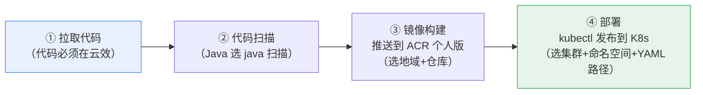

# 88. 阿里云云效：企业项目创建、代码管理与流水线模板实战

## 纲要

- **云效是阿里云的一站式研发平台**：项目协作 + 代码管理 + 流水线 + 应用交付 + 测试管理——SaaS 形态，免运维
- **使用有两硬约束**：代码必须放云效代码管理、K8s 必须是阿里云 ACK——自有部署/其他云/本地代码用不了
- **企业 → 项目 → 代码仓库 → 成员权限**：组织四层结构，仓库级成员管理支持审批/免审批两种授权
- **流水线两种创建方式**：可视化编排（主流）/ YAML 编排；模板分**推荐模板**（内置语言栈）与**企业自定义模板**
- **自定义模板四步骨架**：拉代码 → 代码扫描 → 镜像构建（推 ACR）→ K8s 部署（kubectl 发布）——与自建 CI/CD 同构
- **资源配额要知道**：最大任务并发 3、当月构建时长 1800 分钟——超了要付费，选型前先算账

## 一、场景引入：SaaS 化 CI/CD 的「第三条路」

前九章的自建方案（Jenkins/Zadig/Argo CD）都有一个隐性成本：**平台自己运维**。控制平面、存储、升级、高可用全是团队的活。阿里云云效代表** SaaS 化路线**——研发全流程（协作、代码、流水线、交付、测试）托管在云上，打开网页就能用。

课程的定位很务实：「云效这块我们只需要简单了解一下即可。」——因为它有明确的适用边界（#88 第三节），但作为「技能提升扩展」，它是自建方案之外必须知道的选项。

## 二、企业与项目：组织四层结构

### 2.1 创建企业

路径：**阿里云控制台 → 云效 → 企业管理 → 新建企业**：

1. 选「一站式软件研发平台」→ 立即开启；
2. 输入企业名 → 创建；
3. 选角色 → 开始工作 → 进入云效工作台。

### 2.2 工作台产品矩阵

工作台右侧是云效的产品全家桶：

| 产品 | 用途 |
| --- | --- |
| **项目协作** | 项目管理（缺陷/任务/需求） |
| **代码管理** | **代码仓库 + 流水线**（本节主角） |
| 场景洞察 / 钉钉文档 / 知识库 | 协作与文档 |
| **应用交付** | 部署管理 |
| **测试管理** | 测试用例 |

### 2.3 创建项目

工作台 → 新建项目 → 选模板（**经典项目管理**）→ 项目名称 → 开始项目。项目里可建**缺陷、任务、需求**——即代码管理之外的研发管理面（本课程不展开）。

## 三、代码管理：仓库与成员权限

### 3.1 新建代码仓库

企业管理 → 代码管理 → 新建仓库（先建**代码组**）→ 仓库创建成功。仓库页面给出**克隆密码**与完整功能：提交、分支、标签、成员、流水线入口。

### 3.2 成员权限

仓库 → 成员 → 管理员角色 → 添加成员，两条授权路径：

- **需要审批**（下方入口）：邀请后走审批流；
- **不需要审批**（上方入口）：直接加。

授权方式两种：**复制邀请链接** 或 **添加 IM 用户**（钉钉/阿里云账号体系）。

## 四、流水线：两种创建方式 × 两类模板

### 4.1 创建入口与二分法

仓库 → 创建流水线，两个维度的选择：

| 维度 | 选项 |
| --- | --- |
| **创建方式** | ① 可视化编排（课程主线）② YAML 编排 |
| **模板来源** | ① **推荐模板**（官方内置）② 企业自定义模板 |

### 4.2 推荐模板：语言栈开箱即用

推荐模板按「语言 × 部署目标」矩阵组织：**Java/PHP/Node.js/Go** × **部署到 EDAS / ECS / K8s**。课程示例：选 **Go + 「测试 + 构建镜像 + 部署 ECS」**模板 → 创建 → 流水线骨架自动生成：

1. **单元测试**；
2. **构建镜像并推送 ACR**（选集群——北京地域；添加服务连接需**新建授权**）；
3. **保存运行** → 构建完自动推镜像仓库。

### 4.3 企业自定义模板：四步骨架

自定义模板 = 自己编排每一步。课程搭的标准四步：

逐步要点：

1. **拉代码**：前提是代码放在云效——「如果我们是放在本地的话，我们就没有办法在这边进行构建」；
2. **代码扫描**：按语言选（Java 选 java 代码扫描）；
3. **镜像构建**：选「构建并推送到 ACR 个人版」→ 选**地域**（杭州）+ **仓库**；固定参数走「自定义」添加；配**报告配置路径**；
4. **部署**：选「K8s 部署」→ kubectl 发布 → 选**集群**（必须阿里云 ACK）+ 命名空间 + YAML 路径 → 保存 → 构建（扫描 → 构建推送 → 发布一条龙）。

**这个四步骨架与自建方案完全同构**（拉代码 → 扫描 → 构建 → 部署）——云效的价值不在能力差异，而在「不用运维控制平面」。

## 五、能力边界与资源配额：选型前必须知道

课程把云效的约束讲得很直白，这是本篇最重要的部分：

### 5.1 两硬约束

> 「我们要使用阿里云云效的话，它就只能运用于阿里云的 ACK，并且我们的代码仓库必须要放在阿里的云效，我们才可以使用这个工具。」

- **代码必须放云效代码管理**——本地 git 或其他平台接不进来；
- **K8s 必须是阿里云 ACK**——自建/其他云集群无法作为部署目标；
- 「如果我们设施（自有）的话，部署到其他云平台，又或者说我们代码仓库是搬在本地的话，我们这个工具就没有办法使用」。

### 5.2 资源配额

左下角资源区显示：

| 配额 | 值 |
| --- | --- |
| 最大任务并发 | **3** |
| 当月最大构建时长 | **1800 分钟** |

超时后续用需付费。选型时按「月构建次数 × 单次时长」估算是否够用。

### 5.3 定位结论

课程的收尾：「云效我们只需要简单了解一下即可」——三条原因：**要收费**（免费配额外）、**代码要放云效**（迁移成本）、**K8s 要阿里云 ACK**（云锁定）。它的甜蜜点：**小团队/初创公司，技术栈全在阿里云，想零运维起步**。

## 六、本章小结

课程的收口三件事：**代码仓库管理、成员管理、权限控制** + **流水线的创建、配置与使用**。即云效这章解决「研发管理面」——代码、权限、流水线三件套在 SaaS 里的形态。

## 七、面试考点与追问

**Q1：云效是什么？有什么产品？**
阿里云一站式软件研发平台（SaaS）：项目协作、代码管理、流水线、应用交付、测试管理、场景洞察、知识库等。

**Q2：云效的两硬约束？**
代码必须放云效代码管理；K8s 部署目标必须是阿里云 ACK。自有部署/其他云/本地代码仓库均不可用。

**Q3：流水线的两种创建方式与两类模板？**
方式：可视化编排 / YAML 编排；模板：推荐模板（按 Java/PHP/Node/Go × EDAS/ECS/K8s 组织）/ 企业自定义模板（自编排步骤）。

**Q4：自定义模板的标准四步？**
拉代码 → 代码扫描（按语言选）→ 镜像构建（推 ACR 个人版，选地域+仓库，配报告路径）→ K8s 部署（kubectl 发布，选 ACK 集群+命名空间+YAML 路径）。

**Q5：云效的资源配额？**
最大任务并发 3、当月最大构建时长 1800 分钟——超出需付费。

**Q6：什么团队适合云效？**
技术栈全在阿里云（ACK + ACR）、代码可迁入云效、想零运维起步的小团队/初创；有自建集群或多云诉求的团队不适合。

## 📎 文本↔代码关联

本篇为 **SaaS 平台操作篇**（阿里云云效为云端产品，无本地课件代码文件，如实标注、不虚构路径）。本篇的「自定义模板四步骨架」与自建 CI/CD 完全同构，可对照前文代码资产理解每一步：

- `code/9-Zadig/模板/Dockerfile/go`、`code/9-Zadig/模板/K8S-YAML/backend` —— 「镜像构建」与「K8s 部署」两步的自建等价物
- `code/3-基础-Jenkins/Jenkinsfile/` —— 「代码扫描 → 构建」步骤的自建等价物

**技术点总结**：阿里云云效 = SaaS 化的一站式研发平台，组织四层（企业 → 项目 → 代码仓库 → 成员），流水线两维选择（可视化/YAML × 推荐/自定义模板），自定义模板四步骨架（拉码 → 扫描 → 构建推 ACR → kubectl 发布 ACK）与自建 CI/CD 完全同构——差异不在能力，在**免运维控制平面**。但边界硬核：**代码必须入云效、K8s 必须是阿里云 ACK**，外加配额（并发 3 / 月 1800 分钟）。定位一句话：全阿里云栈的小团队零起步可以选它，有多云/自建/代码主权诉求的团队，它只是扩展知识而非主力方案。

