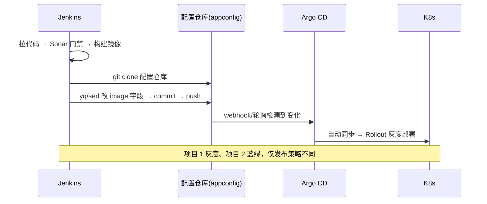

# 89. 综合实战（上）：项目 1~4 的工具组合与「改 YAML 推 git」集成模式

## 纲要

- **综合实战的本质是「组合拳」**：前面每个工具单独讲过，实战把它们拼成流水线——**新增知识只有一步：修改配置仓库的 image 字段**
- **CI + Argo CD 的集成铁律**：Jenkins/Tekton 构建后，用 `git`/`yq`/`sed` 改配置仓库 YAML 的 image → push → Argo CD 自动同步部署
- **项目 1（灰度）/ 项目 2（蓝绿）**：Jenkins（K8s 动态 agent + 共享库）+ Argo CD + Argo Rollout——构建产物经「改 git」触发部署
- **项目 3**：Zadig 独立闭环——构建 + 扫描 + 测试 + 部署一个平台全干，不需要额外 CI 工具
- **项目 4**：Zadig + Jenkins 混编——社区版 Zadig 没有质量门禁，把 Sonar 扫描抽到 Jenkins 做，测试留 Zadig
- **「修改配置仓库」是唯一的通用集成招**：无论配 Argo CD 还是 KubeVela，CI 的最后一招都是改 git 里的 image tag

## 一、场景引入：七个项目，一种模式

课程的压轴章节——七个综合实战项目。表面看五花八门（灰度/蓝绿/平台混编），拆开看**骨架只有一条**：

> Jenkins/Tekton 构建镜像 → **修改配置仓库的 image 字段 → push** → CD 工具（Argo CD / KubeVela）检测到 git 变化 → 自动同步部署。

课程的总结原话：「其实不管我们换哪个工具来集成这些软件，我们前面的章节都有学过。现在我们只是将这些不同的软件集成起来，来做一个混合使用部署。」——**实战不引入新工具，只引入新接缝**。

## 二、集成模式总览：七项目矩阵

| 项目 | CI | CD | 发布方式 | 关键集成招 |
| --- | --- | --- | --- | --- |
| 1 | Jenkins（K8s 动态） | Argo CD + Rollout | **灰度** | 改配置仓库 image → push |
| 2 | Jenkins | Argo CD + Rollout | **蓝绿** | 同上（node 项目免扫描） |
| 3 | Zadig 内置 | Zadig | 自定义流水线 | 平台内闭环 |
| 4 | Jenkins | Zadig | 产品工作流 | image 变量传参 |
| 5 | Zadig 内置 | KubeVela | GitOps + 灰度 | 改 KubeVela 配置仓库 → push |
| 6 | Tekton | KubeVela | Webhook 触发 | curl 调 Webhook 改 image |
| 7 | — | 云效 | 内置/自定义模板 | SaaS 闭环 |

上篇（本篇）讲项目 1~4，下篇（#90）讲 5~7。

## 三、项目 1：Jenkins + Argo CD + Argo Rollout 灰度发布

### 3.1 Jenkins 侧：K8s 动态 agent + 共享库

Jenkinsfile 全是前面学过的件：

- **K8s 动态 agent**：`kubernetes` agent 模板，Pod 即构建节点（#23）；
- **共享库**：加载共享库、引进函数（#24~#25）；
- **K8s 动态 YAML**：加载 `k8s.yaml` 文件做 agent 定义；
- **参数 + 变量 + 形态适配**：针对不同流水线形态做不同配置。

### 3.2 关键步骤：修改配置仓库

前四步与常规流水线一样（拉代码 → Sonar 扫描 + 质量门禁 → 构建镜像 → …），**第五步是实战新增的**：

```bash
# ① 拉配置仓库（独立仓库，先清工作空间再指定分支拉取）
git clone -b $BRANCH http://git.example.com/argocd/appconfig.git

# ② 改 YAML 的 image 字段（两种手法）
# 手法 A：sed
sed -i "s|image:.*|image: ${NEW_IMAGE}|" pro-deploy/deployment.yaml
# 手法 B：yq（专门的 YAML 修改工具）
yq eval '.spec.template.spec.containers[0].image = "'"${NEW_IMAGE}"'"' -i pro-deploy/deployment.yaml

# ③ 提交并推送（触发 Argo CD）
cd appconfig
git add . && git commit -m "update image to ${NEW_IMAGE}" && git push
```

课程的细节要点：

- 配置仓库是**独立仓库**（与业务代码仓分开）——「我们这个配置仓库它是独立的一个仓库」；
- 生产配置从生产环境拷贝，「我是从生产环境上来拷贝下来的」；
- **Argo CD 必须开自动同步**——「修改配置文件提交了之后，他就会触发我们的一个 webhook 来去执行线的一個同步，所以我们在这一边，一定要把这个自动同步给它开启」；
- `yq` 是课程推荐的 YAML 修改工具（「不知道 YQ 指令怎么操作的话，我们可以去百度查看」——生产上它是改 YAML 的标准武器）。

### 3.3 集成闭环



「整体的 Jenkins + Argo CD 就是将两个软件集成起来，一起使用，都是我们前面所学习过的知识，唯一不一样的地方，就是我们要加一个修改 YAML 的配置。」——学生在 Jenkinsfile 原文基础上加这一步，整条 CI/CD 就通了。

## 四、项目 2：Jenkins + Argo CD + 蓝绿发布（node 项目）

与项目 1 同一骨架，两处差异：

1. **发布策略换蓝绿**（Argo CD 侧配置 `strategy.blueGreen`，同 #83）；
2. **node 项目免扫描**——「如果不是使用我们的后端的项目的话，我们不需要做代码扫描。所以这边扫码这一步就可以去掉了」——按项目类型裁剪步骤，不做无用功。

其余完全一样：构建镜像 → 改配置仓库 image（yq/sed）→ push → Argo CD 同步 → 蓝绿发布。

## 五、项目 3：Zadig 独立闭环

项目 3 验证 Zadig 的「平台自闭环」能力：

> 「Zadig 这边它是一个完整的一条流水线，它包括有构建以及代码扫描、测试、部署的功能。所以它并不需要另外再使用持续集成的软件，并且它也包含有集成测试的功能，以及集成了代码扫描，它也可以集成实现。」

即：**Zadig 一个平台顶 Jenkins + Sonar + 部署**——#74~#75 的全部能力（自定义流水线：构建 → 扫描 → 测试 → 审批 → 部署）就是项目 3 的形态。适合不想拼工具、追求配置简单的团队（代价见项目 4）。

## 六、项目 4：Zadig + Jenkins 混编（质量门禁的解）

项目 4 是**社区版 Zadig 短板**的标准解法，课程的动因：

> 「在 Zadig 上对 SonarQube 进行代码扫描，它没有办法做质量门禁控制。做质量门禁控制的话，我们需要付费购买我们的一个企业版。所以如果我们又想做 SonarQube，又想对它做质量门禁控制的话，那我们就把持续集成这一块给它独立出来。然后我们把 SonarQube 放在 Jenkins 这一块来去跑。测试这一块我们就可以放在 Zadig 上来进行实现。」

### 6.1 Zadig 自定义流水线（测试内嵌）

构建（引 `go-multi` 构建模板 → 模板库 `test-go` → Dockerfile 模板库 `go`）→ 测试（测试同学配合）→ 部署。**没有 Sonar 步骤**——因为它被抽到 Jenkins 了，「这里就变成发布、构建、测试、部署，这个是我们自定义的流水线的实现」。

### 6.2 Zadig 产品工作流（Jenkins 构建集成）

另一条腿用产品工作流 + Jenkins 构建方式（#74 的配置）：

- 构建名称 `jenkins-build-gotest`，构建方式 **Jenkins**；
- 选 Jenkins 地址、服务（golang）、job（`jenkins-build`）、**构建超时 60 分钟**；
- 传变量 **`image`**——「我们传递过来的值，我们就需要交给我们的 Zadig。所以这边 Zadig 拿到 Jenkins 传过来的 tag 之后，它就会执行部署」；
- 执行链：Jenkins 构建（可含 Sonar 扫描 + 质量门禁）→ 镜像 tag 回传 Zadig → Zadig 部署 `golang` 服务。

**分工结论**：**Jenkins = CI（构建 + Sonar + 质量门禁）**，**Zadig = CD（部署 + 测试）**——#74 的理论在这里落地为完整项目。

## 七、生产实践要点

1. **「改 YAML 推 git」是 CI/CD 集成通用招**：不管对面是 Argo CD 还是 KubeVela，CI 的最后一步都是改配置仓库的 image 字段再 push——**会 `yq`/`sed` 就会集成**；
2. **配置仓库独立**：业务代码仓与部署配置仓分离——变更频率不同、权限不同、审计对象不同；
3. **Argo CD 侧自动同步必开**：改了配置仓库没人推 = 白改；webhook（#80）让同步秒级；
4. **按项目类型裁剪步骤**：node/前端项目免代码扫描（项目 2），后端项目扫描 + 门禁（项目 1）——流水线不是越多步骤越强；
5. **质量门禁诉求决定架构**：要门禁又用 Zadig 社区版 → Jenkins 前置（项目 4）；能接受人肉看扫描结果 → Zadig 全闭环（项目 3）；
6. **Jenkinsfile 加一步而非重写**：在既有流水线尾部加「拉配置仓库 → 改 image → push」——存量资产零浪费；
7. **灰度/蓝绿只换发布策略**：项目 1/2 的 CI 侧完全同构，差异只在 Argo CD 的 Rollout 策略配置——发布方式是 CD 层的开关。

## 八、报错排查表

| 现象 | 根因 | 解法 |
| --- | --- | --- |
| 改了配置仓库不部署 | Argo CD 没开自动同步 / 没 webhook | 开 automated；配 webhook（#80） |
| `yq`/`sed` 改错字段 | YAML 路径写错 | 先用 yq 查路径再改；改完 git diff 核对 |
| push 被拒 | 配置仓库权限/分支保护 | 配 Jenkins 对配置仓库的写权限 |
| 灰度不生效 | Rollout 策略没配 | Argo CD 侧配 strategy.canary |
| 蓝绿切不了流量 | promote 没点（false 模式） | promote 或设 autoPromotionEnabled true |
| Jenkins 构建成功 Zadig 没反应 | image 变量没传/构建名称没绑服务 | 核对构建参数与工作流关联 |
| node 项目扫描失败 | 多配了扫描步骤 | 按项目类型删扫描步 |
| 门禁不生效 | 扫描在 Zadig 社区版跑 | 抽到 Jenkins 做 Sonar + 门禁 |

## 九、面试考点与追问

**Q1：CI 工具与 Argo CD 的集成模式是什么？**
CI 构建镜像后，最后一步修改配置仓库 YAML 的 image 字段（git/yq/sed）→ commit push → Argo CD（自动同步/webhook）检测到变化 → 同步部署。这是通用集成招。

**Q2：为什么配置仓库要独立于业务代码仓？**
变更频率不同（代码天天改、配置随发布改）、权限不同（CI 只写配置仓的 image 行）、审计对象不同（部署历史看配置仓 log）。

**Q3：项目 1 与项目 2 的差异？**
同一骨架（Jenkins + Argo CD + Rollout + 改配置仓库）；差异：项目 1 灰度发布，项目 2 蓝绿发布且 node 项目免代码扫描。

**Q4：Zadig 社区版想要 Sonar 质量门禁，怎么架构？**
项目 4 模式：持续集成独立出来——Jenkins 做构建 + Sonar 扫描 + 质量门禁，Zadig 拿 Jenkins 传来的 image tag 做部署与测试。

**Q5：yq 在这个架构里干什么用？**
命令行精准修改 YAML 字段（改 image）——比 sed 安全（路径精确、不动其他行），是「改配置仓库」步骤的主力工具。

**Q6：七个实战项目的共同骨架？**
CI（Jenkins/Tekton/Zadig）产出镜像 → 改配置仓库/传参把 image 交给 CD（Argo CD/KubeVela/Zadig）→ CD 按发布策略（灰度/蓝绿/普通）部署。组合不同，骨架同一。

## 📎 文本↔代码关联

本篇为**综合架构篇**，实战所用的 Jenkinsfile / Rollout / 模板资产均在前面关联过，此处点明对应关系（不新增虚构路径）：

- `code/4-进阶-Jenkins/Jenkinsfile/Jenkinsfile-K8S流水线` —— 项目 1/2 的 Jenkins 侧（K8s 动态 agent）
- `code/4-进阶-Jenkins/shared-library/` —— 项目 1/2 的共享库（加载库、引进函数）
- `code/10-Argocd/canary/Canary-Deploy.yaml` —— 项目 1 的灰度发布策略
- `code/10-Argocd/blue-green/BlueGreen-Deploy.yaml` —— 项目 2 的蓝绿发布策略
- `code/9-Zadig/模板/Dockerfile/go`、`code/9-Zadig/模板/K8S-YAML/backend` —— 项目 3/4 的 Zadig 构建模板与部署模板

**技术点总结**：综合实战上篇（项目 1~4）证明了一件事——**前面学的每件东西都是零件，实战只学一个集成招**：CI 构建完后，用 `git clone + yq/sed 改 image + push` 把产物地址写进配置仓库，CD 工具（Argo CD）自动同步部署。项目 1/2 是「Jenkins + Argo CD + Rollout」的灰度/蓝绿变体（同骨架、换策略、按项目类型裁扫描）；项目 3 是 Zadig 平台自闭环；项目 4 是社区版 Zadig 的质量门禁解——**Jenkins 管 CI（构建 + Sonar + 门禁），Zadig 管 CD（部署 + 测试），image 变量是接头**。架构选型的答案从来不是「哪个工具强」，而是「哪个组合匹配你的门禁诉求与运维偏好」。

