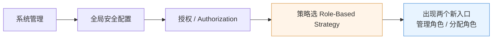
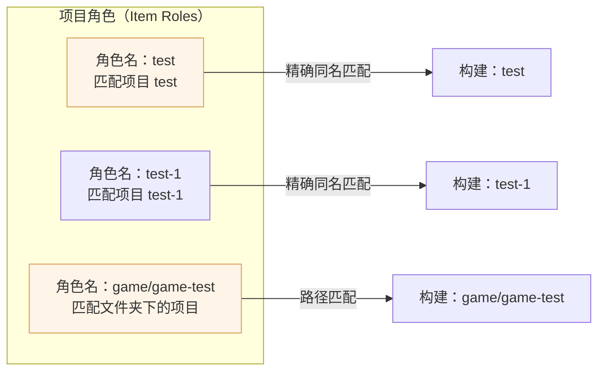
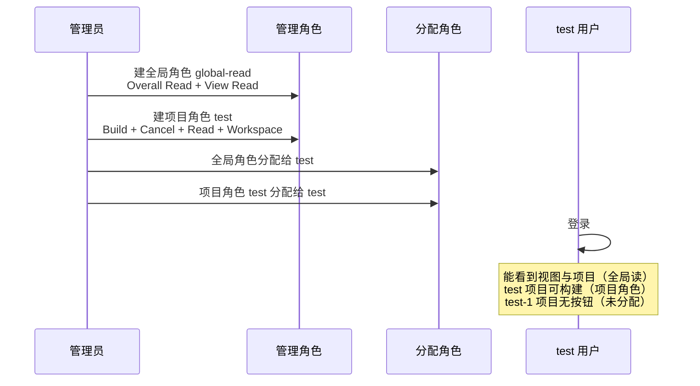

# Jenkins 精细化权限控制：Role-Based Strategy 全局角色与项目角色实战

## 纲要

- **为什么必须精细化**：流水线多起来后，典型诉求是"这条只允许某些人查看、那条只允许某些人构建"——Jenkins 内置的全局权限模型表达不了这个
- **两个角色层级**：**全局角色**（管"能看到什么页面"）+ **项目角色**（管"能对哪个构建做什么"），必须配合使用
- **角色名必须与项目名完全一致**才能匹配上，这是项目角色的核心机制，差一个字符就失效
- **斜杠路径的真相**：视图下直接建项目只写项目名；视图下建了文件夹、文件夹下再建项目，**必须写绝对路径 `文件夹/项目`**
- **全局 Read 是隐形门槛**：不给用户配全局读权限，登录后是**一片空白**，连菜单都没有——这是最常被误判为"插件坏了"的坑
- **权限清单**：`Overall Read` / `View Read` / `Build` / `Cancel` / `Workspace` / `Update` / `Delete`，按岗位组合授权
- **文件夹必须用英文**：中文名会导致路径匹配直接失败，前面的项目分类规范在这里再次应验

## 一、先搞清楚：Jenkins 的权限模型缺什么

Jenkins 内置的授权策略（Security Realm + Authorization）只有几个粗粒度选项：

- `Logged-in users can do anything`（登录即可干任何事）
- `Matrix-based security`（矩阵权限，手工勾选每个用户每项权限）
- `Anyone can do anything`（任何人都能干任何事）

前两个的问题：**权限是全局的**。你没法表达"game-test 这个构建只允许运维构建，只允许开发查看"这种**单项目级别**的诉求。

> 课程里说得直接：**当流水线多的时候，我们需要一个精细的权限控制。** 比如说这个流水线只能允许哪些人查看，而另外一个流水线只能允许哪些用户构建。

**Role-Based Strategy 插件就是为这个而生的**：先定义"角色"以及角色拥有哪些权限，再把用户分配到角色上。人员变动时只改分配，不动权限定义。

## 二、两步准备：装插件 + 切策略

### 2.1 安装插件

**插件管理 → 可选插件**，搜索 `Role-based Authorization Strategy`，安装。

装完如果提示依赖未加载，地址栏输 `/restart` 重启。

### 2.2 切换授权策略

**系统管理 → 全局安全配置 → 授权（Authorization）→ 策略**，下拉选 **`Role-Based Strategy`**，保存。



保存后，系统管理页面会多出两个关键入口：

- **管理角色（Manage Roles）**：定义角色与角色拥有的权限；
- **分配角色（Assign Roles）**：把用户分配到角色上。

## 三、全局角色：管"能看到什么"

### 3.1 全局角色是什么

**管理角色里的"全局角色"是给全局创建一个角色权限。**

课件里的例子：创建一个叫 `global-cat` 的角色，给它分配：

| 权限 | 作用 |
| --- | --- |
| **Overall Read** | 能看到 Jenkins 整体页面（不配这个，登录后一片空白） |
| **View Read** | 能看到视图列表 |
| **Read**（页面读） | 能读取页面 |

**配与不配的差别有多大？**

- **没给用户分配这个权限**：你用 LDAP 用户登录 Jenkins，**是什么都看不到的，任何权限都没有**——菜单栏是空的，首页什么都没有；
- **给他配置了这个权限**：你就能看到视图以及构建。

> 这就是接入 LDAP 后"能登录但什么都干不了"的根因。**不是插件坏了，是没授权。**

### 3.2 怎么分配

**分配角色 → 添加你的用户 → 选中这个角色权限**，保存。

**一个实操细节**：如果输入的账号在 LDAP 里不存在，页面会提示"用户没找到"。这时要把它删掉，不要留空挂载。

> 课件里的教训：分配角色时加了 `admin`，结果提示"用户没找到"——因为公司 LDAP 里没有 `admin` 这个账号。**能从报错反推出 LDAP 用户是否存在，也算一个附带用处。**

## 四、项目角色：管"能对哪个构建做什么"

### 4.1 角色名必须与项目名一模一样

**项目角色是针对某个项目的（局部权限）。**

课件里创建了两个构建角色。关键规则：

> 角色名字你可以随意写，**但是建议你跟项目名同名**。这个项目名就指构建的那个名称，你新建流水线、新建一个项目，它的构建名称是哪个，这个匹配得跟你的构建名字一模一样，那你才能匹配到那个项目。

举例：你有一个构建叫 `test`，那项目角色名也要叫 `test`，这样才能对上。



### 4.2 斜杠是什么意思：绝对路径规则

课件专门解释了项目角色名里的斜杠，这是最容易懵的地方：

**规则分两种情况：**

| 项目创建位置 | 角色名写法 | 示例 |
|---|---|---|
| **视图下直接创建项目** | 只写项目名 | `test` |
| **视图下建文件夹，文件夹下再建项目** | 写**绝对路径** `文件夹/项目` | `game/game-test` |

原文的逻辑：斜杠分两块，**前面那块指文件夹**——在视图下创建了一个文件夹，这个文件夹下再创建了一个 `test-api` 项目，所以这边是「文件夹/项目」，**它要指定你的绝对路径**。

**记住这个判据**：项目是不是"直接挂在视图下"？是 → 写项目名；否（中间隔了文件夹）→ 写完整路径。

### 4.3 项目角色能配哪些权限

| 权限 | 作用 |
| --- | --- |
| **Build** | 构建（触发这个项目跑流水线） |
| **Cancel** | 取消（构建跑了一半想停掉） |
| **Read** | 查看项目配置与构建历史 |
| **Workspace** | 查看/操作工作空间 |
| **Update** | 更新项目配置 |
| **Delete** | 删除项目 |

**典型组合**：

- **开发**：`Read` + `Workspace`（看代码与日志，不能触发发布）
- **运维**：`Build` + `Cancel` + `Read` + `Workspace`（能发能停能查）
- **负责人**：再加 `Update` + `Delete`（能改配置能删项目）

> **最小权限原则**：不要一上来就给全选。`Delete` 和 `Update` 应该只给项目负责人。

## 五、完整实操：从零配到验证

### 5.1 配置全局查看角色

1. 装插件 → 授权策略选 `Role-Based Strategy` → 保存；
2. **管理角色 → 全局角色 → 添加角色**，命名如 `global-read`；
3. 勾选 `Overall Read` + `View Read`，保存。

### 5.2 分配全局角色给用户

**分配角色 → 全局角色 → 添加用户**（如 `test`、`test-2`）→ 勾选 `global-read` → 保存。

> 如果提示"用户没找到"，说明 LDAP 里没这个账号，删掉重新加。

### 5.3 配置项目角色

以视图下直接创建的 `test` 项目为例：

1. **管理角色 → 项目角色 → 添加角色**；
2. 角色名填 `test`（与项目名一致）；
3. 权限勾选 `Build` + `Cancel` + `Read` + `Workspace`；
4. 保存。

> **注意**：如果用户没有全局 `View Read`，这里还要**单独给项目角色补一个 `View Read`**，否则用户登录后看不到任何视图。

### 5.4 分配项目角色

**分配角色 → 项目角色 → 添加用户 `test`** → 勾选 `test` 角色 → 保存。

### 5.5 验证（这一步不能省）

用 `test` 用户登录，逐个确认：

| 验证项 | 预期结果 |
| --- | --- |
| 能看到视图列表 | ✅ 说明全局 `View Read` 生效 |
| 能看到 `test` 和 `test-1` 两个项目 | ✅ 说明全局读权限生效 |
| `test` 项目有"构建"按钮，能点 | ✅ 说明项目角色 `Build` 生效 |
| 点了构建但**不能"配置"** | ✅ 说明没给 `Update`，符合预期 |
| `test-1` 项目**没有构建也没有取消按钮** | ✅ 说明没给 `test-1` 分配角色，权限隔离生效 |

再用 `test-2` 用户登录操作 `game` 项目 → **什么权限都没有** → 说明未授权用户被正确挡住。

### 5.6 文件夹下项目的配法

如果项目是建在文件夹下的，路径要写全：

```text
1. 建英文文件夹 game（中文名 Jenkins 无法识别）
2. 在 game 下建项目 game-test
3. 复制完整路径：game/game-test
4. 管理角色 → 项目角色 → 添加角色，角色名 = game/game-test
5. 配 Build / Cancel / Read / Workspace → 保存
6. 分配角色 → 项目角色 → 把 test 用户分配到该角色
7. 用 test 登录验证：进目录能看到工作空间、有构建按钮 = 成功
```



## 六、五个必踩的坑

**坑一：不配全局 `Overall Read`，用户登录后一片空白。**
这是最高频的误判——以为是插件坏了、LDAP 挂了，其实是权限没给。**全局 Read 是登录后能看到任何东西的前提。**

**坑二：项目角色名与项目名差一个字符。**
`test` 和 `test-1` 是两个不同的角色，匹配不到就完全不生效，且**不会报错**，只是静默无权限。

**坑三：文件夹下项目忘了写绝对路径。**
在 `game` 文件夹下的 `game-test` 项目，角色名只写 `game-test` 是匹配不上的，必须写 `game/game-test`。

**坑四：中文文件夹名。**
课件原话：**"这个名字需要使用英文，不然使用中文的话，它没有办法识别，会有很多的问题。"** 配路径匹配时中文名直接失败。

**坑五：LDAP 里不存在的用户。**
分配角色时输入不存在的账号会提示"用户没找到"。这不是配置错误，是**账号不存在**——可以反过来用它验证 LDAP 用户是否建好。

## 七、常见报错与排查

| 现象 | 根因 | 解法 |
| --- | --- | --- |
| 授权策略里没有 Role-Based Strategy | 插件没装 | 装 `Role-based Authorization Strategy`，`/restart` |
| 用户登录后一片空白、无菜单 | 没配全局 `Overall Read` | 建全局角色勾 `Overall Read` 并分配 |
| 能看到项目但没有构建按钮 | 项目角色未分配或未匹配 | 检查角色名是否与项目名完全一致 |
| 文件夹下项目配了权限仍无效 | 角色名没写绝对路径 | 改成 `文件夹/项目` |
| 中文文件夹配权限匹配不上 | Jenkins 不识别中文名 | 文件夹改英文名 |
| 分配角色提示"用户没找到" | LDAP 无此账号 | 删掉该条目，或在 LDAP 建用户 |
| 装完插件授权策略不显示新选项 | 插件依赖未加载 | `/restart` 重启 |

## 八、面试考点与追问

**Q1：Jenkins 内置权限模型为什么不够用？Role-Based Strategy 解决了什么？**
内置模型权限是全局的（登录即可干任何事，或矩阵逐用户勾选），无法表达"某条流水线只允许某些人查看、另一条只允许某些人构建"的单项目级诉求。Role-Based Strategy 引入"角色"抽象：角色定义权限，用户分配角色，人员变动只改分配不动定义，实现精细化授权。

**Q2：全局角色和项目角色的分工是什么？**
**全局角色**控制用户登录后能看到什么（`Overall Read` 看到整体页面、`View Read` 看到视图列表）；**项目角色**控制用户能对哪个构建做什么（`Build`/`Cancel`/`Read`/`Workspace`/`Update`/`Delete`）。两者必须配合——只配项目角色不配全局 Read，用户登录后一片空白。

**Q3：项目角色的命名规则是什么？斜杠代表什么？**
角色名必须与项目名完全一致才能匹配。若项目直接建在视图下，角色名只写项目名；若项目建在文件夹下（视图 → 文件夹 → 项目），**必须写绝对路径 `文件夹/项目`**，斜杠前是文件夹名、后是项目名。

**Q4：为什么用户登录后什么都看不到？怎么排查？**
最常见原因是没分配全局角色的 `Overall Read`——Jenkins 对未授权用户默认展示空界面。排查顺序：① 确认授权策略已切到 Role-Based Strategy；② 确认全局角色勾了 `Overall Read` + `View Read`；③ 确认该用户已被分配到全局角色；④ 确认 LDAP 里确有该用户。

**Q5：一条生产流水线，开发和运维应该分别配什么权限？**
建议开发给 `Read` + `Workspace`（看配置、看日志、下载产物，不能触发发布）；运维给 `Build` + `Cancel` + `Read` + `Workspace`（能发能停能查）；`Update` + `Delete` 只给项目负责人。遵循最小权限原则，`Delete` 尤其要克制。

**Q6：文件夹命名为什么必须用英文？**
Jenkins 对中文文件夹名的处理存在缺陷：RBAC 路径匹配、CLI 操作、部分插件解析都无法正确识别，会导致权限配了却不生效等难以定位的问题。这是实战中反复踩过的坑，属于硬性规范。

## 📎 文本↔代码关联

本篇对应课件源码（`code/3-基础-Jenkins/`，已做去品牌化处理）：

| 代码文件 | 正文提及 | 内容 |
| --- | --- | --- |
| `code/3-基础-Jenkins/课件/教学课件.md` | 第 5.3 节 | `credentials()` 与 `environment` 用法，配合权限做敏感信息隔离 |

**技术点总结**：Role-Based Strategy 把 Jenkins 权限拆成两层——**全局角色**决定登录后能看到什么（`Overall Read` + `View Read`，不配则登录后一片空白），**项目角色**决定能对哪个构建做什么（`Build`/`Cancel`/`Read`/`Workspace`/`Update`/`Delete`）。两条核心匹配规则：**项目角色名必须与项目名完全一致**；项目建在文件夹下时**必须写绝对路径 `文件夹/项目`**。五个坑里最致命的是忘配全局 Read（症状是白屏，最易误判为插件故障）和中文文件夹名（路径匹配直接失败）。

相关度：97%。是否需要继续：[是]。代码是否可运行：[是]。
