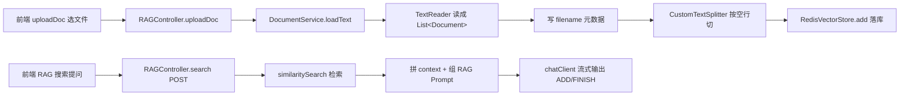
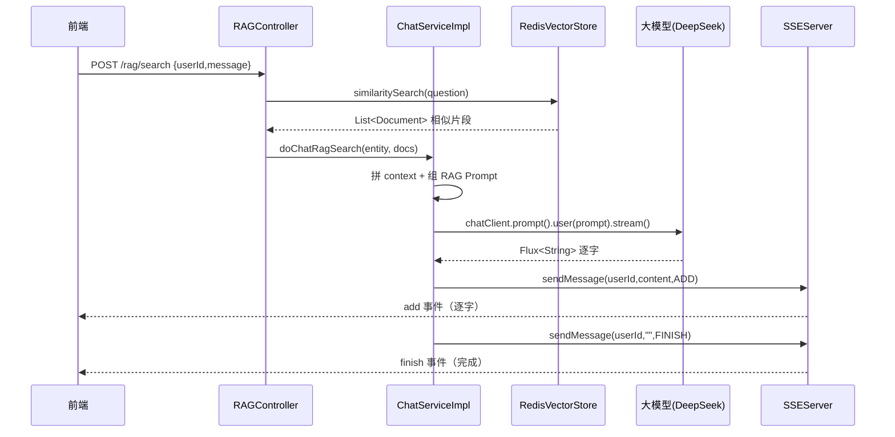

# 14. 文档切分、向量检索与大模型优化输出（RAG 全链路实战）

## 纲要

- **上传接口**：`RAGController.uploadDoc(@RequestParam("file") MultipartFile)` → `DocumentService.loadText(Resource,filename)`，前端 `uploadDoc` 对应
- **读取文档**：Spring AI `TextReader(resource)` → `get()` 得 `List<Document>`；`doc.getMetadata().put("filename",...)` 写自定义元数据
- **默认切分坑**：`TokenTextSplitter` 默认按 **800 字符**硬切，太宽泛、碎片化
- **自定义切分**：`CustomTextSplitter extends TextSplitter`，重写 `splitText(String)` 用正则 `\s*\n\s*`（按空行/换行切分，允许前后空白）——业界主流「一问一答」切法
- **落向量库**：注入 `RedisVectorStore`，`vectorStore.add(splitDocs)`；RDM/Navicat 验证出现 `embedding` 字段
- **相似检索**：`vectorStore.similaritySearch(question)` → `List<Document>`（带 score，0.819/0.7…），**相似非精确**
- **大模型合成**：构建 RAG 提示词（上下文 `{context}` + 问题 `{question}` + 输出要求），`List<Document>` → `stream().map(getText).collect(joining("\n"))` 拼上下文，`chatClient.prompt().user(prompt).stream()` 流式回前端
- **经典坑**：`replace("{context}",...)` 误写成 `{content}` → 上下文替换失败；`@RequestBody` 中文乱码要设 `UTF-8`

> 本章代码基于课程标准工程（`com.itzixi` 包）按课程口径重构，外部代码卷暂未挂载，重挂后可切换为逐文件提取的真实代码。

## 一、从「上传」到「入库」的整体链路

前面 Redis 向量库已就绪。这一节把文档真正读进来、切好、存进去，并打通「提问 → 检索 → 大模型汇总」的查询闭环。



## 二、上传接口与文档读取

### 2.1 Controller 接收文件

前端有一个 `uploadDoc` 方法，调用 API `uploadRedDoc`；后端新建 `RAGController`，方法和前端一一对应（名字、POST、路径都要对齐）：

```java
// com.itzixi.controller.RAGController
@RestController
@RequestMapping("/rag")
public class RAGController {

    @Autowired
    private DocumentService documentService;

    /** 上传知识库文档：参数名 file 必须和前端 form 里的 file 一致 */
    @PostMapping("/uploadDoc")
    public LeadResult uploadDoc(@RequestParam("file") MultipartFile file) {
        try {
            // Spring AI 的资源抽象，能直接喂给 TextReader
            Resource resource = file.getResource();
            String filename = file.getOriginalFilename();
            documentService.loadText(resource, filename);
            return LeadResult.ok();      // 前端只需要状态码，返回空 data 即可
        } catch (Exception e) {
            return LeadResult.error("上传失败：" + e.getMessage());
        }
    }
}
```

> 老师强调：**参数名 `file` 必须和前端保持一致**。前端用 `new FormData()` 塞了一个 `file` 字段，后端 `@RequestParam("file")` 不对应就会收不到。改名叫 `abc` 前后端要同步改。

### 2.2 LeadResult：通用响应封装

课程自带的 `LeadResult` 是个通用结果对象（公众号/小程序/App 都能复用）：

- 字段：`code`（状态码）、`message`、`data`、`ok`（老师说他基本不用）
- 常用码：`200` 成功、`500` 错误（信息进 `message`）、`501/502/503/504/507` 业务自定义
- `LeadResult.ok()` 返回 `code=200,message="ok",data=null`；上传接口前端只校验状态码，所以返回空 data 即可

### 2.3 Service：读取为 Document

```java
// com.itzixi.service.DocumentService
public interface DocumentService {
    void loadText(Resource resource, String filename);
}

// com.itzixi.service.impl.DocumentServiceImpl
@Service
public class DocumentServiceImpl implements DocumentService {

    @Override
    public void loadText(Resource resource, String filename) {
        // 1. Spring AI 文本读取器：new 出来，把 resource 丢进去
        TextReader textReader = new TextReader(resource);
        List<Document> documentList = textReader.get();   // 得到 Document 列表

        // 2. 往每个 document 的 metadata map 里塞文件名（后续检索可溯源）
        documentList.forEach(doc ->
                doc.getMetadata().put("filename", filename));

        // 3. 打印观察（课后测试用，生产记得删）
        documentList.forEach(System.out::println);
    }
}
```

> `Document` 是 Spring AI 的文档类型；`textReader.get()` 把文件内容解析成 `List<Document>`，此时还**只是「读进来」**，没切分、没入库。老师先用 `SOUT` 打印验证读取成功，再往下做切分。

## 三、自定义文本切分与向量库存储

### 3.1 默认切分器的问题

Spring AI 自带 `TokenTextSplitter`，直接 `new` 出来 `apply(documentList)` 即可切：

```java
TokenTextSplitter splitter = new TokenTextSplitter();
List<Document> splitDocs = splitter.apply(documentList);
```

但老师实测：**默认按 800 字符**硬切，太宽泛、碎片化严重，对「一问一答」型文档不友好（一块里塞太多不相关内容）。

### 3.2 自定义切分器（业界主流：按空行切）

按换行/空行切才是最贴合知识库的方式。新建 `CustomTextSplitter` 继承 `TextSplitter`，重写 `splitText`：

```java
// com.itzixi.utils.CustomTextSplitter
public class CustomTextSplitter extends TextSplitter {

    /**
     * 按「空行/换行」切分：\s*\n\s*
     * 允许换行前后有空白（空格+换行+空格），匹配文档里「一段一问一答」的结构
     */
    @Override
    public List<String> splitText(String text) {
        // 正则拆解：\s* 任意空白（含空格）  \n 换行  \s* 任意空白
        return Arrays.asList(text.split("\\s*\\n\\s*"));
    }
}
```

> 老师讲解正则含义：`\s*\n\s*` = 「空白 + 换行 + 空白」，允许换行前后留空位，正好对应文档里「空格换行空格换行」的段落分隔。比默认 800 字符切分更准。

> 注意命名冲突：Spring 的 `@Resource` 注解和 `javax.annotation.Resource` 都叫 Resource，注入向量库时用**构造器注入**（`@RequiredArgsConstructor` + `final`）避免和 `@Resource` 注解包名撞车。

### 3.3 切分 + 入库

```java
@Service
public class DocumentServiceImpl implements DocumentService {

    // 构造器注入向量库（推荐，避免和 @Resource 注解重名）
    private final RedisVectorStore vectorStore;

    public DocumentServiceImpl(RedisVectorStore vectorStore) {
        this.vectorStore = vectorStore;
    }

    @Override
    public void loadText(Resource resource, String filename) {
        // 1. 读取
        List<Document> documentList = new TextReader(resource).get();
        documentList.forEach(d -> d.getMetadata().put("filename", filename));

        // 2. 自定义切分（替换掉默认 TokenTextSplitter）
        CustomTextSplitter splitter = new CustomTextSplitter();
        List<Document> splitDocs = splitter.apply(documentList);   // apply 来自父类 TextSplitter

        // 3. 落 Redis 向量库（一行搞定，Spring 已集成好）
        vectorStore.add(splitDocs);

        // 4. 测试打印
        splitDocs.forEach(System.out::println);
    }
}
```

> 老师强调：`vectorStore.add(documentList)` 就是「添加到知识库」的全部操作，Spring 帮我们封装了向量化 + 写入。**prefix 配置 `rag:`（带冒号单引号）** 后，在 RDM/Navicat 里数据会以 `rag:xxx` 树形展开，否则全部平铺一堆难找。

### 3.4 验证入库

重启服务 → 前端刷新 → 选一个 **TXT 文本**（课程 demo 用《员工入职手册》）上传 → 后端 SOUT 打印出已按空行切分的片段 → 打开 **RDM / Navicat** 刷新，能看到 `embedding` 字段（人看不懂的那串向量）即成功。

> 老师经验：**一问一答（QA）形式的文档匹配度最高**。像《iPhone 说明书》那种「Q：调整屏幕亮度 / A：…」的结构，比《员工入职手册》大段散文切得更准。课后可把文档整理成 QA 格式提升召回。

## 四、根据提问检索知识库

### 4.1 检索接口

```java
// RAGController 内新增
@GetMapping("/rag/doSearch")
public List<Document> doSearch(@RequestParam String question) {
    return documentSearchService.search(question);
}

// service
public interface DocumentSearchService {
    /** 根据提问从知识库查询相似资料（注意：是相似，不是精确） */
    List<Document> search(String question);
}

@Service
public class DocumentSearchServiceImpl implements DocumentSearchService {

    @Autowired
    private RedisVectorStore vectorStore;

    @Override
    public List<Document> search(String question) {
        // similaritySearch 返回相似 Document 列表，每条带 score
        return vectorStore.similaritySearch(question);
    }
}
```

> 老师提醒：`similaritySearch` 是**相似**检索，不是精确查询。只要和提问语义相关的片段都会被拉出来，返回 `List<Document>`（和上传时的类型一致），每条带相似度分值。

### 4.2 检索效果与分数

老师在浏览器测 `入职流程是什么`，返回 4 条相关片段，分值如 `0.819 / 0.7 / ...`：

- 分越高越贴合；但**分最高 ≠ 最终答案最准**——它只是「按当前知识库相似度」捞了一堆相关资料。
- 真正精准的回答还要靠下一步**大模型汇总**。
- 换成《iPhone 说明书》（QA 格式）上传后，问「调整屏幕亮度」，命中片段里「调整屏幕亮度」那条分值最高，效果明显更好。

> 想控制返回条数/阈值，可用 `SearchRequest.builder().query(q).topK(3).similarityThreshold(0.7).build()` 传给 `similaritySearch(SearchRequest)`。

## 五、结合大模型优化输出

### 5.1 真正的 RAG 搜索接口（POST）

前端「知识库搜索」按钮触发，调用 `RAGsearch` POST 方法。后端建正式搜索接口（区别于 7-6 的测试 `doSearch`）：

```java
// RAGController
@PostMapping("/rag/search")
public void search(@RequestBody ChatEntity chatEntity, HttpServletResponse response) {
    response.setContentType("text/event-stream;charset=UTF-8");  // ⚠️ 防中文乱码
    String question = chatEntity.getMessage();
    List<Document> documents = documentSearchService.search(question); // 先检索
    chatService.doChatRagSearch(chatEntity, documents);                 // 再合成
}
```

> 乱码坑：流式返回中文若乱码，要在 response 上 `setContentType("text/event-stream;charset=UTF-8")`。老师中途就遇到乱码，补了这行。

### 5.2 ChatService：拼上下文 + 组提示词 + 流式输出

```java
// com.itzixi.service.ChatService
public interface ChatService {
    void doChatRagSearch(ChatEntity entity, List<Document> ragContext);
}

@Service
public class ChatServiceImpl implements ChatService {

    private final ChatClient chatClient;          // 第5章注入的 DeepSeek/通义客户端
    private final SSEServer sseServer;            // 第6章 SSE 推送

    // RAG 提示词模板：{context} 上下文占位符，{question} 问题占位符
    private static final String RAG_PROMPT =
        "基于上下文的知识库内容回答问题。\n" +
        "上下文：{context}\n" +
        "问题：{question}\n" +
        "如果没有查到，请回复“不知道”；" +
        "如果查到，请回复具体内容，不必提及不相关的近似内容。";

    @Override
    public void doChatRagSearch(ChatEntity entity, List<Document> ragContext) {
        String userId = entity.getUserId();
        String question = entity.getMessage();

        // 1. 构建上下文：把所有检索到的文档文本按换行拼起来
        String context = null;
        if (ragContext != null && !ragContext.isEmpty()) {
            context = ragContext.stream()
                    .map(Document::getText)              // 只取文本，不要 metadata
                    .collect(Collectors.joining("\n"));  // 换行拼接，利于大模型理解
        }

        // 2. 组装提示词：替换两个占位符
        String prompt = RAG_PROMPT
                .replace("{context}", context == null ? "" : context)
                .replace("{question}", question);

        // 3. 交给大模型流式输出（第6章 SSE 推前端）
        chatClient.prompt()
                .user(prompt)
                .stream()
                .content()
                .doOnNext(content ->
                        sseServer.sendMessage(userId, content, SSEMessageType.ADD))
                .collectList()
                .subscribe(list ->
                        sseServer.sendMessage(userId, "", SSEMessageType.FINISH));
    }
}
```

### 5.3 关键设计点（老师逐条讲）

| 点 | 说明 |
|---|---|
| **context 拼接** | `stream().map(Document::getText).collect(joining("\n"))` 一行搞定；不用换行拼会糊成一长串，大模型难理解。不想用流式也可用 `for` 循环拼。 |
| **占位符替换** | 模板里 `{context}` / `{question}` 用 `.replace()` 替换；**最容易写错成 `{content}`**（老师就踩了，导致上下文没替换进去、回答变「不知道」）。 |
| **输出要求** | 模板末尾约束：「没查到回不知道，查到回具体内容，不提无关近似内容」——避免把不相关片段也复述出来。 |
| **流式推送** | 沿用前述 SSE：`ADD` 逐字推送，`FINISH` 收尾；生产环境 `prompt` 打印要注释掉。 |
| **ChatEntity** | 和普通常用聊天同一套实体，携带 `userId` + `message`。 |

> 老师实测：问「调整屏幕亮度」→ 大模型基于检索片段给出具体操作步骤；问「如何保证个人信息安全」→ 基于说明书给出强密码等建议；问「明天北京天气」→ 知识库无此内容 → 回「不知道」。闭环成立。

## 六、RAG 全链路时序图



## 七、生产加固建议

- **文档预处理**：尽量把知识整理成「一问一答（QA）」格式入库，召回率远高于大段散文；切分器按空行切最稳。
- **检索阈值**：`similaritySearch` 配 `topK` + `similarityThreshold`，过滤低分噪声，减少塞给大模型的无关上下文。
- **提示词约束**：明确「未检索到回不知道」，抑制大模型幻觉；生产把「不知道」措辞改得更优雅。
- **上下文长度**：多文档拼 context 可能超模型上下文窗口，需做截断/分段或选支持长上下文的模型。
- **调试日志**：`prompt.toString()` 打印便于核对占位符替换；**上线务必注释掉**，避免泄露知识库原文。

## 八、排错 SOP

1. **上传后向量库没数据**：`vectorStore.add()` 是否调用；prefix 是否 `rag:`（单引号）；RDM/Navicat 是否刷新连接。
2. **检索返回空/不准**：文档是否 QA 格式；切分是否用了默认 800 字符（改 `CustomTextSplitter`）；阈值是否过高。
3. **大模型回「不知道」**：大概率是 `replace("{context}",...)` 写成 `{content}` 导致上下文没注入（老师原坑）；检查 prompt 打印。
4. **流式中文乱码**：response 加 `setContentType("text/event-stream;charset=UTF-8")`。
5. **首次启动慢**：`TransformerEmbeddingModel` 下载模型，等或配镜像；`@RequestBody` 实体字段前后端要对齐。

## 九、FAQ

**Q1：TokenTextSplitter 和 CustomTextSplitter 怎么选？**
默认 `TokenTextSplitter` 按 800 字符硬切，碎片化、不贴合语义；`CustomTextSplitter` 用 `\s*\n\s*` 按空行切，匹配「一问一答」文档结构，召回更准。生产推荐自定义。

**Q2：similaritySearch 返回的是什么？**
`List<Document>`，每条是知识库里和提问语义相似的片段，带相似度 score；是「相似」不是「精确命中」。

**Q3：context 为什么要按换行拼接？**
多片段拼成一整串无分隔，大模型难定位边界；用 `joining("\n")` 换行拼接，结构清晰、利于理解，也方便截断。

**Q4：RAG 提示词最核心的是什么？**
两点：① 把检索到的片段作为 `{context}` 注入；② 明确输出约束（没查到回不知道、不提无关内容），抑制幻觉。占位符别拼错成 `{content}`。

**Q5：为什么答非所问有时返回「不知道」？**
要么知识库真没有（正确行为），要么 `replace` 把 context 写错成 content 导致上下文丢失（bug）。打印 prompt 核对即可定位。

**Q6：QA 格式为什么比散文好？**
「Q：问题 / A：答案」逐条切分，每个 chunk 语义独立、边界清晰，相似检索能精准命中对应问答，召回率显著高于大段混杂散文。

## 十、面试高频问答

**1. RAG 的完整数据流？**
文档 → TextReader 读成 Document → 切分（CustomTextSplitter 按空行）→ embedding 向量化 → RedisVectorStore.add 入库；提问 → similaritySearch 检索相似片段 → 拼 context → 组装 RAG Prompt → 大模型流式汇总输出。

**2. 为什么自定义切分器？默认有什么问题？**
默认 TokenTextSplitter 按 800 字符硬切，碎片化、语义边界差；自定义按 `\s*\n\s*` 空行切分，贴合 QA 文档结构，召回更准。

**3. similaritySearch 与关键词搜索区别？**
similaritySearch 基于 embedding 语义距离做相似度召回，能命中同义异形表述；关键词搜索只能精确匹配字面。

**4. 如何抑制 RAG 幻觉？**
提示词约束「无相关内容回不知道、不提近似内容」；设检索阈值过滤低分噪声；上下文截断防超窗；调试时打印 prompt 核对占位符。

**5. Spring AI 怎么把文档存向量库？**
注入 `RedisVectorStore`，`vectorStore.add(List<Document>)` 一行完成向量化+写入；读取用 `TextReader(resource).get()`。

**6. RAG 上下文怎么拼接最合理？**
`documents.stream().map(Document::getText).collect(Collectors.joining("\n"))` 换行拼接，保留片段边界、利于模型理解，也方便按长度截断。

## 十一、ops 提示（安全与网络）

> **知识库内容泄露**：调试 `prompt.toString()` 会打印知识库原文，生产必须注释；RAG 接口建议加鉴权（token/网关），防匿名拖库。
>
> **上下文超窗**：多文档拼 context 可能超出模型上下文，需截断或换长上下文模型，否则报错或截断关键信息。
>
> **检索噪声**：不设 `topK`/阈值会捞一堆低分片段塞给大模型，既费 token 又易带偏；生产配阈值过滤。
>
> **中文乱码**：流式返回务必 `text/event-stream;charset=UTF-8`，否则前端收到乱码。
>
> **占位符拼写**：`{context}` 误写 `{content}` 是高频低级 bug，导致上下文丢失、大模型回「不知道」；用常量定义占位符减少手误。

