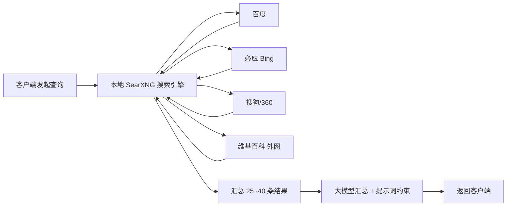
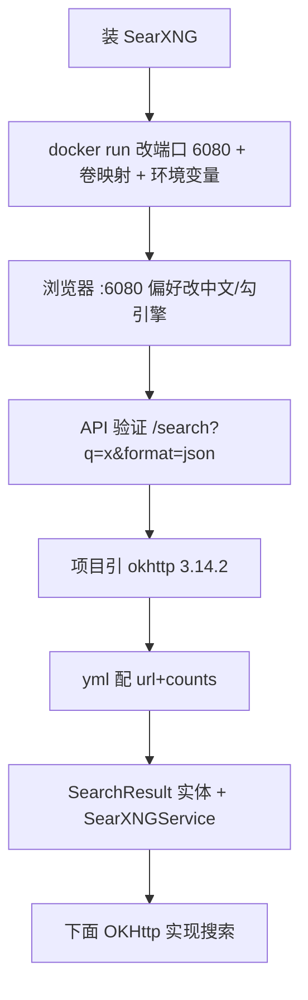

# 15. SearXNG 联网搜索：原理、Docker 安装与项目集成

## 纲要

- **联网搜索原理**：客户端 → **本地搜索引擎 SearXNG**（中转代理）→ 转发到百度/谷歌/维基/搜狗/360 等 → 汇总 25~40 条结果 → 交大模型汇总 → 返回客户端
- **为什么用 SearXNG**：本地代理中转，**隐私保护**（不直接暴露给百度谷歌）；聚合多引擎；类似早年「谷歌百度联合搜索」站点
- **Docker 安装**：改端口 `6080`（避开默认 8080 冲突）、环境变量 `SEARXNG_BASE_URL` + `PORT`、访问 `:6080`、偏好设置改中文消报错、搜索引擎勾选（综合 + bing/百度/搜狗/360）、API 验证 `/search?q=xxx&format=json`
- **项目集成**：**无需专门依赖**（SearXNG 无搜索 SDK），用 `OkHttp` 发 HTTP 请求即可；引入 `okhttp 3.14.2`
- **yml 配置**：自定义属性 `internet.web.search.searxng.url` + `counts`（25 条，建议 15~25，过多费 token/钱）
- **返回实体**：`SearchResult`（title/content/url/score）；`SearXNGService.search(query)` 返回 `List<SearchResult>`；`@Value` 注入两个变量

> 本章代码基于课程标准工程（`com.itzixi` 包）按课程口径重构，外部代码卷暂未挂载，重挂后可切换为逐文件提取的真实代码。

## 一、为什么本篇要引入联网搜索

前述 RAG 解决了「私有知识」问答，但大模型对**时效性 / 公开网络**问题（如「某人是谁」「今天新闻」）依然盲区。联网搜索就是给大模型外挂一个「实时检索」能力：客户端不直接问大模型，而是先让本地 SearXNG 去网上搜，把结果汇总后交大模型提炼。

> 老师比喻：和早年「谷歌百度联合搜索」网站同理——把多个搜索引擎结果聚合起来一起用，而且 SearXNG 是在**本地做代理中转**，你的搜索内容不直接交给百度/谷歌，隐私性更好。

## 二、联网搜索全流程原理



| 角色 | 说明 |
|---|---|
| 客户端 | 发起查询请求（页面点「联网搜索」） |
| 本地 SearXNG | 中转代理，转发到各大在线引擎并聚合结果 |
| 在线引擎 | 百度/必应/搜狗/360/维基等，几十种可挑 |
| 大模型 | 拿到汇总结果集 + 提示词，提炼成通顺答案 |

> 关键点：**请求不是发给大模型，而是发给本地 SearXNG**；最终才把汇总结果和大模型结合——这和 RAG 的模式一致（检索 → 汇总 → 大模型优化输出）。

## 三、Docker 安装 SearXNG

### 3.1 拉镜像 + 起容器

官网文档有 docker container 安装方式；课程改了端口和映射：

```bash
docker run -d \
  --name searxng-mc \
  -p 6080:8080 \
  -v /你的本地路径/searxng:/etc/searxng \
  -e SEARXNG_BASE_URL=http://localhost:6080/ \
  -e SEARXNG_PORT=8080 \
  --restart unless-stopped \
  searxng/searxng:latest
```

> 老师踩坑提示：
> - **端口避开 8080**：默认 `8080` 被太多中间件占用，课程改成 `6080`（宿主机）→ `8080`（容器）。你本机没冲突也可保留 `8080`。
> - **卷映射路径写对**：`-v` 后面是你本机操作系统真实路径（Windows/macOS 各自改），别照抄。
> - **容器名冲突**：若本地已有同名容器，改名（如 `searxng-mc`）再跑。

### 3.2 访问与偏好设置

浏览器开 `http://localhost:6080`（端口随你改的走）：

1. 首次有个报错，**不用管**，点右上角 **preferences（偏好设置）** → 语言改**中文** → save 保存 → 刷新，报错即消失。
2. 偏好里 **搜索引擎** tab：选「综合」，开启 `bing`、`百度`、`搜狗`、`360`（**谷歌因本地网络问题不开**；外网环境可加 `维基百科`）。开好保存。
3. 顶部搜索框随便搜（如「分解影院」），等几秒即可看到聚合结果，每条带来源标记（百度/搜狗/bing）。

### 3.3 API 验证部署成功

SearXNG 自带 JSON API，这是后面代码集成要用的：

```
http://localhost:6080/search?q=分解影院&format=json
```

能看到纯 JSON 输出（含 `query` / `results` 数组），说明部署 + API 都正常，可直接被程序解析。

> 老师强调：联调前先用这个 URL 在浏览器验证一遍，确认返回 JSON 再写代码，能省很多调试时间。

## 四、项目集成 SearXNG（maven + yml + 实体）

### 4.1 引入 OkHttp

SearXNG 没有官方 Java SDK，本质就是发 HTTP 请求，所以用 `OkHttp` 即可：

```xml
<!-- mcp-client/pom.xml 最下方 -->
<dependency>
    <groupId>com.squareup.okhttp3</groupId>
    <artifactId>okhttp</artifactId>
    <version>3.14.2</version>     <!-- 课程版本；新项目可用 4.x -->
</dependency>
<!-- 课程用 hutool 的 JSONUtil 做解析，已在前序章节引入 -->
```

> 老师用 `okhttp 3.14.2`（他的表述「三四点一二」）。新项目建议用 okhttp 4.x（Kotlin 化 API）或保持 3.x 均可；JSON 解析用 hutool `JSONUtil`，也可用 Jackson/Gson。

### 4.2 application.yml 配置

```yaml
# 自定义属性：SearXNG 访问地址 + 结果条数
internet:
  web:
    search:
      searxng:
        url: http://127.0.0.1:6080/search     # 本地 SearXNG 地址
        counts: 25                              # 取前 N 条交大模型
```

> 老师给 `counts=25`，并明确**区间建议 15~25**：太多 → 大模型 token 暴涨、变慢、费钱；太少（如 1~2）→ 信息不足。综合取 25（后面 8-6 改成 10 做演示）。

### 4.3 返回实体 SearchResult

从搜索结果 JSON 里，最常用前三个字段 + 一个 score：

```java
// com.itzixi.entity.SearchResult
@Data
@NoArgsConstructor
@AllArgsConstructor
public class SearchResult {
    private String title;     // 标题
    private String content;   // 摘要/内容
    private String url;       // 来源地址
    private Double score;     // 排序分值（0.5 / 0.1 / 1.411...），double 够用
}
```

> 老师讲解：`title` / `url` / `content` 是基础三项（交给大模型用）；`score` 是排序优先级（每条都有），想按分排序也能拿。score 小数位多，`double` 即可，嫌麻烦写 `String` 也行。

### 4.4 SearXNGService 接口

```java
// com.itzixi.service.SearXNGService
public interface SearXNGService {
    /** 调用本地 SearXNG 搜索，返回结果集 */
    List<SearchResult> search(String query);
}

@Service
public class SearXNGServiceImpl implements SearXNGService {

    @Value("${internet.web.search.searxng.url}")
    private String SEARXNG_URL;          // 大写常量，别写死

    @Value("${internet.web.search.searxng.counts}")
    private Integer COUNTS;              // int 类型

    // OkHttpClient 通过构造器注入（@RequiredArgsConstructor）
    private final OkHttpClient okHttpClient;

    public SearXNGServiceImpl(OkHttpClient okHttpClient) {
        this.okHttpClient = okHttpClient;
    }

    // 真正实现（OKHttp 调用 + 解析）
}
```

> 注入技巧：`@Value("${...}")` 后，按住 Ctrl/Cmd + 点击变量能跳到 yml 即映射正确；变量名建议大写（如 `SEARXNG_URL` / `COUNTS`）区分于普通字段。

## 五、SearXNG 安装 × 集成 决策图



## 六、排错 SOP

1. **容器起不来 / 端口冲突**：默认 8080 易冲突，宿主机改 `6080`；容器名冲突换名；卷路径写本机真实路径。
2. **访问首屏报错**：点 preferences 改中文 + save，刷新即消，属正常。
3. **API 返回非 JSON**：确认 URL 带 `format=json`；SearXNG 地址/端口与 yml 一致。
4. **yml 映射不到**：`@Value` 变量名和 yml 层级（internet.web.search.searxng）必须完全一致；Ctrl 点击能跳转即正确。
5. **谷歌搜不到**：本地网络问题，关掉谷歌、保留 bing/百度/搜狗/360 即可。

## 七、FAQ

**Q1：为什么不直接让大模型联网？**
大模型本身不联网；需要本地 SearXNG 中转聚合多引擎结果，再交大模型提炼。且 SearXNG 本地代理保护隐私（搜索内容不直接给百度/谷歌）。

**Q2：端口为什么要改 6080？**
默认 8080 被大量中间件占用，极易冲突；课程统一演示用 6080，你无冲突可保留 8080。

**Q3：counts 设多少合适？**
老师建议 15~25。太多 token 费钱变慢，太少信息不足；演示最终用 10 条。

**Q4：需要引 SearXNG 官方 SDK 吗？**
不需要。SearXNG 提供 HTTP JSON API，用 OkHttp 发请求 + JSONUtil 解析即可。

**Q5：score 字段有什么用？**
每条结果带排序分值（如 1.411/0.5/0.1），默认从上到下递减；可据此排序或过滤低分噪声。

**Q6：谷歌为什么不开？**
本地网络环境连不上谷歌，开了反而拖慢/报错；保留 bing/百度/搜狗/360，外网可加维基。

## 八、面试高频问答

**1. 联网搜索的架构？**
客户端 → 本地 SearXNG（聚合百度/bing/搜狗/维基等）→ 汇总结果集 → 大模型基于结果提炼输出。请求发给 SearXNG 而非大模型。

**2. SearXNG 相比直接用搜索 API 的优势？**
本地代理中转、隐私保护（不直接暴露给商业引擎）；聚合多引擎结果；自带 JSON API 易集成；开源可自托管。

**3. 为什么结果条数要限制？**
过多结果塞给大模型 → token 暴涨、响应慢、成本高；过少信息不足。折中 15~25 条，并用 score 排序/limit 截断。

**4. 后端怎么调 SearXNG？**
OkHttp 发 `GET /search?q=query&format=json`；取 `response.body().string()`（**非 toString**）得 JSON；`JSONUtil.toBean` 转 `SearXNGResponse`（query + List<SearchResult>）。

**5. @Value 注入外部配置注意什么？**
yml 层级与 `@Value("${...}")` 必须一致；变量建议大写区分；Ctrl 点击能跳转 yml 即映射成功。

**6. 搜索结果如何交给大模型？**
把 `List<SearchResult>` 的 url+content 拼成上下文（如 XML 包裹），替换提示词 `{context}` 占位符，连同 `{question}` 一起提交大模型流式输出。

## 九、ops 提示（安全与网络）

> **端口冲突**：SearXNG 默认 8080 与众多中间件撞车，自托管改非默认端口（如 6080）避免「起不来 / 连错服务」。
>
> **暴露面**：SearXNG 若暴露公网，可能被当作免费搜索代理滥用；生产建议绑内网或加访问控制。
>
> **counts 成本**：结果条数直接挂钩大模型 token 费用与延迟，按业务设阈值（15~25），别无脑拉满。
>
> **外网引擎**：谷歌等依赖本地网络可达性；不可达的引擎及时剔除，免拖慢聚合。
>
> **JSON 解析坑**：取响应体务必 `body().string()`，`toString()` 会解析失败（通义灵码易生成错）——。

