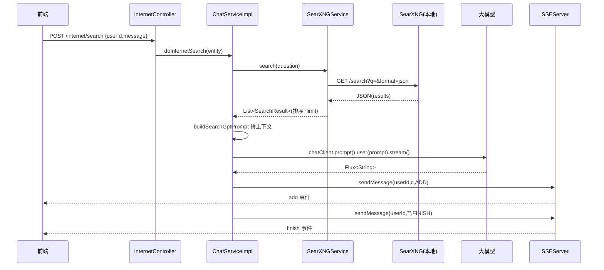

# 16. OKHttp 实时搜索、结果集优化与大模型合成（SearXNG 实战）

## 纲要

- **OkHttpConfig**：`@Configuration` 配 `OkHttpClient`，`connectTimeout(30s)` + `readTimeout(30s/60s)`
- **构建请求 URL**：`HttpUrl.Builder().addQueryParameter("q",query).addQueryParameter("format","json")` 拼在 yml 的 base url 后
- **发送与解析（核心坑）**：`client.newCall(req).execute()` → `response.body().string()`（**必须用 `string()` 不是 `toString()`**，否则 JSON 解析失败）；`JSONUtil.toBean(json,SearXNGResponse.class)`
- **响应封装**：`SearXNGResponse`（`query` + `List<SearchResult> results`）；返回 `response.getResults()`
- **结果集优化**：`subList(0,Math.min(counts,size))` 防越界；`parallelStream().sorted(comparingDouble(getScore).reversed()).limit(counts).toList()` 排序 + 截断
- **大模型合成**：`SearchGptPrompt` 模板（你是互联网搜索大师 + 上下文 + 问题 + 输出约束）；`buildSearchGptPrompt` 用 `String.format` 把每条 `url/content` 包成 `<context>` XML；`replace` 换大框架、`format` 换局部；`chatClient` 流式输出

> 本章代码基于课程标准工程（`com.itzixi` 包）按课程口径重构，外部代码卷暂未挂载，重挂后可切换为逐文件提取的真实代码。

## 一、从「能搜」到「搜得准」的链路

前面把 SearXNG 装好、配置注入妥当。这一节把 `search(query)` 真正落地：发请求 → 取 JSON → 解析 → 截断 → 拼上下文 → 大模型提炼。


## 二、OkHttpClient 配置与 URL 构建

### 2.1 配置类

```java
// com.itzixi.config.OkHttpConfig
@Configuration
public class OkHttpConfig {

    @Bean
    public OkHttpClient okHttpClient() {
        return new OkHttpClient.Builder()
                .connectTimeout(30, TimeUnit.SECONDS)   // 连接超时
                .readTimeout(30, TimeUnit.SECONDS)      // 读超时（也可 60s）
                .build();
    }
}
```

> 老师用 30s 连接 + 30s 读（也可 60s）。注入用**构造器注入**，避免与 `@Resource` 注解包名冲突。

### 2.2 构建请求 URL

```java
// SearXNGServiceImpl 内
HttpUrl url = new HttpUrl.Builder()
        .url(SEARXNG_URL)                         // yml 里的 base：http://127.0.0.1:6080/search
        .addQueryParameter("q", query)            // 查询词
        .addQueryParameter("format", "json")      // 固定 JSON 格式
        .build();

log.info("搜索的 url 地址为: {}", url.toString());
```

> 浏览器测试 `internet/test?query=分解影院`，后端能打印出完整 URL（含 `format=json`）即构建成功；此时接口返回 null 是正常的（还没写解析），URL 对了就好。

## 三、发送请求与解析

```java
@Override
public List<SearchResult> search(String query) {
    try {
        HttpUrl url = new HttpUrl.Builder()
                .url(SEARXNG_URL)
                .addQueryParameter("q", query)
                .addQueryParameter("format", "json")
                .build();

        Request request = new Request.Builder().url(url).get().build();
        Response response = okHttpClient.newCall(request).execute();

        if (!response.isSuccessful()) {
            throw new RuntimeException("请求失败, http:" + response.code());
        }
        // ⚠️ 关键：用 string() 不是 toString()！
        String responseBody = response.body().string();
        // hutool JSONUtil 转 bean
        SearXNGResponse searXNGResponse = JSONUtil.toBean(responseBody, SearXNGResponse.class);
        return dealResults(searXNGResponse.getResults());

    } catch (Exception e) {
        log.error("搜索失败: {}", e.getMessage());
        return Collections.emptyList();   // 失败返回空 list（比 null 安全）
    }
}
```

```java
// 响应封装（外层大 JSON 含 query + results）
@Data
public class SearXNGResponse {
    private String query;
    private List<SearchResult> results;
}
```

> **老师踩的致命坑（务必记牢）**：通义灵码自动生成 `response.body().toString()`，导致 JSON 解析失败（报 500）。**取响应体必须用 `response.body().string()`**——`toString()` 拿到的是对象描述而非内容字符串。调试时打断点看 `responseBody` 是否为真 JSON 即可定位。这也是「不能完全信 AI 编程助手」的典型案例。
>
> 老师还强调：失败分支用 `Collections.emptyList()` 返回空列表，比返回 `null` 更稳（下游不用判空）。

## 四、结果集排序与截断

### 4.1 防越界截取

```java
/** 处理结果集：截取限制个数（防止实际条数 < counts 时越界） */
private List<SearchResult> dealResults(List<SearchResult> results) {
    // Math.min 取较小值，避免 results 不足 counts 时报 IndexOutOfBounds
    return results.subList(0, Math.min(COUNTS, results.size()));
}
```

> 老师讲解：直接 `subList(0,counts)` 有风险——万一只搜到 20 条却写死 25，直接越界。用 `Math.min(COUNTS,results.size())` 谁小取谁，稳。

### 4.2 排序 + 截断（推荐）

```java
private List<SearchResult> dealResults(List<SearchResult> results) {
    return results.parallelStream()                 // JDK8 并发流，多核加速
            .sorted(Comparator.comparingDouble(SearchResult::getScore).reversed())  // 按 score 降序
            .limit(COUNTS)                          // 限制条数（和上面一致）
            .toList();                              // 终止收集
}
```

> 老师优化：默认 score 已是「大→小」递减，但为防止乱序，用 `parallelStream().sorted(comparingDouble(getScore).reversed()).limit(counts).toList()` 显式按分降序 + 截断。`parallelStream` 适合大数据量列表，多核并行更快。最后务必 `.toList()` 收尾。
>
> 演示把 `counts` 从 25 改成 **10**，刷新后美观输出正好 10 条，验证通过。

## 五、结合大模型合成

### 5.1 接口与 Service

```java
// InternetController
@PostMapping("/internet/search")
public void search(@RequestBody ChatEntity chatEntity, HttpServletResponse response) {
    response.setContentType("text/event-stream;charset=UTF-8");  // 防中文乱码
    chatService.doInternetSearch(chatEntity);
}

// ChatService
void doInternetSearch(ChatEntity entity);
```

> 前后端映射坑：前端是 **POST** `internet/search`，后端必须用 `@PostMapping`，写错成 GET 前端会报错。老师中途就漏了 POST 导致前端调不通，补全后重启才通。

### 5.2 注入 SearXNGService + 搜索

```java
@Service
public class ChatServiceImpl implements ChatService {

    private final ChatClient chatClient;
    private final SSEServer sseServer;
    private final SearXNGService searXNGService;   // 注入联网搜索

    // 构造器注入三者...

    @Override
    public void doInternetSearch(ChatEntity entity) {
        String userId = entity.getUserId();
        String question = entity.getMessage();

        // 1. 先联网搜
        List<SearchResult> searchResults = searXNGService.search(question);

        // 2. 构建提示词
        String prompt = buildSearchGptPrompt(question, searchResults);

        // 3. 大模型流式输出（复用第6章 SSE）
        chatClient.prompt().user(prompt).stream().content()
                .doOnNext(c -> sseServer.sendMessage(userId, c, SSEMessageType.ADD))
                .collectList()
                .subscribe(l -> sseServer.sendMessage(userId, "", SSEMessageType.FINISH));
    }
}
```

### 5.3 提示词模板与上下文构建

```java
// 你是互联网搜索大师，基于返回结果作为上下文，综合后生成专业回答
private static final String SEARCH_GPT_PROMPT =
    "你是一个互联网搜索大师，请基于以下互联网返回的结果作为上下文，\n" +
    "根据你的理解，综合后生成专业回答，并输出专业的回答。\n" +
    "上下文：{context}\n" +
    "问题：{question}\n" +
    "如果没有查到，请回复“不知道”；如果查到，请回复具体内容，删除不相关的内容。";

/** 拼上下文：每条结果包成 <context> XML，含来源 url + 摘要 content */
private static String buildSearchGptPrompt(String question, List<SearchResult> results) {
    StringBuilder context = new StringBuilder();
    results.forEach(result -> context.append(String.format(
            "<context>\n[来源:%s]\n[摘要:%s]\n</context>\n",
            result.getUrl(), result.getContent())));

    // 大框架用 replace，局部用 format（老师习惯：段落级 replace，单行级 format）
    return SEARCH_GPT_PROMPT
            .replace("{context}", context.toString())
            .replace("{question}", question);
}
```

> 老师设计点：
> - **上下文格式**：用 `<context>` XML 包裹每条结果，`[来源:url]` + `[摘要:content]`，大模型友好。
> - **replace vs format**：大段提示词框架用 `replace` 占位符替换；单行 `String.format` 用于局部小拼接。两者等价，按范围选习惯即可（很多智能体引擎都用 replace 风格）。
> - **输出约束**：没查到回「不知道」、查到回具体内容并删不相关，抑制幻觉。

### 5.4 实测效果

老师在页面测「分解影院是谁」：
- **不点联网搜索** → 大模型纯推测：「可能是二次元角色 / 网络笔名」（瞎猜）。
- **点联网搜索** → SearXNG 搜到结果 → 大模型汇总输出：「是一位互联网技术领域的资深从业者，影响力/技术专长/教育传播/职业背景，在抖音等平台有短视频」——准确。

后台日志可见完整提示词：10 条 `<context>`（来源+摘要）+ 问题 + 输出要求，最终提交大模型。还可继续搜「分割是谁」等验证。

## 六、联网搜索全链路时序图



## 七、生产加固建议

- **超时与重试**：OkHttp 配连接/读超时；SearXNG 偶发慢可加重试拦截器（RetryInterceptor）。
- **结果集阈值**：`counts` 按场景设 15~25，并用 score 过滤低分噪声，减少 token 浪费。
- **提示词约束**：明确「无结果回不知道」，抑制大模型凭空编造；生产把措辞改优雅。
- **上下文长度**：多结果拼上下文可能超模型窗口，需截断或换长上下文模型。
- **调试日志**：打印最终 prompt 核对占位符替换；上线注释掉，避免泄露搜索原文。

## 八、排错 SOP

1. **500 解析失败**：大概率是 `response.body().toString()`，改 `string()`（老师原坑）。
2. **返回 null / 空**：URL 构建是否正确（带 `format=json`）；SearXNG 是否起、端口/地址与 yml 一致。
3. **越界异常**：`subList(0,counts)` 改用 `Math.min(counts,size)`。
4. **前端报错联不通**：后端接口是否 `@PostMapping`（前端是 POST）。
5. **中文乱码**：response 加 `text/event-stream;charset=UTF-8`。
6. **结果顺序乱**：用 `sorted(comparingDouble(getScore).reversed())` 显式降序。

## 九、FAQ

**Q1：response.body() 用 string() 还是 toString()？**
必须 `string()` 拿内容字符串；`toString()` 是对象描述，会导致 `JSONUtil.toBean` 解析失败（通义灵码易生成错）。

**Q2：结果集为什么要 Math.min？**
实际搜到的条数可能小于设定的 counts（如 20 < 25），直接 `subList(0,counts)` 会越界；`Math.min` 取较小值防异常。

**Q3：parallelStream 有什么用？**
JDK8 并发流，利用多核并行处理大列表，排序/映射更快；结果量小用普通 stream 也行。

**Q4：replace 和 format 怎么选？**
老师习惯：大段提示词框架用 `replace` 占位符（如 `{context}`），单行小拼接用 `String.format`。两者等价，按范围选。

**Q5：context 为什么用 XML 包裹？**
`<context>...[/context>` 明确边界，标注来源/摘要，大模型更易区分多条结果、提取关键信息。

**Q6：不点联网搜为什么答不准？**
那是纯大模型推测（无外部依据），易幻觉；点联网后基于真实搜索结果汇总，准确且可溯源。

## 十、面试高频问答

**1. 后端怎么调 SearXNG 并解析？**
OkHttp 发 `GET /search?q=&format=json`；`response.body().string()` 取 JSON；`JSONUtil.toBean(...,SearXNGResponse.class)`，外层含 `query` + `List<SearchResult>`。

**2. 响应体取字符串的坑？**
必须用 `string()`，不能 `toString()`——后者返回对象描述，JSON 解析必失败。

**3. 如何安全截取结果集？**
`results.subList(0,Math.min(counts,results.size()))` 防越界；或用 `parallelStream().sorted(comparingDouble(getScore).reversed()).limit(counts).toList()` 排序+截断。

**4. 联网搜索结果怎么喂大模型？**
把 `List<SearchResult>` 的 url+content 拼成 `<context>` 上下文，替换提示词 `{context}` + `{question}`，加输出约束（无结果回不知道），`chatClient` 流式输出。

**5. OkHttp 客户端怎么配？**
`@Configuration` 配 `OkHttpClient.Builder().connectTimeout(30s).readTimeout(30s).build()` 成 Bean，构造器注入使用。

**6. 结果条数对成本的影响？**
条数直接决定塞给大模型的 token 量与费用/延迟；建议 15~25 并配合 score 过滤，避免无脑拉满。

## 十一、ops 提示（安全与网络）

> **解析必错坑**：`body().toString()` 是高频低级错误（AI 助手易生成），务必 `string()`；上线前用断点确认 `responseBody` 是合法 JSON。
>
> **成本管控**：`counts` 直接挂钩 token 费用，按业务设阈值（15~25）+ score 截断，别拉满。
>
> **超时**：SearXNG 首搜可能慢，OkHttp 读超时建议 ≥30s，必要时加重试。
>
> **中文乱码**：流式返回务必 `text/event-stream;charset=UTF-8`。
>
> **前后端对齐**：接口 method（POST/GET）必须和前端一致，否则联调报错。

