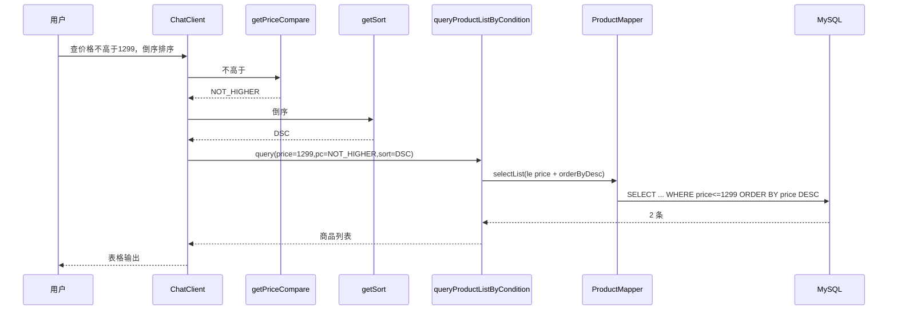

# 21. 商品条件查询与修改：枚举映射与 QueryWrapper 组装

## 纲要

- **为什么用枚举映射参数**：查询字段多（编号/名称/品牌/价格/状态/排序），若把「上架=1」写死不优雅；改为**让大模型把自然语言映射成枚举**，更规范、可扩展
- **两个枚举**：`ListSortEnum`（ASC 正序 / DSC 倒序）、`PriceCompareEnum`（大于/小于/大于等于/小于等于/高于/低于/不高于/不低于/等于 共 9 项，字符串→枚举）
- **枚举映射工具**：`getSort(sortStr)`、`getPriceCompare(pStr)`——`equalsIgnoreCase` 逐分支匹配，把「倒序」「不高于」翻译成枚举常量
- **条件查询组装**：`QueryWrapper` + `StringUtils.isNotBlank` 判空 → `eq`（编号/状态）/ `like`（名称/品牌模糊）/ 价格比对（GT/LT/GE/LE 按枚举分支）/ `orderByAsc`/`orderByDesc`（排序枚举）；最后 `selectList`
- **修改商品 MCP 工具**：`ModifyProductRequest`（全字段 + `required=false` 防默认 0 覆盖）+ `BeanUtils.copyProperties` + `setUpdateTime(now)` + `QueryWrapper.eq("product_id")` + `productMapper.update`
- **实测**：自然语言「查价格不高于 1299 的」「查鞋子和帽子」「把编号 X 改成太阳神机箱、下架」全部命中正确 SQL

> 本章代码基于课程标准工程（`com.itzixi` 包）按课程口径重构，外部代码卷暂未挂载，重挂后可切换为逐文件提取的真实代码。

## 一、枚举映射参数

### 1.1 列表排序枚举

```java
// com.itzixi.enums.ListSortEnum
public enum ListSortEnum {
    ASC("正序查询"),
    DSC("倒序查询");
    private final String value;
    ListSortEnum(String value) { this.value = value; }
    public String getValue() { return value; }
}
```

### 1.2 价格比对枚举（9 项）

```java
// com.itzixi.enums.PriceCompareEnum
public enum PriceCompareEnum {
    GREATER_THAN("大于"),
    LESS_THAN("小于"),
    GREATER_THAN_OR_EQUAL("大于等于"),
    LESS_THAN_OR_EQUAL("小于等于"),
    HIGHER("高于"),          // 语义≈大于
    LOWER("低于"),           // 语义≈小于
    NOT_HIGHER("不高于"),     // = 小于等于
    NOT_LOWER("不低于"),      // = 大于等于
    EQUAL("等于");
    private final String value;
    PriceCompareEnum(String value) { this.value = value; }
    public String getValue() { return value; }
}
```

> 老师提醒：**不要把符号写死在 description 里**（如 `status` 字段把 1/0/2 写进描述尚可，但价格 9 种比对全写死可读性差）。生产上用「枚举 + 描述」让模型映射才是优雅写法。

### 1.3 枚举映射工具（自然语言 → 枚举）

```java
@Tool(description = "把排序方式(正序/倒序)转换为对应的枚举")
public ListSortEnum getSort(String sortStr) {
    if ("ASC".equalsIgnoreCase(sortStr) || "正序".equals(sortStr)) return ListSortEnum.ASC;
    return ListSortEnum.DSC;   // 只有两项，else 兜底
}

@Tool(description = "把商品价格比较(大于/小于/大于等于/小于等于/高于/低于/不高于/不低于/等于)转换为对应枚举")
public PriceCompareEnum getPriceCompare(String pStr) {
    if ("GREATER_THAN".equalsIgnoreCase(pStr) || "大于".equals(pStr)) return PriceCompareEnum.GREATER_THAN;
    else if ("LESS_THAN".equalsIgnoreCase(pStr) || "小于".equals(pStr)) return PriceCompareEnum.LESS_THAN;
    else if ("GREATER_THAN_OR_EQUAL".equalsIgnoreCase(pStr) || "大于等于".equals(pStr)) return PriceCompareEnum.GREATER_THAN_OR_EQUAL;
    else if ("LESS_THAN_OR_EQUAL".equalsIgnoreCase(pStr) || "小于等于".equals(pStr)) return PriceCompareEnum.LESS_THAN_OR_EQUAL;
    else if ("HIGHER".equalsIgnoreCase(pStr) || "高于".equals(pStr)) return PriceCompareEnum.HIGHER;
    else if ("LOWER".equalsIgnoreCase(pStr) || "低于".equals(pStr)) return PriceCompareEnum.LOWER;
    else if ("NOT_HIGHER".equalsIgnoreCase(pStr) || "不高于".equals(pStr)) return PriceCompareEnum.NOT_HIGHER;
    else if ("NOT_LOWER".equalsIgnoreCase(pStr) || "不低于".equals(pStr)) return PriceCompareEnum.NOT_LOWER;
    else return PriceCompareEnum.EQUAL;   // 兜底等于
}
```

> 老师实测：「价格不高于两千元，请倒序排序」→ 模型先调 `getPriceCompare` 得 `NOT_HIGHER`，再调 `getSort` 得 `DSC`，最后调查询工具——**工具链自动编排**。

## 二、查询请求实体（required=false）

```java
@Data
public static class QueryProductRequest {
    @ToolParam(description = "商品编号") private String productId;
    @ToolParam(description = "商品名称") private String name;
    @ToolParam(description = "品牌")     private String brand;
    // 简介一般不作为查询条件，删
    @ToolParam(description = "具体商品价格大小") private Integer price;
    @ToolParam(description = "商品状态 1上架/0下架/2预售") private Integer status;
    @ToolParam(description = "查询列表排序方式(正序/倒序)") private ListSortEnum sort;
    @ToolParam(description = "价格比较方式") private PriceCompareEnum priceCompare;
    // ⚠️ 全部 required=false，否则模型会默认填值，导致查询被污染
}
```

> **required=false 关键点**：MCP 参数默认 `required=true`，模型会自动补值；查询场景下若给 price 默认 0，就会把「查所有」变成「查价格=0」，必须显式设 `required=false`。

## 三、条件查询组装

```java
@Transactional
@Tool(description = "根据条件查询商品信息列表")
public List<Product> queryProductListByCondition(QueryProductRequest req) {
    QueryWrapper<Product> qw = new QueryWrapper<>();

    String productId = req.getProductId();
    String name = req.getName();
    String brand = req.getBrand();
    Integer price = req.getPrice();
    Integer status = req.getStatus();
    ListSortEnum sort = req.getSort();
    PriceCompareEnum pc = req.getPriceCompare();

    // 编号：精确 eq（用数据库字段名，不是属性名）
    if (StringUtils.isNotBlank(productId)) qw.eq("product_id", productId);
    // 名称：模糊 like
    if (StringUtils.isNotBlank(name)) qw.like("name", name);
    // 品牌：模糊 like
    if (StringUtils.isNotBlank(brand)) qw.like("brand", brand);
    // 状态：数字 eq
    if (status != null) qw.eq("status", status);
    // 价格 + 比对枚举：两者都不为空才进条件
    if (price != null && pc != null) {
        String type = pc.name();   // 枚举名字符串
        if ("GREATER_THAN".equals(type) || "HIGHER".equals(type)) qw.gt("price", price);
        else if ("LESS_THAN".equals(type) || "LOWER".equals(type)) qw.lt("price", price);
        else if ("GREATER_THAN_OR_EQUAL".equals(type) || "NOT_LOWER".equals(type)) qw.ge("price", price);
        else if ("LESS_THAN_OR_EQUAL".equals(type) || "NOT_HIGHER".equals(type)) qw.le("price", price);
        else qw.eq("price", price);   // EQUAL 兜底
    }
    // 排序枚举：按价格字段排
    if (sort != null && sort == ListSortEnum.ASC) qw.orderByAsc("price");
    else if (sort != null && sort == ListSortEnum.DSC) qw.orderByDesc("price");

    return productMapper.selectList(qw);   // 返回列表
}
```

> 老师点明：价格比对分支 `GT/LT/GE/LE` 是 MyBatis-Plus 缩写，必须写对（`ge`=大于等于、`le`=小于等于），写错查不出。代码可抽成私有方法更清晰，本课为演示直接内联。

## 四、修改商品 MCP 工具

### 4.1 修改请求实体

```java
@Data
public static class ModifyProductRequest {
    @ToolParam(description = "商品编号(必填)") private String productId;
    @ToolParam(description = "商品名称") private String name;
    @ToolParam(description = "品牌") private String brand;
    @ToolParam(description = "简介") private String intro;
    @ToolParam(description = "价格") private Integer price;
    @ToolParam(description = "库存") private Integer stock;
    @ToolParam(description = "状态 1/0/2") private Integer status;
    // ⚠️ 所有字段 required=false，否则价格默认 0 会覆盖原值
}
```

### 4.2 修改实现

```java
@Transactional
@Tool(description = "根据商品ID修改商品信息")
public String modifyProduct(ModifyProductRequest req) {
    Product product = new Product();
    BeanUtils.copyProperties(req, product);   // 只拷非空字段
    product.setUpdateTime(LocalDateTime.now()); // 必设更新时间

    QueryWrapper<Product> qw = new QueryWrapper<>();
    qw.eq("product_id", req.getProductId());   // 按真实主键

    int updated = productMapper.update(product, qw);
    if (updated <= 0) return "商品信息更新失败，商品可能不存在";
    return "商品信息更新成功";
}
```

> 实测：「修改编号 X 的商品，名称改成太阳神机箱，价格 1999，库存 777，下架」→ 模型映射字段 → `update` 命中正确 `product_id`，数据库刷新即改。注意 return 类型要改 `String`。

## 五、查询/修改全链路时序图



## 六、排错 SOP

1. **查询被污染（多出无关条件）**：MCP 参数默认 `required=true`，模型自动补值；查询实体所有字段设 `required=false`。
2. **价格条件不生效**：`price` 与 `priceCompare` 必须**同时非空**才进 `gt/lt/ge/le` 分支；漏判一个则整段跳过。
3. **排序不生效**：`orderByAsc/Desc` 的字段名写 `price`（数据库列），不是 `sort` 属性；枚举判等用 `==` 而非 `equals` 也可（枚举单例）。
4. **修改把价格改成 0**：`ModifyProductRequest` 漏 `required=false`，模型给 price 默认 0 覆盖原值。
5. **枚举映射错**：`getPriceCompare` 分支是否覆盖 9 项；`NOT_HIGHER`↔`le`、`NOT_LOWER`↔`ge` 别写反。
6. **AI 生成字段名错**：自动生成的 `eq("product_id",...)` 可能写成属性名 `productId`，需人工核对列名。

## 七、FAQ

**Q1：为什么查询字段要 required=false？**
默认 `required=true` 时模型会主动补默认值（如 price=0），把「查所有」变成「查价格=0」，污染结果；查询场景一律显式 `false`。

**Q2：价格比对为什么用枚举而不是写死符号？**
9 种比对全写进 description 可读性极差；用 `PriceCompareEnum` + 映射工具，模型把「不高于」翻译成 `NOT_HIGHER`，代码语义清晰、可扩展。

**Q3：gt/lt/ge/le 分别是什么？**
`gt`=大于、`lt`=小于、`ge`=大于等于、`le`=小于等于，是 MyBatis-Plus `QueryWrapper` 的方法缩写。

**Q4：修改为什么也用 QueryWrapper 不用 updateById？**
同删除：表主键字段是 `product_id` 非 `id`，`updateById` 按 `id` 改会改错；按 `QueryWrapper.eq("product_id",id)` 才准。

**Q5：修改时怎么不覆盖原值？**
请求实体 `required=false` + `BeanUtils.copyProperties` 只拷用户给的字段；未给的字段为 null，MyBatis-Plus 更新时不会把它写进 SQL（配合 `update-strategy: not_null`）。

**Q6：工具链怎么自动编排的？**
用户一句话含「不高于」「倒序」→ 模型先调 `getPriceCompare`/`getSort` 拿枚举 → 再调查询工具传枚举 → 形成多工具链路。

## 八、面试高频问答

**1. MyBatis-Plus 条件构造器常用方法？**
`eq/ne/like/gt/lt/ge/le/orderByAsc/orderByDesc/in/between`；均配 `QueryWrapper`。

**2. 为什么查询实体参数要 required=false？**
避免模型默认补值污染查询条件；仅用户输入的字段参与组装。

**3. 枚举在 MCP 参数里的价值？**
把口语化描述（大于/不高于/倒序）映射成强类型枚举，代码分支清晰、可扩展、防魔法值。

**4. 价格比对 9 种怎么落 SQL？**
`NOT_HIGHER`→`le`、`NOT_LOWER`→`ge`、`HIGHER/LOWER`≈`gt/lt`、`EQUAL`→`eq`，按枚举名分支拼 `QueryWrapper`。

**5. 修改/删除为何绕开 *ById？**
表业务主键为 `product_id`，`updateById/deleteById` 按 ORM 主键 `id` 操作会错位；统一用 `QueryWrapper.eq("product_id",...)`。

**6. 大模型自动编排体现？**
「查不高于 X 倒序」触发 getPriceCompare→getSort→query 三次工具串联，全自然语言驱动，无需手写流程。

## 九、ops 提示（安全与网络）

> **required=false 的双刃剑**：虽防污染，但若前端/模型真的传 null，条件被跳过；关键业务（如「按编号改」）要对必填字段做非空校验，别全信模型。
>
> **枚举映射兜底**：`getPriceCompare` 末尾 `else return EQUAL` 是安全网，但模型若传未知值会被静默当等于，建议未知值直接报错而非兜底，便于发现 prompt 问题。
>
> **SQL 注入面**：`like`/`eq` 走 MyBatis-Plus 预编译参数，安全；但勿在 `orderBy` 里拼接用户原串（本课固定 `price` 列，安全）。
>
> **更新时间**：`setUpdateTime(now)` 必须每次改都设，否则「最后修改时间」失真，影响审计与缓存失效判断。
>
> **类型判断下放模型的风险**：价格单位（元/分）由模型理解，生产应在 description 明确「单位：分」或在代码内换算，避免「299 元」被当 299 分落库。

