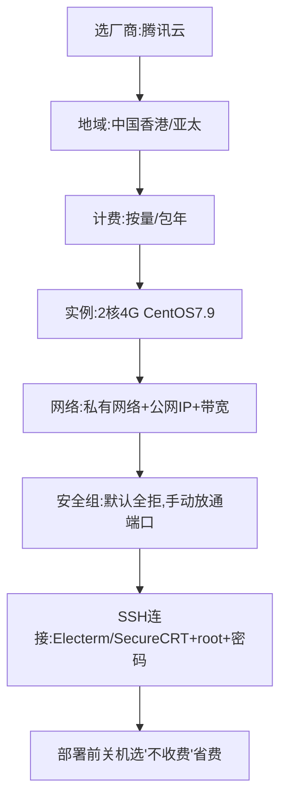

# 22. 云服务器采购、安全组配置与 SSH 连接

## 纲要

- **云厂商选择**：以腾讯云为例（控制台人性化、课程推荐）；其他厂商换汤不换药
- **地域与计费**：选**中国香港/亚太**（国内服务器用 Docker 受网络限制麻烦）；按量计费（关机释放不收费，适合短期课程演示），包年包月适合长期
- **实例配置**：2 核 4G 内存（按「单服务 ~500M × 2 服务 + MySQL/Redis/SearXNG 各 ~500M + 预留」估算）；镜像 CentOS 7.9；SSD 云盘默认
- **网络与安全组**：私有网络（=内网/局域网，同区互通走内网）；**必须勾公网 IP**；带宽按流量计费（10M 起）；安全组=防火墙，**默认全拒绝，需手动放通端口**
- **关机策略**：按量计费务必「关机不收费」（释放 CPU/内存/公网 IP，停止计费）；⚠️ 重启后**公网 IP 会重新分配**，所有本地客户端连接地址要改
- **SSH 工具**：Electerm（开源，命令行+SFTP 上传下载）+ SecureCRT（命令行）；新建连接填公网 IP、端口 22、用户 root、密码

> 本章代码基于课程标准工程（`com.itzixi` 包）按课程口径重构，外部代码卷暂未挂载，重挂后可切换为逐文件提取的真实代码。

## 一、云服务器采购

### 1.1 地域与计费选型

| 选项 | 课程选择 | 原因 |
|---|---|---|
| 地域 | 中国香港（或亚太东京/新加坡） | 国内服务器拉 Docker 镜像受网络限制麻烦；香港离大陆近、速度可接受 |
| 计费 | 按量计费（短期演示） | 关机即停止计费；包年包月适合企业长期 |
| 可用区 | 同一区（多台做集群时） | 跨区网络可能不通、无法走内网，影响服务间通信速度 |
| 实例 | 2 核 4G | 2 服务 + 3 中间件各 ~500M + 预留，4G 够用 |
| 镜像 | CentOS 7.9 | 虽 CentOS 已停止维护但稳定可用 |
| 带宽 | 按流量计费 10M | 每 GB 约 0.6 元；按小时计费更贵 |

> 老师提醒：选「自定义配置」而非快速配置，选项更多；轻量服务器功能阉割，别买。

### 1.2 网络、安全组、关机

- **私有网络**：腾讯云叫私有网络，阿里云叫专有网络，本质都是内网局域网，同网内互通。
- **公网 IP**：一定要勾选，否则无法外部访问（仅内部机可不选）。
- **安全组（=防火墙）**：默认所有端口拒绝；需手动「放通」才能被外部访问。老师把安全组改名 `springAI的安全组`。
- **关机不收费**：按量计费下选「关机不收费」释放 CPU/内存/公网 IP 停止计费；绑定的云盘等资源仍收费。「保留实例」关机也持续收费。
- **⚠️ 公网 IP 变化**：关机再开机、或重启后公网 IP 会重新分配，本地 Navicat/RDM/SSH 连接地址全部要改。

## 二、SSH 工具与连接

### 2.1 推荐工具

- **Electerm**：开源免费，支持命令行脚本 + SFTP 文件上传下载，Win/Mac 都支持（GitHub 搜 electerm 下载）。
- **SecureCRT**：命令行为主，老师个人更常用；上传下载用 Electerm 配合。

### 2.2 新建 SSH 连接

```
Hostname = 云服务器公网 IP
Port     = 22（默认 SSH 端口）
Username = root（云服务器默认）
Password = 购买时设置的密码
Firewall = None
```

> 连上后 `ifconfig` 查看 `eth0` 网卡的内网 IP，与云控制台一致即连接成功。Electerm 切到 SFTP 标签页：左侧本地目录、右侧服务器目录，可直接拖拽上传。

## 三、采购→连接全流程图



## 四、排错 SOP

1. **连不上服务器**：公网 IP 是否勾选；安全组是否放通 22；是否关机（关机 IP 会变）。
2. **重启后连接失效**：公网 IP 重新分配，更新 SSH/Navicat/RDM 地址。
3. **SFTP 传文件慢**：带宽按流量计费，调大带宽（如 10M→50M）提速，注意流量费。
4. **误买轻量服务器**：功能阉割，建议退掉换云服务器 CVM。
5. **关机仍扣费**：确认选的是「关机不收费」而非「保留实例」。

## 五、FAQ

**Q1：为什么选香港不选国内？**
国内服务器拉 Docker 镜像/访问外网受网络限制麻烦；香港离大陆近、速度可接受，且 Docker 体验顺畅。

**Q2：按量计费怎么省钱？**
不用的时段选「关机不收费」，释放资源停止计费；只保留云盘等少量费用。

**Q3：安全组是什么？**
就是云防火墙，默认拒绝所有入站；需逐端口「放通」才能被访问（如 22/5506/9379/6080/80）。

**Q4：为什么重启后本地连不上？**
公网 IP 在关机/重启后会重新分配，本地所有客户端（SSH/Navicat/RDM）的 host 要改成新 IP。

**Q5：SecureCRT 和 Electerm 怎么配合？**
命令行操作用 SecureCRT，文件上传下载用 Electerm 的 SFTP 标签页，拖拽即可。

## 六、面试高频问答

**1. 云服务器安全组作用？**
= 虚拟防火墙，控制入站/出站流量；默认拒绝，需显式放通端口，最小权限原则降低被攻击面。

**2. 按量计费与包年包月区别？**
按量按实际使用时长计费、关机可停费，适合短期/测试；包年包月预付费、单价低，适合长期稳定业务。

**3. 为什么同区部署多台？**
同可用区/私有网络内网互通、低延迟免费；跨区网络不通或无法走内网，影响服务间通信。

**4. 公网 IP 与内网 IP 用途？**
内网 IP 用于同网服务间通信（免费、快）；公网 IP 用于外部访问，会随关机/重启变化。

**5. SSH 默认端口与风险？**
默认 22；生产应改非标端口 + 密钥登录，降低暴力破解风险。

**6. CentOS 停止维护影响？**
CentOS 7 已 EOL，不再安全更新；生产建议迁移到 Rocky/Alma/Oracle Linux 或 Debian 系。

## 七、ops 提示（安全与成本）

> **密码强度**：云服务器 root 密码必须强，弱密码几小时内会被攻破中勒索病毒。
>
> **公网 IP 漂移**：按量/弹性 IP 场景下公网 IP 会变；生产建议绑定**弹性公网 IP（EIP）**固定不变，避免每次改客户端。
>
> **安全组最小开放**：仅放通必要端口，测试完及时回收（老师强调 Redis/MySQL 测试完就改回拒绝）。
>
> **关机不收费的代价**：释放 CPU/内存，再次开机数据盘保留但内存态丢失；有状态服务需重新拉起。
>
> **成本监控**：按流量计费注意带宽档位与流量费，长期跑选包年包月更省。

