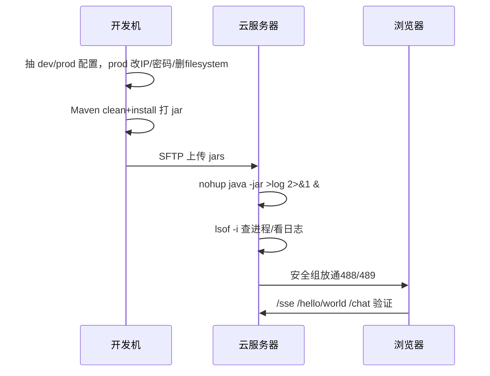

# 25. 生产参数配置与 SpringBoot3 打包发布

## 纲要

- **生产环境参数配置**：client/server 的 `application.yml` 拆分 dev/prod；prod 改**内网 IP**（同机 localhost 也行，跨机必须内网 IP）、数据库密码（云上强密码）、Redis 密码、`spring.ai.mcp.client` 的 server 地址、跨域 `web.cors` 改**公网 IP:80**；**删除 mcp filesystem 本地工具**（服务器上不开文件操作权限）；激活 `prod` 配置
- **Maven 打包**：两模块 `pom` 加 `spring-boot-maven-plugin`（含 `finalName`）→ `clean` + `install` 打可执行 jar（client 102M / server 63M）
- **上传与后台运行**：Electerm SFTP 传 jar 到 `/home/software/jars` → `nohup java -jar xxx.jar > xxx.log 2>&1 &` 后台不挂断运行 → `lsof -i:端口` 查进程
- **安全组放通 + 验证**：放通 488/489（client/server 端口）→ 浏览器测 `/sse`（488）、`/hello/world`（489）、`/chat?message=你是谁`

> 本章代码基于课程标准工程（`com.itzixi` 包）按课程口径重构，外部代码卷暂未挂载，重挂后可切换为逐文件提取的真实代码。

## 一、生产环境参数配置

### 1.1 client 模块配置

原则：把 `application.yml` 里**会变**的生产配置抽到 `application-dev.yml` / `application-prod.yml`，公共部分留在主 yml。

```yaml
# application-prod.yml（client）要点
server:
  port: 489
spring:
  ai:
    mcp:
      client:
        sse:
          connections:
            mcp-server:
              url: http://内网IP:488/sse     # 同机可 localhost；跨机必填内网IP
  datasource:                                 # 若 client 直连库，密码改云上强密码
    password: 强密码
  data:
    redis:
      host: 127.0.0.1
      password: 强密码                        # Redis 云上密码
  cors:
    allowed-origins: http://公网IP:80          # 前端经 Nginx 80 访问
internet:
  web:
    search:
      searxng:
        url: http://内网IP:6080               # 同机部署用内网IP
```

> 老师做法：主 `application.yml` 保留 `openai`（从 `.env` 读密钥，不动）、`vector-store` 等；把 server 地址、datasource 密码、redis 密码、cors 公网 IP 抽到 prod 并改值；dev 保持本地。最后把主 yml 里重复段删掉，激活 prod。

### 1.2 server 模块配置

```yaml
# application-prod.yml（server）要点
server:
  port: 488                                   # 与 client 错开，避免冲突
spring:
  datasource:
    password: 强密码                          # 云上 MySQL 强密码，用户名仍 root
    url: jdbc:mysql://127.0.0.1:5506/库名...  # 端口 5506
  ai:
    mcp:
      server:
        ...                                   # MCP server 配置保留
```

> **删除 mcp filesystem 工具**：服务器上不开本地文件操作权限，client 配置里把 filesystem MCP 工具整段删掉（它是给本地授权文件操作的，上云不安全）。

### 1.3 激活 prod

```yaml
# 主 application.yml 顶部
spring:
  profiles:
    active: prod                              # client 和 server 都改 prod
```

> 改完重启 server + client，启动无报错即配置 OK。

## 二、Maven 打包

### 2.1 加打包插件

```xml
<!-- mcp-client/pom.xml 与 mcp-server/pom.xml 最下方都加 -->
<build>
    <finalName>mcp-client</finalName>          <!-- 自定义 jar 名，可 ctrl+点击跳转项目名 -->
    <plugins>
        <plugin>
            <groupId>org.springframework.boot</groupId>
            <artifactId>spring-boot-maven-plugin</artifactId>
        </plugin>
    </plugins>
</build>
```

### 2.2 clean + install

```
Maven 面板：先 clean → 再 install（把依赖打进 jar）
# client 打出来 ~102MB，server ~63MB
# target 默认被 exclude，需在 Project Structure 里把 target 取消 exclude 才显示
```

> 老师建议：先刷新 Maven 坐标，client 先 install，server 先 clean 再 install；可多试几次确保成功。

## 三、上传与 nohup 后台运行

### 3.1 SFTP 上传

Electerm 进 SFTP → 服务器 `/home/software` 下新建 `jars` → 本地两个 jar 拖进去上传。

### 3.2 nohup 启动

```bash
cd /home/software/jars
# 先起 server
nohup java -jar mcp-server.jar > server.log 2>&1 &
# 再起 client
nohup java -jar mcp-client.jar > client.log 2>&1 &

# 查看进程
lsof -i:488      # server
lsof -i:489      # client
# 看日志
tail -f server.log
tail -f client.log
```

> **nohup 解析**：`nohup`=不挂断运行；`> xxx.log` 把标准输出重定向到日志；`2>&1` 把标准错误也并进日志；结尾 `&` 放后台，关闭终端服务不中断。

## 四、安全组放通 + 验证

云控制台安全组放通 **488 / 489**（允许）→ 浏览器：
- `http://公网IP:488/sse` → 看到 SSE 连接即 server OK
- `http://公网IP:489/hello/world` → 返回 hello 即 client OK
- `http://公网IP:489/chat?message=你是谁` → 收到大模型回复即链路通

## 五、发布流程图



## 六、排错 SOP

1. **启动报错配置不对**：prod 里 IP/密码端口错；看启动日志定位，回到 yml 改。
2. **client 连不上 server**：`mcp.client.sse.url` 是否内网 IP:488；同机用 localhost 也行。
3. **前端跨域报错**：`cors.allowed-origins` 是否填了公网 IP:80（或域名）。
4. **nohup 起不来**：jar 路径错或端口被占；`lsof -i:端口` 查占用。
5. **关终端服务停**：漏 `&` 或没用 nohup；必须用 `nohup ... &`。
6. **filesystem 工具残留**：server 上别开本地文件操作权限，prod 配置删掉该 MCP。

## 七、FAQ

**Q1：dev 和 prod 怎么分工？**
主 yml 放公共（openai 从 .env 读、vector-store）；dev/prod 放环境差异项（IP/密码/端口/cors），用 `spring.profiles.active` 切换。

**Q2：同机部署 server 地址写什么？**
同机可用 `localhost:488`；跨服务器必须写**内网 IP**（走内网免费快）。

**Q3：为什么删 mcp filesystem 工具？**
那是给本地授权文件操作的，上云开放等于给攻击面；生产不应开本地文件 MCP。

**Q4：nohup 各符号含义？**
`nohup` 不挂断；`>log` 输出重定向；`2>&1` 错误并入；`&` 后台运行。

**Q5：jar 多大正常？**
client ~102MB、server ~63MB（含依赖），`spring-boot-maven-plugin` 打可执行 fat jar。

**Q6：如何验证后端发布成功？**
安全组放通 488/489 后，浏览器测 `/sse`、`/hello/world`、`/chat?message=你是谁`。

## 八、面试高频问答

**1. SpringBoot 多环境配置怎么管理？**
`application-{profile}.yml` + 主 yml 的 `spring.profiles.active` 激活；敏感信息走环境变量/配置中心。

**2. fat jar 与 Maven 打包插件？**
`spring-boot-maven-plugin` 打可执行 jar（内嵌容器+依赖），`clean install` 产出可直接 `java -jar` 运行。

**3. nohup 与后台运行？**
`nohup cmd &` 让进程忽略挂断信号、脱离终端后台运行；输出重定向到日志便于排查。

**4. 生产配置安全要点？**
密钥/密码不进仓库（.env/配置中心）、跨机用内网 IP、关不必要 MCP 工具、安全组最小开放。

**5. 云上服务间通信为何用内网 IP？**
内网互通免费低延迟，且不暴露公网；公网通信计费且有安全风险。

**6. 如何验证容器/服务端口可达？**
安全组放通 + `lsof -i:端口` 查监听 + 浏览器/curl 探活接口。

## 九、ops 提示（安全与网络）

> **密钥不下仓库**：`.env` 的 openai key、数据库强密码走配置中心/环境变量；prod yml 不提交明文。
>
> **filesystem MCP 上云风险**：开放本地文件操作权限等于给勒索入口；生产必须删。
>
> **端口规划**：client 489 / server 488 错开；云上务必安全组放通且测完可回收。
>
> **日志重定向**：`2>&1` 保证错误也进日志，否则后台进程报错无迹可寻；定期轮转防撑爆磁盘。
>
> **优雅启停**：生产用 systemd/supervisor 托管 jar，而非裸 nohup，便于开机自启与崩溃重启。

