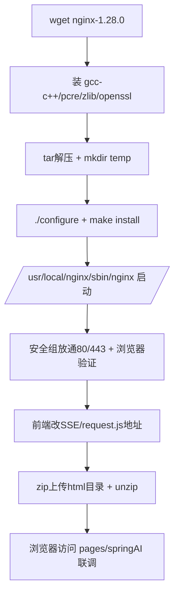

# 26. Nginx 安装与前端发布上线

## 纲要

- **Nginx 安装**：官网下 stable `nginx-1.28.0` → `wget` 直下 → 装依赖 `gcc-c++`/`pcre-devel`/`zlib`/`openssl` → `tar` 解压 → 建临时目录 → `./configure` 生成 Makefile → `make && make install`（装到 `/usr/local/nginx`）
- **验证 Nginx**：`/usr/local/nginx/sbin/nginx` 启动 → 安全组放通 **80/443** → 浏览器访问见「Welcome to nginx」成功
- **前端发布**：改前端联调地址（SSE 连接 + `request.js` 的 IP 与端口 489，内网/公网 IP 均可）→ 源码压缩 zip 上传到 `/usr/local/nginx/html` → `unzip` 解压 → 浏览器 `公网IP/pages/springAI` 访问
- **全栈联调实测**：问「你是谁」正常输出 → 「查询所有商品」MCP 查库正常 → 「发我邮箱」邮件收到，发布成功
- **运维现实**：此章偏运维，企业里由运维做；开发了解即可，跳过也不影响后续集成自有工具

> 本章代码基于课程标准工程（`com.itzixi` 包）按课程口径重构，外部代码卷暂未挂载，重挂后可切换为逐文件提取的真实代码。

## 一、Nginx 安装

### 1.1 下载 + 依赖

```bash
cd /home/software
# 复制官网 stable 版链接后：
wget https://nginx.org/download/nginx-1.28.0.tar.gz

# 装编译依赖
yum install -y gcc-c++          # C++ 编译
yum install -y pcre-devel       # 正则解析
yum install -y zlib             # 压缩/解压
yum install -y openssl          # HTTPS（无 HTTPS 也可不装）
```

### 1.2 解压 + 编译安装

```bash
tar -zxvf nginx-1.28.0.tar.gz
cd nginx-1.28.0
mkdir -p /usr/local/nginx/temp   # ⚠️ 不建临时目录启动可能报错

./configure --prefix=/usr/local/nginx \
  --with-http_ssl_module          # 按需开启 SSL
make && make install

cd /usr/local/nginx && ls         # conf 配置 / html 页面 / sbin 可执行
```

### 1.3 启动 + 安全组 + 验证

```bash
/usr/local/nginx/sbin/nginx      # 启动
# 安全组放通 80（443 为 HTTPS）
# 浏览器访问 http://公网IP → 见 Welcome to nginx 即成功
```

> Nginx 默认端口 80（443=HTTPS/SSL）。老师建议先把不用的端口在安全组关掉防攻击，再单独放通 80。

## 二、前端发布

### 2.1 改前端联调地址

前端源码两处要改（指向云上 client）：
1. **SSE 连接创建处**：把地址改成 `服务器IP:489`（课程 client 端口 489；IP 内网/公网均可）。
2. **`request.js`**：注释本地行，启用下面一行改成 `公网IP:489`。

```js
// request.js 示例
// const BASE = 'http://localhost:489';      // 注释掉
const BASE = 'http://公网IP:489';           // 启用，改云上地址
```

### 2.2 上传 + 解压到 html 目录

```
1. 前端源码整目录压缩成 zip（如 abc.zip）
2. Electerm SFTP：上传到 /usr/local/nginx/html
3. 服务器：unzip abc.zip → 释放出 pages/springAI 等
```

> Nginx 配置 `location /` 的 `root` 指向 `html` 目录；把前端文件放进去即发布。访问路径 = `html` 下相对结构，如 `公网IP/pages/springAI`。

### 2.3 浏览器访问 + 全栈联调

```
访问 http://公网IP/pages/springAI
- F12 无报错
- 问「你是谁」→ 正常输出
- 「查询所有商品」→ MCP 查库正常显示
- 「把回复发我邮箱」→ 邮箱收到商品列表（邮件 MCP 链路通）
```

## 三、前端发布流程图



## 四、排错 SOP

1. **`./configure` 失败**：依赖没装全（gcc-c++/pcre-devel/zlib）；补齐重来。
2. **nginx 启动报错**：多半缺临时目录，建 `/usr/local/nginx/temp` 再起。
3. **访问空白/404**：前端文件没放对 `html` 目录；确认 `pages/springAI` 相对路径。
4. **前端连不上后端**：`request.js`/`SSE` 地址没改成云上 IP:489；或安全组未放通 489。
5. **Welcome 页但前端无样式**：zip 解压层级错（多套一层目录）；核对 `html` 下结构。
6. **F12 跨域报错**：后端 `cors.allowed-origins` 未含 `http://公网IP:80`；回去改 prod 配置。

## 五、FAQ

**Q1：为什么用 stable 不用最新 mainline？**
stable 版更稳定适合生产；mainline 新特性多但变动快，课程选 stable 1.28.0。

**Q2：四个依赖各自干嘛？**
gcc-c++ 编译、pcre-devel 正则、zlib 压缩、openssl 支持 HTTPS。

**Q3：前端改哪几个地址？**
SSE 连接创建处 + `request.js` 的 BASE，都指向云上 client 的 IP:489。

**Q4：前端文件放哪？**
`/usr/local/nginx/html` 目录（Nginx `root` 默认指向它）；放对相对路径即可访问。

**Q5：访问路径怎么拼？**
`http://公网IP/` + html 下相对路径，如 `pages/springAI` → `http://公网IP/pages/springAI`。

**Q6：这章必须做吗？**
偏运维，企业由运维负责；开发了解即可，跳过不影响后续集成自有 MCP 工具。

## 六、面试高频问答

**1. Nginx 编译安装步骤？**
`wget` 源码 → 装 gcc/pcre/zlib/openssl → `tar` 解压 → `./configure --prefix` → `make && make install`。

**2. Nginx 默认端口与用途？**
80（HTTP）、443（HTTPS/SSL）；生产前端/反向代理常用。

**3. 前端静态资源如何发布到 Nginx？**
放到 `html` 目录（`root` 指向），`location /` 映射，访问即 `IP/相对路径`。

**4. 前后端分离跨域怎么处理？**
后端配 CORS（`allowed-origins` 含前端域名/IP:端口），或 Nginx 反向代理同源规避。

**5. Nginx 临时目录为何要建？**
部分版本启动需 temp 目录，缺则报错；提前 `mkdir` 避免。

**6. 静态资源 404 常见原因？**
文件路径不在 `root` 下、解压多套目录层级、URL 相对路径拼错。

## 七、ops 提示（安全与网络）

> **Nginx 暴露面**：80/443 放通即公网可达，注意只放通必要端口，测试完可回收非必要端口。
>
> **前端地址硬编码**：IP 写死在前端，重启公网 IP 变就失效；生产用域名 + DNS，避免改代码。
>
> **HTTPS**：openssl 已装可配 443 + 证书；生产前端应走 HTTPS，防中间人。
>
> **静态资源缓存**：Nginx 对 html/js/css 设缓存策略，但 index.html 建议不缓存避免发布不生效。
>
> **权限**：nginx 进程建议非 root 运行；前端文件目录权限收敛，防目录遍历。

