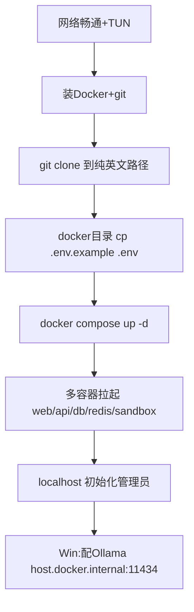

# 28. Dify 私有化部署（MacOS / Windows）

## 纲要

- **Dify 是什么**：开源生成式 AI 应用开发框架（GitHub 83.9k★），可建聊天助手 / 工作流 / Agent / 知识库（RAG）/ 提示词工程，企业级可观测推理
- **部署前置**：① 网络畅通（能访问外网，必要时开 TUN 全局模式）② 装 **Docker**（Desktop）③ 装 **git**；硬件 CPU≥2核、内存≥4G
- **安装步骤（通用）**：`git clone` 仓库（路径**纯英文无空格无中文**）→ 进 `docker` 目录 → 复制 `.env.example` 为 `.env`（隐藏文件）→ `docker compose up -d`（v2 用 `docker compose`，老版 v1 用 `docker-compose`）→ 等待多容器拉起（web/API/db/redis/sandbox 等，流量大）
- **访问与初始化**：浏览器开 `localhost`（或内网 IP）→ 设置管理员邮箱/用户名/密码 → 空白工作台
- **Windows 特例**：配模型供应商选 **Ollama 本地 DeepSeek**，base URL 填 `http://host.docker.internal:11434`（容器取宿主机 IP，不能写 localhost）→ 创建聊天助手实测「你是谁」「糖醋排骨」
- **老师偏好**：本地私有部署优于云上（安全 + 未来让智能体操作本机更灵活）

> 本章代码基于课程标准工程（`com.itzixi` 包）按课程口径重构，外部代码卷暂未挂载，重挂后可切换为逐文件提取的真实代码。

## 一、Dify 简介

Dify = 开源生成式 AI 应用开发平台，核心能力：
- **聊天助手 / 工作流 / Agent**：低代码编排，输出稳定可控
- **知识库（RAG）**：本地文档嵌入、网页爬取嵌入
- **提示词工程**：不会写可由 Dify 辅助生成
- **企业级**：推理过程日志可观测；基于后端服务的 API 设计
- 老师提到在写 Dify 相关书籍，社区活跃、版本迭代快

## 二、部署前置条件

| 前提 | 说明 |
|---|---|
| 网络畅通 | 能自由访问外网；普通代理不通时开 **TUN 全局模式**（老师 git clone 报错即因网络，开 TUN 后成功） |
| Docker | 本地/云都可；Windows 用 Docker Desktop，注意 WSL2 启用 |
| git | 克隆源码；`git -v` 验证 |
| 硬件 | CPU≥2 核、内存≥4G（绝大多数机器满足） |
| 系统 | macOS ≥10.14；Windows + Docker Desktop |

## 三、安装步骤（MacOS / Windows 通用）

```bash
# 1. 选纯英文路径（无中文/空格/特殊字符），如 ~/AI 或 E:\AI
cd ~/AI

# 2. 克隆（网络不通开 TUN；--branch 可选老版本）
git clone https://github.com/langgenius/dify.git

# 3. 进 docker 目录
cd dify/docker

# 4. 复制环境模板为 .env（隐藏文件）
cp .env.example .env

# 5. 启动（v2 用 docker compose；v1 用 docker-compose up -d）
docker compose up -d
# 等待：web / api / db / redis / sandbox / worker 等多容器拉取部署（流量数百 MB~GB）
```

> 老师实测一月耗流量 200+GB（频繁更新部署），注意流量成本。

### 验证

```bash
docker compose ps        # 看容器列表（created + started 即为成功）
# 或 Docker Desktop 看容器
```

### 访问与初始化

浏览器开 `http://localhost`（或 macOS 内网 IP 如 `10.0.x.x`）→ 设置管理员邮箱/用户名/密码 → 进入空白工作台。

## 四、Windows 配置模型

1. 设置 → 语言改**简体中文**。
2. 模型供应商 → **Ollama**（本地已部署 DeepSeek）→ 添加模型，名称如 `deepseek-r1:32b`（LLM 类型）。
3. **base URL 关键坑**：容器内的 `localhost` 是容器自己，不是宿主机；必须填 `http://host.docker.internal:11434`（Docker 内部取宿主机 IP）+ Ollama 端口 11434。
4. 创建聊天助手 → 空白应用 → 选 DeepSeek → 发布 → 预览：`你是谁` / `糖醋排骨怎么做`（推理模型展示 thinking 过程）。

## 五、部署流程图



## 六、排错 SOP

1. **git clone 连不上**：网络问题；普通代理不通开 TUN 全局模式。
2. **`.env` 找不到**：它是隐藏文件；macOS 开显示隐藏，Windows 直接重命名 `cp` 即可。
3. **`docker compose` 命令不存在**：v1 用 `docker-compose`；v2 用 `docker compose`，按版本选。
4. **容器起不来**：Docker Desktop 未运行；Windows 确认 WSL2 启用；端口/资源不足。
5. **Ollama 模型调不通**：base URL 写成 `localhost` 错，必须是 `host.docker.internal:11434`。
6. **访问空白/404**：服务未完全起；`docker compose ps` 确认 web 容器 started 后再访问。

## 七、FAQ

**Q1：为什么本地部署优于云上？**
安全（数据不出本机）+ 未来让智能体操作本机更灵活；云上要考虑安全防护。

**Q2：路径为什么必须纯英文？**
含中文/空格/特殊字符会导致 docker/脚本解析失败，老师特别强调。

**Q3：docker compose 版本差异？**
新版 v2 用 `docker compose up -d`；老版 v1 用 `docker-compose up -d`，按装的版本选。

**Q4：host.docker.internal 是什么？**
Docker 内置 DNS，容器内用它访问宿主机（本机）服务；写 localhost 只会指向容器自己。

**Q5：部署耗流量大吗？**
大，多容器镜像 + 频繁更新，老师一月耗 200+GB，注意成本。

**Q6：Dify 能做什么？**
聊天助手、工作流、Agent、知识库 RAG、提示词工程，低代码编排 AI 应用。

## 八、面试高频问答

**1. Dify 部署核心步骤？**
网络+Docket+git 前置 → `git clone`（纯英文路径）→ `cp .env.example .env` → `docker compose up -d` → 初始化管理员。

**2. 容器访问宿主机服务如何配置？**
用 `host.docker.internal`（Mac/Win）指向宿主机，不能写 `localhost`（指容器自身）。

**3. RAG 在 Dify 中如何体现？**
知识库模块：本地文档/网页嵌入向量库，聊天时检索增强，低代码构建。

**4. 工作流与 Agent 区别？**
工作流=可视化编排节点、输出稳定可控；Agent=自主调用工具完成复杂任务（可嵌工作流）。

**5. docker compose up -d 的 -d 含义？**
后台（detached）运行容器，不占用当前终端。

**6. 私有化部署的安全价值？**
数据本地化、不外流，适合企业敏感场景；结合内网隔离降低泄露风险。

## 九、ops 提示（安全与网络）

> **管理账号**：初始化设强密码管理员邮箱，别用弱口令；Dify 暴露公网需反向代理 + 鉴权。
>
> **流量成本**：compose 拉取多镜像耗流量大，按量计费/限流环境注意；可用私有 registry 缓存镜像。
>
> **host.docker.internal 暴露**：仅内网解析，云上跨主机不适用，需改真实宿主机 IP 或 service 名。
>
> **数据持久化**：Dify 的 db/redis 数据卷别误删；定期备份向量库与业务数据。
>
> **版本分支**：课程 Win 用老版本（自带模型插件），必要时 `--branch` 选版；生产锁版本避免意外升级。

## 十、Dify 容器组成与 .env 关键配置（进阶）

`docker compose up -d` 实际拉起下列服务（来自官方 `docker-compose.yml`）：

| 服务 | 作用 |
| --- | --- |
| `api` / `worker` | 后端 API 与异步任务（worker 负责文档解析、向量索引） |
| `web` | 前端（默认由 nginx 暴露） |
| `db`（postgres） | 业务数据库，数据卷持久化 |
| `redis` | 缓存 / 任务队列 |
| `weaviate`（或 milvus/qdrant） | 向量库，承载 RAG 嵌入 |
| `nginx` | 反向代理，对外 80/443 |
| `sandbox` | 代码执行沙箱，安全隔离 LLM 生成的代码 |

关键 `.env` 配置项（按需修改）：

```bash
# 对外暴露端口（默认 80，冲突改这里）
EXPOSE_NGINX_PORT=80
EXPOSE_DOMAIN=localhost

# 向量库选型：weaviate / milvus / qdrant / pgvector ...
VECTOR_STORE=weaviate

# 首次启动自动迁移数据库
DB_AUTO_MIGRATE=true

# 文件上传大小上限（知识库文档）
UPLOAD_FILE_SIZE_LIMIT=15
```

> 生产对接：把 `EXPOSE_NGINX_PORT` 改为业务端口，前面再挂 HTTPS 反代 + 鉴权；向量库与 postgres 的 volume 务必持久化并定期备份，容器删了数据不丢。

