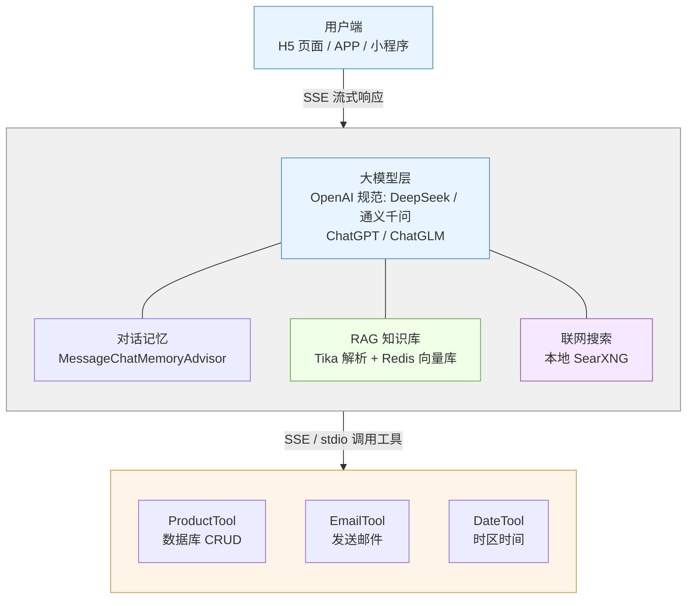
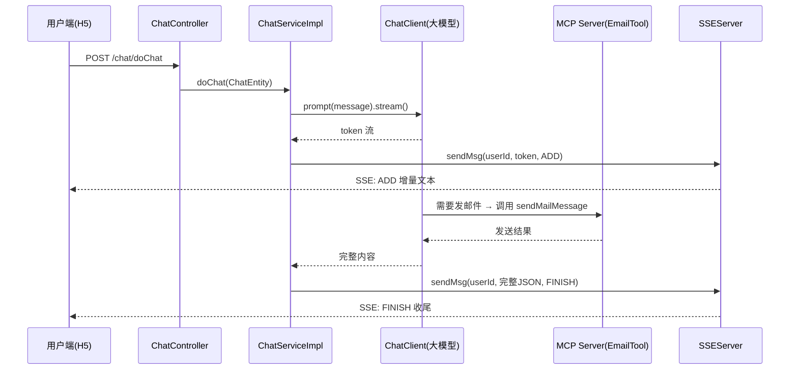
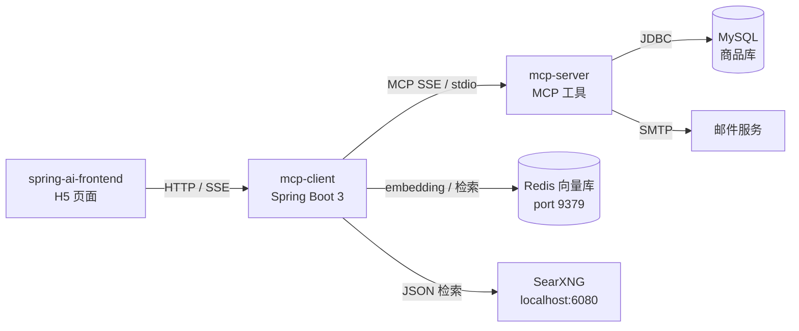

# 2. 初识 SpringAI：项目功能与架构全解析

## 纲要

- **项目定位**：用 SpringAI 1.0.0 GA 把「大模型聊天 + RAG 本地知识库 + 联网搜索 + MCP 工具调用」四大能力揉进一个可运行项目，而不是只讲 API 调通
- **三大能力主线**：RAG 知识库（私有文档不出本地）、SearXNG 联网搜索（本地部署保隐私）、MCP（让大模型直接操作数据库 / 发邮件 / 查日期）
- **先见效果再讲原理**：聊天问答、联网搜索、带记忆的邮件发送、知识库检索、自然语言查库，五个演示把抽象概念落到可见界面
- **架构全景**：H5 用户端经 SSE 流式通道打到 MCP Client，Client 内聚合大模型 / 对话记忆 / RAG / 联网搜索，右侧挂 MCP Server 提供工具
- **核心编排类**：`ChatServiceImpl` 是大脑——用 `ChatClient.Builder` 注入 `defaultToolCallbacks` 与 `MessageChatMemoryAdvisor`，`doChat / doChatRagSearch / doInternetSearch` 三个方法串起全部能力
- **版本选型坑**：SpringAI 里程碑版（0.8.x 等）与 1.0.0 正式版依赖坐标、包名差异巨大，本课程以 GA 为准，避免复制老博客代码踩坑
- **代码即真相**：pom 依赖、Application 启动类、application.yml、MCP 工具注册、ProductTool / EmailTool / DateTool、ChatServiceImpl / DocumentServiceImpl / SSEServer / SearXNG 服务全部来自课程真实工程，可直接对照

## 一、项目到底解决什么问题

很多「SpringAI 入门」教程只教你怎么写一段 `ChatClient.call("你好")` 把字打出来，但离一个**能用的产品**还差三块拼图：

1. **知识库**：大模型本身不知道你公司的员工手册、产品文档，硬问就瞎编（幻觉）。
2. **联网搜索**：大模型训练数据有截止日期，问它「今天的热点 / 某个具体人物」它答不上来。
3. **工具调用（MCP）**：大模型只会说，不会「做」——查数据库、发邮件、调内部系统这些动作它干不了。

这门课的项目把这四块**全链路融合**进同一个应用：用户在前端说话 → 后端决定是走知识库、走联网搜索、还是调用 MCP 工具 → 把结果喂回大模型 → 流式返回给用户。下面先看跑起来的效果，再回头拆架构与代码。

## 二、先见效果：项目能做什么（功能演示）

课程用同一个聊天界面演示了五类能力，建议先建立「它能干嘛」的直觉，后面看代码才不会迷路。

### 1. 基础聊天（大模型识别意图）

前端输入框问「你是谁？」，等几秒模型就回：「我是一个智能搜索助手，可以解答问题、提供信息、完成任务」。这一步只是最基础的对话，但模型已经「知道自己是干嘛的」——说明系统提示词（system prompt）里给它定了角色（代码里这个角色名叫 `LaGoGo`，见第六节）。

### 2. 联网搜索（SearXNG）

问「某位具体人物是谁？」如果不开联网搜索，模型大概率说「这可能是个虚构的角色名」。打开联网搜索开关再问，请求会经过本地的 SearXNG 搜索引擎，把检索结果汇总给大模型，再由模型组织成答案流式输出。信息量越大，输出越慢——这是真实可感知的延迟，不是 bug。

> **隐私点**：课程强调联网搜索也是**本地部署**的开源引擎 SearXNG，而不是把用户 query 发给某个商业搜索 API。对政府 / 医院 / 学校这类敏感场景，本地化是硬要求。

### 3. 发邮件（MCP 工具 + 对话记忆）

关掉联网搜索，再说「把刚才的回答发到我的邮箱」。这里同时用到了两个能力：

- **MCP 工具 `sendMailMessage`**：真正去发邮件的动作由工具执行；
- **对话记忆（Chat Memory）**：如果模型没有记忆，它根本不知道「刚才的回答」是什么。记忆让多轮对话有了上下文。

邮件发出后主题由模型自动生成（例如「关于 XX 的专业介绍，请注意查收」），证明模型理解了上文内容并做了归纳。

### 4. 知识库检索（RAG）

上传一份文档，系统把它切块、向量化、存入本地向量库。问「员工入职需要注意什么？」模型从知识库召回相关片段再作答；如果知识库里没有，就老实回「不知道」。**不胡编**是 RAG 对比纯大模型最值钱的特性。

### 5. 自然语言查数据库（MCP 工具）

用自然语言说「查询所有商品信息」「请以列表形式展示」，大模型把这句话翻译成对数据库的条件查询并返回结果（课程里是一个商品列表 JSON）。后面讲模型如何把「按品牌、价格、状态、库存过滤」之类的条件映射成 SQL / `QueryWrapper`。

> **一句话记住**：聊天是入口，RAG + 联网搜索解决「知道什么」，MCP 解决「能做什么」，三者由同一个大模型统一编排。

## 三、项目全景架构：从 H5 到 MCP Server

把上面的演示翻译成一张架构图，核心是一条**相对关系**链条：大模型对用户端是「服务端」，对 MCP Server 又是「客户端」。



几个容易混淆的点，课程里专门点了出来：

- **用户端 ↔ 后端用 SSE（Server-Sent Events）**：服务端主动、流式地把 token 推给前端，体验上就是「字一个个蹦出来」。SSE 是单向流（服务端→客户端），比 WebSocket 更轻，正好适配大模型生成场景。
- **MCP Client 里集成的是「符合 OpenAI 规范」的大模型**：DeepSeek、通义千问、ChatGPT、ChatGLM 都能无缝接入，换模型只改配置不改动代码。
- **大模型既是服务端又是客户端**：对用户端它是服务端，对 MCP Server 它是客户端去「调用工具」。理解这种相对性，才不会被 MCP 的角色命名绕晕。

## 四、核心数据流：一次「带工具调用」的对话发生了什么

以「把刚才的回答发到我的邮箱」为例，请求在体内是这样流转的（注意 SSE 把过程切成 `ADD` 增量和 `FINISH` 收尾两类事件）：



关键点：大模型在生成过程中**自主决定**调用 `EmailTool`，工具执行结果回流后模型再组织语言；前端全程靠 SSE 的 `ADD / FINISH` 两种事件拼出完整对话。

## 五、技术栈与 SpringAI 版本选型（最容易踩的坑）

课程明确以 **SpringAI 1.0.0 正式版（GA）** 为准，并强调：里程碑版（如 0.8.x）到 1.0.0 之间，**依赖包名、API 坐标都变了**，网上很多老博客代码直接抄会编译不过。

看 `mcp-client/pom.xml` 里的真实依赖，能验证这一点：

```xml
<dependencyManagement>
    <dependencies>
        <dependency>
            <groupId>org.springframework.ai</groupId>
            <artifactId>spring-ai-bom</artifactId>
            <version>1.0.0</version>            <!-- GA 正式版 -->
            <type>pom</type>
            <scope>import</scope>
        </dependency>
    </dependencies>
</dependencyManagement>

<dependencies>
    <!-- Web 框架：Spring Boot 3 -->
    <dependency>
        <groupId>org.springframework.boot</groupId>
        <artifactId>spring-boot-starter-web</artifactId>
    </dependency>

    <!-- 大模型：OpenAI 规范接入（DeepSeek/通义千问/ChatGPT 等均兼容） -->
    <dependency>
        <groupId>org.springframework.ai</groupId>
        <artifactId>spring-ai-starter-model-openai</artifactId>
    </dependency>

    <!-- RAG 向量库：Redis -->
    <dependency>
        <groupId>org.springframework.ai</groupId>
        <artifactId>spring-ai-starter-vector-store-redis</artifactId>
    </dependency>

    <!-- 本地向量化：Transformers 加载 ONNX 模型（model.onnx） -->
    <dependency>
        <groupId>org.springframework.ai</groupId>
        <artifactId>spring-ai-starter-model-transformers</artifactId>
    </dependency>

    <!-- MCP 客户端 -->
    <dependency>
        <groupId>org.springframework.ai</groupId>
        <artifactId>spring-ai-starter-mcp-client</artifactId>
    </dependency>
    <dependency>
        <groupId>org.springframework.ai</groupId>
        <artifactId>spring-ai-mcp</artifactId>
    </dependency>

    <!-- 文档解析：Tika 支持 pdf/docx 等上传 -->
    <dependency>
        <groupId>org.springframework.ai</groupId>
        <artifactId>spring-ai-tika-document-reader</artifactId>
    </dependency>

    <!-- 对话记忆 advisor -->
    <dependency>
        <groupId>org.springframework.ai</groupId>
        <artifactId>spring-ai-advisors-vector-store</artifactId>
    </dependency>
</dependencies>
```

几点解读：

- **`spring-ai-bom:1.0.0` 统一管理所有 `org.springframework.ai` 依赖版本**，子模块不用再写版本号，避免版本错配。
- **`spring-ai-starter-model-transformers` + `model.onnx`**：知识库做 embedding 时用的是**本地 Transformers 模型**（那个 90MB 的 `model.onnx` 不是废文件，而是离线向量化模型），好处是 embedding 不出本地、不调云端、省 token 且保隐私。
- **`spring-ai-starter-vector-store-redis`**：向量存进 Redis，需要本地跑一个 Redis（课程里端口是 `9379`，非默认 `6379`，勿混淆）。
- **JDK 要求**：`pom.xml` 里 `maven.compiler.source/target` 是 **21**，务必用 JDK 21 编译运行。

> **Ops 审计（依赖加速）**：在国内拉取 `spring-ai-bom` 及大量依赖时，官方 Maven Central 常常超时。建议在 `settings.xml` 里配置 **Aliyun 镜像**（`mirrors.aliyun.com/repository/public`），把 `central` 与 `spring` 等仓都代理过去，可显著缩短首次构建时间。注意不要把镜像配置写死进提交到仓库的 `pom.xml`，保持仓库中立。

## 六、代码落地：关键模块拆解

### 6.1 启动类：用 .env 注入密钥，绝不硬编码

`Application.java` 在 `main` 里先加载 `.env`，把变量塞进系统属性再启动 Spring：

```java
@SpringBootApplication
public class Application {

    public static void main(String[] args) {
        // 加载 .env 文件（缺失也不报错）
        Dotenv dotenv = Dotenv.configure().ignoreIfMissing().load();
        // 把 .env 里的变量设置到环境变量中
        dotenv.entries().forEach(entry -> System.setProperty(entry.getKey(), entry.getValue()));

        SpringApplication.run(Application.class, args);
    }
}
```

> **Ops 审计（高危）**：API Key、Redis 密码等敏感信息**必须走 `.env` 或环境变量**，且 `.env` 要加入 `.gitignore` 永不提交。

### 6.2 application.yml：大模型 / MCP / Redis / SearXNG 四块配置

```yaml
spring:
  application:
    name: spring-ai-mcp-client
  profiles:
    active: dev
  ai:
    mcp:
      client:
        enabled: true
        name: spring-ai-mcp-client
        type: ASYNC
        sse:
          connections:
            server1:
              url: https://mcp.amap.com          # 高德 MCP（地图类工具）
              sse-endpoint: /sse?key=YOUR_AMAP_KEY   # ⚠️ 已脱敏，真实 key 放 .env
            server2:
              url: http://localhost:9060
              sse-endpoint: /sse
        stdio:
          servers-configuration: classpath:mcp-server.json
    openai:
      api-key: ${OPENAI_API_KEY}
      base-url: ${OPENAI_BASE_URL}
      chat:
        options:
          model: ${OPENAI_MODEL}
    vectorstore:
      redis:
        initialize-schema: true
        index-name: lee-vectorstore
        prefix: 'embedding:'
  data:
    redis:
      host: 127.0.0.1
      port: 9379
      password: 123456            # ⚠️ 演示用弱密码，生产请改强密码并外置

logging:
  level:
    root: info

internet:
  websearch:
    searxng:
      url: http://localhost:6080/search   # 本地 SearXNG
      counts: 10
```

> **Ops 审计（高危）**：上面两处 `⚠️` 都是真实工程里的敏感点——① 高德 MCP 的 `key` 在原始配置中是明文，**博客/仓库里必须脱敏成 `YOUR_AMAP_KEY`**；② Redis `password: 123456` 是演示弱口令，生产环境务必改成强密码并通过环境变量注入，否则一旦暴露就是数据泄露。

### 6.3 MCP Server 启动与 @Tool 注册

`mcp-server` 的 `Application.java` 通过 `MethodToolCallbackProvider` 把 `DateTool / EmailTool / ProductTool` 三个 Bean 注册成 MCP 工具集：

```java
@MapperScan("com.itzixi.mapper")
@SpringBootApplication
public class Application {

    public static void main(String[] args) {
        SpringApplication.run(Application.class, args);
    }

    /**
     * 注册 MCP 工具
     */
    @Bean
    public ToolCallbackProvider registMCPTools(DateTool dateTool, EmailTool emailTool, ProductTool productTool) {
        return MethodToolCallbackProvider.builder()
                .toolObjects(dateTool, emailTool, productTool)
                .build();
    }
}
```

`@Tool` + `@ToolParam` 是 SpringAI 把「普通 Java 方法」暴露给大模型的关键注解：**方法的 Javadoc / `@Tool(description=...)` 就是给大模型的「工具说明书」**，模型据此决定什么时候调用、填什么参数。`mcp-server/pom.xml` 里对应的起步依赖是 `spring-ai-starter-mcp-server-webflux`（基于 WebFlux 的 SSE 型 MCP Server），外加 `mysql-connector-j`、`mybatis-plus-boot-starter`、`spring-boot-starter-mail`、用于 markdown→html 的 `flexmark-all`。

### 6.4 ProductTool：自然语言查库的落地（演示 5）

商品增删改查全部用 `@Tool` 标注，大模型自然语言进来后被映射到 `QueryWrapper` 条件：

```java
@Component
@Slf4j
public class ProductTool {

    @Resource
    private ProductMapper productMapper;

    @Data
    @ToString
    @NoArgsConstructor
    @AllArgsConstructor
    public static class QueryProductRequest {
        @ToolParam(description = "商品的编号", required = false) private String productId;
        @ToolParam(description = "商品的名称", required = false) private String productName;
        @ToolParam(description = "商品的品牌", required = false) private String brand;
        @ToolParam(description = "具体商品价格大小", required = false) private Integer price;
        @ToolParam(description = "商品的状态（1上架/0下架/2预售）", required = false) private Integer status;
        @ToolParam(description = "查询列表的排序", required = false) private ListSortEnum sortEnum;
        @ToolParam(description = "比较价格的大小", required = false) private PriceCompareEnum priceCompareEnum;
    }

    @Tool(description = "根据条件查询商品（product）信息")
    public List<Product> queryProductListByCondition(QueryProductRequest req) {
        QueryWrapper<Product> qw = new QueryWrapper<>();
        if (StringUtils.isNotBlank(req.getProductId()))   qw.eq("product_id", req.getProductId());
        if (StringUtils.isNotBlank(req.getProductName()))  qw.like("product_name", req.getProductName());
        if (StringUtils.isNotBlank(req.getBrand()))        qw.like("brand", req.getBrand());
        if (req.getStatus() != null)                       qw.eq("status", req.getStatus());
        // 价格比较枚举 → gt/lt/ge/le ...
        if (req.getPrice() != null && req.getPriceCompareEnum() != null) {
            PriceCompareEnum e = req.getPriceCompareEnum();
            if (e.type.equals(PriceCompareEnum.GREATER_THAN.type))       qw.gt("price", req.getPrice());
            else if (e.type.equals(PriceCompareEnum.LESS_THAN.type))     qw.lt("price", req.getPrice());
            else if (e.type.equals(PriceCompareEnum.EQUAL_TO.type))      qw.eq("price", req.getPrice());
            // ... 其余比较分支省略
        }
        if (req.getSortEnum() != null && req.getSortEnum().type.equals(ListSortEnum.DESC.type))
            qw.orderByDesc("price");
        return productMapper.selectList(qw);
    }
}
```

关键点：**`@ToolParam(description=...)` 写清楚每个字段含义和枚举取值**，模型才能准确填参；价格比较、排序都被抽象成枚举（`PriceCompareEnum` / `ListSortEnum`），避免模型自由发挥写出非法 SQL。这正是「自然语言 → 安全查询」的工程化做法。

### 6.5 EmailTool：带 markdown→html 的邮件发送（演示 3）

```java
@Component
@Slf4j
public class EmailTool {

    private final JavaMailSender mailSender;
    private final String from;

    @Autowired
    public EmailTool(JavaMailSender mailSender, @Value("${spring.mail.username}") String from) {
        this.mailSender = mailSender;
        this.from = from;
    }

    @Data
    @ToString
    @NoArgsConstructor
    @AllArgsConstructor
    public static class EmailRequest {
        @ToolParam(description = "收件人邮箱") private String email;
        @ToolParam(description = "发送邮件的标题/主题") private String subject;
        @ToolParam(description = "发送邮件的消息/正文内容") private String message;
        @ToolParam(description = "内容格式：markdown=1；html=2") private Integer contentType;
    }

    @Tool(description = "给指定邮箱发送邮件信息")
    public void sendMailMessage(EmailRequest emailRequest) {
        try {
            MimeMessage mimeMessage = mailSender.createMimeMessage();
            MimeMessageHelper helper = new MimeMessageHelper(mimeMessage);
            helper.setFrom(from);
            helper.setTo(emailRequest.getEmail());
            helper.setSubject(emailRequest.getSubject());
            if (emailRequest.getContentType() == 1)
                helper.setText(convertToHtml(emailRequest.getMessage()), true); // md→html
            else
                helper.setText(emailRequest.getMessage(), true);
            mailSender.send(mimeMessage);
        } catch (MessagingException e) {
            log.error("========== 发送邮件失败：{} ==========", e.getMessage());
        }
    }

    public static String convertToHtml(String md) {
        MutableDataSet dataSet = new MutableDataSet();
        return HtmlRenderer.builder(dataSet).build().render(Parser.builder(dataSet).build().parse(md));
    }
}
```

> 原始工程里 `getMyEmailAddress()` 返回了一个写死的邮箱地址，这里已**替换为 `your-email@example.com` 占位**，提醒你发件人地址要从配置（`${spring.mail.username}`）读取，不要硬编码真实邮箱。

### 6.6 DateTool：时区时间工具

```java
@Component
@Slf4j
public class DateTool {

    @Tool(description = "根据城市所在的时区id来获得当前的时间")
    public String getCurrentTimeByZoneId(String cityName, String zoneId) {
        ZoneId zone = ZoneId.of(zoneId);
        ZonedDateTime zonedDateTime = ZonedDateTime.now(zone);
        return String.format("当前的时间是 %s",
                zonedDateTime.format(DateTimeFormatter.ofPattern("yyyy-MM-dd HH:mm:ss")));
    }

    @Tool(description = "获得当前时间")
    public String getCurrentTime() {
        return String.format("当前的时间是 %s",
                LocalDateTime.now().format(DateTimeFormatter.ofPattern("yyyy-MM-dd HH:mm:ss")));
    }
}
```

三个工具（`ProductTool / EmailTool / DateTool`）组合后，大模型就能用自然语言完成「查商品、发邮件、报时」——这就是 MCP Server 的价值。

### 6.7 ChatServiceImpl：编排核心（整个项目的大脑）

这是理解项目最关键的一个类。它用构造器注入 `ChatClient.Builder`，在构建时挂上**工具回调**和**对话记忆 Advisor**；三个公开方法分别实现普通聊天、RAG 聊天、联网搜索聊天，内部都通过 `SSEServer.sendMsg` 把增量 token 推给前端。

```java
@Service
@Slf4j
public class ChatServiceImpl implements ChatService {

    private ChatClient chatClient;

    @Resource
    private SesrXngService sesrXngService;

    private ChatMemory chatMemory;

    private String systemPrompt =
            """
                你是一个非常聪明的人工智能助手，可以帮我解决很多问题，我为你取一个名字，你的名字叫'LaGoGo'。
            """;

    // 构造器注入，自动配置方式（推荐）
    public ChatServiceImpl(ChatClient.Builder chatClientBuilder,
                           ToolCallbackProvider tools,
                           ChatMemory chatMemory) {
        this.chatClient = chatClientBuilder
                .defaultToolCallbacks(tools)                                  // ① 挂 MCP 工具
                .defaultAdvisors(MessageChatMemoryAdvisor.builder(chatMemory).build()) // ② 挂对话记忆
                .build();
    }

    // 普通聊天：流式返回，逐 token 通过 SSE 推送给前端
    @Override
    public void doChat(ChatEntity chatEntity) {
        String userId = chatEntity.getCurrentUserName();
        String prompt = chatEntity.getMessage();
        String botMsgId = chatEntity.getBotMsgId();

        Flux<String> stringFlux = chatClient.prompt(prompt).stream().content();
        List<String> list = stringFlux.toStream().map(chatResponse -> {
            String content = chatResponse.toString();
            SSEServer.sendMsg(userId, content, SSEMsgType.ADD);   // 增量事件
            return content;
        }).collect(Collectors.toList());

        String fullContent = list.stream().collect(Collectors.joining());
        ChatResponseEntity chatResponseEntity = new ChatResponseEntity(fullContent, botMsgId);
        SSEServer.sendMsg(userId, JSONUtil.toJsonStr(chatResponseEntity), SSEMsgType.FINISH); // 收尾事件
    }
}
```

RAG 聊天使用独立的提示词模板，把召回的文档片段填进 `{context}`，并明确「没查到就回不知道」：

```java
private static final String ragPROMPT = """
        基于上下文的知识库内容回答问题：
        【上下文】
        {context}

        【问题】
        {question}

        【输出】
        如果没有查到，请回复：不知道。
        如果查到，请回复具体的内容。不相关的近似内容不必提到。
        """;

@Override
public void doChatRagSearch(ChatEntity chatEntity, List<Document> ragContext) {
    String userId = chatEntity.getCurrentUserName();
    String question = chatEntity.getMessage();
    String botMsgId = chatEntity.getBotMsgId();

    String context = null;
    if (ragContext != null && ragContext.size() > 0) {
        context = ragContext.stream()
                .map(Document::getText)
                .collect(Collectors.joining("\n"));
    }

    Prompt prompt = new Prompt(ragPROMPT
            .replace("{context}", context)
            .replace("{question}", question));

    Flux<String> stringFlux = chatClient.prompt(prompt).stream().content();
    // ... 同样用 SSEServer 推 ADD / FINISH（省略）
}
```

联网搜索聊天则先调 `SesrXngService.search` 拿到结果，再把每条结果的「来源 + 摘要」包成 `<context>` 块塞进提示词：

```java
private static final String sesrXngPROMPT = """
        你是一个互联网搜索大师，请基于以下互联网返回的结果作为上下文，根据你的理解结合用户的提问综合后，生成并且输出专业的回答：
        【上下文】
        {context}
        【问题】
        {question}
        【输出】
        如果没有查到，请回复：不知道。
        如果查到，请回复具体的内容。
        """;

@Override
public void doInternetSearch(ChatEntity chatEntity) {
    String userId = chatEntity.getCurrentUserName();
    String question = chatEntity.getMessage();
    String botMsgId = chatEntity.getBotMsgId();

    List<SearchResult> searchResults = sesrXngService.search(question);
    String finalPrompt = buildSesrXngPrompt(question, searchResults);
    Flux<String> stringFlux = chatClient.prompt(finalPrompt).stream().content();
    // ... SSE 推送（省略）
}

private static String buildSesrXngPrompt(String question, List<SearchResult> searchResults) {
    StringBuilder context = new StringBuilder();
    searchResults.forEach(searchResult -> {
        context.append(String.format("<context>\n[来源] %s \n [摘要] %s \n </context>\n",
                searchResult.getUrl(), searchResult.getContent()));
    });
    return sesrXngPROMPT
            .replace("{context}", context)
            .replace("{question}", question);
}
```

**读这段代码要抓住三条线**：① `defaultToolCallbacks` 让大模型在回答时**自动决定**调用哪个 MCP 工具；② `MessageChatMemoryAdvisor` 把多轮消息注入上下文，实现「记忆」；③ 三种聊天共用 `SSEServer.sendMsg(...,ADD/FINISH)` 把流式结果送回前端。

### 6.8 DocumentServiceImpl + CustomTextSplitter：RAG 入库与检索

文档上传后，先 `TextReader` 解析，再用自定义切分器切块，最后 `RedisVectorStore.add` 落向量库；检索则是 `similaritySearch`：

```java
@Service
@RequiredArgsConstructor
public class DocumentServiceImpl implements DocumentService {

    private final RedisVectorStore redisVectorStore;

    @Override
    public List<Document> loadText(Resource resource, String fileName) {
        // 加载读取文档
        TextReader textReader = new TextReader(resource);
        textReader.getCustomMetadata().put("fileName", fileName);
        List<Document> documentList = textReader.get();

        // 自定义文本切分（按空行切段，比默认 TokenTextSplitter 更贴合中文段落）
        CustomTextSplitter tokenTextSplitter = new CustomTextSplitter();
        List<Document> list = tokenTextSplitter.apply(documentList);

        // 向量存储
        redisVectorStore.add(list);
        return documentList;
    }

    @Override
    public List<Document> doSearch(String question) {
        return redisVectorStore.similaritySearch(question);
    }
}
```

自定义切分器按「连续两个换行」分段，对中文文档比默认的 token 切分更友好：

```java
public class CustomTextSplitter extends TextSplitter {
    @Override
    protected List<String> splitText(String text) {
        return List.of(split(text));
    }
    public String[] split(String text) {
        return text.split("\\s*\\R\\s*\\R\\s*"); // 按空行切段
    }
}
```

> **排错提示**：若上传后检索不到，先确认 Redis 已启动且端口是 `9379`、`password` 正确，且 `initialize-schema: true` 已开启（首次会自动建索引）；中文文档务必用 `CustomTextSplitter` 这类按段落切分的策略，否则切块粒度不对会严重拉低召回率。

### 6.9 SSEServer：流式通道的实现

前端通过 `SSEController.connect(userId)` 拿到一个 `SseEmitter`，后续所有 `ADD / FINISH` 事件都经它下发。核心是一个 `ConcurrentHashMap` 维护 userId → emitter：

```java
@Slf4j
public class SSEServer {

    // 存放所有用户
    private static final Map<String, SseEmitter> sseClients = new ConcurrentHashMap<>();

    public static SseEmitter connect(String userId) {
        // 0L 表示不超时；默认 30 秒超时未完成任务会抛异常
        SseEmitter sseEmitter = new SseEmitter(0L);
        sseEmitter.onTimeout(timeoutCallback(userId));
        sseEmitter.onCompletion(completionCallback(userId));
        sseEmitter.onError(errorCallback(userId));
        sseClients.put(userId, sseEmitter);
        return sseEmitter;
    }

    public static void sendMsg(String userId, String message, SSEMsgType msgType) {
        if (CollectionUtils.isEmpty(sseClients)) return;
        if (sseClients.containsKey(userId)) {
            SseEmitter sseEmitter = sseClients.get(userId);
            sendEmitterMessage(sseEmitter, userId, message, msgType);
        }
    }

    private static void sendEmitterMessage(SseEmitter sseEmitter,
                                           String userId, String message, SSEMsgType msgType) {
        try {
            SseEmitter.SseEventBuilder msgEvent = SseEmitter.event()
                    .id(userId).data(message).name(msgType.type);
            sseEmitter.send(msgEvent);
        } catch (IOException e) {
            log.error("SSE异常...{}", e.getMessage());
            remove(userId);
        }
    }
    // remove / 各类 callback 省略
}
```

> **Ops 审计（连接保活）**：`new SseEmitter(0L)` 表示永不超时，适合长对话生成；但若客户端中途断开，回调里必须 `remove(userId)` 清理 `ConcurrentHashMap`，否则会出现**内存泄漏 + 向已断开连接写数据抛异常**。`onCompletion / onTimeout / onError` 三个回调都要接好，这是 SSE 服务的标配防护。

### 6.10 SesrXngServiceImpl + InternetController：联网搜索

后端用 OkHttp 请求本地 SearXNG 的 JSON 接口，取前 `counts` 条并按相关度 `score` 倒序：

```java
@Service
@RequiredArgsConstructor
@Slf4j
public class SesrXngServiceImpl implements SesrXngService {

    @Value("${internet.websearch.searxng.url}")
    private String SEARXNG_URL;
    @Value("${internet.websearch.searxng.counts}")
    private Integer COUNTS;

    private final OkHttpClient okHttpClient;

    @Override
    public List<SearchResult> search(String query) {
        HttpUrl url = HttpUrl.get(SEARXNG_URL)
                .newBuilder()
                .addQueryParameter("q", query)
                .addQueryParameter("format", "json")
                .build();

        Request request = new Request.Builder().url(url).build();
        try (Response response = okHttpClient.newCall(request).execute()) {
            if (!response.isSuccessful()) throw new RuntimeException("请求失败: HTTP " + response.code());
            if (response.body() != null) {
                String responseBody = response.body().string();
                SearXNGResponse searXNGResponse = JSONUtil.toBean(responseBody, SearXNGResponse.class);
                return dealResults(searXNGResponse.getResults());
            }
        } catch (IOException e) {
            throw new RuntimeException(e);
        }
        return Collections.emptyList();
    }

    private List<SearchResult> dealResults(List<SearchResult> results) {
        return results.subList(0, Math.min(COUNTS, results.size()))
                .parallelStream()
                .sorted(Comparator.comparingDouble(SearchResult::getScore).reversed())
                .limit(COUNTS).toList();
    }
}
```

`InternetController` 把它暴露成 HTTP 接口：

```java
@RestController
@RequestMapping("internet")
public class InternetController {

    @Resource
    private SesrXngService sesrXngService;
    @Resource
    private ChatService chatService;

    @GetMapping("/test")
    public Object test(@RequestParam("query") String query) {
        return sesrXngService.search(query);
    }

    @PostMapping("/search")
    public void search(@RequestBody ChatEntity chatEntity, HttpServletResponse response) {
        response.setCharacterEncoding("UTF-8");
        chatService.doInternetSearch(chatEntity);
    }
}
```

> **Ops 审计（本地依赖）**：SearXNG 必须本地起在 `http://localhost:6080`（见 `application.yml` 的 `internet.websearch.searxng.url`）。若返回空列表，先 `curl http://localhost:6080/search?q=test&format=json` 验证引擎本身可用，再排查 OkHttp 调用；`format=json` 参数是 SearXNG 返回结构化结果的前提，漏掉会拿到 HTML 页面导致解析失败。

### 6.11 mcp-server.json：stdio 型工具配置

`application.yml` 里 `stdio.servers-configuration: classpath:mcp-server.json` 指向一份 stdio 启动配置，示例挂了一个文件系统 MCP 工具：

```json
{
  "mcpServers": {
    "filesystem": {
      "command": "npx",
      "args": [
        "-y",
        "@modelcontextprotocol/server-filesystem",
        "/Volumes/lee/docker"
      ]
    }
  }
}
```

> 注意：示例里的 `/Volumes/lee/docker` 是作者本机路径，迁移到你机器时**必须改成你自己的目录**，否则文件系统 MCP 会指向不存在的路径。`npx -y @modelcontextprotocol/server-filesystem` 需要本机有 Node.js 环境，且首次运行会联网拉包。

### 6.12 前端入口：Chat / RAG / Internet 的 Controller

`mcp-client` 的 Controller 把前端请求转给 Service，典型的 Spring Boot 写法：

```java
@RestController
@RequestMapping("chat")
public class ChatController {
    @Resource
    private ChatService chatService;
    @PostMapping("doChat")
    public void doChat(@RequestBody ChatEntity chatEntity) {
        chatService.doChat(chatEntity);   // 走大模型 + 工具 + 记忆
    }
}

@RestController
@RequestMapping("rag")
public class RagController {
    @Resource
    private DocumentService documentService;
    @Resource
    private ChatService chatService;

    @PostMapping("/uploadRagDoc")
    public LeeResult uploadRagDoc(@RequestParam("file") MultipartFile file) {
        List<Document> docs = documentService.loadText(file.getResource(), file.getOriginalFilename());
        return LeeResult.ok(docs);
    }
    @GetMapping("/doSearch")
    public LeeResult doSearch(@RequestParam String question) {
        return LeeResult.ok(documentService.doSearch(question));
    }
}
```

`/rag/uploadRagDoc` 接收上传文档 → Tika 解析 → 切块向量化入库；`/chat/doChat` 走完整的大模型编排链路；`/internet/search` 走联网搜索。前端 H5 工程（`spring-ai-frontend`，含 `pages/`、`js/`、`css/`、`libs/`）负责把这些接口串成可视化界面。

## 七、给新手的架构学习建议

按课程导学精神，重排几条最实在的：

1. **先跑通再读码**：把 `mcp-client` + `mcp-server` + 前端 + Redis + SearXNG 都起来，亲眼看到「问一句、流一串、查一次库、发一封邮件」，再回头看代码，每个类都有了归属。
2. **版本对齐第一**：确认本地是 **SpringAI 1.0.0 GA + JDK 21 + Spring Boot 3**，依赖别抄里程碑版的老博客。
3. **`@Tool` 的 description 是给模型看的说明书**：写得越准，模型调用越稳；这是 MCP 开发最关键的「软技能」。
4. **敏感信息全外置**：API Key、邮箱密码、Redis 密码一律 `.env` / 环境变量，`.gitignore` 兜底，**绝不进仓库、绝不进博客**。
5. **本地化是卖点也是责任**：RAG 文档、SearXNG 搜索都走本地，隐私优势明显，但也意味着你要自己维护 Redis、SearXNG 这些中间件。
6. **SSE 连接要清理**：`SseEmitter` 的超时 / 完成 / 错误回调必须 `remove(userId)`，否则长连接累积会拖垮服务。

## 八、面试考点与追问

**Q1：这个项目用 SSE 而不是 WebSocket，为什么？**
SSE（Server-Sent Events）是服务端→客户端的单向流式通道，正好匹配「大模型逐个 token 生成、前端逐字渲染」的场景，实现比 WebSocket 轻、天然走 HTTP/HTTPS。WebSocket 是双向全双工，对本场景的「只下行流」是过度设计。

**Q2：MCP 里「Client / Server」到底谁是谁？**
相对概念：对**用户端**而言，跑大模型的 Spring Boot 应用是「服务端」；对 **MCP Server**（提供工具的一方）而言，它又是去调用工具的「客户端」。大模型在中间扮演编排者，根据用户意图决定调哪个工具。

**Q3：RAG 的 embedding 为什么用本地 Transformers 模型（model.onnx）？**
把文档切块后做向量化若走云端大模型 embedding，既花钱又可能泄露私文档；用本地 `spring-ai-starter-model-transformers` 加载 `model.onnx` 可离线完成向量化，契合课程反复强调的「数据不出本地」隐私诉求。

**Q4：自然语言查库为什么要把价格/排序抽象成枚举？**
防止模型自由生成任意 SQL 造成注入或非法查询。把「大于/小于/等于」收敛到 `PriceCompareEnum`、`ListSortEnum` 等有限枚举，再由代码翻译成安全的 `QueryWrapper` 条件，是「LLM 生成 → 受控执行」的标准工程做法。

**Q5：SpringAI 里程碑版和 1.0.0 GA 最大区别是什么？**
依赖坐标与包名在 GA 前后发生了不兼容变更，老博客的 `import` 和 `artifactId` 直接照抄会编译失败。生产项目应锁定 `spring-ai-bom:1.0.0` 统一管理版本。

**Q6：`ChatServiceImpl` 里 `.defaultToolCallbacks(...)` 和 `.defaultAdvisors(...)` 各自干什么？**
`defaultToolCallbacks` 把 MCP 工具挂到大模型上，使其能在回答时自主调用（查库 / 发邮件 / 报时）；`defaultAdvisors(MessageChatMemoryAdvisor)` 把对话记忆注入上下文，实现多轮连贯。两者都在 `ChatClient.Builder` 构建期一次性装配，后续 `chatClient.prompt(...)` 自动携带。

**Q7：SSE 的 ADD 和 FINISH 事件分别有什么用？**
`ADD` 是增量文本事件，前端每收到一个就把新 token 追加到对话框；`FINISH` 是收尾事件，携带完整回答的 JSON（`ChatResponseEntity`），前端据此标记本条消息「完成」并可能做持久化。缺少 FINISH 会导致前端一直显示「生成中」。

## 九、项目模块结构与排错速查

把前面拆开的模块重新拼回一张依赖图，并给出一张实战排错表，方便你第一次跑通时对照。

### 9.1 模块依赖图



前端是独立的 `spring-ai-frontend`（含 `pages/`、`js/`、`css/`、`libs/`、`img/` 等静态资源），通过 HTTP 调用 `mcp-client`；`mcp-client` 既直接调 Redis / SearXNG，又通过 MCP 协议调 `mcp-server`；`mcp-server` 再落地到 MySQL 与邮件服务。这就是「用户端 → MCP Client → MCP Server → 外部系统」的完整链路。

### 9.2 SSE 连接入口（真实代码）

前端建立 SSE 通道就靠 `SSEController.connect`，它把请求转交给 `SSEServer.connect(userId)` 拿到 `SseEmitter`：

```java
@RestController
@RequestMapping("sse")
public class SSEController {

    // 前端发送连接的请求，连接 SSE 服务
    @GetMapping(path = "connect", produces = {MediaType.TEXT_EVENT_STREAM_VALUE})
    public SseEmitter connect(@RequestParam String userId) {
        return SSEServer.connect(userId);
    }

    // SSE 发送单个消息
    @GetMapping("sendMessage")
    public Object sendMessage(@RequestParam String userId, @RequestParam String message) {
        SSEServer.sendMsg(userId, message, SSEMsgType.MESSAGE);
        return "OK";
    }

    // SSE 发送群消息
    @GetMapping("sendMessageAll")
    public Object sendMessageAll(@RequestParam String message) {
        SSEServer.sendMsgToAllUsers(message);
        return "OK";
    }
}
```

前端拿到 `text/event-stream` 的 `SseEmitter` 后，后端 `ChatServiceImpl` 里每产生一个 token 就 `SSEServer.sendMsg(userId,token,SSEMsgType.ADD)`，结束时再发一个 `FINISH`，前端据此拼接并收尾。注意 `connect` 接口的 `produces = TEXT_EVENT_STREAM_VALUE` 是浏览器识别 SSE 的前提，漏掉会导致前端收不到流。

### 9.3 排错速查表

| 现象 | 可能原因 | 排查动作 |
| --- | --- | --- |
| 聊天无响应 / 一直「生成中」 | SSE 的 `FINISH` 没发出，或 `SseEmitter` 提前超时断开 | 确认 `onCompletion/onError` 已 `remove(userId)`；抓包看前端是否收到 `FINISH` 事件 |
| 知识库检索为空 | Redis 未起 / 端口不是 9379 / 未初始化索引 | `redis-cli -p 9379 ping`；确认 `initialize-schema: true` |
| 上传文档解析失败 | 文件类型不被 Tika 支持 | 优先 pdf/docx/txt；确认 `spring-ai-tika-document-reader` 依赖存在 |
| 联网搜索返回空 | SearXNG 未起 / 漏传 `format=json` | `curl "http://localhost:6080/search?q=test&format=json"` 验证 |
| 调用工具报错 | `@ToolParam` 描述不清 / 枚举未覆盖边界 | 重写 description；补全 `PriceCompareEnum` 等枚举分支 |
| 换模型不生效 | `OPENAI_BASE_URL / MODEL` 未注入 | 确认 `.env` 已加载，变量名与 `application.yml` 一致 |
| 邮件发不出去 | 发件人未配 / SMTP 不通 | 检查 `${spring.mail.username}` 与 SMTP 配置；用真实邮箱测试 |
| 中文召回率低 | 切块粒度不对 | 用 `CustomTextSplitter` 按段落切，不要用默认 token 切分 |
| MCP 工具调用 404 | `mcp-server` 没启动在 9060 | 确认 `mcp-server` 已 `run`，且 `application.yml` 的 `server2.url` 指向正确 |
| stdio 工具报错 | 本机无 Node.js / 路径不存在 | 安装 Node；把 `mcp-server.json` 里的 `/Volumes/lee/docker` 改成你自己的目录 |

> **排错心法**：这类「AI 全家桶」项目的故障 80% 出在**中间件没起来**（Redis / SearXNG / MySQL / mcp-server）和**密钥没注入**（`.env` 未加载），先 `curl` 验证依赖服务再怀疑代码，能省下大量时间。

## 📎 文本↔代码关联

本篇所有代码均来自课程解压后的真实工程 `code/unzip-target/springai-mcp-rag-dev/SpringAI-MCP-RAG-Dev`，逐文件可校验：

- `mcp-client/pom.xml` —— SpringAI 1.0.0 GA 依赖（openai / redis 向量库 / transformers / mcp-client / tika / advisor）
- `mcp-client/src/main/java/com/itzixi/Application.java` —— `.env` 注入后启动
- `mcp-client/src/main/resources/application.yml` —— 大模型 / MCP(SSE+stdio) / Redis / SearXNG 配置（key 已脱敏）
- `mcp-server/src/main/java/com/itzixi/Application.java` —— `MethodToolCallbackProvider` 注册 MCP 工具
- `mcp-server/pom.xml` —— `spring-ai-starter-mcp-server-webflux` + mysql + mybatis-plus + mail + flexmark
- `mcp-server/.../mcp/tool/ProductTool.java` —— 商品 CRUD 的 `@Tool` 实现（自然语言查库）
- `mcp-server/.../mcp/tool/EmailTool.java` —— 邮件发送的 `@Tool` 实现（md→html）
- `mcp-server/.../mcp/tool/DateTool.java` —— 时区时间 `@Tool`
- `mcp-client/.../service/impl/ChatServiceImpl.java` —— 编排核心（tools + memory + RAG + 联网搜索 + SSE）
- `mcp-client/.../service/impl/DocumentServiceImpl.java` + `utils/CustomTextSplitter.java` —— RAG 入库与检索
- `mcp-client/.../utils/SSEServer.java` —— SSE 流式通道
- `mcp-client/.../service/impl/SesrXngServiceImpl.java` + `controller/InternetController.java` —— 联网搜索
- `mcp-client/src/main/resources/mcp-server.json` —— stdio 文件系统 MCP 配置

**技术点总结**：SpringAI 项目 = 用户端(SSE 流式) → MCP Client(聚合 大模型+对话记忆+RAG+联网搜索) → MCP Server(工具)。版本务必锁 1.0.0 GA + JDK 21；`@Tool` 的 description 是模型调用的说明书；密钥/密码全部外置并脱敏，RAG 与搜索均走本地以保隐私；SSE 连接务必在回调中清理避免泄漏。

