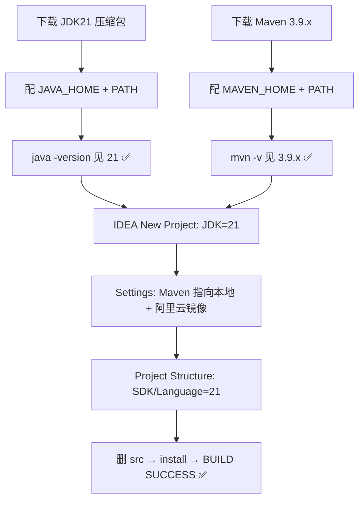

# 3. 配置高效开发环境（上）：JDK 21 + Maven + IDEA 地基

## 纲要

- **前述是地基**：所有代码跑通的前提，先把 JDK 21、Maven、IDEA 配稳，后面才不会「我本地能跑」
- **JDK 选型**：用 **OpenJDK 21（LTS，GA）**；不碰 Oracle 高版本收费风险，也不用 22/23 非 LTS
- **Maven 选型**：3.9.x（需 JDK 8+），本地多版本可共存，小版本差异不大
- **环境变量**：`JAVA_HOME` / `MAVEN_HOME` 指向安装根目录，`PATH` 追加其 `bin`
- **IDEA 关键坑**：默认 JDK 常是 1.8，必须手动切到 21；父工程删掉 `src`；`install` 验证构建
- **国内网络**：镜像 / 代理必备，否则依赖拉不动、Docker 镜像下载慢
- **多平台落地**：本文给出 macOS / Windows / Linux 三套完整步骤，以及 Maven 镜像配置、多版本管理、IDEA 深度配置与常见错误排查

## 一、为什么前述值得先把地基打牢

前面第 1–2 章建立了「AI 闭环」的全局观、跑通了演示。但演示再炫，环境没配好，后面每一步都会卡在「编译失败 / 依赖下载不动 / 端口冲突」。本章就是把**可复现的开发环境**搭起来——它不性感，却是后面 10 章能不能顺滑推进的分水岭。

> 课程里老师反复强调：IDEA 新建项目默认 JDK 是 1.8，而 SpringAI 1.0 + Spring Boot 3.5 必须 JDK 17+，用 1.8 编译器大量包直接失效。这种坑，提前避开比事后排查省十倍时间。

环境不一致带来的隐性成本往往被低估：本地用 21 能跑、CI 用 17 挂掉；同事用 IDEA 自带 Maven、你用本地 Maven，依赖树对不上；Docker 镜像版本漂移，开发 / 测试 / 生产三套行为。把环境一次性配准、写进 README，是专业团队协作的第一课。

## 二、JDK 21 安装与配置

### 2.1 为什么选 OpenJDK 而非 Oracle JDK

- **Oracle JDK** 官方但部分高版本商用收费；**OpenJDK** 免费、开源，美国大量公司采用，个人 / 企业都够用。
- 版本号上，**21 是 LTS（长期支持）**，22/23 不是 LTS，最新 24 也不建议生产。课程统一用 **21（带 GA 标记的版本）**。
- 课程老师本机演示用的就是 OpenJDK 21（GA 版），不是 Oracle 版。他在视频里明确说：「Oracle 有一些版本需要收费，用免费的 OpenJDK 更好，我美国朋友的公司也大量用 OpenJDK。」

### 2.2 各操作系统下载

| 系统 | 芯片 | 包类型 | 说明 |
|---|---|---|---|
| macOS | Apple Silicon（M1/M2/M3） | arm64 压缩包 | 解压后配环境变量 |
| macOS | Intel（x86_64） | x86_64 压缩包 | 同上 |
| Windows | — | zip 解压版 | 解压到某目录，配环境变量 |
| Linux | — | tar.gz / 包管理器 | 服务器常用（apt / yum / sdkman） |

> 课程推荐**压缩包**而非安装版——解压即用、可多版本并存、迁移方便。下载入口：openjdk.org 或 Adoptium（Eclipse Temurin）等发行方。认准文件名里的 `21` 与 `GA`（General Availability，正式发布版），不要下 `ea`（Early Access 早期预览版）。

### 2.3 配置环境变量（核心步骤）

**macOS（zsh，M 系列芯片）**——编辑 `~/.zshrc`：

```bash
# 1. 设置 JAVA_HOME 指向 JDK 21 解压根目录下的 home
export JAVA_HOME=/你的路径/jdk-21.0.x.jdk/Contents/Home

# 2. 把 $JAVA_HOME/bin 追加到 PATH
export PATH=$JAVA_HOME/bin:$PATH
```

> Intel 芯片 macOS 用的是 `~/.bash_profile`（bash），不要改错文件。改完 `source ~/.zshrc` 生效。课程老师原话：「M1/M2 芯片改 `.zshrc`，Intel 芯片改 `.bash_profile`，不同操作系统配置不一样，注意一下。」他当年还配过 JDK 8 的 `JAVA_HOME`，后来不用了，直接加 `#` 注释掉即可，切换版本就是改这一行路径。

**Windows**——系统环境变量里新建 `JAVA_HOME` 指向 JDK 根目录（形如 `C:\jdk-21.0.x`），再把 `%JAVA_HOME%\bin` 追加到 `Path`（注意 Windows 用 `%变量%` 双百分号 + 反斜杠，不是 `$` 和正斜杠）。改完**重开 CMD** 才能生效（已打开的窗口不会自动刷新环境变量）。

**Linux（Ubuntu / CentOS）**：

```bash
# 解压到 /opt 或 /usr/local
sudo tar -xzf OpenJDK21U-jdk_x64_linux_hotspot_21.0.x.tar.gz -C /opt

# 写入 /etc/profile.d/java.sh（对所有用户生效）
sudo tee /etc/profile.d/java.sh <<'EOF'
export JAVA_HOME=/opt/jdk-21.0.x+xx
export PATH=$JAVA_HOME/bin:$PATH
EOF
source /etc/profile.d/java.sh
```

> 服务器上推荐用包管理器或 SDKMAN 安装，避免手写路径出错；多用户环境务必用 `/etc/profile.d/` 而非个人 `~/.bashrc`，否则 sudo 下容易找不到 JDK。

### 2.4 验证

```bash
java -version
# openjdk version "21" ...

javac -version
# javac 21
```

能看到 21 即安装成功。若提示命令找不到，九成是 `PATH` 没追加对或没 `source` 生效。

### 2.5 Windows / Linux 完整落地清单

**Windows 步骤（图文级）**：

1. 浏览器搜 `Adoptium Temurin 21` → 选 Windows → 选 `x64` / `zip`（不要 msi 安装版，方便多版本并存）。
2. 解压到 `C:\jdk-21.0.x`，记住这个路径。
3. 桌面「此电脑」右键 → 属性 → 高级系统设置 → 环境变量。
4. 在「系统变量」区点「新建」：`变量名=JAVA_HOME`，`变量值=C:\jdk-21.0.x`。
5. 找到 `Path` 变量 → 编辑 → 新建 → 填 `%JAVA_HOME%\bin` → 上移到顶部避免被旧版本覆盖。
6. **全部确定关闭** → 重新打开 CMD（旧窗口不刷新）→ `java -version` 验证。

**Linux 步骤（CentOS 示例）**：

1. `sudo yum install -y java-21-openjdk-devel`（或手动 tar 解压）。
2. 配置 `/etc/profile.d/java.sh` 如上。
3. `source` 后 `java -version` 验证；`which java` 应指向 `/opt/.../bin/java`。

> 服务器常见坑：系统自带 `java 1.8` 在 `/usr/bin`，若 `JAVA_HOME` 没配或 `PATH` 顺序不对，`java -version` 仍显示 1.8。用 `readlink -f $(which java)` 看清真实路径。

## 三、Maven 安装与配置

### 3.1 版本与下载

- 最新稳定 3.9.x（课程本地 3.9.2，演示用 3.9.0，小版本差异不大）；Maven 本身需 **JDK 8+** 才能运行。
- 下载 binary 压缩包，解压即用。官网 `maven.apache.org → Download`，认准 `apache-maven-3.9.x-bin.tar.gz` / `.zip`。
- 课程老师本地是 3.9.2，他在视频里敲 `mvn -v` 验证时显示的就是 3.9.2，并说「3.9.0 和 3.9.2 差别不大，小版本混用没问题」。

### 3.2 配置环境变量

```bash
# macOS / Linux
export MAVEN_HOME=/你的路径/apache-maven-3.9.x
export PATH=$MAVEN_HOME/bin:$PATH
```

Windows 同 JDK：新建 `MAVEN_HOME`，`Path` 追加 `%MAVEN_HOME%\bin`。

### 3.3 验证

```bash
mvn -v
# Apache Maven 3.9.x
# Maven home: /.../apache-maven-3.9.x
# Java version: 21
```

> 关键：输出里 `Java version` 应是 21（Maven 用的是 `JAVA_HOME` 指向的 JDK）。若显示 1.8，说明 `JAVA_HOME` 没指对。

### 3.4 多版本 Maven 共存

项目本地若同时有 3.9.0 / 3.9.2，小版本间差异不大，可直接切 `MAVEN_HOME` 指向不同目录，不影响构建结果。

### 3.5 完整 `settings.xml`（含阿里云镜像，国内必配）

Maven 默认连 `repo.maven.apache.org`（境外），国内几乎拉不动。务必在 `conf/settings.xml`（全局）或 `~/.m2/settings.xml`（用户）加入阿里云镜像：

```xml
<?xml version="1.0" encoding="UTF-8"?>
<settings xmlns="http://maven.apache.org/SETTINGS/1.0.0">
  <mirrors>
    <!-- 仅代理 central，不影响其他私有仓库 -->
    <mirror>
      <id>aliyun-maven</id>
      <name>Aliyun Maven Mirror</name>
      <url>https://maven.aliyun.com/repository/public</url>
      <mirrorOf>central</mirrorOf>
    </mirror>
  </mirrors>

  <profiles>
    <profile>
      <id>jdk21</id>
      <properties>
        <maven.compiler.source>21</maven.compiler.source>
        <maven.compiler.target>21</maven.compiler.target>
      </properties>
    </profile>
  </profiles>

  <activeProfiles>
    <activeProfile>jdk21</activeProfile>
  </activeProfiles>
</settings>
```

> **镜像配置三要点**：① `mirrorOf` 写 `central` 而非 `*`，否则连你公司私服也被劫持；② 阿里云 `repository/public` 已聚合绝大多数中央库依赖；③ 改完让 IDEA 重新 `Reload` 项目，旧依赖才不会卡在半下载状态。

### 3.6 jenv / SDKMAN 多版本管理（进阶）

当本机同时维护 JDK 8 / 11 / 17 / 21 多个项目时，手改 `JAVA_HOME` 太累，推荐用工具：

- **SDKMAN!**（macOS / Linux）：`sdk install java 21.0.2-tem` → `sdk use java 21.0.2-tem`，按项目切换。
- **jenv**（macOS / Linux）：`jenv add /path/to/jdk21` → `jenv local 21` 在项目目录锁定版本。
- **Windows**：用 `jabba` 或直接多 `JAVA_HOME` 命名（`JAVA8_HOME` / `JAVA21_HOME`）手动切。

> CI / 容器里务必显式声明 JDK 版本（`Dockerfile` 写死、`pom.xml` 写死 `<release>21</release>`），避免「本地能跑、流水线挂掉」的环境漂移。

## 四、IDEA 创建项目与关键配置

### 4.1 New Project 步骤

1. `File → New → Project` → 语言选 **Java**，构建工具选 **Maven**（熟悉 Gradle 也可）。
2. **JDK 必须选 21**（中间那栏默认 1.8，务必改）。
3. 填项目名（如 `spring-mcp-rag`）、位置，其他默认 → `Create`。

### 4.2 三个必改的坑

| 配置点 | 默认陷阱 | 正确做法 |
|---|---|---|
| **Maven 指向** | IDEA 用自带 Maven，常报错 | `Settings → 搜索 Maven` → 改 `Maven home path` 为本地 3.9.x；`User settings` 指向本地 `conf/settings.xml`；`Local repository` 统一路径 |
| **Project SDK** | 默认 1.8 | `File → Project Structure → SDKs` 选 21 |
| **Language level** | SDK default（可能 1.8） | 同样在 Project Structure 选 21，按 JDK 21 规范编译 |

> 课程里老师每次新建项目 IDEA 的 Maven 都会报错——不是你错了，是 IDEA 默认 Maven 没指向本地。改完 `Apply / OK`，红色错误即消失。他原话：「IDEA 自带的 Maven 和本地不一致时容易依赖解析异常，统一指向本地 Maven，避免『本地能跑、CI 挂掉』。」

### 4.3 IDEA 深度配置清单

除了上面三处，专业开发还需确认：

1. **Maven 面板出现红波浪线**：先 `Reload All Maven Projects`（右上刷新图标），再 `mvn clean`；多半是镜像没生效或 `settings.xml` 路径没指对。
2. **依赖下载卡死**：看 `Local repository` 路径下是否出现 `*.lastUpdated` 残文件，删掉重下；或勾选 `Settings → Maven → Always update snapshots`。
3. **编码统一**：`Settings → Editor → File Encodings` 全部设为 `UTF-8`，避免中文乱码。
4. **自动导入**：`Settings → Maven → Importing → 勾选 Automatically import`，改 pom 自动拉依赖。
5. **父工程识别**：根 `pom.xml` 的 `packaging` 必须是 `pom` 且 `<modules>` 列出子模块，IDEA 才会显示为聚合工程。

### 4.4 父工程清理

因为后续是**模块化开发**（mcp-client / mcp-server），当前根项目作为父工程：

- 删掉自动生成的 `src` 目录（父工程不需要源码，也可留，但课程删掉更干净）；
- 删掉默认包；
- 保留空的工程骨架。

### 4.5 install 验证

右侧 Maven 面板 → `Lifecycle → install` 双击。若显示 `BUILD SUCCESS`，说明 Maven + JDK 环境配置成功，后续开发会频繁用到 `install`。



## 五、常见错误排查（深度版）

| 现象 | 根因 | 解决 |
|---|---|---|
| `java -version` 不是 21 | `JAVA_HOME` 指错 / 没 source | 重配并 `source ~/.zshrc`；Windows 重开 CMD |
| IDEA 编译报「不支持的 class 文件主版本」 | 项目 SDK 是 1.8 | Project Structure 切 21 |
| Maven 面板红错 | IDEA 用自带 Maven | 指向本地 3.9.x + 本地 settings.xml |
| `mvn -v` 显示的 Java 是 1.8 | `JAVA_HOME` 冲突 | 确认 `JAVA_HOME` 指向 21 根目录 |
| 改了环境变量不生效 | 没 source / 改错 shell 文件 | macOS M 芯片用 `~/.zshrc`，Intel 用 `~/.bash_profile` |
| 依赖下不动 / 超时 | 没配国内镜像 | `settings.xml` 加阿里云 mirror，`mirrorOf=central` |
| `Could not resolve dependencies` | 镜像只代理了部分仓库 / 私服未配 | 检查 `mirrorOf` 是否误写成 `*`，补私服地址 |
| 本地能跑、CI 挂 | 环境漂移（JDK/Maven 版本不一） | Dockerfile / pom 写死版本，统一镜像 |
| `readlink -f $(which java)` 指向旧版 | `PATH` 顺序问题 | 把 `$JAVA_HOME/bin` 移到 `Path` 顶部 |

## 六、环境验证终检清单（checklist）

配完环境，逐项打勾，确保后面 10 章不卡环境：

- [ ] `java -version` 输出含 `21`
- [ ] `javac -version` 输出 `21`
- [ ] `mvn -v` 的 `Java version` 是 `21`
- [ ] `mvn -v` 的 `Maven home` 指向**本地**目录（非 IDEA 自带）
- [ ] `settings.xml` 含阿里云镜像，`mvn help:evaluate` 能拉到插件
- [ ] IDEA 新建项目 SDK = 21、Language level = 21
- [ ] IDEA Maven 指向本地，且 `User settings` 指向同一 `settings.xml`
- [ ] 父工程 `pom.xml` 的 `packaging=pom` 且 `install` 出 `BUILD SUCCESS`
- [ ] Docker 已安装（下面装 MySQL 要用）

> 把这份清单 + 版本号 + 路径写进团队 `README`，新人 clone 即复现，别每次从零排环境。

## 七、Gradle 对比附录（可选）

课程全用 Maven，但部分团队用 Gradle，对比备查：

| 维度 | Maven | Gradle |
|---|---|---|
| 配置语言 | XML（pom.xml） | Groovy / Kotlin DSL |
| 构建速度 | 中等 | 快（增量 + 缓存） |
| 学习曲线 | 平缓、资料多 | 陡、API 变动频繁 |
| 生态 | Java 主流 | Android 默认、Spring 也支持 |
| 适合 | 本课、传统企业 | 安卓、大型多模块 |

> 结论：Java 后端新手无脑 Maven；追求构建速度且团队有经验再上 Gradle。本课程所有 pom 示例都以 Maven 为准。

## 八、FAQ

**Q1：一定要 OpenJDK 吗？Oracle JDK 不行？**
个人学习两者都行；但 Oracle 高版本商用收费，企业项目用 OpenJDK 规避授权风险。课程统一 OpenJDK 21。

**Q2：Maven 和 Gradle 选哪个？**
Java 生态 Maven 更主流、资料多，课程全用 Maven。Gradle 构建更快但学习曲线陡，API 变动频繁。

**Q3：IDEA 自带 Maven 为什么不能用？**
能用，但版本与本地不一致时容易依赖解析异常。课程建议统一指向本地 Maven，避免「本地能跑、CI 挂掉」。

**Q4：父工程为什么要删 src？**
因为父工程只做聚合与管理，不写业务代码。留着也行，但模块化开发时删掉更清晰，避免误把代码写进父模块。

**Q5：JDK 21 和课程说的 22/23 差在哪？**
21 是 LTS（长期支持、生态最全）；22/23 是特性版、LTS 支持周期短、框架兼容性滞后。生产选 21。

**Q6：能不能用 JDK 17 代替 21？**
Spring Boot 3.5 最低要求 17，理论可用；但课程与 SpringAI 1.0 演示均基于 21，建议直接上 21，避免新语法（如虚拟线程、序列化收集器）不可用。

**Q7：多个 JDK 怎么快速切换？**
macOS/Linux 用 jenv 或 SDKMAN；Windows 用多 `JAVA_HOME` 命名手动切；CI 用 Docker 固定版本。

**Q8：阿里云镜像配了还是慢？**
检查 `mirrorOf` 是否误写 `*`（会劫持私服）、URL 是否 `maven.aliyun.com/repository/public`、DNS 是否解析正常。

**Q9：Maven 本地仓库在哪？能删吗？**
默认 `~/.m2/repository`；可整体删除强制重下（会重新拉全部依赖，耗时但能清掉损坏的 `lastUpdated` 残文件）。

**Q10：服务器上用系统自带 java 还是自己装？**
建议自己装并配 `JAVA_HOME`，避免系统 `yum/apt` 装到 1.8 且路径不可控；生产用 LTS 版本。

## 九、面试高频问答（环境篇）

**1. JDK LTS 是什么？为什么生产选 LTS？**
LTS（Long-Term Support）由发行方长期维护安全与兼容更新；非 LTS 版本快速迭代、支持期短。生产选 LTS 保证依赖生态（IDEA、Maven 插件、基础镜像）全链路兼容。

**2. JAVA_HOME 和 PATH 各自作用？**
`JAVA_HOME` 指向 JDK 安装根目录，供 Maven / 其他工具定位 JDK；`PATH` 追加 `$JAVA_HOME/bin` 让你在任意目录直接敲 `java`/`javac` 命令。

**3. Maven 的本地仓库、私服、中央仓库是什么关系？**
本地仓库（`~/.m2/repository`）缓存依赖；私服（Nexus / 阿里云）代理中央仓库并缓存，加速且可发私有包；中央仓库是源头。国内用阿里云镜像替代直连中央仓库。

**4. 为什么 IDEA 项目要显式指定 SDK=21？**
IDEA 默认 SDK 可能是 1.8，而 Spring Boot 3 要求 17+。不显式指定会导致编译期大量类找不到，且错误信息不直接指向 JDK 版本，极难排查。

**5. 多 JDK 如何共存与切换？**
通过 `JAVA_HOME` 指向不同版本目录 + 切换 `PATH`；或用 `jenv` / `SDKMAN!` 管理。容器化 / CI 里显式声明 JDK 版本，避免环境漂移。

**6. Maven 镜像为什么只 mirror central 而非 *？**
`mirrorOf=*` 会把所有仓库请求（含公司私服）都转发到阿里云，导致私服依赖拉不到；写 `central` 只代理中央库，私服照常工作。

**7. 依赖冲突（Jar 包版本打架）怎么排查？**
`mvn dependency:tree` 看依赖树，定位谁引入了旧版本；用 `<exclusions>` 排除或用 `<dependencyManagement>` 锁定版本。

**8. 本地能跑、CI 挂，典型原因？**
环境漂移：JDK/Maven 版本不一致、镜像未配、pom 没锁版本。解法：Dockerfile 写死 JDK、pom 写 `<release>21</release>`、CI 用同源镜像。

**9. 为什么不用 IDEA 自带 Maven？**
版本与本地可能不一致，依赖解析结果不同，导致「本地能跑、别人/CI 挂」。统一指向本地 Maven + 同一 settings.xml 保证一致性。

**10. Spring Boot 3 为什么必须 JDK 17+？**
Spring Boot 3 基于 Jakarta EE 9+（包名 `jakarta.*` 而非 `javax.*`），且大量 API 依赖 Java 17 的密封类、record 等特性；JDK 8/11 无法编译运行。

## 十、最小可运行 Spring Boot 3.5 项目预览（衔接前述）

环境配好后，趁热打铁搭一个能跑的最小骨架，既验证环境、又为前述铺垫。目标：`mvn spring-boot:run` 后访问 `http://localhost:8080/hello` 返回字符串。

### 10.1 父工程 pom（聚合 + 依赖管理）

```xml
<!-- 父工程 pom.xml：packaging 必须是 pom -->
<project>
  <modelVersion>4.0.0</modelVersion>
  <groupId>com.example</groupId>
  <artifactId>spring-mcp-rag</artifactId>
  <version>1.0.0</version>
  <packaging>pom</packaging>

  <!-- Spring Boot 3.5.0 父依赖，统一管理版本 -->
  <parent>
    <groupId>org.springframework.boot</groupId>
    <artifactId>spring-boot-starter-parent</artifactId>
    <version>3.5.0</version>
    <relativePath/>
  </parent>

  <properties>
    <java.version>21</java.version>
    <maven.compiler.release>21</maven.compiler.release>
  </properties>

  <modules>
    <module>mcp-client</module>
    <module>mcp-server</module>
  </modules>
</project>
```

### 10.2 子模块 mcp-client pom + 启动类 + 控制器

```xml
<!-- mcp-client/pom.xml -->
<project>
  <parent>
    <groupId>com.example</groupId>
    <artifactId>spring-mcp-rag</artifactId>
    <version>1.0.0</version>
  </parent>
  <artifactId>mcp-client</artifactId>
  <dependencies>
    <dependency>
      <groupId>org.springframework.boot</groupId>
      <artifactId>spring-boot-starter-web</artifactId>
    </dependency>
  </dependencies>
</project>
```

```java
// mcp-client/src/main/java/com/example/mcpclient/McpClientApplication.java
package com.example.mcpclient;

import org.springframework.boot.SpringApplication;
import org.springframework.boot.autoconfigure.SpringBootApplication;

@SpringBootApplication
public class McpClientApplication {
    public static void main(String[] args) {
        SpringApplication.run(McpClientApplication.class, args);
    }
}
```

```java
// mcp-client/src/main/java/com/example/mcpclient/HelloController.java
package com.example.mcpclient;

import org.springframework.web.bind.annotation.GetMapping;
import org.springframework.web.bind.annotation.RestController;

@RestController
public class HelloController {
    @GetMapping("/hello")
    public String hello() {
        return "Hello SpringAI!";
    }
}
```

### 10.3 运行与验证

```bash
# 在 mcp-client 目录
mvn spring-boot:run
# 另开终端
curl http://localhost:8080/hello
# 期望输出：Hello SpringAI!
```

### 10.4 起步常见报错

| 报错 | 根因 | 解决 |
|---|---|---|
| `ClassNotFoundException: jakarta.servlet` | 用了 Spring Boot 2 的 import | Boot 3 用 `jakarta.*`，确认 parent 3.5.0 |
| 端口 8080 被占 | 其他服务占用 | `server.port=8081` 或关占用进程 |
| 启动报 `Unsupported class file major version` | 编译 JDK 低于 17 | 确认 SDK/Language=21 |
| `mvn spring-boot:run` 找不到插件 | 没继承 starter-parent | 确认 parent 指向 3.5.0 |

> 这一节只是「冒烟测试」，本篇会正经讲父子工程、MCP 模块拆分与配置管理。能跑通说明 JDK 21 + Maven + IDEA 全链路 OK。

## 十一、Maven 生命周期与常用命令详解

Maven 有三套独立生命周期：`clean`（清理）、`default`（构建）、`site`（文档）。日常只用 `default`，关键阶段：

| 阶段 | 作用 | 触发的前置阶段 |
|---|---|---|
| `validate` | 校验 pom 合法 | — |
| `compile` | 编译主代码 | validate |
| `test` | 跑单元测试 | compile |
| `package` | 打成 jar/war | test |
| `verify` | 集成校验 | package |
| `install` | 装到本地仓库 | verify |
| `deploy` | 发到远程仓库 | install |

**高频命令**：

```bash
mvn clean                  # 删 target
mvn compile                # 只编译
mvn test                   # 编译 + 单测
mvn package -DskipTests    # 打 jar 跳过测试（联调常用）
mvn install -DskipTests    # 装本地仓库，供其他模块引用
mvn -pl mcp-client -am install   # 只构建 mcp-client 及其依赖模块（-am = also make）
mvn dependency:tree        # 看依赖树，查冲突
mvn -o package             # 离线构建（依赖已缓存时加速）
```

> `-pl`（project list）+ `-am`（also make）在多模块里极实用：只重build改动的模块，省去全量。课程后续 mcp-client / mcp-server 联动时用得上。

## 十二、Java 21 关键新特性速览（为后续编码打底）

Spring Boot 3.5 + SpringAI 1.0 大量用到 Java 17+ 特性，了解 21 的加持能读懂后续代码：

- **虚拟线程（Virtual Threads，JDK 21 正式）**：`Thread.startVirtualThread(() -> ...)`，高并发 IO 场景吞吐倍增。Spring Boot 3.2+ 可在 `application.yml` 开 `spring.threads.virtual.enabled=true`。
- **Record 模式（Record Patterns）**：`if (obj instanceof Point(int x,int y))` 直接解构，简化 DTO 判型。
- **Switch 模式匹配**：`switch (o) { case Integer i -> ...;case String s -> ...;}` 取代臃肿 if-else。
- **Unnamed Patterns & Variables（`_`）**：忽略不关心的绑定，减少噪音变量。
- **Sequenced Collections**：`SequencedCollection` 接口统一 `first()` / `last()`，List 直接取首尾。
- **字符串模板（String Templates）**：**仍处于预览**（需 `--enable-preview`），生产别用；日常用 `String.format` / 文本块 `"""` 即可。

> 文本块 `"""..."""` 在后续写 SQL / JSON / 提示词（Prompt）时极好用，天然多行、免转义，后续频繁用到。

## 十三、环境漂移与 Docker 可复现环境

「我本地能跑」的根因是环境漂移。除统一 JDK/Maven 外，团队可进一步固化：

- **Maven Wrapper（`mvnw`）**：项目内置 `mvnw` 脚本，所有人用同一 Maven 版本，无需本机预装。`mvn -N wrapper:wrapper` 生成。
- **Dev Container**：`.devcontainer/devcontainer.json` 声明 JDK21 + Maven 镜像，新人 VS Code / IDEA 一键进容器开发，环境 100% 一致。
- **Dockerfile 固化 JDK**：

```dockerfile
FROM maven:3.9.9-eclipse-temurin-21 AS build
WORKDIR /app
COPY . .
RUN mvn -o package -DskipTests

FROM eclipse-temurin:21-jre
COPY --from=build /app/mcp-client/target/*.jar app.jar
ENTRYPOINT ["java","-jar","/app.jar"]
```

> 把构建环境与运行环境都写进镜像，CI 与本地行为完全对齐，彻底消灭「本地能跑、流水线挂掉」。

## 十四、IDEA 全流程图文（对话级）详解

很多新手卡在 IDEA 的对话框。下面按操作顺序逐项说明每个面板该填什么：

### 14.1 New Project 对话框

打开 `File → New → Project`，左侧选 `New Project`（不是空工程），右侧字段：

- **Name**：`spring-mcp-rag`
- **Location**：选你工作区目录
- **Language**：`Java`
- **Build system**：`Maven`（默认可能是 Gradle，改过来）
- **JDK**：下拉选 `21`（若列表没有，点 `Add JDK → 指向 JAVA_HOME`）；**默认 1.8 务必改**
- **Catalog / Archetype**：留空（不套模板）
- 点 `Create`

### 14.2 Settings → Maven 面板

`IntelliJ IDEA → Settings（macOS）/ File → Settings（Windows）`，搜索 `Maven`：

- **Maven home path**：改为本地 `apache-maven-3.9.x`（点 `...` 选目录，别用 `Bundled`）
- **User settings file**：勾 `Override`，选本地 `conf/settings.xml`（含阿里云镜像那份）
- **Local repository**：自动跟随 settings，或手动指 `~/.m2/repository`
- 点 `Apply`

### 14.3 Project Structure 面板

`File → Project Structure`：

- **Project → SDK**：选 `21`
- **Project → Language level**：选 `21`（或 `SDK default` 但确认是 21）
- **Modules → Sources / Dependencies**：确认每个模块依赖指向 21
- 点 `OK`，红色报错消失即成功

### 14.4 运行配置

右上 `Add Configuration → + → Spring Boot → 选 McpClientApplication`；`JDK` 选 21；`Apply`。之后点绿三角即可运行，控制台见 `Started McpClientApplication` 即成功。

> 三个面板（New Project / Maven / Project Structure）任一填错，后面编译/依赖就会红。课程老师每次新建都重配这三处，红错即源于此。

## 十五、Maven 私有仓库鉴权与代理配置进阶

团队有私服（Nexus / 阿里云 packages）时，`settings.xml` 还要配 `<servers>` 鉴权与 `<proxies>` 代理：

```xml
<servers>
  <server>
    <id>private-repo</id>
    <username>${env.NEXUS_USER}</username>
    <password>${env.NEXUS_PWD}</password>   <!-- 用环境变量，别硬编码 -->
  </server>
</servers>

<proxies>
  <proxy>
    <id>corp-proxy</id>
    <active>true</active>
    <protocol>http</protocol>
    <host>proxy.company.com</host>
    <port>8080</port>
    <nonProxyHosts>localhost|127.0.0.1</nonProxyHosts>
  </proxy>
</proxies>
```

> 私服用 `mirrorOf` 覆盖时记得把私服 id 也并进，避免中央库请求被劫持到私服失败。密码走环境变量，提交安全。

## 十六、真实排错案例集（War Stories）

**案例 1：依赖下载到 99% 卡死**
现象：`BUILD` 卡在 `Downloading ... lastUpdated`。根因：镜像没生效或网络中断，留下 `.lastUpdated` 残文件，Maven 判定「已尝试」不再重下。解法：删 `~/.m2/repository` 下对应目录的 `*.lastUpdated`，确认 `settings.xml` 镜像正确后重跑。

**案例 2：本地 21、CI 17，编译爆红**
现象：本地 `mvn package` 过，GitHub Actions 挂。根因：CI 默认 `actions/setup-java` 没指定 21，用了缓存里的 17。解法：CI 显式 `java-version: '21'` + `distribution: 'temurin'`，pom 写 `<release>21</release>` 锁死。

**案例 3：IDEA 能跑、命令行 mvn 报错**
现象：IDEA 内运行正常，`mvn` 命令报找不到符号。根因：IDEA 用了自带 Maven + 自带 JDK，与命令行 `JAVA_HOME` 不一致。解法：两者都指向本地同一 Maven/ JDK。

**案例 4：端口 8080 被默默占用**
现象：Spring Boot 启动报 `Port 8080 was already in use`。根因：之前运行的实例没关、或别的软件（如某些代理）占了。解法：`lsof -i :8080`（macOS/Linux）查 PID 杀掉，或 `server.port=8081`。

## 十七、项目骨架与 .gitignore 规范

标准多模块骨架（提交到 git 时）：

```
spring-mcp-rag/
├── pom.xml                 # 父：packaging=pom + modules
├── mcp-client/
│   ├── pom.xml
│   └── src/main/java/...    # 业务代码
├── mcp-server/
│   ├── pom.xml
│   └── src/main/java/...
├── docs/                    # 建表 SQL、docker-compose 等文档
│   ├── product.sql
│   └── docker-compose.yml
├── .gitignore
└── README.md                # 环境版本 + 复现步骤
```

`.gitignore` 必含：

```
target/
*.iml
.idea/
*.log
.env
```

> 把 `docs/`（SQL、compose）和 `README`（版本号）一起提交，是「环境即文档」的落地；`.env` 永不进 git，密钥安全。

## 十八、JDK 下载页导航与完整性校验

避免下到篡改包，下载与校验流程：

1. 入口：`adoptium.net`（Eclipse Temurin，课程同款 OpenJDK 发行）或 `openjdk.org`。
2. 选：`Temurin 21 (LTS)` → `Operating System`(macOS/Windows/Linux) → `Architecture`(x64 / aarch64) → `Package Type`(zip/tar.gz，非 installer 方便多版本)。
3. 下载同时拉 `sha256.txt`，本地校验：

```bash
shasum -a 256 OpenJDK21U-jdk_x64_mac_hotspot_21.0.x.tar.gz
# 与官网 sha256 比对一致才解压
```

> 服务器批量部署更推荐用 SDKMAN 或包管理器，免手工校验；个人开发手工下 + 校验最稳妥。

## 十九、本地仓库目录结构与依赖解析揭秘

`~/.m2/repository` 的目录规则：`groupId` 反写分层 + `artifactId` + `version` + 文件。例如 `org.springframework.boot:spring-boot-starter-web:3.5.0` 落到：

```
~/.m2/repository/org/springframework/boot/spring-boot-starter-web/3.5.0/
├── spring-boot-starter-web-3.5.0.pom
├── spring-boot-starter-web-3.5.0.jar
└── _remote.repositories      # 记录从哪个仓库拉取，镜像失效时据此判断
```

- `*.lastUpdated`：拉取失败残标志，存在则 Maven 短期内不再重试，需删除。
- `maven-metadata-*.xml`：版本索引，SNAPSHOT 依赖据此找最新快照。
- 依赖解析顺序：本地仓库 → 私服/镜像 → 中央库；`mirrorOf=central` 只拦中央库请求。

> 理解结构后，「依赖下不动」八成是 `lastUpdated` 残留或镜像没配，删目录重下即可，不必重装 Maven。

## 二十、IDEA 插件推荐清单（Java / Spring 提效）

| 插件 | 用途 |
|---|---|
| **Spring Boot Helper / Initializr** | 快速建 Spring 工程、yml 配置提示 |
| **Lombok** | 支持 `@Data/@Slf4j`，少写样板代码 |
| **MyBatisX** | Mapper 与 XML 互跳、生成 |
| **Maven Helper** | 依赖冲突一目了然、一键排除 |
| **Rainbow Brackets** | 嵌套括号配色，读复杂 lambda 友好 |
| **通义灵码** | AI 补全/解释 |
| **GitToolBox** | 行级 blame / 状态提示 |

> 装太多会拖慢 IDEA；课程核心就 Lombok + Maven Helper + 通义灵码三件套，其余按需。

## 二十一、环境排错决策树

```
环境异常
├─ java -version 不是 21 ─→ 重配 JAVA_HOME + source 正确 shell 文件
├─ mvn -v 的 Java 是 1.8 ─→ JAVA_HOME 指向错，改指向 21
├─ IDEA 红错 ─→ Maven 指向本地 + Project Structure SDK=21
├─ 依赖下不动 ─→ settings.xml 加阿里云镜像(mirrorOf=central) + 删 lastUpdated
├─ 本地能跑 CI 挂 ─→ 锁死 JDK/Maven 版本(Dockerfile/pom)
└─ install 失败 ─→ 看具体报错；父工程 packaging=pom 且 modules 列全
```

> 把决策树拍进团队 Wiki，新人自助排环境，别每次 @ 你。

## 二十二、开发机与云主机选型建议

环境跑在哪也影响体验：

- **本地开发机**：macOS（M 系列 arm64）或 Windows + WSL2；内存 ≥ 16G（Docker + IDEA + 多个容器同时跑），SSD 必选（Maven 构建 / 镜像 IO 吃盘速）。
- **云主机练手**：2 核 4G 起（MySQL + Redis + 后端 + Nginx 同机够用），选**同一地域 + 同一私有网络**；系统 CentOS Stream / Ubuntu 22.04，按第十一节关 `firewalld` 或开安全组。
- **镜像选择**：JDK 直接上 `eclipse-temurin:21-jre`；构建用 `maven:3.9-eclipse-temurin-21`。
- **成本**：练手机用按量付费，做完释放；别长期空转烧钱。

> 课程老师本机多容器常驻，所以特意把 MySQL 映射端口改成 `5506` 避开冲突——开发机容器多了，端口规划要提前想好。

## 二十三、Java 8 → 21 迁移实战要点

团队若从老项目升级，注意：

- **包名 `javax.*` → `jakarta.*`**：Spring Boot 3 的硬门槛，所有 `javax.persistence` / `javax.servlet` 全改，老代码编译爆红主因。
- **移除法**：Java 21 删 `finalize()`、废弃 `SecurityManager`，老库若依赖需换替代。
- **字节码**：编译目标设为 21，老 `-source 1.8` 直接报错。
- **依赖升级**：Spring 升 3.5、Hibernate 6、SpringAI 1.0，配套 Hibernate/Jakarta 版本一起动。
- **逐步迁移**：先用 `jdeps` 扫描过时 API，分模块升级，别一次性梭哈。

> 课程从零用 21 避开了迁移坑；但面试常问「为什么升不动老项目」，答 `javax→jakarta` 包名断裂 + 依赖链联动即可击中要害。

## 二十四、补充面试题（5 题）

**11. 为什么 Spring Boot 3 必须 jakarta 而非 javax？**
Jakarta EE 9 起 Oracle 把 `javax.*` 商标权收回，社区改名 `jakarta.*`；Spring Boot 3 基于 Jakarta EE 9+，包名断裂是升级最大阻力。

**12. 虚拟线程适合什么场景？有坑吗？**
适合 IO 密集型（Web 请求、远程调用），吞吐远高于平台线程；但 `synchronized` 内阻塞、ThreadLocal 滥用会失效，且需框架（Spring Boot 3.2+）适配。CPU 密集型无收益。

**13. Maven 和 Gradle 构建缓存差异？**
Gradle 有增量编译 + 构建缓存，二次构建快；Maven 每次较全量。但 Maven 配置直观、资料多，团队新手友好。

**14. 容器里 JDK 内存怎么设？**
设 `-XX:MaxRAMPercentage=75.0` 让 JVM 按容器内存比例分配，避免默认按宿主机内存算 OOM；配合 `docker stats` 监控。

**15. 如何证明环境一致性？**
`mvn help:evaluate` 输版本 + `docker images` 锁镜像 + `pom` 写死 `<release>21</release>` + CI 同 Dockerfile，四管齐下，杜绝「本地能跑」。

## 二十五、ops 提示（国内环境必看）

> **网络是头号拦路虎**：Maven 依赖、Docker 镜像都依赖境外源。务必：
> 1. Maven 配 **阿里云镜像**（`settings.xml` 的 `<mirrors>` 加 aliyun-maven，仅 mirror `central`）；
> 2. Docker 镜像拉不动时换国内加速器（如 `registry.cn-hangzhou.aliyuncs.com` 等代理）；
> 3. 课程装 MySQL 镜像时老师也提示「保证网络畅通 / 科学上网」，否则 `docker pull` 卡死。
> 4. 装好 JDK / Maven 后，把版本与路径写进团队脚手架 README，新人一键复现，别每次从零排环境。

