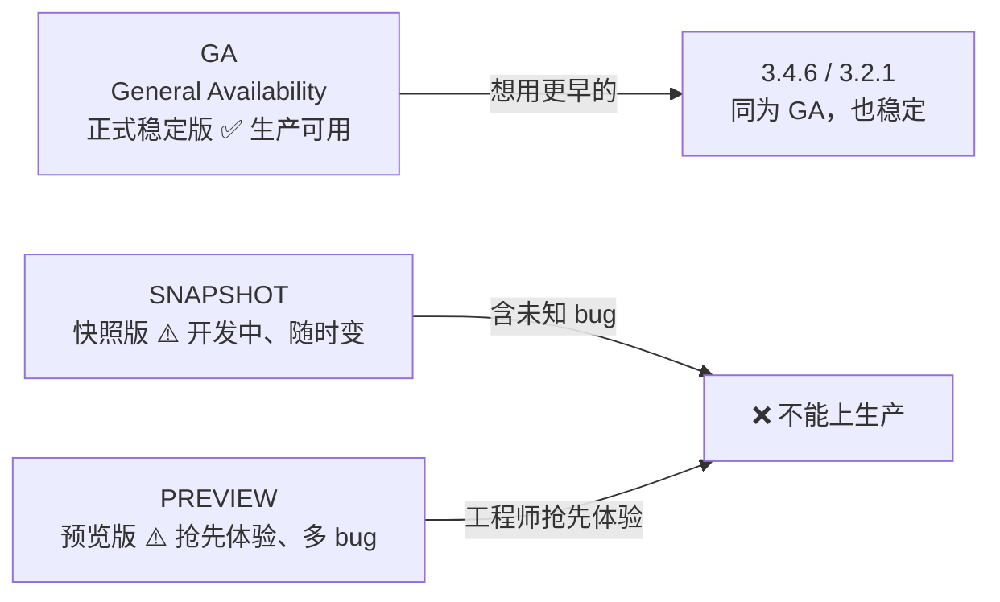

# 5. SpringBoot3 快速入门与版本选型

## 纲要

- **为什么离不开 Spring**：当前主流 Java Web 应用基本都基于 Spring 生态，SpringBoot 是其中最核心的脚手架
- **SpringBoot 解决了什么**：内嵌 Tomcat、自动配置、Starter 依赖，消灭了 SpringMVC/Struts 时代大量的 XML 配置
- **版本号怎么看**：GA（正式稳定版）才能上生产；SNAPSHOT（快照）与 PREVIEW（预览）含未知 bug，仅体验用
- **环境硬指标**：Spring Boot 3.x 最低 JDK 17，稳定 LTS 用 JDK 21；Maven 3.6.3+ / Gradle 7.x~8.x；内嵌 Tomcat 10.1
- **最新正式版**：课程基于 Spring Boot **3.5.0**（GA）开发
- **版本选型坑**：SpringAI 里程碑版（0.8.x）与 1.0.0 GA 坐标 / 包名完全不同，复制老博客代码必踩坑

## 一、Java Web 为什么绕不开 Spring

要写 Java Web 应用，基本离不开 Spring。Spring 官方生态极其庞大：除了我们本课用到的 SpringAI，还有微服务（服务治理能力最强）、响应式（Reactive）、Cloud（云端平台集成，可对接 AWS / 阿里云等）、Web 应用、事件驱动、批处理等等。

> 你可以把 Spring 理解成「Java 企业级开发的操作系统」——它定义了依赖注入、AOP、事务等一整套范式，几乎所有第三方库都和它无缝集成。

SpringBoot 是 Spring 生态里「让你最快跑起来」的那一层。在它出现之前，我们用的是更早的 Struts / 纯 SpringMVC，需要写大量 XML 配置，开发体验很重。SpringBoot 的出现把这件事彻底简化。

## 二、SpringBoot 到底帮你做了什么

用一句话概括：**约定优于配置（Convention over Configuration）**。

| 痛点（SpringBoot 之前） | SpringBoot 的解法 |
|---|---|
| 大量 XML / 注解配置 | 自动配置（AutoConfiguration），按需加载 |
| 自己下载并部署 Tomcat | 内嵌 Web 服务器（默认 Tomcat 10.1） |
| 手动拼装一堆相互兼容的依赖 | Starter 起步依赖，一站式引入 |
| 打包后还要丢进外部容器 | 打成一个可执行 jar，java -jar 直接跑 |

首页文档里那个最简单的 Controller 示例，正是 SpringBoot 的精髓——几行代码就能起一个 Web 应用：

```java
@RestController
public class DemoController {
    @GetMapping("/hello")
    public String hello() {
        return "Hello Spring Boot 3";
    }
}
```

## 三、版本号怎么读：GA / SNAPSHOT / PREVIEW

打开 SpringBoot 官网的 Projects → Spring Boot，最显眼的就是当前最新的正式版本 **3.5.0**。但版本号后面那些后缀，决定了你能不能上生产：



- **GA（General Availability）**：正式发布的稳定版。课程用的 3.5.0 就是 GA。**上生产必须用 GA。**
- **SNAPSHOT（快照）**：开发中的中间版本，每天都在变，可能随时引入破坏性改动，**绝不上生产**。
- **PREVIEW（预览）**：比当前 GA 更高的预览版本，让工程师抢先体验新特性，但大概率带 bug，只能本地玩。

> 课程里也提到可以用更早的 GA（如 3.4.6、3.2.1），它们都是稳定版。选哪个 GA 取决于你公司现有技术栈的兼容要求；本课统一用最新的 3.5.0。

## 四、环境硬指标：JDK / Maven / 容器

SpringBoot 官网「System Requirements」里写得很清楚，下面用一张表对照：

| 项目 | 最低要求 | 课程推荐 | 说明 |
|---|---|---|---|
| **JDK** | 17 | **21（LTS）** | 21 是当前最稳的 LTS；最新已到 24，但 21 绝对够用 |
| **Maven** | 3.6.3 | 3.9.x | 课程本地用 3.9，高于 3.6.3 即可 |
| **Gradle** | 7.x / 8.x | — | 若用 Gradle 需对应版本 |
| **内嵌 Tomcat** | 10.1 | 10.1 | Servlet 6.0 规范 |
| **Servlet 容器** | Tomcat 10.1 | 10.1 | 内嵌默认 |

**关于 JDK 版本的关键提醒：**
- Spring Boot 3.x **彻底放弃 JDK 8 / 11**，最低 JDK 17。这是很多从老项目迁移过来的同学第一个踩的坑。
- 稳定 LTS 选 **JDK 21**——虚拟线程、Record 模式、字符串模板等特性在 21 上最完整。课程全程基于 21 开发。
- 最新已到 JDK 24，但「新」不等于「适合生产」。21 在企业里兼容性最好，别盲目追新。

## 五、官方文档怎么用（别只会百度）

SpringBoot 官网提供几类资料，建议按需查阅：

1. **Overview**：能力总览，快速建立印象。
2. **Quick Start**：官方入门指南，5 分钟跑通 Hello World。
3. **Version Support / System Requirements**：确认 JDK、Maven、Servlet 版本要求（就是上表的出处）。
4. **Reference Documentation**：最权威的参考文档，遇到具体注解 / 配置项查这里。

> **学习建议**：养成「先看官方文档再搜博客」的习惯。博客时效性差，SpringAI 这种快速演进的项目尤其明显——老博客的包名可能早已作废。

## 六、为什么本课选 Spring Boot 3.5.0 + JDK 21

这是个有意为之的「稳妥组合」：

- **3.5.0 是 GA**，不是 SNAPSHOT / PREVIEW，生产可信赖。
- **JDK 21 是 LTS**，生态工具（IDEA、Maven 插件、Docker 基础镜像）全部支持到位。
- **与 SpringAI 1.0.0 GA 完全对齐**——SpringAI 1.0 要求 Spring Boot 3.4+，3.5.0 完全满足。

> ⚠️ **SpringAI 版本选型坑（重点）**：SpringAI 早期里程碑版（如 0.8.x）和 1.0.0 GA 在依赖坐标（groupId/artifactId）、包名（如 `org.springframework.ai...` 的层级）、API 上差异巨大。网上大量老博客仍是 0.8.x 写法，直接复制会 404 依赖或编译报错。本课程一律以 **SpringAI 1.0.0 GA** 为准。

## 七、动手前的最小验证

在动手搭项目之前，先确认本机环境达标，避免后面各种诡异报错：

```bash
# 1. JDK 版本——必须看到 21
java -version
# openjdk version "21" ...

# 2. Maven 版本——必须 >= 3.6.3
mvn -v
# Apache Maven 3.9.x ...

# 3. IDEA 里确认 Project SDK 指向 JDK 21
#   File -> Project Structure -> SDKs -> 21

# 4.（可选）通义灵码插件已安装，自动补全可用
```

如果 `java -version` 看到的还是 8 或 11，请先安装 JDK 21 并在 IDEA 里把 SDK 切过去——否则后面 `spring-boot-starter-parent:3.5.0` 一引入就会报「Unsupported class file major version」。

## 八、FAQ：版本与环境的常见疑问

**Q1：公司还在用 JDK 8，能用 Spring Boot 3 吗？**
不能。Spring Boot 3.x 最低 JDK 17。若公司强依赖 JDK 8，只能停留在 Spring Boot 2.7（已 EOL），或推动 JDK 升级。

**Q2：SNAPSHOT 版本真的不能用吗？**
本地学习、尝鲜可以。但生产环境用 SNAPSHOT 等于把「未知 bug」部署上线，出问题都难复现——严禁。

**Q3：Maven 和 Gradle 选哪个？**
Java 生态 Maven 更主流，课程全程用 Maven。Gradle 构建更快但学习曲线陡，API 变动也快。新手无脑选 Maven。

**Q4：内嵌 Tomcat 和外部 Tomcat 有什么区别？**
SpringBoot 默认把 Tomcat 打进 jar 里，java -jar 自包含运行，免部署。传统方式把 war 丢进外部 Tomcat。本课用内嵌，简单可靠。

**Q5：SpringAI 一定要 Spring Boot 3.5 吗？**
SpringAI 1.0.0 GA 要求 Spring Boot 3.4+。3.5.0 满足，所以能用。更低版本（如 3.2）可能缺 API。

## 九、面试高频问答（版本选型篇）

**1. Spring Boot 3 相比 2 最大的 breaking change 是什么？**
最低 JDK 17（放弃 8/11）；javax.* 全面迁移到 jakarta.*（如 `javax.servlet` → `jakarta.servlet`）；GraalVM 原生镜像支持成熟。大量老代码因此无法直接升级。

**2. GA / SNAPSHOT / PREVIEW 的区别，生产怎么选？**
GA 是经充分测试、可稳定使用的正式版，生产唯一选择；SNAPSHOT 是开发中的不稳定快照；PREVIEW 是抢先体验版，均含未知 bug，仅本地体验。

**3. 为什么 Spring Boot 内嵌 Tomcat 而不是让你自己装？**
降低部署复杂度、实现自包含可执行 jar、统一运行环境避免「我本地能跑」。生产也可用外部容器，但内嵌是默认最佳实践。

**4. 为什么说 JDK 21 比 24 更适合生产？**
21 是 LTS（长期支持），厂商工具链、基础镜像、框架兼容性最完备；24 是最新特性版，LTS 支持周期短、生态跟进慢，企业落地风险高。

**5. 你如何说服团队把 Spring Boot 从 2.x 升到 3.x？**
以安全（2.x 已 EOL 无安全补丁）、SpringAI 等新框架强依赖 3.x、JDK 17+ 性能提升（虚拟线程）为论据，并规划分阶段迁移 + 自动化测试兜底。

**6. 怎么快速判断一个开源依赖能不能上生产？**
看是否 GA 发布、最近提交活跃度、Issues 处理效率、是否进 Spring 官方 starter 列表；SNAPSHOT / 0.x 未达 1.0 的谨慎使用。

## 十、本章小结与下一步

本章你建立了 SpringBoot 3 的「版本世界观」：认得 GA / SNAPSHOT / PREVIEW，知道 JDK 17 是底线、21 是稳选，明白内嵌 Tomcat 与 Starter 的价值，也提前避开了 SpringAI 版本错配的大坑。

## 十一、Spring Boot 3 关键新特性速览（面试常问）

选了 Spring Boot 3，下面这些新特性能让你在面试里把「为什么升级」讲透：

- **虚拟线程（Virtual Threads，JDK 21）**：`spring-boot-starter-web` 默认 Tomcat 可一键切换为虚拟线程执行器，单实例轻松扛万级并发，且改造成本极低（无需改业务代码）。本课项目虽未强制，但生产强烈建议开启。
- **GraalVM 原生镜像**：`spring-boot-maven-plugin` 配合 GraalVM 可把应用编译成原生可执行文件，启动毫秒级、内存占用骤降，适合 Serverless / 容器冷启动场景。
- **ProblemDetails（RFC 7807）**：Spring MVC / WebFlux 原生支持标准错误响应体，统一异常处理更规范。
- **@SpringBootTest 增强**：测试切片（test slice）更细，如 `@WebMvcTest`、`@DataJpaTest` 启动更快。
- **jakarta.* 命名空间**：所有 `javax.*` 迁移到 `jakarta.*`，老代码升级时这是第一道坎。

> 这些特性大多「默认就在」，你不用写额外代码就能受益；但面试被问到时要能说清「它解决了什么旧问题」。

## 十二、版本踩坑速查表

| 想做的事 | 坑 | 正确姿势 |
|---|---|---|
| 老项目（JDK 8）升级 | 直接引 3.5.0 编译失败 | 先升 JDK 17+，再迁移 jakarta |
| 复制网上的 SpringAI 依赖 | 0.8.x 坐标 404 | 统一用 1.0.0 GA 坐标 |
| 用 SNAPSHOT 上线 | 半夜构建挂了 | 仅 GA 进生产 |
| 本地能跑、服务器报版本错 | 服务器 JDK 还是 11 | 服务器也装 21，并锁 `JAVA_HOME` |
| 依赖下载卡死 | 直连境外中央仓库 | 配阿里云镜像 |

## 十三、把老 Spring Boot 2 项目迁到 3 的实战清单

如果你手里已有 Spring Boot 2.x 项目要升级，照这张表走能少踩 80% 的坑：

| 步骤 | 动作 | 常见报错 |
|---|---|---|
| 1 | JDK 升到 17+（建议 21） | `Unsupported class file major version` |
| 2 | 父坐标升 3.5.0 | 依赖树巨变 |
| 3 | `javax.*` → `jakarta.*` | 编译找不到类（全局替换） |
| 4 | 校验第三方 starter 是否兼容 3.x | 老版 MyBatis / Druid 报 NoSuchMethod |
| 5 | 检查 `spring.factories` → `AutoConfiguration.imports` | 自动配置失效 |
| 6 | 跑全量测试 + 接口回归 | 行为细微差异 |

> 迁移最怕「只升版本不升 JDK」——Spring Boot 3 硬性要求 JDK 17，这是第一道必须过的坎。

## 十四、本节思考题（自测）

1. 你的项目若要用虚拟线程，最低需要哪个 JDK？tomcat 执行器怎么切？
2. 为什么生产不能用 SNAPSHOT？举一个它可能坑你的真实场景。
3. 如果同事坚持用 JDK 8 + Spring Boot 2，你会怎么用「安全 / 生态 / 性能」三点说服他升级？
4. `spring-ai-bom` 和 `spring-boot-dependencies` 的 BOM 机制有什么异同？

## 十五、本章小结速记（背下来）

- Spring Boot 3 最低 JDK 17，稳选 **JDK 21（LTS）**；最新 24 不推荐生产。
- 上生产只用 **GA**；SNAPSHOT / PREVIEW 含未知 bug，本地体验即可。
- 内嵌 Tomcat 10.1，Servlet 6.0；Maven ≥ 3.6.3 / Gradle 7~8。
- `spring-boot-starter-parent` 通过 BOM 统一管理依赖版本，子模块不写版本号。
- SpringAI 必须对齐 **1.0.0 GA**，老博客 0.8.x 坐标已作废。
- 虚拟线程、GraalVM 原生镜像、jakarta.* 是 3.x 的核心差异点。

### 易错点速记（本节）
- 把 SNAPSHOT 当 GA 用进生产 —— 半夜构建挂了都难复现。
- JDK 还停留在 8/11 就引 3.5.0 —— 编译直接 `major version` 报错。
- 盲目复制网上的 SpringAI 0.8.x 依赖 —— 坐标 404，务必用 1.0.0 GA。
- 以为「最新 JDK 24」比 21 更适合生产 —— LTS 才是生态最稳的选择。
- Maven / Gradle 版本太低 —— 低于 3.6.3 / 7.x 直接不支持 Spring Boot 3。
- 只看博客不查官方文档 —— 快速演进的项目，官方文档永远比二手博客新。

**📌 实践建议**：版本选型不是「越新越好」，而是「生态工具链最稳 + 团队可维护」。本课统一 Spring Boot 3.5.0 + JDK 21 + SpringAI 1.0.0 GA，是一个经得起生产检验的组合，照抄即可，不必自己冒险追新。把版本号锁在父 pom 的 BOM 里，将来升级只需改一处版本即可全量生效，避免各模块版本漂移。

### 补充建议（落地清单）
- 新项目直接以本课「3.5.0 + JDK 21 + SpringAI 1.0.0 GA」矩阵为基线起步，省去大半选型争论。
- 版本升级时只改父 pom 一处 BOM 版本，子模块自动继承，杜绝版本漂移。
- 把这套版本矩阵写进团队脚手架模板，新人一键生成即合规，不必重复踩坑。

