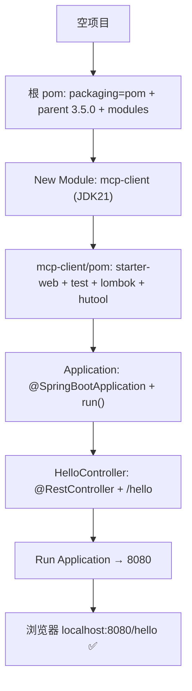

# 6. 使用 Maven 搭建 SpringBoot3 基础架构

## 纲要

- **父子分层工程**：根 pom 用 `packaging=pom` 做「父级 / 聚合工程」，只管理子模块，自己不打包运行
- **根 pom 关键三步**：引入 `spring-boot-starter-parent:3.5.0` 作为 parent、设 `packaging=pom`、声明 `modules`
- **子模块 mcp-client**：JDK 21 + Maven，加 `spring-boot-starter-web` + `spring-boot-starter-test` 即可，版本从父 pom 继承
- **Application 启动类**：`@SpringBootApplication` + `SpringApplication.run(...)`，靠通义灵码自动补全极快
- **HelloController**：`@RestController` + `@GetMapping("/hello")` 返回字符串，跑在 8080 端口
- **依赖继承机制**：面向对象「继承」思想——子模块不写版本号，统一从父 pom 的 BOM 继承
- **国内加速**：Maven 中央仓库可换阿里云镜像（见文末 ops 提示）

## 一、先理解「父级工程」是什么

课程里的项目现在是一个**空项目**。我们要先把它变成一个**多层级的父子工程**：根目录的 pom 是「父级 / 主 pom」，它本身不运行、不发布，只负责统一管理其他子模块。

> 类比：父 pom 像公司的「集团总部」，只定制度和资源；mcp-client / mcp-server 像「子公司」，各自干具体的活。

这种结构的好处：所有子模块的依赖版本、插件配置集中到父 pom 管理，避免每个模块各写各的、版本打架。

## 二、根 pom 的三处关键修改

打开空项目根目录的 pom 文件，做三件事：

### 1. 改 `packaging` 为 `pom`

默认是 `jar`（可独立运行 / 发布），但父级工程不需要运行，改成 `pom`：

```xml
<!-- 父级工程：只做管理与聚合，不打包成可运行 jar -->
<packaging>pom</packaging>
```

### 2. 引入 Spring Boot 父坐标（parent）

去 Maven 中央仓库搜 `spring-boot-starter-parent`，复制 3.5.0 的坐标作为 `<parent>`。但注意父工程里它的 `type` 和 `relativePath` 写法：

```xml
<parent>
    <groupId>org.springframework.boot</groupId>
    <artifactId>spring-boot-starter-parent</artifactId>
    <version>3.5.0</version>
    <type>pom</type>
    <relativePath/> <!-- 从仓库搜索，而非本地相对路径 -->
</parent>
```

> 这里容易踩坑：`relativePath` 默认是 `../pom.xml`，在聚合工程里要写成 `<relativePath/>` 让它去仓库找，否则 IDE 会去上级目录找父 pom 而报错。

### 3. 声明聚合的模块

```xml
<modules>
    <module>mcp-client</module>
    <module>mcp-server</module>
</modules>
```

这样 `mvn install` 时会按依赖顺序把两个子模块一起构建。

### 完整的根 pom 骨架

```xml
<?xml version="1.0" encoding="UTF-8"?>
<project xmlns="http://maven.apache.org/POM/4.0.0"
         xmlns:xsi="http://www.w3.org/2001/XMLSchema-instance"
         xsi:schemaLocation="http://maven.apache.org/POM/4.0.0
                             http://maven.apache.org/xsd/maven-4.0.0.xsd">
    <modelVersion>4.0.0</modelVersion>

    <parent>
        <groupId>org.springframework.boot</groupId>
        <artifactId>spring-boot-starter-parent</artifactId>
        <version>3.5.0</version>
        <type>pom</type>
        <relativePath/>
    </parent>

    <groupId>com.example</groupId>
    <artifactId>springai-mcp-rag-dev</artifactId>
    <version>1.0.0</version>
    <packaging>pom</packaging>
    <name>springai-mcp-rag-dev</name>

    <modules>
        <module>mcp-client</module>
        <module>mcp-server</module>
    </modules>
</project>
```

> 注：上面 `groupId/com.example` 等为课程工程示意，实际以你新建工程时填写的为准。课程里根 pom 还内嵌了一段**阿里云 Maven 镜像的注释说明**，用于国内加速依赖下载（见文末 ops 提示）。

## 三、创建子模块 mcp-client

在 IDEA 里选中项目 → 右键 → New → Module → 选 Java + Maven，JDK 选 **21**，ArtifactId 填 `mcp-client`，其他选项默认，点 Create。

创建完成后，mcp-client 自己的 `pom.xml` 里需要：指定打包方式、引入真正要用的依赖。

### mcp-client 的 pom

```xml
<?xml version="1.0" encoding="UTF-8"?>
<project xmlns="http://maven.apache.org/POM/4.0.0"
         xmlns:xsi="http://www.w3.org/2001/XMLSchema-instance"
         xsi:schemaLocation="http://maven.apache.org/POM/4.0.0
                             http://maven.apache.org/xsd/maven-4.0.0.xsd">
    <modelVersion>4.0.0</modelVersion>

    <!-- 继承根工程的父坐标，自动拿到 spring-boot 的 BOM 管理 -->
    <parent>
        <groupId>com.example</groupId>
        <artifactId>springai-mcp-rag-dev</artifactId>
        <version>1.0.0</version>
    </parent>

    <artifactId>mcp-client</artifactId>
    <packaging>jar</packaging>
    <name>mcp-client</name>

    <dependencies>
        <!-- Web / MVC：提供 @RestController、Tomcat 内嵌 -->
        <dependency>
            <groupId>org.springframework.boot</groupId>
            <artifactId>spring-boot-starter-web</artifactId>
        </dependency>

        <!-- 测试：spring-boot 测试支持，scope=test -->
        <dependency>
            <groupId>org.springframework.boot</groupId>
            <artifactId>spring-boot-starter-test</artifactId>
            <scope>test</scope>
        </dependency>

        <!-- Lombok：@Data / @Slf4j 等，减少样板代码（课程说 90%+ 项目都在用） -->
        <dependency>
            <groupId>org.projectlombok</groupId>
            <artifactId>lombok</artifactId>
            <optional>true</optional>
        </dependency>

        <!-- 工具集：Hutool（国内常用第三方工具） -->
        <dependency>
            <groupId>cn.hutool</groupId>
            <artifactId>hutool-all</artifactId>
            <version>5.8.32</version>
        </dependency>
    </dependencies>
</project>
```

> **关键点**：子模块里**不写版本号**。因为版本由父 pom 的 `spring-boot-starter-parent`（它内部引用了 `spring-boot-dependencies` BOM）统一管理。这就是面向对象的「继承」设计——你只要声明要用什么，版本交给父级。

课程里还顺手加了 Apache Commons 等工具类依赖，原则是：**只加当前这节课用到的，别把老师所有坐标一股脑复制进来，容易冲突报错**。

## 四、Application 启动类

删掉自动生成的 `main` 方法，新建一个 `Application` 类：

```java
package com.example.mcpclient;

import org.springframework.boot.SpringApplication;
import org.springframework.boot.autoconfigure.SpringBootApplication;

@SpringBootApplication
public class Application {
    public static void main(String[] args) {
        // 启动 Spring Boot 应用，参数为当前类（用于扫描同包及子包组件）
        SpringApplication.run(Application.class, args);
    }
}
```

> 课程里用「通义灵码」做自动补全：`@SpringBootApplication` 打头、`SpringApplication.run` 自动带出 `Application.class` 参数，几乎不用手敲。通义灵码是本课强烈推荐的效率工具。

## 五、HelloController：你的第一个接口

建包 `controller`，写 `HelloController`：

```java
package com.example.mcpclient.controller;

import org.springframework.web.bind.annotation.GetMapping;
import org.springframework.web.bind.annotation.RestController;

@RestController // 声明为 Web 控制器，被 Spring 容器扫描并执行
public class HelloController {

    @GetMapping("/hello") // GET 请求即可在浏览器直接访问
    public String hello() {
        return "Hello 风间影院"; // 课程演示用的返回串，可改成任意文本
    }
}
```

- `@RestController` = `@Controller` + `@ResponseBody`，返回值直接写进 HTTP body。
- `@GetMapping("/hello")` 等价于 `@RequestMapping(value="/hello",method=GET)`，浏览器地址栏敲 URL 就能触发（GET 方法）。
- 路由规律：`/hello` 对应方法，`/word` 之类可再加一层路径（如 `/hello/word`）。

## 六、运行与验证

课程建议的习惯：**在 IDEA 右侧 Maven 面板先点 `install` 构建一遍**，排查潜在问题，再运行。

1. 右键 `Application` 类 → Run。
2. 控制台看到应用成功启动，运行在 **8080** 端口。
3. 浏览器访问 `http://localhost:8080/hello`（或 `127.0.0.1:8080/hello`、本机内网 IP 均可），页面返回 `Hello 风间影院` 即代表 Spring Boot Web 构建成功。



> 端口说明：`8080` 是 Spring Boot 默认。后面会讲怎么改端口、怎么配多环境。本地 IP 用 `127.0.0.1` 或 `localhost` 等价；同局域网其他机器用你本机内网 IP 才能访问。

## 七、常见错误排查

| 现象 | 根因 | 解决 |
|---|---|---|
| 引入 parent 后 IDE 报「找不到父 pom」 | `relativePath` 默认指向上级目录 | 改成 `<relativePath/>` 让它去仓库找 |
| 启动报 `Unsupported class file major version` | 项目 JDK 仍是 8/11 | IDEA 把 Project SDK 切到 JDK 21 |
| 依赖下载极慢 / 卡住 | 默认连 Maven 中央仓库（境外） | 配阿里云镜像（见文末） |
| 访问 8080 无响应 | 端口被占用 / 应用没真起来 | `lsof -i:8080` 查占用；看控制台是否 BUILD SUCCESS |
| `mvn install` 报依赖冲突 | 复制了过多不相关坐标 | 只保留当前章节用到的依赖 |

## 八、FAQ

**Q1：为什么父工程用 packaging=pom 而不是 jar？**
父工程只做聚合与管理，自身不打包运行。若写 jar，Maven 会尝试把它打成可执行包却无主类，多余且易错。

**Q2：子模块不写版本号不会出问题吗？**
不会——`spring-boot-starter-parent` 内部通过 `spring-boot-dependencies` BOM 锁定了所有官方 starter 的版本。子模块只声明 `artifactId` 即可继承正确版本。

**Q3：Lombok 的 optional=true 是什么意思？**
标记该依赖为可选，不会传递给依赖本模块的其他模块，避免污染下游 classpath，同时本模块编译期可用。

**Q4：通义灵码是必须的吗？**
不是必须，但强烈推荐。本课大量用它的自动补全提升编码效率，不装也能照着代码手敲。

**Q5：mcp-server 模块这节就要建吗？**
根 pom 里已经声明了 `<module>mcp-server</module>`，但本节课先聚焦 mcp-client。mcp-server 会在讲 MCP 服务（前述）时再填充内容。

## 九、面试高频问答（工程搭建篇）

**1. Maven 父子工程（聚合 vs 继承）有什么区别？**
聚合（`<modules>`）是为了一条命令构建多个模块；继承（`<parent>`）是为了复用配置与依赖版本。实践中两者常结合：父 pom 既是聚合器又是 parent。

**2. spring-boot-starter-parent 做了什么？**
它引入 `spring-boot-dependencies` BOM 统一管理依赖版本，提供默认插件配置（如 repackage 打包）、默认资源过滤与 Java 版本，让你「零配置」起步。

**3. 为什么子模块依赖可以不写 version？**
因为 parent 的 BOM 已声明了版本，Maven 依赖调解时会采用 BOM 中锁定的版本，避免版本冲突。

**4. Lombok 在编译期怎么工作的？**
Lombok 通过注解处理器（Annotation Processor）在编译阶段修改 AST，自动生成 getter/setter/构造器/日志字段，字节码里就有这些方法，运行时无需额外依赖。

**5. 怎么让 Spring Boot 打成一个可执行 jar？**
`spring-boot-maven-plugin` 的 `repackage` 目标会把依赖打进 `BOOT-INF/lib`，并写入 `Main-Class` 启动器，`java -jar xxx.jar` 直接运行。

## 十、ops 提示（国内环境必看）

> **Maven 国内加速**：默认中央仓库在境外，依赖下载常超时。在 `~/.m2/settings.xml` 的 `<mirrors>` 中加入阿里云镜像：
> ```xml
> <mirror>
> <id>aliyun-maven</id>
> <name>Aliyun Maven</name>
> <url>https://maven.aliyun.com/repository/public</url>
> <mirrorOf>central</mirrorOf>
> </mirror>
> ```
> 课程根 pom 内也附了这段镜像说明。注意：仅镜像 `central`，不要 `mirrorOf=*`，否则 Spring 自己的里程碑仓库会被一起屏蔽。

> **JDK 与 IDEA 对齐**：确认 IDEA 的 `Project Structure → SDKs` 指向 JDK 21，且 `File → Settings → Build → Maven → Runner → JRE` 也选 21，否则命令行 `mvn` 与 IDE 可能用不同 JDK 导致诡异报错。

## 十、mcp-server 模块：课程真实工程长什么样

前面聚焦 mcp-client。课程工程的另一个核心模块是 **mcp-server**——它用 WebFlux 把工具暴露成 MCP 服务，内部集成 MySQL（MyBatis-Plus）、邮件、Markdown 解析等能力。它的 `pom.xml` 片段（来自课程 `springai-mcp-rag-dev` 工程）长这样：

```xml
<dependencies>
    <!-- MCP 服务端：基于 WebFlux 暴露 SSE 类型 MCP 服务 -->
    <dependency>
        <groupId>org.springframework.ai</groupId>
        <artifactId>spring-ai-starter-mcp-server-webflux</artifactId>
    </dependency>
    <!-- 数据库 -->
    <dependency>
        <groupId>com.baomidou</groupId>
        <artifactId>mybatis-plus-spring-boot3-starter</artifactId>
        <version>3.5.7</version>
    </dependency>
    <dependency>
        <groupId>com.mysql</groupId>
        <artifactId>mysql-connector-j</artifactId>
        <scope>runtime</scope>
    </dependency>
    <!-- 邮件 -->
    <dependency>
        <groupId>org.springframework.boot</groupId>
        <artifactId>spring-boot-starter-mail</artifactId>
    </dependency>
    <!-- Markdown 转 HTML（邮件内容美化） -->
    <dependency>
        <groupId>org.commonmark</groupId>
        <artifactId>commonmark</artifactId>
        <version>0.21.0</version>
    </dependency>
    <dependency>
        <groupId>org.projectlombok</groupId>
        <artifactId>lombok</artifactId>
        <optional>true</optional>
    </dependency>
</dependencies>
```

它的 `Application` 用 `MethodToolCallbackProvider` 把加了 `@Tool` 注解的方法注册成模型可调用工具：

```java
@SpringBootApplication
public class McpServerApplication {
    public static void main(String[] args) {
        SpringApplication.run(McpServerApplication.class, args);
    }

    // 把 ProductTool / EmailTool / DateTool 里 @Tool 方法批量注册为 MCP 工具
    @Bean
    public ToolCallbackProvider toolCallbackProvider(
            ProductTool productTool, EmailTool emailTool, DateTool dateTool) {
        return MethodToolCallbackProvider.builder()
                .toolObjects(productTool, emailTool, dateTool)
                .build();
    }
}
```

> 这段代码是后面前述「MCP 服务与工具」的主干。这里先建立印象：mcp-client 负责「调用大模型 + 编排」，mcp-server 负责「提供工具」，二者通过 MCP 协议解耦。

## 十一、Maven 构建生命周期与常用命令

父子工程下，`mvn` 命令的作用域很关键：

```bash
# 在根目录执行：构建全部模块（按依赖顺序）
mvn clean install

# 只构建某个模块（-pl 指定模块，-am 同时构建其依赖）
mvn -pl mcp-client -am clean install

# 跳过测试（紧急修复时，不推荐常态使用）
mvn install -DskipTests

# 只跑测试不打包
mvn test
```

> `clean install` 里的 `clean` 会删 `target/` 重新编译，能排掉「改了代码没生效」的缓存诡异问题——课程里老师习惯先 `install` 再运行，就是这个道理。

## 十二、构建排错高频场景

| 场景 | 根因 | 处理 |
|---|---|---|
| `Cannot resolve spring-boot-starter-parent:3.5.0` | 仓库没同步 / 网络不通 | 配阿里云镜像；`mvn -U` 强刷 |
| 子模块找不到父 pom | `relativePath` 没设空 | 父工程管理模块用 `<relativePath/>` |
| 依赖冲突 `NoSuchMethodError` | 两个版本打架 | `mvn dependency:tree` 看树，exclusions 排除 |
| Lombok 注解不生效 | 注解处理器未启用 / IDE 未装插件 | IDEA 装 Lombok 插件并开 Annotation Processing |
| jar 跑起来报 `no main manifest` | 缺 spring-boot-maven-plugin | 确认 repackage 目标已配置 |

> 排错第一招永远是 `mvn dependency:tree` 和 `mvn -X` 开 debug 日志，别靠猜。

## 十三、父子工程速记（背下来）

- 父 pom：`packaging=pom` + `spring-boot-starter-parent:3.5.0` + `<modules>` 聚合。
- 子模块：继承父 pom，依赖**不写版本号**（由 BOM 管）。
- `relativePath` 默认指向上级目录，聚合工程里写成 `<relativePath/>` 让它去仓库找。
- 工程结构：根（聚合）+ mcp-client（Web/调用）+ mcp-server（工具/MCP 服务）。
- 验证：`mvn -pl mcp-client -am install` → 跑 `Application` → `localhost:8080/hello`。
- 排错首选：`mvn dependency:tree` 与 `mvn -X`，别靠猜。

### 易错点速记（本节）
- 忘了把聚合工程的 `packaging` 改成 `pom` —— 父工程被当成可运行 jar，报错。
- 子 pom 没设 `<relativePath/>` —— IDE 去上级目录找父 pom，找不到。
- 子模块依赖写了版本号 —— 与父 BOM 冲突，或版本不一致埋雷。
- `mvn` 与 IDEA 用不同 JDK —— 命令行能跑、IDE 报错，或反之。
- 没装 Lombok 插件却用 `@Data` —— 编译期找不到 getter/setter。
- 一次复制老师所有坐标 —— 不相关的依赖冲突，启动即 `NoSuchMethodError`。

### 补充建议（落地清单）
- 把构建命令写进 README，新人 clone 后即 `mvn install` 一条龙跑通，降低上手成本。
- CI 与本地用同一份 Maven 命令与 JDK 版本，彻底消灭「我本地能跑」类环境差异。
- 根 pom 锁定插件版本（含 spring-boot-maven-plugin），避免不同机器构建产物不一致。

## 十四、本章小结与下一步

你现在已经从零搭出父子工程，跑通了第一个 8080 接口。下一步要做的，是让项目「可配置」——默认配置生产不可用，我们要用 `application.yml` 自定义端口、应用名、日志级别，并学会多环境解耦。

**📌 实践建议**：父子工程建好后，第一时间把 `target/`、`*.iml` 加进 `.gitignore`，并把根 pom 的 `<modules>` 与 CI 的构建命令对齐——多人协作时「本地能跑、CI 挂掉」八成是 ignore 或 JDK 版本没对齐。CI 里显式声明 `JAVA_HOME` 与 Maven 版本，能消灭大部分「我本地能跑」类环境差异问题。
