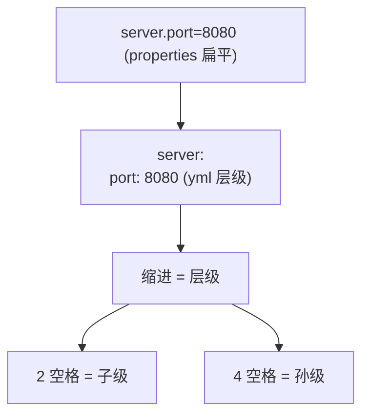

# 7. SpringBoot 配置管理：application.yml 的妙用

## 纲要

- **默认配置不够用**：刚跑起来的项目全是默认配置，发布前必须自定义
- **配置文件名固定**：`resources/application.yml`（yml 是 YAML 简称），Spring 自动加载
- **yml 层级靠缩进**：用「点」分隔的扁平写法（如 `server.port`）在 yml 里变成换行 + 子层级，靠**两个空格**缩进表达从属关系
- **三个最常用配置**：`server.port`（端口）、`spring.application.name`（应用名）、`logging.level`（日志级别）
- **日志级别**：debug 信息极多（自动装配过程全打），生产一般用 `info`；可按包精细控制
- **改完要重启**：yml 修改后需重新启动应用才生效，且访问 URL 的端口要同步改

## 一、为什么需要 application.yml

前面把父子工程搭起来、Hello World 跑通了——但那时**所有配置都是 Spring Boot 的默认值**（端口 8080、无应用名、日志默认级别）。真正做项目要发布，不可能用默认值：端口要规划、应用要起名、日志要控量。

在 `resources` 资源文件夹右键 → New → File，取名 `application.yml`（注意拼写，少一个字母都不认），Spring 会自动加载它。

```yaml
# resources/application.yml
server:
  port: 8080          # 服务端口，默认为 8080
```

> yml 文件名必须叫 `application.yml`（或 `application.properties` / `application.yaml`）。名字不一致 Spring 不会加载，配置全失效。

## 二、yml 的层级语法（最容易写错的地方）

在 properties 里你看到的是扁平的 `server.port=8080`；但在 yml 里，点号被翻译成**换行 + 缩进层级**，用冒号 `:` 区隔：

```yaml
server:
  port: 8080        # server 的子级，缩进 2 个空格
  address: 127.0.0.1
```

**缩进规则（铁律）：**
- 用**空格**缩进，不要用 Tab（IDEA 默认把 Tab 转成空格，但手敲文件时注意）。
- 每一层比上一层多 **2 个空格**（行业惯例）。如果下面还有层级，再 +2（4 空格），以此类推。
- 层级关系完全由缩进决定，写错缩进 = 配置进了错误的节点 = 不生效或报错。



## 三、三个最常用配置项

### 1. server.port —— 改端口

```yaml
server:
  port: 7070    # 把默认 8080 改成 7070
```

改完**重启应用**，再访问时浏览器 URL 的端口也要改成 `7070`，否则旧端口已失效、访问不到。

> 课程演示：原本 8080 能访问，改成 7070 后，浏览器仍用 8080 就打不开——必须端口一致。

### 2. spring.application.name —— 应用名

```yaml
spring:
  application:
    name: springai-mcp-client   # 当前模块（mcp-client）的名字
```

注意 `spring.application.name` 后面**没有等号**——yml 里键值用 `key: value`（冒号 + 空格 + 值）。为空时显示默认，建议显式起名，方便链路追踪、注册中心识别。

### 3. logging.level —— 日志级别

```yaml
logging:
  level:
    root: info    # 根日志级别
```

课程演示了把 `root` 设成 `debug` 后，控制台瞬间刷出大量日志（自动装配过程、bean 处理细节全打出来）。这种信息太多，通常不用。`info` 是推荐默认；更高要求可用 `warn` / `error` 进一步降噪。

```yaml
logging:
  level:
    root: info
    com.example.mcpclient: debug   # 只对自己包开 debug，其他保持 info
```

> 精细控制技巧：按**包路径**单独设级别。自己的业务包开 `debug` 排错，第三方包保持 `info`，既不漏关键信息也不被噪声淹没。

## 四、一份典型的基础 application.yml

把上面三项合起来，mcp-client 的基础配置长这样：

```yaml
server:
  port: 8080

spring:
  application:
    name: springai-mcp-client

logging:
  level:
    root: info
```

就这么几行，已经比「全默认」专业很多：端口明确、应用有名、日志可控。

## 五、配置不生效的常见原因

| 现象 | 根因 | 修复 |
|---|---|---|
| 配置完全没反应 | 文件名不是 `application.yml` | 改名，确保拼写 |
| 端口改了但还是 8080 | 没重启应用 | 重启，且 URL 端口同步改 |
| 启动报 `mapping values are not allowed` | yml 缩进 / 冒号格式错 | 检查冒号后有无空格、缩进是否用空格 |
| 某个子项不生效 | 缩进层级写错，节点挂错父级 | 对照文档核对缩进 |
| 中文乱码 | 文件编码非 UTF-8 | IDEA 把文件编码设为 UTF-8 |

> yml 对格式极其敏感：`key:` 后面必须有空格再跟值；字符串含冒号或特殊字符建议加引号。一个小空格错就能让整个文件解析失败。

## 六、FAQ

**Q1：yml 和 properties 用哪个？**
都能用，Spring 都认。yml 层级清晰、可读性高，适合配置多的项目；properties 扁平简单、改起来快。课程统一用 yml。

**Q2：可以用 application.yaml 吗？**
可以。`application.yml` 和 `application.yaml` 等价。但不能同时大量重复定义，后加载的会覆盖先加载的。

**Q3：logging.level.root=debug 会不会影响性能？**
开发期影响可忽略；生产期 `debug` 会大量写日志、拖慢 IO 且占磁盘，**生产务必 info 及以上**。

**Q4：配置改了一定要重启吗？**
`application.yml` 是启动期加载，改了需重启。若想热更新，可用 `@ConfigurationProperties` + `@RefreshScope`（配合 Spring Cloud / 配置中心），那是进阶话题。

**Q5：端口被占用怎么办？**
换一个未被占用的端口（如 7070 / 9090）；或 `lsof -i:8080` 找到占用进程并释放。

## 七、面试高频问答（配置篇）

**1. yml 和 properties 在加载优先级上谁高？**
同名配置下，Spring 按 `application.properties` > `application.yml` > `application.yaml` 的顺序，**后加载的覆盖先加载的**？实际规则复杂（还有 profile 叠加），结论是：别在同一项目混用同名字段制造歧义，统一一种格式最稳。

**2. Spring Boot 配置加载顺序大概是怎样的？**
大致：命令行参数 > 环境变量 > 外部 `application-{profile}.yml` > 打包内的 `application.yml` > 默认配置。外部化配置优先，便于容器化部署时覆盖。

**3. 为什么生产环境日志不能开 debug？**
debug 日志量巨大，会拖慢应用、快速占满磁盘、掩盖真正有价值的 info/warn 信息，且可能泄露内部细节。生产用 info/warn/error。

**4. @Value 和 @ConfigurationProperties 怎么选？**
`@Value` 适合注入单个零散值；`@ConfigurationProperties` 适合把一组相关配置绑定成一个强类型 Bean，类型安全、支持宽松绑定与校验，推荐用于复杂配置。

**5. 多环境配置除了 profile 还有别的方案吗？**
有：环境变量注入、配置中心（Nacos / Apollo / Spring Cloud Config）、启动参数 `--spring.profiles.active`。容器化场景多用环境变量 + 配置中心。

## 八、本章小结与下一步

你已经掌握 `application.yml` 的基础：会改名、会写层级、会改端口 / 应用名 / 日志级别，也知道 yml 缩进是「层级即真理」。但真实项目有开发、测试、预发、生产多套环境，端口和配置各不相同——频繁改同一个文件既麻烦又易错。## 八、yml 里的数据类型与写法

yml 不只是「字符串」，常见类型写法：

```yaml
server:
  port: 8080          # 数字（不用引号）
  ssl:
    enabled: false    # 布尔
  names:              # 列表（两种写法都行）
    - alice
    - bob
  config:             # 行内对象
    timeout: 30s
    url: "http://localhost"   # 含特殊字符的值加引号
```

> 新手最常错：把 `port: "8080"` 写成字符串导致类型不匹配；或布尔写 `enable: off`（yml 认 `true/false`，不认 on/off）。

## 九、在代码里读取配置：@Value 与 @ConfigurationProperties

写进 yml 的配置，代码里这样取：

```java
// 方式一：@Value 取单个值
@Value("${server.port:8080}")
private int port;

// 方式二：@ConfigurationProperties 绑一组（推荐复杂配置）
@ConfigurationProperties(prefix = "app.mail")
@Component
public class MailProperties {
    private String host;
    private String from;
    // getter/setter
}
```

`@ConfigurationProperties` 支持松绑定（`app.mail.host` ↔ `app.mail.host`）、类型安全、JSR-303 校验，比 `@Value` 更适合成组配置。

## 十、配置优先级速查（排错必备）

当「配置不生效」时，先想清楚谁覆盖了谁。从低到高（后者覆盖前者）：

1. 打包内的 `application.yml`
2. 打包内的 `application-{profile}.yml`
3. 外部目录的 `application.yml`（与 jar 同目录 / config 子目录）
4. 环境变量
5. 命令行参数 `--server.port=9090`

> 口诀：**越靠「外部 / 启动期注入」优先级越高**。容器化部署时几乎全靠 4/5 两项，jar 内部的 yml 只放默认值。

## 十一、常见 yml 错误案例（排错速查）

| 你写的 | 现象 | 正确写法 |
|---|---|---|
| `server.port:8080`（冒号后无空格） | 解析失败 | `server.port: 8080` |
| 用 Tab 缩进 | 层级错乱 | 统一 2 空格 |
| `port: "8080"` | 类型是字符串，偶发类型不匹配 | 数字别加引号 |
| `enabled: off` | 不是布尔 | `enabled: false` |
| 中文冒号 `：` | 解析异常 | 用英文半角 `:` |
| 重复 key | 后者覆盖前者，难排查 | 搜索确认无重复 |

> yml 对格式零容忍，一个空格错全盘皆输。IDEA 有 yml 插件会实时标红，务必开着。

## 十二、配置安全红线

- **密钥不进 yml**：数据库密码、API Key 走 `.env` / 环境变量 / 配置中心，yml 只放占位。
- **`.env` 进 `.gitignore`**：避免密钥随代码提交泄露。
- **生产禁用 debug 日志**：防止敏感信息（SQL 参数、 token 片段）落盘。
- **不同环境密码强度不同**：本地可用弱密码方便，生产必须强密码 + 内网隔离。

## 十三、properties 与 yml 对照小抄

同一份配置两种写法，按需选用：

```properties
# application.properties
server.port=8080
spring.application.name=springai-mcp-client
logging.level.root=info
```

```yaml
# application.yml（等价）
server:
  port: 8080
spring:
  application:
    name: springai-mcp-client
logging:
  level:
    root: info
```

> 选 yml 的理由：层级清晰、支持列表 / 对象、可读性高，适合配置多的项目。本课统一 yml。两者可共存但同名冲突时以后加载者为准，别混用制造歧义。

### 易错点速记（本节）
- 冒号后没空格 `port:8080` —— yml 解析失败，服务起不来。
- 用 Tab 缩进 —— 层级错乱，配置进了错误节点。
- 布尔写 `enabled: off` —— yml 只认 `true/false`。
- 数字加引号 `"8080"` —— 偶尔触发类型不匹配。
- 重复 key —— 后者静默覆盖前者，排查极难。
- 中文冒号 `：` —— 配置整体解析异常。
- 改了 yml 不重启 —— 启动期配置，改完必须重启应用。

**📌 实践建议**：yml 的缩进和冒号格式用 IDEA 的 Spring 插件实时校验，别等启动时才报错。团队里统一「2 空格缩进 + 冒号后空格」的书写规范，能省掉大量低级排错时间。提交前用 IDE 的 yml 校验面板扫一遍，比启动报错再回头找空格高效得多。

### 补充建议（落地清单）
- 配置样例随代码一起提交到仓库，新人照抄即可，不必从零摸索 yml 格式。
- 团队共用一份 yml 模板（含端口 / 日志 / 应用名占位），格式问题集中消灭。
- 对 `application.yml` 做基础 lint（缩进、必填项），提交前卡住低级错误。

