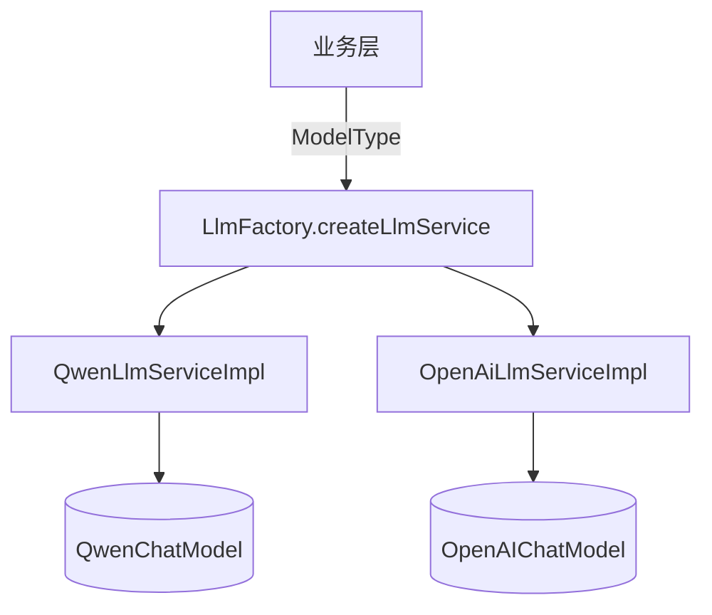

# 13. 工厂模式：统一多模型接入层

## 纲要

- **痛点**：每接一个模型都手写 API 构造，重复率高、维护难
- **方案**：工厂模式 —— 传入模型类型标识，由工厂构建对应客户端
- **三件套**：`ModelType` 枚举 + `LlmFactory.createLlmService()` + `LlmService` 接口及实现
- **收益**：业务层只依赖接口，底层客户端可灵活替换
- **扩展**：新增模型只需加枚举值 + 实现类

> 本章用设计模式收敛多模型接入复杂度，按课程口径重构；代码为课程示意。

## 一、为什么需要工厂

已接入 DeepSeek、通义千问、万象、百炼 DeepSeek 等多个模型，每接一个都要写一套客户端构造。业务代码若直接 `new` 具体客户端，耦合高、重复多。工厂模式把「构造哪类客户端」收口到一处。

## 二、模型类型枚举

```java
public enum ModelType {
    OPEN_AI,
    QWEN
    // 后续新增模型在此追加
}
```

## 三、统一接口

```java
public interface LlmService {
    String chat(String prompt);
}
```

## 四、工厂类

```java
public class LlmFactory {

    public static LlmService createLlmService(ModelType type) {
        return switch (type) {
            case QWEN  -> new QwenLlmServiceImpl();
            case OPEN_AI -> new OpenAiLlmServiceImpl();
        };
    }
}
```

## 五、实现类

每个实现类在构造函数里构造自己的客户端：

```java
public class QwenLlmServiceImpl implements LlmService {
    private final QwenChatModel model;

    public QwenLlmServiceImpl() {
        this.model = QwenChatModel.builder()
                .apiKey(System.getenv("DASHSCOPE_API_KEY"))
                .modelName("qwen-plus")
                .build();
    }

    @Override
    public String chat(String prompt) {
        return model.chat(prompt);
    }
}
```

```java
public class OpenAiLlmServiceImpl implements LlmService {
    private final OpenAIChatModel model;

    public OpenAiLlmServiceImpl() {
        this.model = OpenAIChatModel.builder()
                .baseUrl("https://api.openai.com/v1")
                .apiKey(System.getenv("OPENAI_API_KEY"))
                .modelName("gpt-4o-mini")
                .build();
    }

    @Override
    public String chat(String prompt) {
        return model.chat(prompt);
    }
}
```

## 六、业务调用

```java
LlmService svc = LlmFactory.createLlmService(ModelType.QWEN);
String ans = svc.chat("你好");
```

业务层只认 `LlmService` 接口，底层换模型只需改枚举参数，无需改动调用方。



## 七、FAQ

**Q1：工厂模式解决什么问题？**
收口多模型客户端的构造逻辑，降低耦合与重复代码，便于扩展。

**Q2：新增一个模型要改几处？**
枚举加一项 + 新增一个实现类 + 工厂 switch 加一个分支，调用方零改动。

**Q3：和直接用 starter 注入比？**
starter 适合固定 few 模型；工厂适合需要运行时按标识动态选模型的场景。

## 八、面试高频问答

1. **这里工厂模式属于哪种？** 简单工厂（静态方法按类型返回产品）。
2. **如何避免 switch 膨胀？** 可进阶为工厂方法模式或注册表（Map<ModelType,Supplier>）。
3. **为什么接口返回 Service 而非 Model？** 屏蔽底层差异，业务只关心 `chat` 能力。

## 九、ops 提示

> **密钥来源**：实现类里用 `System.getenv()` 取 key，避免硬编码；生产配合配置中心。
>
> **可扩展性**：模型多到一定量时，把 `switch` 换成「类型→Supplier」注册表，消除分支修改。
>
> **统一抽象**：若后续要同时支持 ImageModel，可在接口层再抽象「能力类型」，避免 chat 与 generate 混用。

