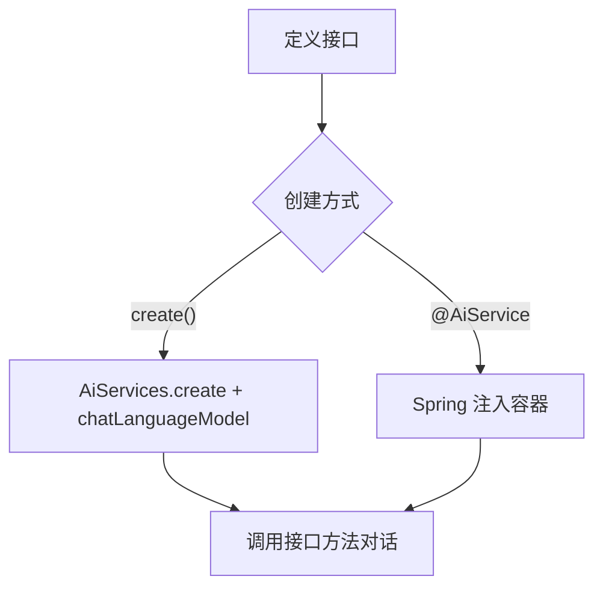

# 15. AiService 创建实战：create() 与 @AiService 注解

## 纲要

- **依赖**：高阶 `langchain4j` 全量坐标（受 bom 管理，免写版本）
- **方式一 create()**：`AiServices.create(接口.class).chatLanguageModel(model).build()` 一行构造
- **方式二 注解**：接口标 `@AiService`，启动后注入 Spring 上下文，免手动构造
- **易错点**：注解方式若上下文有多个模型，必须显式指定用哪个，否则启动报错
- **交互**：调用接口方法即与大模型对话

> 本章落地两种 AiService 创建方式，按课程口径重构；代码为课程示意，去品牌与脱敏处理。

## 一、引入高阶依赖

```xml
<dependency>
    <groupId>dev.langchain4j</groupId>
    <artifactId>langchain4j</artifactId>
</dependency>
```

## 二、方式一：AiServices.create()

先定义交互接口，再用 `create()` 把具体模型注入，返回动态代理对象：

```java
public interface Assistant {
    String chat(String userMessage);
}

Assistant assistant = AiServices.create(Assistant.class)
        .chatLanguageModel(qwenModel)   // 传入具体 ChatLanguageModel
        .build();

String answer = assistant.chat("你好");
```

一行构造出「能对话的接口实现」，屏蔽了底层请求 / 响应细节。

## 三、方式二：@AiService 注解

在接口上标 `@AiService`，Spring 启动时自动把它注入容器，测试 / 业务直接 `@Autowired`：

```java
@AiService
public interface Assistant {
    String chat(String userMessage);
}

// 业务中使用
@Autowired
private Assistant assistant;
```

## 四、易错点：模型未指定

注解方式下，若 Spring 上下文存在 **多个** `ChatLanguageModel` Bean，框架不知道用哪个，启动会报错。需保证「有且仅有一个」候选模型，或显式指定：

```java
@AiService(wiringMode = EXPLICIT)   // 显式装配
public interface Assistant {
    String chat(String userMessage);
}
```

> 实操：上下文中只保留当前要用的模型 Bean（如只配通义千问），避免歧义。



## 五、FAQ

**Q1：两种创建方式怎么选？**
快速试验用 `create()`；与 Spring 工程集成用 `@AiService` 更优雅。

**Q2：注解方式报「不知道用哪个模型」？**
上下文有多个模型 Bean，需收敛为单一或显式 wiring。

**Q3：接口方法能传复杂参数吗？**
能；参数会被框架格式化为消息，也可返回 POJO（输出解析）。

## 六、面试高频问答

1. **AiService 两种创建方式？** 编程式 `AiServices.create()` 与声明式 `@AiService` 注解。
2. **注解方式为什么要指定模型？** 多模型 Bean 存在歧义，需唯一或显式装配。
3. **@AiService 底层？** 框架扫描接口生成动态代理 Bean 注入 Spring。

## 七、ops 提示

> **模型唯一性**：生产多模型场景，用 `wiringMode=EXPLICIT` + 显式 `@Bean` 绑定，避免启动歧义。
>
> **依赖范围**：AiService 来自 `langchain4j` 主模块，确认已引入，否则 `@AiService` 不生效。
>
> **可测性**：保留一个 `@SpringBootTest` 验证代理注入成功，作为接入冒烟测试。

