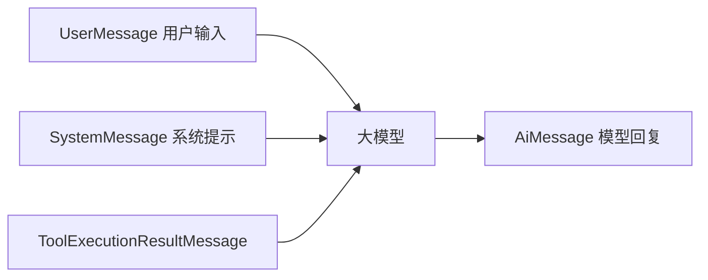

# 16. AiService 消息类型：UserMessage / SystemMessage / AiMessage

## 纲要

- **会话真相**：每次 `chat()` 调用默认是「新会话」，模型不记得上一轮（无记忆）
- **底层封装**：入参被包成 `UserMessage`，返回被包成 `AiMessage`
- **消息家族**：`UserMessage`（用户） / `SystemMessage`（系统提示词） / `AiMessage`（模型回复） / `ToolExecutionResultMessage`（工具结果）
- **SystemMessage 与 UserMessage 区别**：前者由应用设定（如「你扮演作家」），后者是用户输入
- **记忆与工具**：记忆在后章讲；工具结果消息在 Tools 章展开

> 本章拆解大模型消息结构，理解 AiService 的底层数据形态，按课程口径重构；代码为课程示意。

## 一、会话是无记忆的

反复调用 `model.chat("你是谁？")` / `model.chat("我是谁？")`，两次是 **独立的新会话**。若不主动维护历史，模型第二次并不知道你第一次说了「我是玄三」。记忆能力需后续 ChatMemory 接入。

## 二、底层消息封装

框架在调用 `chat` 时，把你的入参包成 `UserMessage`；模型回复包成 `AiMessage`：

```java
// 等价底层逻辑
UserMessage um = UserMessage.from("你是谁？");
Response<AiMessage> resp = model.generate(um);
AiMessage am = resp.content();
System.out.println(am.text());
```

## 三、消息类型家族

| 类型 | 角色 | 来源 |
|---|---|---|
| `UserMessage` | 用户发给模型的消息 | 用户输入 |
| `SystemMessage` | 系统提示词 | 应用设定（如「你是一名作家」） |
| `AiMessage` | 模型回复 | 大模型生成 |
| `ToolExecutionResultMessage` | 工具执行结果 | 工具调用返回（Tools 章详述） |

**关键区别**：`SystemMessage` 是「应用替用户设定的上下文 / 人设」，与 `UserMessage`（真实用户输入）不同。例如作家应用里「请你扮演一名作家」就是 SystemMessage。



## 四、为什么关心消息类型

- 排错时看源码，能确认入参被包成了哪种消息；
- 后续做记忆 / 多轮对话，本质就是维护 `UserMessage` + `AiMessage` 的历史列表；
- `SystemMessage` 是控制模型行为（人设 / 约束）的主要手段。

## 五、FAQ

**Q1：为什么模型不记得上一句？**
默认无记忆，每次调用独立；需 ChatMemory 维护历史。

**Q2：SystemMessage 能动态改吗？**
能；可在每次请求前注入不同系统提示，控制模型人设。

**Q3：ToolExecutionResultMessage 是什么？**
工具调用后的执行结果消息，让模型基于结果继续推理，Tools 章展开。

## 六、面试高频问答

1. **大模型四类核心消息？** UserMessage / SystemMessage / AiMessage / ToolExecutionResultMessage。
2. **System 与 User 消息区别？** 前者应用设定的人设 / 约束，后者真实用户输入。
3. **为什么默认无记忆？** 每次 chat 是新会话，历史需显式维护（ChatMemory）。

## 七、ops 提示

> **人设靠 SystemMessage**：把角色 / 输出格式约束写在系统消息，比塞进用户消息更稳定。
>
> **记忆预留**：多轮对话务必引入 ChatMemory，否则用户体验断裂。
>
> **源码视角**：排错时从 `UserMessage` / `AiMessage` 入手，确认消息构造是否符合预期。

