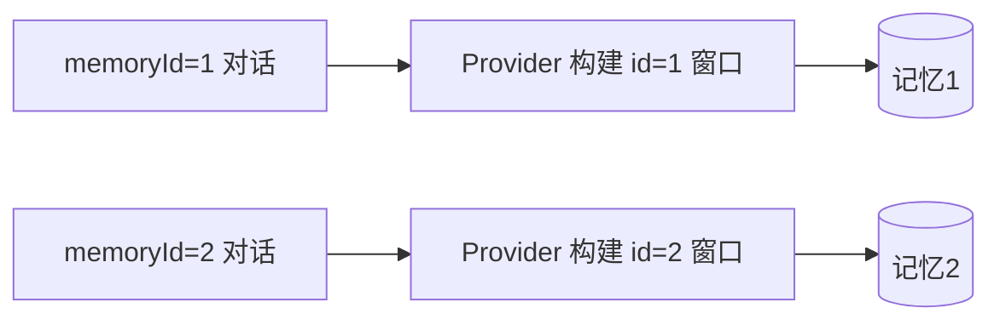

# 19. ChatMemory 会话隔离机制：memoryId 与 Provider

## 纲要

- **问题**：多用户共用一个记忆，或同一用户想同时开多个会话，会串味
- **方案**：`@AiService(chatMemoryProvider=...)` + 方法入参 `@MemoryId` + `@UserMessage`
- **隔离原理**：每个 `memoryId` 对应独立记忆窗口
- **ChatMemoryProvider**：按 memoryId 动态构建 `MessageWindowChatMemory`
- **验证**：memoryId=1 记得历史，memoryId=2 不知情 —— 隔离成立

> 本章解决「多用户 / 多会话」记忆隔离，按课程口径重构；代码为课程示意，去品牌与脱敏处理。

## 一、为什么需要隔离

默认所有调用共用同一记忆，用户 A 能看到用户 B 的对话。现实需要：每个用户有唯一 ID，或同一用户并发多个会话，必须隔离。

## 二、声明式隔离

```java
@AiService(chatMemoryProvider = "myProvider")
public interface Assistant {
    String chat(@MemoryId String memoryId, @UserMessage String message);
}

@Configuration
class ChatConfig {
    @Bean
    public ChatMemoryProvider myProvider() {
        return memoryId -> MessageWindowChatMemory.builder()
                .id(memoryId)          // 用业务 ID 作为隔离键
                .maxMessages(10)
                .build();
    }
}
```

## 三、隔离原理

- **`@MemoryId`**：传入业务唯一标识（如用户 ID / 会话 ID），作为记忆隔离的 key。
- **`ChatMemoryProvider`**：每次调用按 `memoryId` 返回（或复用）对应窗口，不同 ID 互不干扰。



## 四、验证隔离

```java
assistant.chat("1", "我是玄风");      // memoryId=1 建立历史
assistant.chat("1", "我是谁？");      // 记得「玄风」
assistant.chat("2", "我是谁？");      // memoryId=2 不知情，隔离生效
```

## 五、FAQ

**Q1：memoryId 用什么值？**
业务唯一标识：用户 ID、会话 ID、设备 ID 等。

**Q2：Provider 每次都 new 窗口吗？**
框架通常按 id 缓存复用；实现时也可自行维护 Map 缓存。

**Q3：和单记忆 Bean 区别？**
单 Bean 是「全局共享一个窗口」；Provider 是「按 id 多窗口隔离」。

## 六、面试高频问答

1. **多用户记忆如何隔离？** 用 `@MemoryId` + `ChatMemoryProvider`，每个 id 独立窗口。
2. **隔离的底层 key 是什么？** `memoryId` 作为 ChatMemoryStore 的存储键。
3. **Provider 的职责？** 按 memoryId 提供 / 复用对应的 MessageWindowChatMemory。

## 七、ops 提示

> **ID 安全**：memoryId 若为用户 ID，注意鉴权，避免越权读取他人会话。
>
> **缓存策略**：Provider 内用 Map 缓存窗口，控制内存与 GC 压力。
>
> **持久化结合**：生产建议 Provider 指向自定义持久化存储（后章 MySQL），重启不丢。

