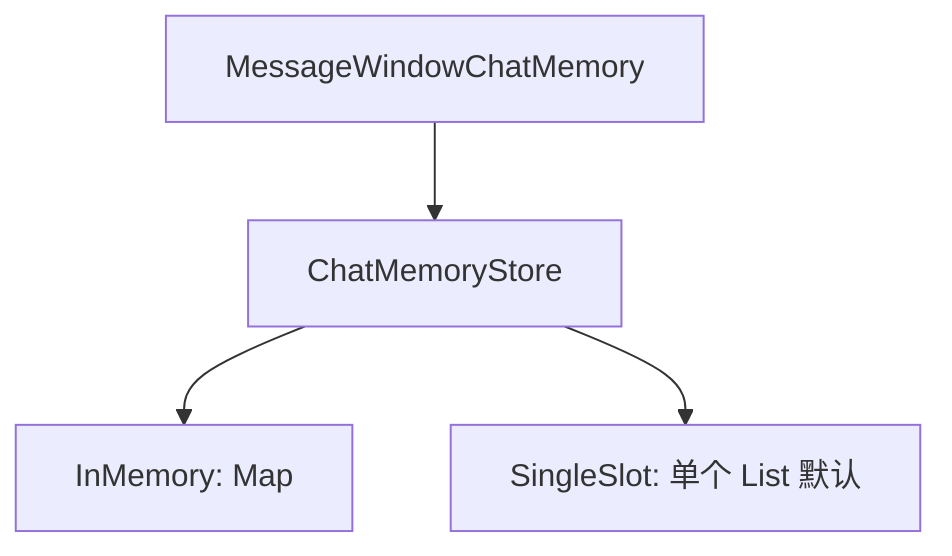

# 20. ChatMemory 源码剖析：默认内存存储

## 纲要

- **类关系**：`MessageWindowChatMemory` 依赖 `ChatMemoryStore` 做实际存储
- **两种 Store**：`InMemoryChatMemoryStore`（Map：k=memoryId,v=list）与 `SingleSlotChatMemoryStore`（单槽）
- **默认实现**：默认走 `SingleSlotChatMemoryStore`，数据存在内存 `list` 级别
- **隔离底层**：隔离本质是按 `memoryId` 作为数据结构 key 分别存放
- **风险**：内存存储 → 重启 / 宕机丢数据、内存打满

> 本章从断点调试视角看清 ChatMemory 存储本质，按课程口径重构；代码为课程示意。

## 一、ChatMemoryStore 是存储核心

`MessageWindowChatMemory` 内部持有一个 `ChatMemoryStore`，所有增删改查都委托给它。框架提供两个实现：

| 实现 | 数据结构 | 特点 |
|---|---|---|
| `InMemoryChatMemoryStore` | `Map<memoryId,List<Message>>` | 多槽，支持多会话隔离 |
| `SingleSlotChatMemoryStore` | 单 list（默认） | 全局一个槽，无隔离 |

## 二、默认存在内存

断点可见：默认 `chatMemoryStore` 是 `SingleSlotChatMemoryStore`，无论是 `add` / `update` / `delete` / `get`，底层都基于 **内存 list** 操作，增删改的单位就是 `ChatMessage`。

## 三、隔离的底层实现

当用 `memoryId` 做隔离时，底层以 `memoryId` 作为 key，把每轮请求 / 响应（UserMessage / AiMessage）作为元素存入对应结构：memoryId=1 存一组对话，memoryId=2 存另一组，互不干扰。

## 四、内存存储的风险

- **资源打满**：对话多了占满 JVM 内存。
- **丢数据**：机器重启 / 宕机，内存对话全失。

因此生产必须 **自定义持久化介质**（后两讲讲解 MySQL 落地）。

## 五、FAQ

**Q1：默认 Store 是哪个？**
`SingleSlotChatMemoryStore`（单槽内存），不隔离。

**Q2：InMemory 和 SingleSlot 区别？**
前者用 Map 支持多 memoryId 隔离；后者单 list，全局共享。

**Q3：怎么看默认存储？**
断点调试代理对象，观察 `chatMemoryStore` 实际类型即可。

## 六、面试高频问答

1. **ChatMemory 存储委托给谁？** `ChatMemoryStore` 接口，默认 `SingleSlotChatMemoryStore`。
2. **隔离本质？** 以 `memoryId` 为 key 存放各自的消息列表。
3. **内存存储生产隐患？** 重启丢数据、内存膨胀。

## 七、ops 提示

> **生产禁用纯内存**：务必自定义持久化（MySQL/Redis），否则重启即失忆。
>
> **隔离与存储联动**：多用户隔离 + 持久化需同时满足，Provider 指向持久化 Store。
>
> **监控**：内存 Store 仅用于本地试验，生产加对话量监控防 OOM。

